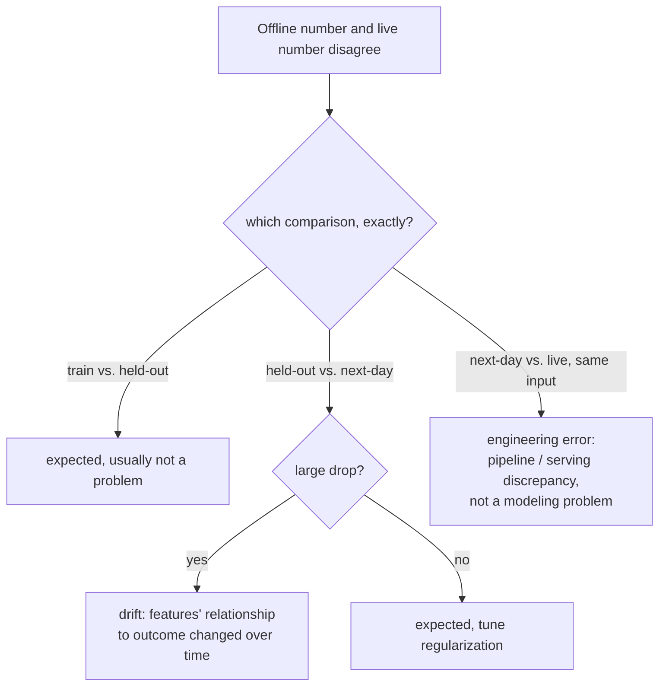

# Lección 16. Telemetría de producción y deriva

**Vínculo con la misión:** La lección 15 dio a un A/B test su métrica guardrail, un número vigilado de forma continua durante el experimento para que una mejora del OEC no pueda esconder una pérdida silenciosa en otro lugar. La **telemetría de producción** es la misma disciplina extendida más allá del final del experimento: vigilar esos números de forma continua, para siempre, una vez que el cambio se ha lanzado. Esta lección trata de qué hacer con la brecha que se abre cuando un número en el que confiabas offline deja de coincidir con lo que producción te muestra realmente.
**Fuente principal:** [Guide: "Rules of Machine Learning", Zinkevich, Google](https://developers.google.com/machine-learning/guides/rules-of-ml)
**Requisitos previos:** [Lección 9](0009-statistical-significance-vs-noise.md), [Lección 15](0015-ab-tests-and-guardrail-metrics.md)

## Calentamiento

1. ▢ ¿Qué es una métrica guardrail, y en qué se diferencia de un OEC?

Comprobación

Un OEC es la métrica que un experimento intenta realmente mover; una métrica guardrail es una métrica separada que el experimento no optimiza en absoluto, seguida específicamente para detectar que el cambio daña en silencio otra cosa mientras persigue el OEC.

2. ▢ ¿Por qué importa la aleatorización en un A/B test para fiarse de una diferencia medida entre control y tratamiento?

Comprobación

La aleatorización es lo que permite atribuir cualquier diferencia medida en el resultado al propio cambio, y no a alguna otra diferencia no relacionada entre los dos grupos de usuarios.

## Qué debes saber

### Una brecha entre offline y en vivo tiene (al menos) tres causas distintas, no una

La propia guía de ingeniería de Google divide la brecha de rendimiento de un modelo en tres comparaciones separadas, cada una con una causa probable distinta, en lugar de tratar "el número offline y el número en vivo discrepan" como un único problema. La brecha entre el rendimiento en entrenamiento y el rendimiento held-out es esperable y no es en sí un problema. La brecha entre el rendimiento held-out y los datos "del día siguiente" (datos recogidos después del conjunto held-out) también es esperable hasta cierto punto, pero una caída *grande* apunta específicamente a variables cuya relación con el resultado cambia con el tiempo. La brecha entre ese rendimiento del día siguiente y el rendimiento genuinamente en vivo, en producción, es distinta en naturaleza: si el mismo ejemplo exacto produce un resultado diferente en el momento de servir que el que produjo offline, la guía es directa en que esto indica un **error de ingeniería**, no un problema de modelado en absoluto, ya que una entrada idéntica debe producir una salida idéntica sin importar dónde se evalúe.

### La deriva es una de esas tres causas en concreto, no una etiqueta comodín

La **deriva** es lo que realmente es una brecha grande entre held-out y el día siguiente: la relación real entre las variables y los resultados cambia con el tiempo, de modo que un modelo (o una eval) construido con datos más antiguos deja cada vez más de coincidir con lo que es verdad ahora. El trabajo de la telemetría de producción es hacer esto visible de forma continua, comparando una métrica en vivo con su línea base histórica de forma permanente, en lugar de esperar a que haya un síntoma lo bastante grande como para que alguien lo note por casualidad. Detectar la deriva pronto es directamente función de la rapidez con que puede hacer daño: un sistema cuya calidad se degradaría mucho en un día necesita una monitorización continua y activa, mientras que uno que se degrada despacio a lo largo de un trimestre puede revisarse con mucha menos urgencia, el mismo razonamiento de frescura que rige cada cuánto necesita realmente renovarse un modelo o un conjunto de eval de referencia.

### La tercera brecha casi nunca significa lo que la gente piensa primero

Cuando los resultados en vivo divergen de lo que habría predicho una evaluación offline idéntica, para las mismas entradas exactas, el instinto suele ser culpar al modelo, volver a entrenarlo o dudar de la eval. El planteamiento de la guía de Google lo corta de raíz: un ejemplo idéntico debe dar un resultado idéntico se puntúe offline o se sirva en vivo, así que una discrepancia aquí implica específicamente al pipeline, una diferencia en cómo se manejan los datos o se calculan las variables entre la ruta de entrenamiento/eval y la ruta de servicio en vivo, no el juicio real del modelo. Perseguir una corrección del modelo para lo que en realidad es un error del pipeline desperdicia justo el tipo de esfuerzo que la lección 11 advirtió no gastar en la etapa equivocada.

### Haz una comprobación de cordura antes de que un modelo llegue a producción, y gradúa la alerta según el radio de impacto

Antes de que un modelo recién entrenado se exporte siquiera al servicio, una comprobación básica de cordura contra datos held-out (que detecte un modelo obviamente roto antes de que llegue a los usuarios) merece tratarse de forma distinta de una alerta sobre un modelo que ya está en vivo: un problema detectado antes de la exportación merece un correo, ya que todavía no ha ocurrido nada de cara al usuario; un problema en un modelo que ya sirve tráfico real puede justificar avisar de inmediato a alguien por el sistema de guardias, ya que el radio de impacto y la urgencia son completamente distintos. Una telemetría que trata toda anomalía por igual, sin importar si es previa a la exportación o ya de cara al usuario, o avisa demasiado a menudo para ser útil o pasa por alto los casos que realmente necesitan que se avise a alguien de inmediato.

## Práctica

1. ▢ Un equipo observa que su modelo en vivo rinde claramente peor que en la eval held-out del mes pasado, y la brecha lleva varias semanas ensanchándose poco a poco. ¿Cuál de las tres comparaciones describe esto, y cuál es la causa probable?

Pista

Considera cuál comparación implica específicamente una brecha que crece con el tiempo, en lugar de una discrepancia puntual sobre entradas idénticas.

Comprobación

La comparación entre held-out y el día siguiente, y una brecha grande y creciente aquí apunta específicamente a deriva: variables cuya relación con el resultado cambia con el tiempo, lo que hace que el conjunto held-out más antiguo (y el modelo entrenado contra él) sea progresivamente menos representativo de la realidad actual.

2. ▢ Un equipo descubre que puntuar la misma entrada exacta offline y observar lo que el sistema en vivo devolvió realmente para esa misma entrada produce dos resultados distintos. ¿Qué indica esto específicamente, y qué debería comprobar primero el equipo?

Comprobación

Un error de ingeniería, no un problema de modelado: una entrada idéntica debe producir una salida idéntica sin importar si se puntúa offline o se sirve en vivo. El equipo debería buscar una discrepancia en cómo se manejan los datos o se calculan las variables entre la ruta offline/de entrenamiento y la ruta de servicio en vivo, en lugar de asumir que el propio modelo necesita volver a entrenarse.

3. ▢ ¿Por qué necesita un equipo saber con qué rapidez se degrada la calidad de su sistema sin una actualización (su requisito de frescura) antes de decidir con qué urgencia vigilar la deriva?

Comprobación

Porque cuánto daño puede hacer la deriva, y con qué rapidez, determina con qué urgencia hay que detectarla: un sistema que se degrada mucho en un día necesita una monitorización continua y activa, mientras que uno que solo se degrada de forma significativa a lo largo de un trimestre puede revisarse con una cadencia mucho menos urgente, sin gastar un esfuerzo de monitorización desproporcionado respecto al riesgo real.

4. ▢ Un modelo recién entrenado falla una comprobación de cordura sobre datos held-out antes de exportarse siquiera al servicio. ¿Debería esto disparar la misma severidad de alerta que un modelo en vivo y de cara al usuario que muestra un problema?

Comprobación

No. Un problema detectado antes de la exportación no ha afectado todavía a ningún usuario real y se maneja de forma apropiada con una alerta de menor urgencia (un correo); un problema en un modelo que ya sirve tráfico en vivo tiene un radio de impacto real y continuo de cara al usuario y puede justificar avisar de inmediato a alguien por el sistema de guardias, ya que la urgencia y las consecuencias de las dos situaciones son genuinamente distintas.

5. ▢ ¿Qué afirmación describe correctamente cómo interpretar una brecha entre un número offline y un número en vivo?

    - a) Cualquier brecha entre un número offline y un número en vivo es deriva, y debería corregirse volviendo a entrenar el modelo
    - b) La brecha hay que atribuirla a la causa correcta entre (al menos) varias distintas, varianza entre entrenamiento y holdout, deriva entre held-out y el día siguiente, o una discrepancia de ingeniería entre el día siguiente y en vivo, ya que cada una apunta a una corrección genuinamente distinta
    - c) Una discrepancia entre una puntuación offline y un resultado en vivo sobre la entrada idéntica es esperable y no requiere investigación
    - d) Todas las alertas de monitorización de producción deberían avisarse con la misma urgencia, sin importar si el modelo ha llegado ya al tráfico en vivo

Comprobación

**b)** Esa es la distinción precisa en tres vías que establece esta lección. (a) es falsa: solo una brecha grande entre held-out y el día siguiente indica específicamente deriva; otras brechas tienen causas distintas y correcciones distintas. (c) es falsa: una entrada idéntica que produce un resultado diferente offline frente a en vivo indica específicamente un error de ingeniería que hay que investigar, no una discrepancia esperable. (d) es falsa: un problema detectado antes de exportar un modelo merece una respuesta de menor urgencia que uno que ya afecta al tráfico en vivo y de cara al usuario.

## Prácticas en el mundo real

- [ ] Para un modelo o sistema al que tengas acceso, comprueba si su monitorización distingue estos tres tipos de brechas entre offline y online, o trata cualquier discrepancia como una única señal indiferenciada de "algo va mal".
- [ ] Estima el requisito de frescura de tu propio sistema: cuánto se degradaría la calidad si el modelo o el conjunto de eval de referencia pasara un día, una semana o un trimestre sin actualizarse, y si la cadencia de tu monitorización coincide realmente con esa estimación.
- [ ] Mañana: lee completas las reglas circundantes de la fuente primaria sobre monitorización e ingeniería de variables y anota qué recomienda comprobar primero cuando se sospecha un desfase entre entrenamiento y servicio pero todavía no se ha aislado en una de las tres comparaciones.

## Para profundizar

- [Guide: "Rules of Machine Learning", Zinkevich, Google](https://developers.google.com/machine-learning/guides/rules-of-ml)
- [Recursos](../RESOURCES.md)

---

¿No termina de quedar claro? Vuelve a leer la fuente primaria de arriba, ya que esta lección la comprime y en la compresión es donde se escapa la comprensión. Consulta el [glosario](../GLOSSARY.md) por si algún término te resultó resbaladizo.

Si lo poco claro es la propia lección y no el material, eso es un defecto: [abre un issue](https://github.com/TokenCemetery/teach/issues).
