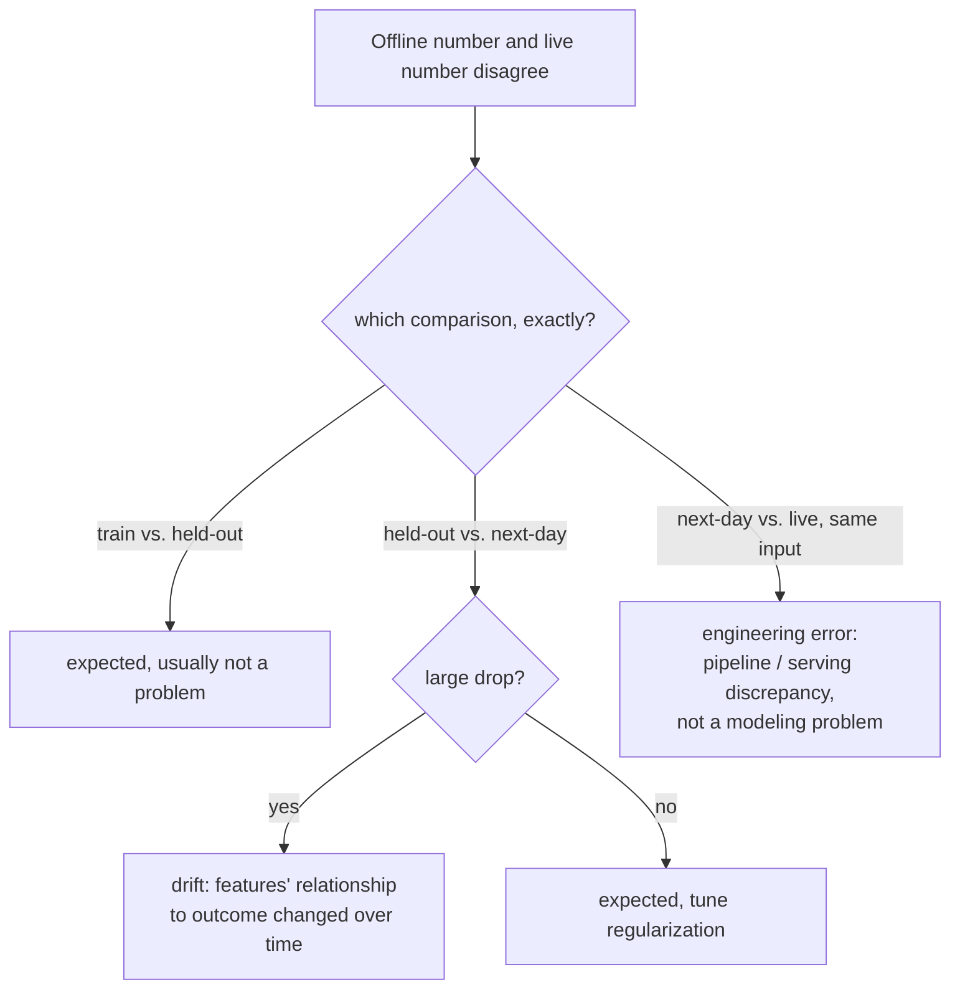

# Leçon 16. Télémétrie de production et dérive

**Lien avec la mission :** La leçon 15 a donné à un A/B test sa métrique garde-fou, un chiffre surveillé en continu pendant l'expérience pour qu'un gain d'OEC ne puisse pas cacher une perte discrète ailleurs. La **télémétrie de production** est la même discipline prolongée au-delà de la fin de l'expérience : surveiller ces chiffres en continu, pour toujours, une fois le changement livré. Cette leçon porte sur ce qu'il faut faire de l'écart qui s'ouvre quand un chiffre auquel vous faisiez confiance hors ligne cesse de correspondre à ce que la production vous montre réellement.
**Source primaire :** [Guide : "Rules of Machine Learning", Zinkevich, Google](https://developers.google.com/machine-learning/guides/rules-of-ml)
**Prérequis :** [Leçon 9](0009-statistical-significance-vs-noise.md), [Leçon 15](0015-ab-tests-and-guardrail-metrics.md)

## Échauffement

1. ▢ Qu'est-ce qu'une métrique garde-fou, et en quoi diffère-t-elle d'un OEC ?

Vérifier

Un OEC est la métrique qu'une expérience cherche réellement à faire bouger ; une métrique garde-fou est une métrique distincte que l'expérience n'optimise pas du tout, suivie précisément pour détecter que le changement abîme en silence autre chose pendant la poursuite de l'OEC.

2. ▢ Pourquoi la randomisation dans un A/B test importe-t-elle pour faire confiance à une différence mesurée entre contrôle et traitement ?

Vérifier

La randomisation est ce qui permet d'attribuer toute différence mesurée de résultat au changement lui-même, plutôt qu'à une autre différence, sans rapport, entre les deux groupes d'utilisateurs.

## À savoir

### Un écart hors ligne contre en production a (au moins) trois causes différentes, pas une

Les recommandations d'ingénierie de Google décomposent l'écart de performance d'un modèle en trois comparaisons distinctes, chacune avec une cause probable différente, au lieu de traiter « le chiffre hors ligne et le chiffre en production divergent » comme un seul problème. L'écart entre la performance à l'entraînement et la performance held-out est attendu et n'est pas en soi un problème. L'écart entre la performance held-out et celle sur des données du « lendemain » (des données collectées après le jeu held-out) est lui aussi attendu dans une certaine mesure, mais une *forte* baisse désigne précisément des variables dont la relation avec le résultat change avec le temps. L'écart entre cette performance du lendemain et la performance réellement en production est d'une autre nature : si le même exemple exact produit un résultat différent au moment du service que hors ligne, les recommandations sont directes : cela indique une **erreur d'ingénierie**, pas du tout un problème de modélisation, puisqu'une entrée identique est censée produire une sortie identique où qu'elle soit évaluée.

### La dérive est l'une de ces trois causes, pas une étiquette fourre-tout

La **dérive** est ce qu'est réellement un fort écart held-out contre lendemain : la relation réelle entre les variables d'entrée et les résultats change au fil du temps, si bien qu'un modèle (ou une eval) construit sur des données plus anciennes cesse de plus en plus de correspondre à ce qui est vrai maintenant. Le rôle de la télémétrie de production est de rendre cela visible en continu, en comparant une métrique en production à sa baseline historique de façon permanente, plutôt que d'attendre un symptôme assez gros pour que quelqu'un le remarque par hasard. Détecter tôt la dérive dépend directement de la vitesse à laquelle elle peut faire des dégâts : un système dont la qualité se dégraderait fortement en un jour demande une surveillance continue et active, alors qu'un système qui ne se dégrade que lentement sur un trimestre peut être vérifié bien moins urgemment, selon le même raisonnement de fraîcheur qui gouverne la fréquence à laquelle un modèle ou un jeu d'eval de référence a réellement besoin d'être renouvelé.

### Le troisième écart ne veut presque jamais dire ce qu'on pense en premier

Quand les résultats en production divergent de ce qu'une évaluation hors ligne identique aurait prédit, pour exactement les mêmes entrées, l'instinct est souvent d'accuser le modèle, de le réentraîner ou de remettre en cause l'eval. Le cadrage des recommandations de Google coupe court : un exemple identique devrait donner un résultat identique qu'il soit noté hors ligne ou servi en production, donc un écart ici met précisément en cause le pipeline, une différence dans la manière dont les données sont traitées ou dont les variables sont calculées entre le chemin d'entraînement/eval et le chemin de service en production, et non le jugement réel du modèle. Poursuivre un correctif de modèle pour ce qui est en réalité un bug de pipeline gaspille exactement le genre d'effort que la leçon 11 déconseillait de dépenser sur la mauvaise étape.

### Un contrôle de cohérence avant qu'un modèle atteigne la production, et une alerte proportionnée au rayon d'impact

Avant même qu'un modèle nouvellement entraîné soit exporté vers le service, un contrôle de cohérence de base sur des données held-out (qui attrape un modèle manifestement cassé avant qu'il soit exposé aux utilisateurs) mérite d'être traité autrement qu'une alerte sur un modèle déjà en production : un problème attrapé avant l'export vaut un e-mail, puisque rien n'a encore touché les utilisateurs ; un problème sur un modèle qui sert déjà du trafic réel peut justifier d'appeler quelqu'un immédiatement, puisque le rayon d'impact et l'urgence sont complètement différents. Une télémétrie qui traite toute anomalie de la même façon, qu'elle survienne avant l'export ou déjà côté utilisateur, soit appelle trop souvent pour être utile, soit rate les cas qui demandent réellement qu'on appelle quelqu'un tout de suite.

## Pratique

1. ▢ Une équipe observe que son modèle en production performe nettement moins bien qu'il ne l'avait fait sur l'eval held-out du mois dernier, et que l'écart s'élargit lentement depuis plusieurs semaines. Laquelle des trois comparaisons cela décrit-il, et quelle est la cause probable ?

Indice

Demandez-vous quelle comparaison implique précisément un écart qui grandit avec le temps, plutôt qu'un écart ponctuel sur des entrées identiques.

Vérifier

La comparaison held-out contre lendemain, et un écart fort et croissant ici désigne précisément la dérive : des variables dont la relation avec le résultat change avec le temps, ce qui rend le jeu held-out plus ancien (et le modèle entraîné dessus) de moins en moins représentatif de la réalité actuelle.

2. ▢ Une équipe constate que noter exactement la même entrée hors ligne et observer ce que le système en production a réellement renvoyé pour cette même entrée produisent deux résultats différents. Qu'est-ce que cela indique précisément, et que doit vérifier l'équipe en premier ?

Vérifier

Une erreur d'ingénierie, pas un problème de modélisation : une entrée identique est censée produire une sortie identique qu'elle soit notée hors ligne ou servie en production. L'équipe doit rechercher un écart dans la manière dont les données sont traitées ou dont les variables sont calculées entre le chemin hors ligne/entraînement et le chemin de service en production, plutôt que de supposer que le modèle lui-même doit être réentraîné.

3. ▢ Pourquoi une équipe doit-elle savoir à quelle vitesse la qualité de son système se dégrade sans mise à jour (son exigence de fraîcheur) avant de décider avec quelle urgence surveiller la dérive ?

Vérifier

Parce que l'ampleur des dégâts que la dérive peut faire, et leur rapidité, détermine avec quelle urgence elle doit être attrapée : un système qui se dégrade fortement en un jour demande une surveillance continue et active, alors qu'un système qui ne se dégrade sensiblement que sur un trimestre peut être vérifié à une cadence bien moins urgente, sans gaspiller un effort de surveillance disproportionné au risque réel.

4. ▢ Un modèle nouvellement entraîné échoue à un contrôle de cohérence sur des données held-out avant même d'être exporté vers le service. Cela devrait-il déclencher la même gravité d'alerte qu'un modèle en production, exposé aux utilisateurs, qui présente un problème ?

Vérifier

Non. Un problème attrapé avant l'export n'a encore touché aucun utilisateur réel et se traite de façon appropriée par une alerte de moindre urgence (un e-mail) ; un problème sur un modèle qui sert déjà du trafic réel a un rayon d'impact réel et continu côté utilisateurs et peut justifier d'appeler quelqu'un immédiatement, puisque l'urgence et les conséquences des deux situations sont réellement différentes.

5. ▢ Laquelle de ces affirmations décrit correctement comment interpréter un écart entre un chiffre hors ligne et un chiffre en production ?

    - a) Tout écart entre un chiffre hors ligne et un chiffre en production est de la dérive, et doit être corrigé en réentraînant le modèle
    - b) L'écart doit être attribué à la bonne parmi plusieurs causes distinctes (au moins), variance entraînement contre held-out, dérive held-out contre lendemain, ou écart d'ingénierie lendemain contre production, puisque chacune désigne un correctif réellement différent
    - c) Un écart entre un score hors ligne et un résultat en production sur la même entrée est attendu et n'exige aucune enquête
    - d) Toutes les alertes de surveillance en production devraient appeler quelqu'un avec la même urgence, que le modèle ait ou non déjà atteint le trafic réel

Vérifier

**b)** C'est la distinction précise en trois volets qu'établit cette leçon. (a) est faux : seul un fort écart held-out contre lendemain indique précisément de la dérive ; les autres écarts ont d'autres causes et d'autres correctifs. (c) est faux : une entrée identique qui produit un résultat différent hors ligne et en production indique précisément une erreur d'ingénierie qui demande une enquête, pas un écart attendu. (d) est faux : un problème attrapé avant l'export d'un modèle justifie une réponse de moindre urgence qu'un problème qui touche déjà du trafic réel, côté utilisateurs.

## Exercices en situation réelle

- [ ] Pour un modèle ou un système auquel vous avez accès, vérifiez si sa surveillance distingue ces trois types d'écarts hors ligne/en ligne, ou traite tout désaccord comme un seul signal indifférencié du type « quelque chose ne va pas ».
- [ ] Estimez l'exigence de fraîcheur de votre propre système : de combien la qualité se dégraderait-elle si le modèle ou le jeu d'eval de référence n'était pas mis à jour pendant un jour, une semaine ou un trimestre, et votre cadence de surveillance correspond-elle réellement à cette estimation ?
- [ ] Demain : lisez en entier les règles voisines de la source primaire sur la surveillance et l'ingénierie des variables, et notez ce qu'elle recommande de vérifier en premier quand un décalage entraînement-service est soupçonné mais pas encore isolé à l'une des trois comparaisons.

## Pour aller plus loin

- [Guide : "Rules of Machine Learning", Zinkevich, Google](https://developers.google.com/machine-learning/guides/rules-of-ml)
- [Ressources](../RESOURCES.md)

---

Ça ne passe pas ? Relisez la source primaire en haut de page, car cette leçon la condense et c'est dans la condensation que la compréhension s'échappe. Consultez le [glossaire](../GLOSSARY.md) pour tout terme qui vous a paru glissant.

Si c'est la leçon elle-même qui n'est pas claire plutôt que la matière, c'est un défaut : [ouvrez une issue](https://github.com/TokenCemetery/teach/issues).
