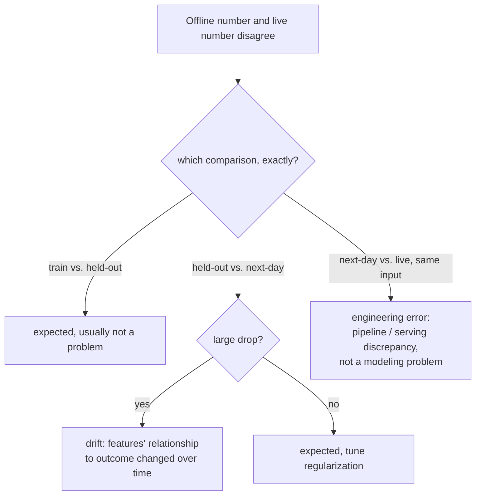

# पाठ 16. Production Telemetry और Drift

**मिशन से संबंध:** पाठ 15 ने A/B test को उसकी guardrail metric दी, यानी experiment के दौरान लगातार देखी जाने वाली संख्या, ताकि OEC की बढ़त कहीं और के चुपचाप नुक़सान को छिपा न सके। **Production telemetry** उसी अनुशासन का experiment के अंत से आगे विस्तार है: बदलाव ship होने के बाद उन संख्याओं को लगातार, हमेशा के लिए देखते रहना। यह पाठ उस फ़ासले के बारे में है जो तब खुलता है जब offline जिस संख्या पर आपने भरोसा किया वह उससे मेल खाना बंद कर दे जो production असल में आपको दिखा रहा है।
**मुख्य स्रोत:** [गाइड: "Rules of Machine Learning", Zinkevich, Google](https://developers.google.com/machine-learning/guides/rules-of-ml)
**पूर्व-आवश्यकताएँ:** [पाठ 9](0009-statistical-significance-vs-noise.md), [पाठ 15](0015-ab-tests-and-guardrail-metrics.md)

## वार्म-अप

1. ▢ Guardrail metric क्या है, और वह OEC से कैसे अलग है?

जाँचें

OEC वह metric है जिसे experiment असल में हिलाने की कोशिश कर रहा है; guardrail metric अलग metric है जिसे experiment बिल्कुल optimize नहीं कर रहा, और जिसे ख़ास तौर पर यह पकड़ने के लिए ट्रैक किया जाता है कि OEC का पीछा करते हुए बदलाव चुपचाप कुछ और नुक़सान न पहुँचाए।

2. ▢ Control और treatment के बीच मापे गए फ़र्क़ पर भरोसा करने के लिए A/B test में यादृच्छिकीकरण क्यों मायने रखता है?

जाँचें

यादृच्छिकीकरण ही नतीजे में किसी भी मापे गए फ़र्क़ को बदलाव से जोड़ने देता है, उपयोगकर्ताओं के दोनों समूहों के बीच किसी और, असंबंधित फ़र्क़ से नहीं।

## यह जानें

### Offline-बनाम-live फ़ासले के (कम से कम) तीन अलग कारण हैं, एक नहीं

Google का अपना इंजीनियरिंग मार्गदर्शन model के प्रदर्शन के फ़ासले को तीन अलग तुलनाओं में तोड़ता है, जिनके अलग संभावित कारण हैं, बजाय इसके कि "offline संख्या और live संख्या असहमत हैं" को एक अकेली समस्या माना जाए। Training प्रदर्शन और held-out प्रदर्शन के बीच का फ़ासला अपेक्षित है और अपने-आप में समस्या नहीं। Held-out प्रदर्शन और "अगले दिन" के data (held-out सेट के बाद इकट्ठा किए गए data) के बीच का फ़ासला भी कुछ हद तक अपेक्षित है, पर *बड़ी* गिरावट ख़ास तौर पर उन features की ओर इशारा करती है जिनका नतीजे से संबंध समय के साथ बदलता है। उस अगले-दिन के प्रदर्शन और सचमुच live, in-production प्रदर्शन के बीच का फ़ासला प्रकृति में अलग है: अगर वही सटीक example serving के समय offline से अलग नतीजा देता है, तो मार्गदर्शन सीधे कहता है कि यह **इंजीनियरिंग की ग़लती** दर्शाता है, modeling की समस्या बिल्कुल नहीं, क्योंकि एक जैसे input को एक जैसा output देना चाहिए, चाहे उसे कहीं भी परखा जाए।

### Drift उन तीनों कारणों में से एक ख़ास कारण है, सब कुछ समेटने वाला लेबल नहीं

**Drift** वही है जो held-out से अगले-दिन का बड़ा फ़ासला असल में होता है: features और नतीजों के बीच का असली-दुनिया का संबंध समय के साथ बदल जाना, जिससे पुराने data पर बना model (या eval) धीरे-धीरे उससे मेल खाना बंद कर देता है जो अब असल में सच है। Production telemetry का काम इसे लगातार दिखाना है, live metric की तुलना उसके ऐतिहासिक baseline से लगातार करते हुए, इतना बड़ा लक्षण बनने का इंतज़ार करने के बजाय कि कोई संयोग से नोटिस कर ले। Drift को जल्दी पकड़ना सीधे इस पर निर्भर है कि वह कितनी तेज़ी से नुक़सान कर सकता है: जिस system की गुणवत्ता एक दिन में बुरी तरह गिर जाए उसे लगातार, सक्रिय monitoring चाहिए, जबकि जो एक तिमाही में धीरे-धीरे गिरता है उसे कहीं कम तात्कालिकता से जाँचा जा सकता है, वही freshness का तर्क जो तय करता है कि model या reference eval सेट को असल में कितनी बार ताज़ा करना है।

### तीसरे फ़ासले का मतलब लगभग कभी वह नहीं होता जो लोग सबसे पहले सोचते हैं

जब live नतीजे उससे अलग हों जिसकी भविष्यवाणी ठीक वही offline evaluation करता, बिल्कुल उन्हीं inputs के लिए, तो अक्सर सहज प्रवृत्ति model को दोष देने, उसे दोबारा train करने, या eval पर शक करने की होती है। Google के मार्गदर्शन की बात उसे काट देती है: एक जैसे example को offline score किए जाने पर और live serve किए जाने पर एक जैसा नतीजा देना चाहिए, इसलिए यहाँ का अंतर ख़ास तौर पर pipeline की ओर इशारा करता है, training/eval रास्ते और live serving रास्ते के बीच data संभालने या features निकालने के तरीक़े में फ़र्क़, model के असली निर्णय की ओर नहीं। जो असल में pipeline का bug है उसके लिए model का सुधार खोजना ठीक वही मेहनत बर्बाद करना है जिसके ग़लत चरण पर ख़र्च होने के ख़िलाफ़ पाठ 11 ने चेताया था।

### Production तक पहुँचने से पहले sanity-check करें, और alert को blast radius के हिसाब से ग्रेड करें

नए train किए model को serving के लिए export करने से पहले ही, held-out data के विरुद्ध बुनियादी sanity check (साफ़ तौर पर टूटे model को उपयोगकर्ता के सामने आने से पहले पकड़ना) को पहले से live model के alert से अलग ढंग से लेना सही है: export से पहले पकड़ी गई समस्या के लिए email काफ़ी है, क्योंकि अभी उपयोगकर्ता के सामने कुछ नहीं हुआ; असली traffic दे रहे model की समस्या किसी को तुरंत page करने को सही ठहरा सकती है, क्योंकि blast radius और तात्कालिकता बिल्कुल अलग हैं। जो telemetry हर विसंगति को एक जैसा मानती है, चाहे वह export से पहले की हो या पहले से उपयोगकर्ता के सामने, वह या तो इतनी बार page करती है कि काम की न रहे, या उन मामलों को चूक जाती है जिनमें सचमुच तुरंत किसी को page करना चाहिए।

## अभ्यास

1. ▢ एक टीम देखती है कि उनका live model पिछले महीने के held-out eval पर जैसा था उससे साफ़ तौर पर बुरा प्रदर्शन कर रहा है, और फ़ासला कई हफ़्तों से धीरे-धीरे चौड़ा हो रहा है। यह तीन तुलनाओं में से किसका वर्णन है, और संभावित कारण क्या है?

संकेत

सोचें कि कौन-सी तुलना ख़ास तौर पर समय के साथ बढ़ते फ़ासले से जुड़ी है, न कि एक जैसे inputs पर एक-बार के अंतर से।

जाँचें

Held-out-बनाम-अगले-दिन की तुलना, और यहाँ का बड़ा, चौड़ा होता फ़ासला ख़ास तौर पर drift की ओर इशारा करता है: ऐसे features जिनका नतीजे से संबंध समय के साथ बदल रहा है, जिससे पुराना held-out सेट (और उसके विरुद्ध train हुआ model) मौजूदा हक़ीक़त का धीरे-धीरे कम प्रतिनिधि बनता जा रहा है।

2. ▢ एक टीम पाती है कि ठीक उसी input को offline score करने और यह देखने पर कि live system ने उसी input के लिए असल में क्या लौटाया, दो अलग नतीजे मिलते हैं। यह ख़ास तौर पर क्या दर्शाता है, और टीम को सबसे पहले क्या जाँचना चाहिए?

जाँचें

इंजीनियरिंग की ग़लती, modeling की समस्या नहीं: एक जैसे input को एक जैसा output देना चाहिए, चाहे उसे offline score किया जाए या live serve किया जाए। टीम को यह मानने के बजाय कि model को दोबारा train करना है, offline/training रास्ते और live serving रास्ते के बीच data संभालने या features निकालने के तरीक़े में किसी अंतर को जाँचना चाहिए।

3. ▢ Drift के लिए कितनी तात्कालिकता से monitor करना है, यह तय करने से पहले टीम को यह क्यों जानना चाहिए कि अपडेट के बिना उनके system की गुणवत्ता कितनी तेज़ी से गिरती है (उसकी freshness की ज़रूरत)?

जाँचें

क्योंकि drift कितना नुक़सान कर सकता है, और कितनी तेज़ी से, यह तय करता है कि उसे कितनी तात्कालिकता से पकड़ना है: जो system एक दिन में बुरी तरह गिरता है उसे लगातार, सक्रिय monitoring चाहिए, जबकि जो सिर्फ़ एक तिमाही में सार्थक रूप से गिरता है उसे कहीं कम तात्कालिक cadence पर जाँचा जा सकता है, असल जोखिम के अनुपात से ज़्यादा monitoring की मेहनत बर्बाद किए बिना।

4. ▢ नए train किए model का held-out data पर sanity check serving के लिए export होने से पहले ही विफल हो जाता है। क्या इसे उसी alert गंभीरता का होना चाहिए जितनी live, उपयोगकर्ता के सामने वाले model में समस्या दिखने पर?

जाँचें

नहीं। Export से पहले पकड़ी गई समस्या ने अभी किसी असली उपयोगकर्ता को प्रभावित नहीं किया है और उसे कम-तात्कालिकता वाले alert (email) से संभालना ठीक है; असली traffic दे रहे model की समस्या का असली, जारी उपयोगकर्ता-सामने वाला blast radius है और वह किसी को तुरंत page करने को सही ठहरा सकती है, क्योंकि दोनों स्थितियों की तात्कालिकता और नतीजे सचमुच अलग हैं।

5. ▢ Offline संख्या और live संख्या के फ़ासले की व्याख्या कैसे करें, इसका सही वर्णन कौन-सा दावा करता है?

    - a) Offline संख्या और live संख्या के बीच का कोई भी फ़ासला drift है, और model को दोबारा train करके ठीक किया जाना चाहिए
    - b) फ़ासले को (कम से कम) कई अलग कारणों में से सही कारण पर डालना होता है, training-बनाम-holdout variance, held-out-बनाम-अगले-दिन का drift, या अगले-दिन-बनाम-live का इंजीनियरिंग अंतर, क्योंकि हर एक सचमुच अलग सुधार की ओर इशारा करता है
    - c) एक ही input पर offline score और live नतीजे के बीच का अंतर अपेक्षित है और उसकी जाँच की ज़रूरत नहीं
    - d) सभी production monitoring alerts को एक जैसी तात्कालिकता से page किया जाना चाहिए, चाहे model live traffic तक पहुँचा हो या नहीं

जाँचें

**b)** यही वह सटीक, तीन-तरफ़ा भेद है जो यह पाठ स्थापित करता है। (a) ग़लत है: सिर्फ़ held-out से अगले-दिन का बड़ा फ़ासला ख़ास तौर पर drift दर्शाता है; दूसरे फ़ासलों के अलग कारण और अलग सुधार हैं। (c) ग़लत है: एक ही input का offline बनाम live अलग नतीजा देना ख़ास तौर पर ऐसी इंजीनियरिंग की ग़लती दर्शाता है जिसकी जाँच ज़रूरी है, अपेक्षित अंतर नहीं। (d) ग़लत है: model के export होने से पहले पकड़ी गई समस्या के लिए, पहले से live, उपयोगकर्ता के सामने वाले traffic को प्रभावित करने वाली समस्या से कम तात्कालिक प्रतिक्रिया सही है।

## असली दुनिया का अभ्यास

- [ ] जिस model या system तक आपकी पहुँच है, उसके लिए जाँचें कि क्या उसकी monitoring offline/online फ़ासलों की इन तीन क़िस्मों में भेद करती है, या किसी भी असहमति को एक अभेदित "कुछ गड़बड़ है" संकेत मानती है।
- [ ] अपने system की freshness की ज़रूरत का अनुमान लगाएँ: अगर model या reference eval सेट एक दिन, एक हफ़्ते या एक तिमाही अपडेट न हो तो गुणवत्ता कितनी गिरेगी, और क्या आपकी monitoring की cadence असल में उस अनुमान से मेल खाती है?
- [ ] कल: मुख्य स्रोत के monitoring और feature engineering पर आसपास के rules पूरे पढ़ें, और लिखें कि जब training-serving skew पर शक हो पर तीन तुलनाओं में से किसी एक तक अलग न किया गया हो, तब वह सबसे पहले क्या जाँचने की सिफ़ारिश करता है।

## आगे बढ़ने के लिए

- [गाइड: "Rules of Machine Learning", Zinkevich, Google](https://developers.google.com/machine-learning/guides/rules-of-ml)
- [संसाधन](../RESOURCES.md)

---

बात नहीं बन रही? ऊपर दिए primary source को दोबारा पढ़ें, क्योंकि यह पाठ उसे संक्षिप्त करता है और समझ संक्षेप में ही रिसती है। जो शब्द फिसलन भरा लगे, उसके लिए [शब्दावली](../GLOSSARY.md) देखें।

अगर दिक़्क़त सामग्री की नहीं बल्कि पाठ की ही है, तो वह एक खोट है: [issue खोलें](https://github.com/TokenCemetery/teach/issues)।
