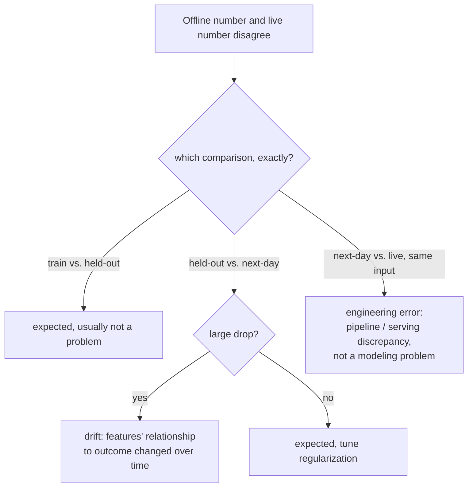

# Lição 16. Telemetria de produção e drift

**Ligação com a missão:** A lição 15 deu a um teste A/B sua métrica guardrail, um número vigiado continuamente durante o experimento para que um ganho de OEC não possa esconder uma perda silenciosa em outro ponto. A **telemetria de produção** é a mesma disciplina estendida para além do fim do experimento: vigiar esses números continuamente, para sempre, depois que a mudança foi lançada. Esta lição trata do que fazer com a diferença que se abre quando um número em que você confiava offline deixa de corresponder ao que a produção de fato mostra.
**Fonte principal:** [Guia: "Rules of Machine Learning", Zinkevich, Google](https://developers.google.com/machine-learning/guides/rules-of-ml)
**Pré-requisitos:** [Lição 9](0009-statistical-significance-vs-noise.md), [Lição 15](0015-ab-tests-and-guardrail-metrics.md)

## Aquecimento

1. ▢ O que é uma métrica guardrail, e em que ela difere de um OEC?

Verificação

Um OEC é a métrica que um experimento realmente tenta mover; uma métrica guardrail é uma métrica separada que o experimento não está otimizando de modo algum, acompanhada especificamente para pegar a mudança danificando em silêncio outra coisa enquanto persegue o OEC.

2. ▢ Por que a aleatorização em um teste A/B importa para confiar em uma diferença medida entre controle e tratamento?

Verificação

A aleatorização é o que permite atribuir qualquer diferença medida de resultado à própria mudança, e não a alguma outra diferença, sem relação, entre os dois grupos de usuários.

## Saiba isto

### Uma diferença entre offline e ao vivo tem (pelo menos) três causas diferentes, e não uma

A própria orientação de engenharia do Google divide a diferença de desempenho de um modelo em três comparações separadas, cada uma com uma causa provável diferente, em vez de tratar "o número offline e o número ao vivo discordam" como um único problema. A diferença entre o desempenho no treino e o desempenho held-out é esperada e não é, em si, um problema. A diferença entre o desempenho held-out e os dados do "dia seguinte" (dados coletados depois do conjunto held-out) também é esperada até certo ponto, mas uma queda *grande* aponta especificamente para features cuja relação com o resultado muda ao longo do tempo. A diferença entre esse desempenho do dia seguinte e o desempenho genuinamente ao vivo, em produção, é diferente em natureza: se o exato mesmo exemplo produz um resultado diferente em tempo de serving do que offline, a orientação é direta ao dizer que isso indica um **erro de engenharia**, e não um problema de modelagem, já que uma entrada idêntica deve produzir uma saída idêntica, onde quer que seja avaliada.

### Drift é uma dessas três causas em particular, não um rótulo genérico

**Drift** é o que uma grande diferença entre held-out e dia seguinte de fato é: a relação do mundo real entre features e resultados mudando ao longo do tempo, de modo que um modelo (ou um eval) construído sobre dados mais antigos deixa cada vez mais de corresponder ao que é verdade agora. O trabalho da telemetria de produção é tornar isso visível continuamente, comparando uma métrica ao vivo com sua baseline histórica de forma contínua, em vez de esperar um sintoma grande o bastante para que alguém o note por acaso. Pegar o drift cedo é diretamente função de quão rápido ele pode causar dano: um sistema cuja qualidade se degradaria muito em um dia precisa de monitoramento contínuo e ativo, enquanto um que se degrada devagar ao longo de um trimestre pode ser verificado com muito menos urgência, o mesmo raciocínio de atualidade que governa com que frequência um modelo ou um conjunto de eval de referência de fato precisa ser renovado.

### A terceira diferença quase nunca significa o que as pessoas pensam primeiro

Quando os resultados ao vivo divergem do que uma avaliação offline idêntica teria previsto, para as exatas mesmas entradas, o instinto muitas vezes é culpar o modelo, retreiná-lo ou duvidar do eval. O enquadramento da orientação do Google corta isso: um exemplo idêntico deve dar um resultado idêntico, seja pontuado offline ou servido ao vivo, então uma discrepância aqui implica especificamente o pipeline, uma diferença em como os dados são tratados ou as features são calculadas entre o caminho de treino/eval e o caminho de serving ao vivo, e não o julgamento real do modelo. Perseguir uma correção de modelo para o que na verdade é um bug de pipeline desperdiça exatamente o tipo de esforço que a lição 11 alertou contra gastar na etapa errada.

### Faça uma verificação de sanidade antes de um modelo chegar à produção, e gradue o alerta conforme o raio de impacto

Antes de um modelo recém-treinado ser exportado para serving, uma verificação básica de sanidade contra dados held-out (pegando um modelo obviamente quebrado antes de ele ficar voltado ao usuário) merece ser tratada de forma diferente de um alerta sobre um modelo já ao vivo: um problema pego antes da exportação merece um e-mail, já que nada voltado ao usuário aconteceu ainda; um problema em um modelo que já atende tráfego real pode justificar chamar alguém imediatamente, já que o raio de impacto e a urgência são completamente diferentes. Uma telemetria que trata toda anomalia de forma idêntica, seja pré-exportação ou já voltada ao usuário, ou chama gente demais para ser útil ou perde os casos que de fato precisam de alguém chamado de imediato.

## Prática

1. ▢ Uma equipe observa que seu modelo ao vivo está sensivelmente pior do que estava no eval held-out do mês passado, e a diferença vem aumentando devagar ao longo de várias semanas. Qual das três comparações isso descreve, e qual é a causa provável?

Dica

Considere qual comparação envolve especificamente uma diferença crescente ao longo do tempo, e não uma discrepância pontual em entradas idênticas.

Verificação

A comparação held-out contra dia seguinte, e uma diferença grande e crescente aqui aponta especificamente para drift: features cuja relação com o resultado está mudando ao longo do tempo, tornando o conjunto held-out mais antigo (e o modelo treinado contra ele) progressivamente menos representativo da realidade atual.

2. ▢ Uma equipe descobre que pontuar offline a exata mesma entrada e observar o que o sistema ao vivo de fato devolveu para essa mesma entrada produz dois resultados diferentes. O que isso indica especificamente, e o que a equipe deve verificar primeiro?

Verificação

Um erro de engenharia, e não um problema de modelagem: uma entrada idêntica deve produzir uma saída idêntica, seja pontuada offline ou servida ao vivo. A equipe deve verificar se há uma discrepância em como os dados são tratados ou as features são calculadas entre o caminho offline/de treino e o caminho de serving ao vivo, em vez de presumir que o próprio modelo precisa ser retreinado.

3. ▢ Por que uma equipe precisa saber com que rapidez a qualidade do seu sistema se degrada sem uma atualização (seu requisito de atualidade) antes de decidir com que urgência monitorar o drift?

Verificação

Porque quanto dano o drift pode causar, e com que rapidez, determina com que urgência ele precisa ser pego: um sistema que se degrada muito em um dia precisa de monitoramento contínuo e ativo, enquanto um que só se degrada de forma relevante ao longo de um trimestre pode ser verificado em uma cadência bem menos urgente, sem desperdiçar esforço de monitoramento desproporcional ao risco real.

4. ▢ Um modelo recém-treinado falha em uma verificação de sanidade em dados held-out antes de ser exportado para serving. Isso deve disparar a mesma severidade de alerta que um modelo ao vivo, voltado ao usuário, apresentando um problema?

Verificação

Não. Um problema pego antes da exportação ainda não afetou nenhum usuário real e é tratado de forma apropriada com um alerta de menor urgência (um e-mail); um problema em um modelo que já atende tráfego ao vivo tem um raio de impacto real e contínuo voltado ao usuário e pode justificar chamar alguém imediatamente, já que a urgência e as consequências das duas situações são genuinamente diferentes.

5. ▢ Qual afirmação descreve corretamente como interpretar uma diferença entre um número offline e um número ao vivo?

    - a) Toda diferença entre um número offline e um número ao vivo é drift, e deve ser corrigida retreinando o modelo
    - b) A diferença precisa ser atribuída à causa certa entre (pelo menos) várias distintas, variância entre treino e held-out, drift entre held-out e dia seguinte, ou uma discrepância de engenharia entre dia seguinte e ao vivo, já que cada uma aponta para uma correção genuinamente diferente
    - c) Uma discrepância entre uma pontuação offline e um resultado ao vivo na entrada idêntica é esperada e não exige investigação
    - d) Todos os alertas de monitoramento em produção devem chamar alguém com a mesma urgência, independentemente de o modelo já ter chegado ao tráfego ao vivo

Verificação

**b)** Essa é a distinção precisa, em três partes, que esta lição estabelece. (a) é falsa: só uma grande diferença entre held-out e dia seguinte indica drift especificamente; as outras diferenças têm causas e correções diferentes. (c) é falsa: uma entrada idêntica produzindo um resultado diferente offline e ao vivo indica especificamente um erro de engenharia que precisa ser investigado, e não uma discrepância esperada. (d) é falsa: um problema pego antes de um modelo ser exportado merece uma resposta de menor urgência do que um que já afeta o tráfego ao vivo, voltado ao usuário.

## Prática no mundo real

- [ ] Para um modelo ou sistema a que você tenha acesso, verifique se o monitoramento dele distingue esses três tipos de diferença offline/online, ou trata qualquer discordância como um único sinal indiferenciado de "algo está errado".
- [ ] Estime o requisito de atualidade do seu próprio sistema: quanto a qualidade se degradaria se o modelo ou o conjunto de eval de referência ficasse sem atualização por um dia, uma semana ou um trimestre, e a cadência do seu monitoramento de fato corresponde a essa estimativa?
- [ ] Amanhã: leia por inteiro as regras vizinhas da fonte principal sobre monitoramento e engenharia de features e anote o que ela recomenda verificar primeiro quando se suspeita de training-serving skew mas ele ainda não foi isolado em uma das três comparações.

## Para ir além

- [Guia: "Rules of Machine Learning", Zinkevich, Google](https://developers.google.com/machine-learning/guides/rules-of-ml)
- [Recursos](../RESOURCES.md)

---

Não ficou claro? Releia a fonte principal no topo, já que esta lição a comprime e é na compressão que o entendimento escapa. Consulte o [glossário](../GLOSSARY.md) para qualquer termo que pareceu escorregadio.

Se o problema é a lição em si, e não o material, isso é um defeito: [abra uma issue](https://github.com/TokenCemetery/teach/issues).
