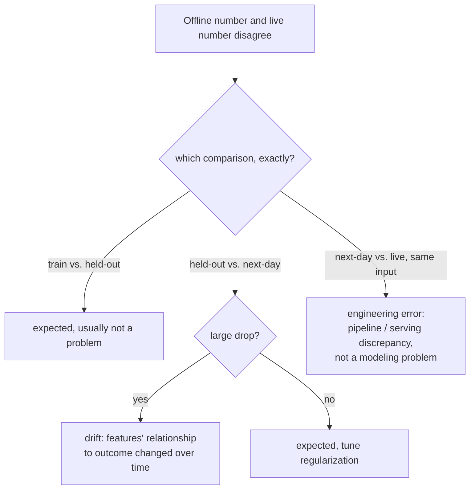

# Урок 16. Телеметрия продакшена и дрейф

**Связь с целью курса:** Урок 15 дал A/B-тесту его защитную метрику, число, за которым ведётся постоянное наблюдение во время эксперимента, чтобы прирост OEC не скрывал тихую потерю в другом месте. **Телеметрия продакшена** это та же дисциплина, продлённая за пределы окончания эксперимента: непрерывное наблюдение за этими числами, навсегда, после того как изменение выпущено. Этот урок о том, что делать с разрывом, который открывается, когда число, которому вы доверяли офлайн, перестаёт совпадать с тем, что реально показывает продакшен.
**Первоисточник:** [Руководство: "Rules of Machine Learning", Zinkevich, Google](https://developers.google.com/machine-learning/guides/rules-of-ml)
**Предварительные требования:** [Урок 9](0009-statistical-significance-vs-noise.md), [Урок 15](0015-ab-tests-and-guardrail-metrics.md)

## Разминка

1. ▢ Что такое защитная метрика и чем она отличается от OEC?

Проверка

OEC это метрика, которую эксперимент на самом деле пытается сдвинуть; защитная метрика это отдельная метрика, которую эксперимент вообще не оптимизирует и отслеживает именно затем, чтобы поймать, как изменение тихо портит что-то другое в погоне за OEC.

2. ▢ Почему рандомизация в A/B-тесте важна для доверия к измеренной разнице между контрольной и тестовой группами?

Проверка

Рандомизация позволяет приписать любую измеренную разницу в исходе самому изменению, а не какому-то другому, не связанному отличию между двумя группами пользователей.

## Что нужно знать

### У разрыва между офлайном и онлайном (как минимум) три разные причины, а не одна

Собственные инженерные рекомендации Google разбивают разрыв в качестве модели на три отдельных сравнения, у каждого своя вероятная причина, вместо того чтобы считать «офлайн-число и онлайн-число расходятся» единой проблемой. Разрыв между качеством на обучающих данных и на отложенных ожидаем и сам по себе не проблема. Разрыв между качеством на отложенных данных и на данных «следующего дня» (собранных после отложенного набора) тоже в какой-то мере ожидаем, но *большое* падение указывает именно на признаки, связь которых с исходом меняется со временем. Разрыв между качеством на данных следующего дня и по-настоящему живым качеством в продакшене иной по природе: если один и тот же пример при обслуживании даёт результат, отличный от офлайнового, рекомендации прямо говорят, что это указывает на **инженерную ошибку**, а вовсе не на проблему моделирования, поскольку идентичный вход должен давать идентичный выход независимо от того, где его оценивают.

### Дрейф это одна конкретная из этих трёх причин, а не универсальный ярлык

**Дрейф** это то, чем на самом деле является большой разрыв между отложенными данными и данными следующего дня: реальная связь между признаками и исходами меняется со временем, так что модель (или эвал), построенные на более старых данных, всё меньше соответствуют тому, что истинно сейчас. Задача телеметрии продакшена сделать это видимым непрерывно: сравнивать живую метрику с её исторической базовой линией постоянно, а не ждать, пока симптом станет достаточно большим, чтобы кто-то заметил его случайно. Раннее обнаружение дрейфа напрямую зависит от того, как быстро он может навредить: системе, чьё качество сильно деградировало бы за день, нужен непрерывный активный мониторинг, а та, что деградирует медленно за квартал, может проверяться куда менее срочно, это то же рассуждение о свежести, которое определяет, как часто модель или эталонный набор для эвала вообще нужно обновлять.

### Третий разрыв почти никогда не значит то, к чему тянутся в первую очередь

Когда живые результаты расходятся с тем, что предсказала бы идентичная офлайн-оценка на тех же самых входах, инстинкт часто в том, чтобы винить модель, переобучать её или сомневаться в эвале. Рамка рекомендаций Google это обрывает: идентичный пример должен давать идентичный результат, оценивают его офлайн или обслуживают вживую, поэтому расхождение здесь указывает именно на конвейер, на отличие в обработке данных или вычислении признаков между путём обучения и эвала и путём живого обслуживания, а не на фактическое суждение модели. Искать исправление модели для того, что на самом деле баг конвейера, значит тратить именно те усилия, о трате которых на не тот этап предупреждал урок 11.

### Проверяйте на вменяемость до того, как модель попадёт в продакшен, и соразмеряйте оповещение с радиусом поражения

До того как только что обученную модель вообще экспортируют в обслуживание, базовую проверку на вменяемость по отложенным данным (ловящую явно сломанную модель до того, как она станет видна пользователям) стоит считать иным случаем, чем оповещение о модели, которая уже работает вживую: проблема, пойманная до экспорта, стоит письма, поскольку ничего пользовательского ещё не произошло; проблема в модели, уже обслуживающей реальный трафик, может оправдать немедленный вызов дежурного, поскольку радиус поражения и срочность совершенно другие. Телеметрия, обращающаяся с каждой аномалией одинаково, до экспорта она или уже видна пользователям, либо вызывает дежурного слишком часто, чтобы это было полезно, либо упускает случаи, которым действительно нужен немедленный вызов.

## Практика

1. ▢ Команда наблюдает, что их живая модель работает заметно хуже, чем на прошломесячном отложенном эвале, а разрыв медленно растёт на протяжении нескольких недель. Какое из трёх сравнений это описывает и какова вероятная причина?

Подсказка

Подумайте, какое сравнение связано именно с растущим со временем разрывом, а не с разовым расхождением на идентичных входах.

Проверка

Сравнение отложенных данных с данными следующего дня, и большой растущий разрыв здесь указывает именно на дрейф: признаки, связь которых с исходом меняется со временем, делают более старый отложенный набор (и модель, обученную относительно него) всё менее репрезентативным для текущей реальности.

2. ▢ Команда обнаруживает, что оценка в точности того же входа офлайн и наблюдение за тем, что живая система на самом деле вернула для того же входа, дают два разных результата. На что конкретно это указывает и что команде проверить в первую очередь?

Проверка

На инженерную ошибку, а не на проблему моделирования: идентичный вход должен давать идентичный выход независимо от того, оценивают его офлайн или обслуживают вживую. Команде стоит проверить расхождение в обработке данных или вычислении признаков между офлайн-путём (обучение) и путём живого обслуживания, а не считать, что саму модель нужно переобучать.

3. ▢ Почему команде нужно знать, как быстро качество системы деградирует без обновления (её требование к свежести), прежде чем решать, насколько срочно мониторить дрейф?

Проверка

Потому что то, сколько вреда и как быстро может причинить дрейф, определяет, насколько срочно его нужно ловить: система, сильно деградирующая за день, нуждается в непрерывном активном мониторинге, а та, что значимо деградирует лишь за квартал, может проверяться куда менее срочно, не тратя усилия на мониторинг несоразмерно реальному риску.

4. ▢ Только что обученная модель проваливает проверку на вменяемость по отложенным данным ещё до экспорта в обслуживание. Должно ли это вызвать оповещение той же серьёзности, что проблема в живой модели, видимой пользователям?

Проверка

Нет. Проблема, пойманная до экспорта, ещё не затронула ни одного реального пользователя и уместно обрабатывается оповещением меньшей срочности (письмом); проблема в модели, уже обслуживающей живой трафик, имеет реальный продолжающийся радиус поражения для пользователей и может оправдать немедленный вызов дежурного, поскольку срочность и последствия этих двух ситуаций действительно различны.

5. ▢ Какое утверждение верно описывает, как интерпретировать разрыв между офлайн-числом и онлайн-числом?

    - a) Любой разрыв между офлайн- и онлайн-числом это дрейф, и исправлять его нужно переобучением модели
    - b) Разрыв нужно отнести к верной из (как минимум) нескольких различных причин: разброс между обучающими и отложенными данными, дрейф между отложенными данными и данными следующего дня или инженерное расхождение между данными следующего дня и живым обслуживанием, поскольку каждая указывает на действительно разное исправление
    - c) Расхождение между офлайн-оценкой и живым результатом на идентичном входе ожидаемо и расследования не требует
    - d) Все оповещения мониторинга продакшена следует передавать дежурному с одинаковой срочностью независимо от того, дошла ли модель до живого трафика

Проверка

**b)** Это точное трёхстороннее различие, которое устанавливает урок. Вариант (a) неверен: именно большой разрыв между отложенными данными и данными следующего дня указывает на дрейф; другие разрывы имеют другие причины и другие исправления. Вариант (c) неверен: идентичный вход, дающий разный результат офлайн и вживую, указывает именно на инженерную ошибку, которую нужно расследовать, а не на ожидаемое расхождение. Вариант (d) неверен: проблема, пойманная до экспорта модели, требует менее срочной реакции, чем уже затрагивающая живой, видимый пользователям трафик.

## Практика в реальной работе

- [ ] Для модели или системы, к которой у вас есть доступ, проверьте, различает ли их мониторинг эти три вида расхождений между офлайном и онлайном или считает любое несогласие одним неразличимым сигналом «что-то не так».
- [ ] Оцените собственное требование вашей системы к свежести: насколько упало бы качество, если бы модель или эталонный набор для эвала не обновляли день, неделю или квартал, и соответствует ли ваша частота мониторинга этой оценке?
- [ ] Завтра: прочитайте целиком окружающие правила первоисточника о мониторинге и конструировании признаков и отметьте, что он рекомендует проверять первым, когда перекос между обучением и эксплуатацией подозревается, но ещё не отнесён к одному из трёх сравнений.

## Что почитать дальше

- [Руководство: "Rules of Machine Learning", Zinkevich, Google](https://developers.google.com/machine-learning/guides/rules-of-ml)
- [Ресурсы](../RESOURCES.md)

---

Не доходит? Перечитайте первоисточник в начале: этот урок его сжимает, а при сжатии понимание как раз и теряется. Загляните в [глоссарий](../GLOSSARY.md), если какой-то термин показался скользким.

Если неясен сам урок, а не материал, это дефект: [откройте issue](https://github.com/TokenCemetery/teach/issues).
