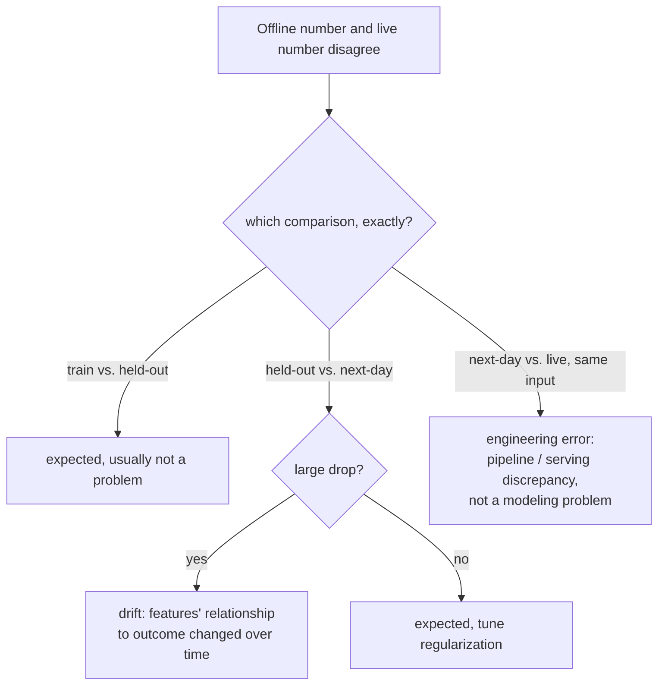

# 第 16 课：生产遥测与漂移

**使命关联:** 第 15 课给了 A/B 测试它的护栏指标，这是在实验期间持续盯着的一个数字，使 OEC 的提升不能掩盖别处悄悄的损失。**生产遥测**是同一条纪律在实验结束之后的延伸：在改动上线之后，持续、永久地盯着这些数字。本课讲的是，当一个你在离线时信任的数字，不再与生产实际显示给你的相符时，所出现的差距该怎么办。
**主要来源:** [指南：“Rules of Machine Learning”，Zinkevich，Google](https://developers.google.com/machine-learning/guides/rules-of-ml)
**前置知识:** [第 9 课](0009-statistical-significance-vs-noise.md)、[第 15 课](0015-ab-tests-and-guardrail-metrics.md)

## 热身

1. ▢ 什么是护栏指标，它与 OEC 有何不同？

检查

OEC 是实验真正想要推动的指标；护栏指标是另一个实验根本不去优化的指标，专门跟踪它，是为了抓住改动在追逐 OEC 的同时，悄悄损害了别的东西。

2. ▢ 为什么 A/B 测试中的随机化，对于信任对照组与实验组之间测得的差异很重要？

检查

随机化使得测得的任何结果差异，都能归因于改动本身，而不是两组用户之间其他某种无关的差异。

## 要点

### 离线与线上的差距，有（至少）三种不同的成因，而不是一种

Google 自己的工程指导，把模型表现上的差距拆成了三种独立的比较，各有不同的可能成因，而不是把“离线数字和线上数字不一致”当作单一的问题。训练表现与留出表现之间的差距，是预期之中的，本身并不算问题。留出表现与“次日”数据（在留出集之后收集的数据）之间的差距，在一定程度上也是预期之中的，但*很大*的下降，特指那些与结果之间的关系随时间变化的特征。这个次日表现与真正线上、生产环境中的表现之间的差距，性质又不同：如果同一个样本，在服务时得出的结果与离线时不同，指导意见直截了当地说，这表明的是**工程错误**，而根本不是建模问题，因为相同的输入，不管在哪里评估，本应产生相同的输出。

### 漂移是这三种成因中特定的一种，而不是一个包罗万象的标签

**漂移**就是留出表现到次日数据之间出现的大幅差距的真实含义：特征与结果之间的现实关系随时间变化，使得基于较早数据构建的模型（或评测），越来越不再符合现在的真实情况。生产遥测的任务，是让这一点持续可见，持续地把线上指标与它的历史基线作比较，而不是等到症状大到有人碰巧注意到。尽早发现漂移，直接取决于它能多快造成破坏：质量在一天之内就会严重下降的系统，需要持续、主动的监控，而一个在一个季度里缓慢退化的系统，检查起来可以不那么紧迫，这与决定模型或参考评测集究竟多久需要刷新一次的新鲜度推理，是同一个道理。

### 第三种差距，几乎从来不是人们首先想到的意思

当线上结果，与对完全相同的输入做同样的离线评测所预测的结果出现分歧时，本能的反应往往是怪模型、重新训练它，或者怀疑评测。Google 指导意见的表述把这条路堵住了：同一个样本，不管是离线评分还是线上服务，都应当给出相同的结果，所以这里的差异，特指流水线出了问题，也就是数据的处理方式，或特征的计算方式，在训练/评测路径与线上服务路径之间有所不同，而不是模型实际的判断出了问题。为一个实际上是流水线缺陷的问题去追求模型的修复，浪费的正是第 11 课警告过不要花在错误阶段上的那种精力。

### 模型到达生产环境之前先做合理性检查，并让告警与影响范围相称

在新训练的模型被导出到服务之前，对留出数据做一次基本的合理性检查（在一个明显有问题的模型面向用户之前就抓住它），值得与对已经上线的模型的告警区别对待：导出之前发现的问题，值得发一封电子邮件，因为面向用户的事情还没有发生；而一个已经在处理真实流量的模型上出现的问题，则可以理由充分地立即呼叫某个人，因为影响范围和紧迫程度完全不同。不管是导出之前还是已经面向用户，都一视同仁对待每个异常的遥测，要么呼叫得太频繁而没有用处，要么漏掉了真正需要立即呼叫人的情况。

## 练习

1. ▢ 某团队观察到，他们的线上模型的表现，明显比它在上个月的留出评测上更差，而且这个差距在几周内慢慢扩大。这描述的是三种比较中的哪一种，可能的成因是什么？

提示

想一想，哪一种比较特指随时间不断扩大的差距，而不是对相同输入的一次性差异。

检查

是留出表现与次日数据之间的比较，这里大而且不断扩大的差距，特指漂移：特征与结果之间的关系在随时间变化，使较早的留出集（以及针对它训练的模型），越来越不能代表当前的现实。

2. ▢ 某团队发现，对完全相同的输入做离线评分，与观察线上系统对同一个输入实际返回的结果，得到了两个不同的结果。这特指什么，团队首先应该检查什么？

检查

是工程错误，而不是建模问题：相同的输入，不管是离线评分还是线上服务，本应产生相同的输出。团队应该检查离线/训练路径与线上服务路径之间，数据的处理方式或特征的计算方式是否有差异，而不是假定模型本身需要重新训练。

3. ▢ 为什么团队需要先知道系统的质量在不更新的情况下退化得有多快（它的新鲜度要求），才能决定监控漂移有多紧迫？

检查

因为漂移能造成多大的破坏、有多快，决定了它需要多紧迫地被发现：质量在一天之内就严重退化的系统，需要持续、主动的监控，而只在一个季度里才明显退化的系统，可以用不那么紧迫的节奏检查，不会在监控上白费与实际风险不相称的精力。

4. ▢ 某个新训练的模型，在被导出到服务之前，没有通过对留出数据的合理性检查。这应当触发与一个线上、面向用户的模型出现问题时相同级别的告警吗？

检查

不应该。导出之前发现的问题，还没有影响任何真实用户，适合用较低紧迫程度的告警（一封电子邮件）来处理；而已经在处理线上流量的模型上出现的问题，有真实的、持续的面向用户的影响范围，可以理由充分地立即呼叫某个人，因为这两种情形的紧迫程度和后果确实不同。

5. ▢ 下列哪项说法正确地描述了如何解读离线数字与线上数字之间的差距？

    - a) 离线数字与线上数字之间的任何差距都是漂移，应通过重新训练模型来修复
    - b) 必须把这个差距归因于（至少）几种不同成因中正确的那一种：训练与留出之间的方差、留出与次日之间的漂移，或次日与线上之间的工程差异，因为每一种指向的修复方式确实不同
    - c) 同一输入上，离线分数与线上结果之间的差异是预期之中的，不需要调查
    - d) 不管模型是否已经到达线上流量，所有的生产监控告警都应该以相同的紧迫程度呼叫

检查

**b)** 这正是本课所确立的、精确的三方区分。（a）错误：只有很大的、留出到次日之间的差距，才特指漂移；其他差距有不同的成因和不同的修复。（c）错误：同一输入在离线与线上产生不同的结果，特指需要调查的工程错误，而不是预期之中的差异。（d）错误：模型导出之前发现的问题，比已经影响线上、面向用户流量的问题，应当得到紧迫程度较低的响应。

## 实战练习

- [ ] 对于你能用到的某个模型或系统，检查它的监控是否区分了这三种离线/线上的差距，还是把任何不一致都当作一个不加区分的“出问题了”信号。
- [ ] 估计你自己系统的新鲜度要求：如果模型或参考评测集一天、一周或一个季度不更新，质量会退化多少，你的监控节奏是否真的与这个估计相符？
- [ ] 明天：完整阅读主要来源中关于监控和特征工程的相关规则，并记下当怀疑存在训练与服务偏差、却尚未把它隔离到三种比较之一时，它建议先检查什么。

## 延伸阅读

- [指南：“Rules of Machine Learning”，Zinkevich，Google](https://developers.google.com/machine-learning/guides/rules-of-ml)
- [资源](../RESOURCES.md)

---

没学明白？请重读顶部的主要来源，因为本课是对它的压缩，而理解正是在压缩中流失的。如果有哪个术语觉得含糊，可以查看[术语表](../GLOSSARY.md)。

如果问题出在课程本身，而不是学习材料，那就是一个缺陷：[提交 issue](https://github.com/TokenCemetery/teach/issues)。
