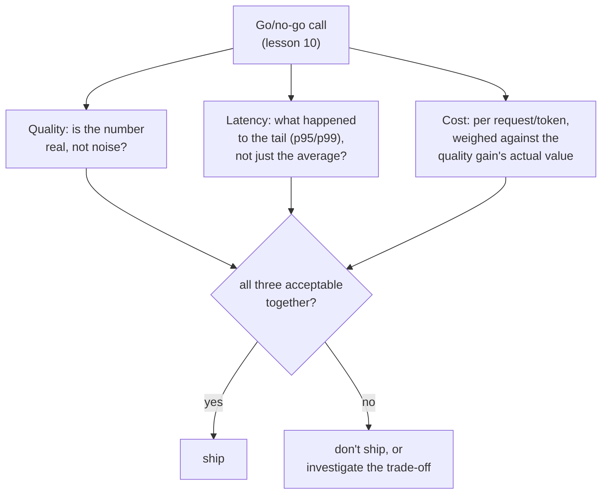

# Lección 17. Costo y latencia como dimensiones de una eval

**Vínculo con la misión:** La lección 10 enseñó a defender una decisión de go/no-go con un número de calidad fiable. Esa decisión siempre ha tenido otras dos entradas esperando entre bambalinas: lo que cuesta ejecutar el cambio y qué tan rápido responde. Tratarlas como una ocurrencia tardía, comprobadas solo cuando el número de calidad ya se ve bien, es el mismo error contra el que advirtió la lección 15 para un OEC reportado sin su métrica guardrail: un número celebrado de forma aislada, mientras se acumula un costo real en algún lugar que nadie medía.
**Fuente principal:** [Paper: "The Tail at Scale", Dean and Barroso, 2013](https://www.barroso.org/publications/TheTailAtScale.pdf)
**Requisitos previos:** [Lección 10](0010-defending-the-go-no-go-call.md), [Lección 15](0015-ab-tests-and-guardrail-metrics.md)

## Calentamiento

1. ▢ ¿Qué es un OEC, y qué dos propiedades necesita un buen candidato a OEC?

Comprobación

La métrica concreta (o pequeña combinación) que un experimento intenta realmente mover. Un buen candidato es movible, lo bastante sensible para cambiar dentro de un experimento factible, y está conectado causalmente con el resultado que de verdad importa, no meramente correlacionado con él.

2. ▢ ¿Por qué reportar solo la mejora de un OEC, sin ninguna métrica guardrail revisada, puede esconder una regresión real?

Comprobación

Un cambio diseñado para mover el OEC tiene todos los incentivos para hacerlo, pero nada de tener éxito en eso garantiza nada sobre una métrica que nadie vigilaba; una métrica guardrail es lo que hace falta para detectar ese tipo de daño sin vigilar.

## Qué debes saber

### Un número de latencia promedio esconde justo la parte que determina qué tan rápido se siente un sistema

La propiedad más importante de la latencia para un sistema real e interactivo no es su promedio, es su **cola**: la fracción más lenta de las peticiones, que se suele reportar como un percentil como p95 o p99. Un cambio de modelo puede dejar el tiempo de respuesta promedio casi sin cambios mientras empeora de forma notable la cola, y la experiencia real de un usuario sobre "¿esto es rápido?" está dominada por con qué frecuencia cae en esa cola lenta, no por el promedio de todas las peticiones cuya rapidez nunca notó. Reportar solo una cifra de latencia promedio para una decisión de go/no-go puede esconder una regresión real y de cara al usuario, igual que una puntuación de exactitud agregada puede esconder un fallo sesgado en una categoría rara, o una puntuación de fidelidad de la respuesta completa puede esconder una afirmación sin respaldo.

### El fan-out hace de la cola lo que realmente decide el tiempo de respuesta de un sistema real

A escala real, una sola petición de cara al usuario a menudo se abre en abanico hacia muchas llamadas de backend, y la respuesta global solo se completa cuando *todas* esas llamadas han terminado. Esto significa que la probabilidad de tocar al menos un componente lento crece con cuántos componentes se tocan: un componente que solo es lento muy de vez en cuando puede aun así volver lenta en conjunto a una gran fracción de las peticiones con fan-out, ya que basta con que una de muchas llamadas en paralelo caiga en la cola para que toda la petición quede limitada por la latencia de cola. Esta es exactamente la razón de que medir y defenderse de la latencia de cola, y no de la latencia promedio, sea la disciplina que necesita un sistema real de producción, y de que una decisión de go/no-go para un componente integrado en un sistema mayor tenga que preguntar específicamente por su cola.

### El costo hay que medirlo por unidad de lo que se sirve, no tratarlo como una partida fija

El costo, como la latencia, no es un número plano: un costo por token difiere entre tokens de entrada y de salida, y un modelo "mejor" puede costar de forma significativa más por petición mientras produce una mejora de calidad que puede valer o no ese multiplicador. Reportar una mejora de calidad sin su costo por petición (o por token, la unidad que de verdad corresponda a lo que se sirve) deja a la decisión de go/no-go sin poder sopesar ambas cosas entre sí en absoluto; una mejora de calidad que cuesta diez veces más por petición tiene que valer aproximadamente eso más para quienes dependen de ella, no darse por buena simplemente porque puntuó más alto.

### El costo y la latencia pertenecen a la misma decisión de go/no-go que ya enseñó la lección 10, no se añaden después

Nada de esta lección pide un nuevo marco de decisión: la disciplina de la lección 10 (un número defendido, contrastado con el ruido, sopesado frente a lo que cuesta equivocarse) se aplica directamente al costo y la latencia igual que a la calidad. El error que corrige esta lección es tratar el costo y la latencia como una comprobación separada y secundaria que se hace solo cuando una mejora de calidad ya se ve bien, en lugar de como entradas de primera clase de la misma decisión de go/no-go desde el principio. Un cambio que gana en calidad, retrocede en latencia p99 y cuesta tres veces más por petición no se ha evaluado en absoluto hasta que los tres números están sobre la mesa juntos, igual que la mejora de un OEC no se evalúa en absoluto hasta que se han revisado junto a ella sus métricas guardrail.

## Práctica

1. ▢ Un cambio de modelo muestra la latencia promedio sin cambios, pero un equipo no ha revisado su latencia p99. ¿Por qué "latencia promedio sin cambios" no basta para concluir que el cambio es seguro de lanzar?

Pista

Considera qué puede esconder un promedio sobre la fracción más lenta de las peticiones.

Comprobación

Un promedio sin cambios puede coexistir con una cola (p95 o p99) claramente peor; como la experiencia de los usuarios sobre "¿esto es rápido?" está dominada por con qué frecuencia caen en la cola lenta y no por el promedio de todas las peticiones, el promedio por sí solo no puede descartar una regresión de latencia real y de cara al usuario.

2. ▢ Una petición de cara al usuario se abre en abanico hacia 50 llamadas de backend, cada una de las cuales es lenta solo el 1% de las veces. ¿Por qué esto hace que la petición global tenga mucha más probabilidad de quedar limitada por la latencia de cola de lo que sugeriría la propia tasa del 1% de cualquier llamada de backend individual?

Comprobación

La petición global solo se completa cuando las 50 llamadas han terminado, así que basta con que una de esas 50 llamadas independientes caiga en su propia cola lenta para que toda la petición sea lenta; con suficientes llamadas en abanico, la probabilidad de que al menos una caiga en la cola sube muy por encima de la propia tasa de lentitud rara de cualquier componente individual.

3. ▢ Un equipo reporta que un nuevo modelo puntúa un 8% más alto en su eval de calidad, sin mencionar su costo por petición. ¿Qué falta antes de que esto pueda informar una decisión de go/no-go?

Comprobación

El costo por petición (o por token) comparado con el del modelo anterior, para poder sopesar de verdad la mejora de calidad frente a lo que cuesta obtenerla; una mejora de calidad del 8% que cuesta diez veces más por petición es una decisión muy distinta a la misma mejora del 8% con aproximadamente el mismo costo, y el número reportado por sí solo no puede distinguir ambas.

4. ▢ ¿Por qué esta lección describe incorporar el costo y la latencia a la decisión de go/no-go como "no un nuevo marco", en lugar de introducir un proceso de decisión separado para ellos?

Comprobación

Porque la disciplina existente de la lección 10 (un número defendido y fiable, sopesado frente a lo que cuesta equivocarse) ya se aplica directamente al costo y la latencia; el error que se corrige es tratarlos como una ocurrencia tardía comprobada solo después de que una mejora de calidad se ve bien, no que haga falta un proceso completamente nuevo para evaluarlos.

5. ▢ ¿Qué afirmación describe correctamente cómo encajan el costo y la latencia en una decisión de go/no-go?

    - a) Solo la métrica de calidad necesita defenderse con un número fiable; el costo y la latencia son comprobaciones secundarias que se hacen solo si el resultado de calidad se ve prometedor
    - b) El costo y la latencia son entradas de primera clase de la decisión de go/no-go junto con la calidad, la latencia debería evaluarse por su cola (p95/p99) y no solo por su promedio, y el costo debería sopesarse por petición o por token frente a la mejora de calidad que compra
    - c) La latencia promedio siempre basta para caracterizar si un cambio en el sistema es seguro de lanzar
    - d) Una mejora de calidad justifica automáticamente cualquier aumento de costo, ya que una puntuación más alta es lo único que importa

Comprobación

**b)** Ese es el tratamiento completo y de primera clase que establece esta lección. (a) es falsa: tratar el costo y la latencia como comprobaciones secundarias y posteriores es exactamente el error que corrige esta lección. (c) es falsa: un promedio sin cambios puede esconder una cola claramente peor, que es lo que realmente domina la experiencia real del usuario. (d) es falsa: una mejora de calidad hay que sopesarla frente a lo que cuesta, no darla por buena sin importar el multiplicador.

## Prácticas en el mundo real

- [ ] Para un cambio de modelo o de sistema que hayas evaluado (o uno descrito en un informe al que tengas acceso), comprueba si su latencia se reportó como un promedio, un percentil o ambos, y si se reportó siquiera el costo por petición.
- [ ] Para un modelo o API "mejor" que hayas considerado adoptar, consulta su costo por token (entrada y salida por separado) y estima si su mejora de calidad, a tu propio juicio, vale el multiplicador de costo que conlleva.
- [ ] Mañana: lee completa la discusión de la fuente primaria sobre las peticiones hedged y tied y anota qué ceden estas técnicas (carga extra, complejidad extra) para reducir específicamente la latencia de cola.

## Para profundizar

- [Paper: "The Tail at Scale", Dean and Barroso, 2013](https://www.barroso.org/publications/TheTailAtScale.pdf)
- [Recursos](../RESOURCES.md)

---

¿No termina de quedar claro? Vuelve a leer la fuente primaria de arriba, ya que esta lección la comprime y en la compresión es donde se escapa la comprensión. Consulta el [glosario](../GLOSSARY.md) por si algún término te resultó resbaladizo.

Si lo poco claro es la propia lección y no el material, eso es un defecto: [abre un issue](https://github.com/TokenCemetery/teach/issues).
