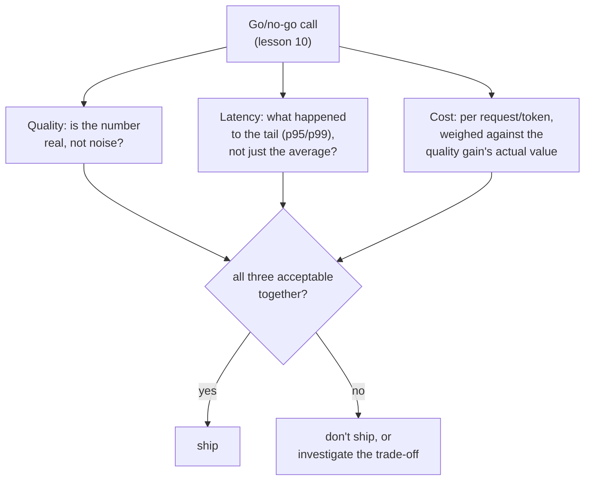

# Leçon 17. Coût et latence comme dimensions d'eval

**Lien avec la mission :** La leçon 10 a enseigné à défendre un go/no-go avec un chiffre de qualité digne de confiance. Cette décision a toujours eu deux autres entrées qui attendaient en coulisses : ce que le changement coûte à exploiter, et la rapidité de sa réponse. Les traiter après coup, en ne les vérifiant qu'une fois que le chiffre de qualité paraît bon, est la même erreur que la leçon 15 déconseillait pour un OEC rapporté sans sa métrique garde-fou : un seul chiffre, célébré isolément, pendant qu'un coût réel s'accumule quelque part où personne ne mesurait.
**Source primaire :** [Article : "The Tail at Scale", Dean and Barroso, 2013](https://www.barroso.org/publications/TheTailAtScale.pdf)
**Prérequis :** [Leçon 10](0010-defending-the-go-no-go-call.md), [Leçon 15](0015-ab-tests-and-guardrail-metrics.md)

## Échauffement

1. ▢ Qu'est-ce qu'un OEC, et de quelles deux propriétés un bon candidat d'OEC a-t-il besoin ?

Vérifier

La métrique précise (ou petite combinaison) qu'une expérience cherche réellement à faire bouger. Un bon candidat est mobile, assez sensible pour changer dans une expérience réalisable, et lié causalement au résultat qui compte vraiment, pas seulement corrélé à lui.

2. ▢ Pourquoi ne rapporter que l'amélioration d'un OEC, sans métrique garde-fou vérifiée, peut-il cacher une vraie régression ?

Vérifier

Un changement conçu pour faire bouger l'OEC a tout intérêt à le faire, mais réussir cela ne garantit rien sur une métrique que personne ne surveillait ; une métrique garde-fou est ce qu'il faut pour attraper ce genre de dommage non surveillé.

## À savoir

### Une latence moyenne cache précisément la partie qui détermine la rapidité ressentie d'un système

La propriété la plus importante de la latence pour un vrai système interactif n'est pas sa moyenne, c'est sa **queue** : la fraction des requêtes les plus lentes, typiquement rapportée en percentile comme p95 ou p99. Un changement de modèle peut laisser le temps de réponse moyen presque inchangé tout en aggravant nettement la queue, et l'expérience réelle d'un utilisateur de « est-ce rapide » est dominée par la fréquence à laquelle il tombe dans cette queue lente, pas par la moyenne de toutes les requêtes dont il n'a jamais remarqué la rapidité. Ne rapporter qu'une latence moyenne pour un go/no-go peut cacher une vraie régression côté utilisateur, comme un score d'exactitude agrégé peut cacher un échec déséquilibré sur une catégorie rare, ou un score de fidélité sur la réponse entière peut cacher une affirmation non soutenue.

### Le fan-out fait de la queue ce qui décide réellement du temps de réponse d'un vrai système

À grande échelle, une seule requête côté utilisateur se répartit souvent sur de nombreux appels backend, et la réponse globale n'aboutit que quand *chacun* de ces appels est terminé. Cela signifie que la probabilité de tomber sur au moins un composant lent croît avec le nombre de composants sollicités : un composant qui n'est lent que rarement peut quand même rendre lente une grande fraction des requêtes réparties, puisqu'il suffit qu'un seul des nombreux appels parallèles tombe dans la queue pour que toute la requête soit bornée par la latence de queue. C'est précisément pourquoi mesurer et se défendre contre la latence de queue, et non la latence moyenne, est la discipline dont un vrai système de production a besoin, et pourquoi un go/no-go pour un composant intégré à un système plus grand doit interroger spécifiquement sa queue.

### Le coût doit être mesuré par unité de ce qui est servi, pas traité comme un poste fixe

Le coût, comme la latence, n'est pas un chiffre plat : un coût par token diffère entre tokens d'entrée et de sortie, et un « meilleur » modèle peut coûter sensiblement plus par requête en produisant un gain de qualité qui vaut ou non ce multiplicateur. Rapporter une amélioration de qualité sans son coût par requête (ou par token, selon l'unité qui correspond réellement à ce qui est servi) laisse le go/no-go incapable de peser les deux l'un contre l'autre ; un gain de qualité qui coûte dix fois plus par requête doit valoir à peu près autant de plus pour ceux qui s'y fient, et non être simplement supposé valable parce qu'il a obtenu un meilleur score.

### Coût et latence appartiennent au même go/no-go que la leçon 10 a déjà enseigné, pas à un ajout après coup

Rien dans cette leçon ne demande un nouveau cadre de décision : la discipline de la leçon 10 (un chiffre défendu, confronté au bruit, pesé face à ce que coûte une erreur) s'applique directement au coût et à la latence comme à la qualité. L'erreur que cette leçon corrige est de traiter coût et latence comme un contrôle séparé et secondaire, réalisé seulement une fois qu'un gain de qualité paraît bon, plutôt que comme des entrées de premier rang du même go/no-go dès le départ. Un changement qui gagne en qualité, régresse en latence p99 et coûte trois fois plus par requête n'a pas été évalué du tout tant que les trois chiffres ne sont pas sur la table ensemble, comme le gain d'un OEC n'est pas évalué du tout tant que ses métriques garde-fous n'ont pas été vérifiées à côté.

## Pratique

1. ▢ Un changement de modèle montre une latence moyenne inchangée, mais une équipe n'a pas vérifié sa latence p99. Pourquoi « latence moyenne inchangée » ne suffit-il pas pour conclure que le changement est sûr à livrer ?

Indice

Demandez-vous ce qu'une moyenne peut cacher de la fraction la plus lente des requêtes.

Vérifier

Une moyenne inchangée peut coexister avec une queue (p95 ou p99) nettement pire ; comme l'expérience de « est-ce rapide » des utilisateurs est dominée par la fréquence à laquelle ils tombent dans la queue lente plutôt que par la moyenne de toutes les requêtes, la moyenne seule ne peut pas exclure une vraie régression de latence côté utilisateur.

2. ▢ Une requête côté utilisateur se répartit sur 50 appels backend, dont chacun n'est lent que 1 % du temps. Pourquoi cela rend-il la requête globale bien plus susceptible d'être bornée par la latence de queue que ne le suggérerait le taux de 1 % d'un seul appel backend ?

Vérifier

La requête globale n'aboutit que quand chacun des 50 appels est terminé, donc il suffit qu'un seul de ces 50 appels indépendants tombe dans sa propre queue lente pour que toute la requête soit lente ; avec assez d'appels répartis, la probabilité qu'au moins un tombe dans la queue grimpe bien au-dessus du taux de lenteur rare d'un composant isolé.

3. ▢ Une équipe rapporte qu'un nouveau modèle obtient 8 % de mieux sur son eval de qualité, sans mentionner son coût par requête. Que manque-t-il avant que cela puisse éclairer un go/no-go ?

Vérifier

Le coût par requête (ou par token) comparé à celui du modèle précédent, pour que le gain de qualité puisse réellement être pesé face à ce qu'il coûte d'obtenir ; un gain de qualité de 8 % qui coûte dix fois plus par requête est une décision très différente du même gain de 8 % à peu près au même coût, et le seul chiffre rapporté ne permet pas de distinguer les deux.

4. ▢ Pourquoi cette leçon décrit-elle l'intégration du coût et de la latence au go/no-go comme « pas un nouveau cadre », plutôt que d'introduire un processus de décision séparé pour eux ?

Vérifier

Parce que la discipline existante de la leçon 10 (un chiffre défendu et digne de confiance, pesé face à ce que coûte une erreur) s'applique déjà directement au coût et à la latence ; l'erreur corrigée est de les traiter comme un ajout après coup vérifié seulement quand un gain de qualité paraît bon, et non de manquer d'un tout nouveau processus pour les évaluer.

5. ▢ Laquelle de ces affirmations décrit correctement la place du coût et de la latence dans un go/no-go ?

    - a) Seule la métrique de qualité doit être défendue par un chiffre digne de confiance ; coût et latence sont des contrôles secondaires réalisés seulement si le résultat de qualité paraît prometteur
    - b) Coût et latence sont des entrées de premier rang du go/no-go au même titre que la qualité, la latence doit être évaluée par sa queue (p95/p99) plutôt que par sa seule moyenne, et le coût doit être pesé par requête ou par token face au gain de qualité qu'il achète
    - c) La latence moyenne suffit toujours à caractériser si un changement de système est sûr à livrer
    - d) Une amélioration de qualité justifie automatiquement toute hausse de coût, puisqu'un meilleur score est la seule chose qui compte

Vérifier

**b)** C'est le traitement complet, de premier rang, qu'établit cette leçon. (a) est faux : traiter coût et latence comme des contrôles secondaires, après coup, est exactement l'erreur que cette leçon corrige. (c) est faux : une moyenne inchangée peut cacher une queue nettement pire, ce qui domine réellement l'expérience des utilisateurs. (d) est faux : un gain de qualité doit être pesé face à ce qu'il coûte, et non supposé valable quel que soit le multiplicateur.

## Exercices en situation réelle

- [ ] Pour un changement de modèle ou de système que vous avez évalué (ou décrit dans un rapport auquel vous avez accès), vérifiez si sa latence a été rapportée en moyenne, en percentile ou les deux, et si le coût par requête a été rapporté tout court.
- [ ] Pour un « meilleur » modèle ou une API que vous avez envisagé d'adopter, retrouvez son coût par token (entrée et sortie séparément) et estimez si son gain de qualité, à votre propre jugement, vaut le multiplicateur de coût qu'il porte.
- [ ] Demain : lisez en entier la discussion de la source primaire sur les requêtes hedged et tied, et notez ce que ces techniques sacrifient (charge supplémentaire, complexité supplémentaire) pour réduire spécifiquement la latence de queue.

## Pour aller plus loin

- [Article : "The Tail at Scale", Dean and Barroso, 2013](https://www.barroso.org/publications/TheTailAtScale.pdf)
- [Ressources](../RESOURCES.md)

---

Ça ne passe pas ? Relisez la source primaire en haut de page, car cette leçon la condense et c'est dans la condensation que la compréhension s'échappe. Consultez le [glossaire](../GLOSSARY.md) pour tout terme qui vous a paru glissant.

Si c'est la leçon elle-même qui n'est pas claire plutôt que la matière, c'est un défaut : [ouvrez une issue](https://github.com/TokenCemetery/teach/issues).
