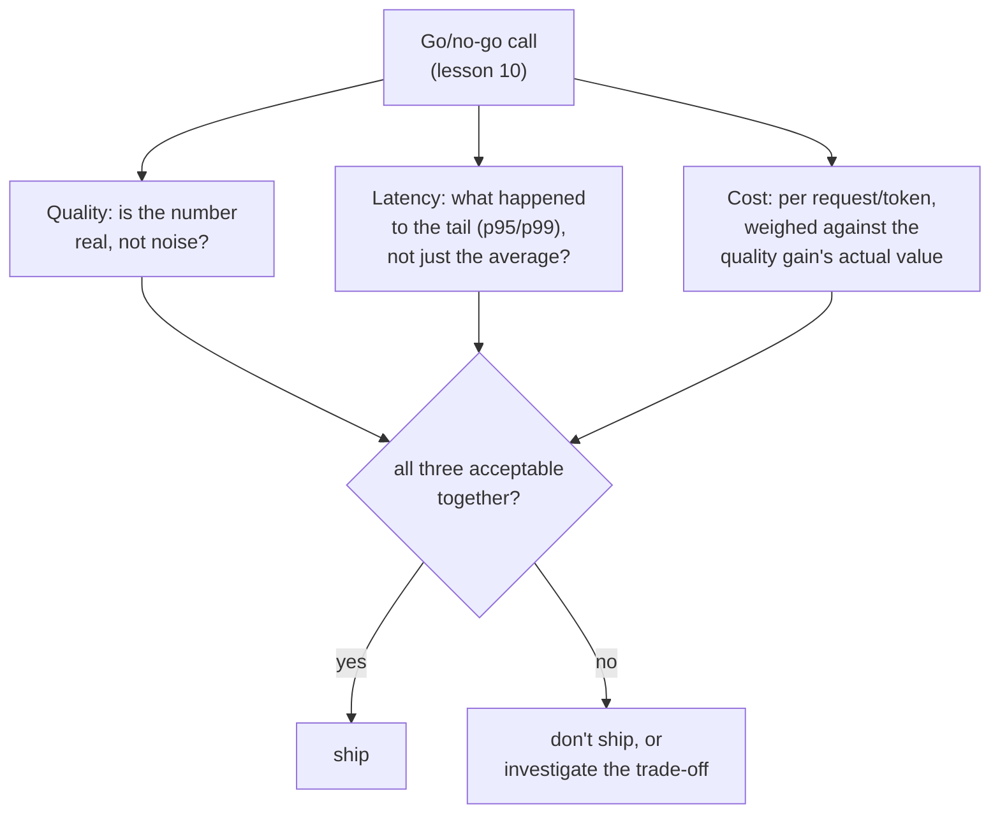

# पाठ 17. Eval Dimensions के रूप में Cost और Latency

**मिशन से संबंध:** पाठ 10 ने भरोसेमंद गुणवत्ता की संख्या के साथ go/no-go फ़ैसले का बचाव करना सिखाया। उस फ़ैसले के पास हमेशा दो और inputs पर्दे के पीछे इंतज़ार में रहे हैं: बदलाव को चलाने में क्या लगता है, और वह कितनी तेज़ी से जवाब देता है। इन्हें बाद का ख़याल मानना, उन्हें तभी जाँचना जब गुणवत्ता की संख्या पहले ही अच्छी दिख रही हो, वही ग़लती है जिसके ख़िलाफ़ पाठ 15 ने guardrail metric के बिना बताए गए OEC के लिए चेताया था: एक संख्या, अकेली मनाई जाती हुई, जबकि कहीं और, जहाँ कोई माप नहीं रहा था, असली क़ीमत जमा हो रही है।
**मुख्य स्रोत:** [पेपर: "The Tail at Scale", Dean and Barroso, 2013](https://www.barroso.org/publications/TheTailAtScale.pdf)
**पूर्व-आवश्यकताएँ:** [पाठ 10](0010-defending-the-go-no-go-call.md), [पाठ 15](0015-ab-tests-and-guardrail-metrics.md)

## वार्म-अप

1. ▢ OEC क्या है, और अच्छे OEC उम्मीदवार को कौन-से दो गुण चाहिए?

जाँचें

वह ख़ास metric (या छोटा मिश्रण) जिसे experiment असल में हिलाने की कोशिश कर रहा है। अच्छा उम्मीदवार हिलाने लायक होता है, इतना संवेदनशील कि व्यावहारिक experiment में खिसक जाए, और उस नतीजे से कारण के रूप में जुड़ा होता है जो सचमुच मायने रखता है, सिर्फ़ उसके साथ correlated नहीं।

2. ▢ सिर्फ़ OEC का सुधार बताना, बिना कोई guardrail metric जाँचे, असली regression को क्यों छिपा सकता है?

जाँचें

OEC हिलाने के लिए गढ़े गए बदलाव के पास वैसा करने का हर प्रोत्साहन होता है, पर उसमें सफल होने से ऐसी metric के बारे में कुछ तय नहीं होता जिसे कोई देख नहीं रहा था; ऐसे बिना देखे नुक़सान को पकड़ने के लिए guardrail metric चाहिए।

## यह जानें

### औसत latency की संख्या ठीक वही हिस्सा छिपा देती है जो तय करता है कि system कितना तेज़ महसूस होता है

असली, interactive system के लिए latency की सबसे ज़रूरी ख़ूबी उसका औसत नहीं, उसकी **tail** है: requests का सबसे धीमा हिस्सा, जिसे आम तौर पर p95 या p99 जैसे percentile के रूप में बताया जाता है। Model का कोई बदलाव औसत response समय को लगभग वैसा ही छोड़कर tail को कहीं ज़्यादा बुरा बना सकता है, और उपयोगकर्ता का "क्या यह तेज़ है" का असली अनुभव इस पर हावी होता है कि वे कितनी बार उस धीमी tail से टकराते हैं, उन सब requests के औसत से नहीं जिनके तेज़ होने पर उन्होंने कभी ध्यान ही नहीं दिया। Go/no-go फ़ैसले के लिए सिर्फ़ औसत latency आँकड़ा बताना असली, उपयोगकर्ता-सामने की regression को वैसे ही छिपा सकता है जैसे कुल accuracy score किसी दुर्लभ category पर झुकी विफलता को छिपा सकता है, या पूरे-उत्तर का faithfulness score एक असमर्थित दावे को।

### Fan-out ही tail को वह चीज़ बना देता है जो असली system का response समय तय करती है

असली पैमाने पर, एक उपयोगकर्ता-सामने की request अक्सर कई backend calls में फैल जाती है, और कुल response तभी पूरा होता है जब उनमें से *हर एक* ख़त्म हो जाए। इसका मतलब है कि कम से कम एक धीमे component से टकराने की संभावना इस पर बढ़ती है कि कितने components को छुआ गया: जो component सिर्फ़ कभी-कभार धीमा है, वह भी फैली हुई requests के बड़े हिस्से को कुल मिलाकर धीमा बना सकता है, क्योंकि पूरी request को tail-latency से बाँधने के लिए कई समानांतर calls में से सिर्फ़ एक का tail में आना काफ़ी है। यही कारण है कि औसत latency के बजाय tail latency को मापना और उसके विरुद्ध बचाव करना वह अनुशासन है जो असली production system को चाहिए, और इसीलिए बड़े system में जुड़े component के go/no-go फ़ैसले को ख़ास तौर पर उसकी tail के बारे में पूछना होगा।

### Cost को उस चीज़ की प्रति इकाई मापना होगा जो serve हो रही है, तय मद की तरह नहीं

Cost, latency की तरह, एक सपाट संख्या नहीं है: प्रति-token cost input और output tokens के लिए अलग होती है, और "बेहतर" model प्रति request काफ़ी ज़्यादा महँगा हो सकता है, जबकि गुणवत्ता की बढ़त उस गुणक के लायक हो भी सकती है और नहीं भी। गुणवत्ता का सुधार उसकी प्रति request (या प्रति token, जो भी इकाई असल में उससे मेल खाती हो जो serve हो रही है) cost के बिना बताना go/no-go फ़ैसले को दोनों को एक-दूसरे के सामने तौलने लायक ही नहीं छोड़ता; जो गुणवत्ता की बढ़त प्रति request दस गुना ज़्यादा महँगी पड़ती है, उसे उस पर निर्भर लोगों के लिए लगभग उतनी ही ज़्यादा मूल्यवान होना चाहिए, न कि महज़ इसलिए मान ली जाए कि उसने ऊँचा score किया।

### Cost और latency उसी go/no-go फ़ैसले के भीतर हैं जो पाठ 10 पहले ही सिखा चुका है, बाद में चिपकाई नहीं गईं

इस पाठ में कुछ भी नए निर्णय-ढाँचे की माँग नहीं करता: पाठ 10 का अनुशासन (बचाव की गई संख्या, noise के सामने जाँची हुई, ग़लत होने की क़ीमत के सामने तौली हुई) cost और latency पर उसी तरह सीधे लागू होता है जैसे गुणवत्ता पर। यह पाठ जिस ग़लती को सुधारता है वह है cost और latency को अलग, गौण जाँच मानना जो सिर्फ़ तब की जाए जब गुणवत्ता की जीत पहले ही अच्छी दिख रही हो, शुरू से उसी go/no-go फ़ैसले के पहले दर्जे के inputs मानने के बजाय। जो बदलाव गुणवत्ता पर जीतता है, p99 latency पर regress करता है, और प्रति request तीन गुना ज़्यादा महँगा है, उसका evaluation तब तक हुआ ही नहीं जब तक तीनों संख्याएँ एक साथ मेज़ पर न हों, ठीक वैसे ही जैसे OEC की बढ़त का evaluation तब तक नहीं हुआ जब तक उसके साथ guardrail metrics न जाँची गई हों।

## अभ्यास

1. ▢ Model का एक बदलाव औसत latency को अपरिवर्तित दिखाता है, पर टीम ने उसकी p99 latency नहीं जाँची। "औसत latency अपरिवर्तित" यह निष्कर्ष निकालने के लिए काफ़ी क्यों नहीं कि बदलाव ship करना सुरक्षित है?

संकेत

सोचें कि औसत requests के सबसे धीमे हिस्से के बारे में क्या छिपा सकता है।

जाँचें

अपरिवर्तित औसत कहीं ज़्यादा बुरी tail (p95 या p99) के साथ मौजूद हो सकता है; चूँकि उपयोगकर्ताओं का "क्या यह तेज़ है" का अनुभव हर request के औसत के बजाय इस पर हावी होता है कि वे कितनी बार धीमी tail से टकराते हैं, अकेला औसत असली, उपयोगकर्ता-सामने की latency regression को ख़ारिज नहीं कर सकता।

2. ▢ एक उपयोगकर्ता-सामने की request 50 backend calls में फैलती है, जिनमें से हर एक सिर्फ़ 1% बार धीमी होती है। इससे कुल request के tail-latency से बँधे होने की संभावना किसी अकेली backend call की अपनी 1% दर के सुझाव से कहीं ज़्यादा क्यों हो जाती है?

जाँचें

कुल request तब तक पूरी नहीं होती जब तक 50 की 50 calls ख़त्म न हो जाएँ, इसलिए पूरी request को धीमा बनाने के लिए उन 50 स्वतंत्र calls में से सिर्फ़ एक का अपनी धीमी tail में आना काफ़ी है; पर्याप्त फैली हुई calls के साथ, कम से कम एक के tail में आने की संभावना किसी अकेले component की अपनी दुर्लभ-धीमेपन की दर से कहीं ऊपर चढ़ जाती है।

3. ▢ एक टीम बताती है कि नया model उनके गुणवत्ता eval पर 8% ऊँचा score करता है, उसकी प्रति-request cost का ज़िक्र किए बिना। इसे go/no-go फ़ैसले की जानकारी देने से पहले क्या छूटा है?

जाँचें

पिछले model की तुलना में प्रति request (या प्रति token) cost, ताकि गुणवत्ता की बढ़त को असल में उसे पाने की क़ीमत के सामने तौला जा सके; 8% की गुणवत्ता की बढ़त जो प्रति request दस गुना महँगी पड़ती है, लगभग उसी cost पर उसी 8% की बढ़त से बहुत अलग फ़ैसला है, और अकेली बताई गई संख्या दोनों में फ़र्क़ नहीं कर सकती।

4. ▢ इस पाठ में cost और latency को go/no-go फ़ैसले में मिलाने को "नया ढाँचा नहीं" क्यों कहा गया है, उनके लिए अलग निर्णय प्रक्रिया लाने के बजाय?

जाँचें

क्योंकि पाठ 10 का मौजूदा अनुशासन (बचाव की गई, भरोसेमंद संख्या, ग़लत होने की क़ीमत के सामने तौली हुई) cost और latency पर सीधे लागू होता है; जिस ग़लती को सुधारा जा रहा है वह उन्हें बाद का ख़याल मानना है जो गुणवत्ता की जीत अच्छी दिखने के बाद ही जाँचा जाए, उन्हें परखने के लिए बिल्कुल नई प्रक्रिया की ज़रूरत नहीं।

5. ▢ Cost और latency go/no-go फ़ैसले में कैसे आते हैं, इसका सही वर्णन कौन-सा दावा करता है?

    - a) सिर्फ़ गुणवत्ता की metric का भरोसेमंद संख्या से बचाव ज़रूरी है; cost और latency गौण जाँचें हैं जो तभी की जाती हैं जब गुणवत्ता का नतीजा आशाजनक दिखे
    - b) Cost और latency गुणवत्ता के साथ go/no-go के पहले दर्जे के inputs हैं, latency को सिर्फ़ औसत से नहीं बल्कि उसकी tail (p95/p99) से परखना चाहिए, और cost को प्रति request या प्रति token उस गुणवत्ता की बढ़त के सामने तौलना चाहिए जो वह ख़रीदती है
    - c) औसत latency हमेशा यह बताने के लिए काफ़ी है कि system का बदलाव ship करना सुरक्षित है या नहीं
    - d) गुणवत्ता का सुधार अपने-आप cost की किसी भी बढ़ोतरी को सही ठहराता है, क्योंकि ऊँचा score ही अकेली मायने रखने वाली चीज़ है

जाँचें

**b)** यही वह पूरा, पहले दर्जे का बर्ताव है जो यह पाठ स्थापित करता है। (a) ग़लत है: cost और latency को गौण, बाद की जाँचें मानना ठीक वही ग़लती है जिसे यह पाठ सुधारता है। (c) ग़लत है: अपरिवर्तित औसत कहीं ज़्यादा बुरी tail छिपा सकता है, जो असल में उपयोगकर्ता के असली अनुभव पर हावी होती है। (d) ग़लत है: गुणवत्ता की बढ़त को उसकी क़ीमत के सामने तौलना पड़ता है, गुणक चाहे जो हो उसे मूल्यवान मान नहीं लिया जाता।

## असली दुनिया का अभ्यास

- [ ] जिस model या system बदलाव का आपने evaluation किया है (या जो किसी रिपोर्ट में बताया गया है जिस तक आपकी पहुँच है), उसके लिए जाँचें कि latency औसत, percentile या दोनों के रूप में बताई गई थी, और प्रति request cost बताई भी गई थी या नहीं।
- [ ] जिस "बेहतर" model या API को आपने अपनाने पर विचार किया है, उसकी प्रति-token cost (input और output अलग-अलग) देखें और अपने निर्णय से अनुमान लगाएँ कि उसकी गुणवत्ता की बढ़त उस cost गुणक के लायक है जो वह साथ लाती है या नहीं।
- [ ] कल: मुख्य स्रोत में hedged और tied requests की चर्चा पूरी पढ़ें, और लिखें कि ये techniques ख़ास तौर पर tail latency घटाने के लिए क्या छोड़ देती हैं (अतिरिक्त load, अतिरिक्त जटिलता)।

## आगे बढ़ने के लिए

- [पेपर: "The Tail at Scale", Dean and Barroso, 2013](https://www.barroso.org/publications/TheTailAtScale.pdf)
- [संसाधन](../RESOURCES.md)

---

बात नहीं बन रही? ऊपर दिए primary source को दोबारा पढ़ें, क्योंकि यह पाठ उसे संक्षिप्त करता है और समझ संक्षेप में ही रिसती है। जो शब्द फिसलन भरा लगे, उसके लिए [शब्दावली](../GLOSSARY.md) देखें।

अगर दिक़्क़त सामग्री की नहीं बल्कि पाठ की ही है, तो वह एक खोट है: [issue खोलें](https://github.com/TokenCemetery/teach/issues)।
