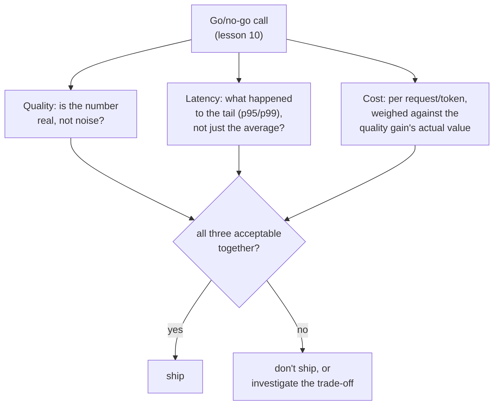

# Lição 17. Custo e latência como dimensões de eval

**Ligação com a missão:** A lição 10 ensinou a defender uma decisão de go/no-go com um número de qualidade confiável. Essa decisão sempre teve mais duas entradas esperando nos bastidores: o que a mudança custa para rodar e com que rapidez ela responde. Tratá-las como um detalhe posterior, verificado só depois que o número de qualidade já parece bom, é o mesmo erro contra o qual a lição 15 alertou para um OEC reportado sem sua métrica guardrail: um número, celebrado isoladamente, enquanto um custo real se acumula em algum ponto que ninguém estava medindo.
**Fonte principal:** [Artigo científico: "The Tail at Scale", Dean e Barroso, 2013](https://www.barroso.org/publications/TheTailAtScale.pdf)
**Pré-requisitos:** [Lição 10](0010-defending-the-go-no-go-call.md), [Lição 15](0015-ab-tests-and-guardrail-metrics.md)

## Aquecimento

1. ▢ O que é um OEC, e de que duas propriedades um bom candidato a OEC precisa?

Verificação

A métrica específica (ou pequena combinação) que um experimento realmente tenta mover. Um bom candidato é movível, sensível o bastante para se deslocar dentro de um experimento viável, e causalmente ligado ao resultado que de fato importa, e não apenas correlacionado com ele.

2. ▢ Por que reportar apenas a melhoria de um OEC, sem nenhuma métrica guardrail verificada, pode esconder uma regressão real?

Verificação

Uma mudança projetada para mover o OEC tem todo incentivo para fazê-lo, mas nada em ter sucesso nisso garante coisa alguma sobre uma métrica que ninguém estava vigiando; uma métrica guardrail é o que se precisa para pegar esse tipo de dano não vigiado.

## Saiba isto

### Um número de latência média esconde exatamente a parte que determina quão rápido um sistema parece

A propriedade mais importante da latência em um sistema real e interativo não é a média, é a **cauda**: a fração mais lenta das requisições, tipicamente reportada como um percentil como p95 ou p99. Uma mudança de modelo pode deixar o tempo médio de resposta quase inalterado e ao mesmo tempo piorar sensivelmente a cauda, e a experiência real do usuário sobre "isto é rápido?" é dominada por com que frequência ele cai nessa cauda lenta, e não pela média de todas as requisições cuja rapidez ele nunca notou. Reportar apenas uma latência média em uma decisão de go/no-go pode esconder uma regressão real, voltada ao usuário, do mesmo modo que uma pontuação agregada de acurácia pode esconder uma falha assimétrica em uma categoria rara, ou uma pontuação de fidelidade da resposta inteira pode esconder uma afirmação sem sustentação.

### O fan-out faz da cauda o que de fato decide o tempo de resposta de um sistema real

Em escala real, uma única requisição voltada ao usuário muitas vezes se espalha por muitas chamadas de backend, e a resposta geral só termina quando *todas* essas chamadas terminaram. Isso significa que a chance de atingir pelo menos um componente lento cresce com quantos componentes são tocados: um componente que é lento só raramente ainda pode tornar lenta uma grande fração das requisições com fan-out, já que basta uma de muitas chamadas paralelas cair na cauda para fazer a requisição inteira ficar limitada pela latência de cauda. É exatamente por isso que medir e se defender contra a latência de cauda, e não a latência média, é a disciplina de que um sistema de produção real precisa, e por que uma decisão de go/no-go para um componente embutido em um sistema maior precisa perguntar especificamente por sua cauda.

### O custo precisa ser medido por unidade daquilo que está sendo servido, e não tratado como um item fixo

O custo, como a latência, não é um número plano: o custo por token difere entre tokens de entrada e de saída, e um modelo "melhor" pode custar sensivelmente mais por requisição enquanto produz um ganho de qualidade que pode ou não valer esse multiplicador. Reportar uma melhoria de qualidade sem seu custo por requisição (ou por token, a unidade que de fato corresponder ao que está sendo servido) deixa a decisão de go/no-go incapaz de ponderar as duas coisas uma contra a outra; um ganho de qualidade que custa dez vezes mais por requisição precisa valer aproximadamente isso a mais para as pessoas que dependem dele, e não ser presumido como vantajoso só porque pontuou mais alto.

### Custo e latência pertencem à mesma decisão de go/no-go que a lição 10 já ensinou, e não acrescentados depois

Nada nesta lição pede um novo framework de decisão: a disciplina da lição 10 (um número defendido, conferido contra o ruído, ponderado contra o que custa errar) se aplica diretamente ao custo e à latência, como à qualidade. O erro que esta lição corrige é tratar custo e latência como uma verificação separada e secundária, feita só depois que um ganho de qualidade já parece bom, em vez de entradas de primeira classe da mesma decisão de go/no-go desde o começo. Uma mudança que vence em qualidade, regride na latência p99 e custa três vezes mais por requisição não foi avaliada de modo algum até que os três números estejam na mesa juntos, do mesmo modo que o ganho de um OEC não é avaliado de modo algum até que suas métricas guardrail tenham sido verificadas ao lado.

## Prática

1. ▢ Uma mudança de modelo mostra a latência média inalterada, mas uma equipe não verificou sua latência p99. Por que "latência média inalterada" não basta para concluir que a mudança é segura para lançar?

Dica

Considere o que uma média pode esconder sobre a fração mais lenta das requisições.

Verificação

Uma média inalterada pode coexistir com uma cauda sensivelmente pior (p95 ou p99); como a experiência do usuário sobre "isto é rápido?" é dominada por com que frequência ele cai na cauda lenta, e não pela média de todas as requisições, a média sozinha não consegue descartar uma regressão real de latência voltada ao usuário.

2. ▢ Uma requisição voltada ao usuário se espalha por 50 chamadas de backend, cada uma lenta só 1% das vezes. Por que isso torna a requisição geral muito mais provável de ficar limitada pela latência de cauda do que a taxa de 1% de qualquer chamada isolada sugeriria?

Verificação

A requisição geral só termina quando todas as 50 chamadas terminaram, então basta uma dessas 50 chamadas independentes cair em sua própria cauda lenta para tornar a requisição inteira lenta; com chamadas suficientes em fan-out, a chance de que pelo menos uma caia na cauda sobe bem acima da taxa rara de lentidão do próprio componente isolado.

3. ▢ Uma equipe reporta que um novo modelo pontua 8% mais alto em seu eval de qualidade, sem mencionar seu custo por requisição. O que falta antes de isso poder embasar uma decisão de go/no-go?

Verificação

O custo por requisição (ou por token) comparado com o do modelo anterior, para que o ganho de qualidade possa ser de fato ponderado contra o que custa obtê-lo; um ganho de qualidade de 8% que custa dez vezes mais por requisição é uma decisão muito diferente do mesmo ganho de 8% a um custo aproximadamente igual, e o número reportado sozinho não distingue os dois.

4. ▢ Por que esta lição descreve incorporar custo e latência à decisão de go/no-go como "não um novo framework", em vez de introduzir um processo de decisão separado para eles?

Verificação

Porque a disciplina existente da lição 10 (um número defendido e confiável, ponderado contra o que custa errar) já se aplica diretamente ao custo e à latência; o erro sendo corrigido é tratá-los como um detalhe posterior, verificado só depois de um ganho de qualidade parecer bom, e não a necessidade de um processo inteiramente novo para avaliá-los.

5. ▢ Qual afirmação descreve corretamente como custo e latência pertencem a uma decisão de go/no-go?

    - a) Só a métrica de qualidade precisa ser defendida com um número confiável; custo e latência são verificações secundárias feitas apenas se o resultado de qualidade parecer promissor
    - b) Custo e latência são entradas de primeira classe da decisão de go/no-go ao lado da qualidade, a latência deve ser avaliada por sua cauda (p95/p99) e não apenas pela média, e o custo deve ser ponderado por requisição ou por token contra o ganho de qualidade que ele compra
    - c) A latência média é sempre suficiente para caracterizar se uma mudança no sistema é segura para lançar
    - d) Uma melhoria de qualidade justifica automaticamente qualquer aumento de custo, já que uma pontuação mais alta é a única coisa que importa

Verificação

**b)** Esse é o tratamento completo, de primeira classe, que esta lição estabelece. (a) é falsa: tratar custo e latência como verificações secundárias, posteriores ao fato, é exatamente o erro que esta lição corrige. (c) é falsa: uma média inalterada pode esconder uma cauda sensivelmente pior, que é o que de fato domina a experiência real do usuário. (d) é falsa: um ganho de qualidade precisa ser ponderado contra o que custa, e não presumido como vantajoso seja qual for o multiplicador.

## Prática no mundo real

- [ ] Para uma mudança de modelo ou de sistema que você avaliou (ou uma descrita em um relatório a que você tenha acesso), verifique se a latência foi reportada como média, como percentil ou como ambos, e se o custo por requisição foi reportado de algum modo.
- [ ] Para um modelo ou API "melhor" que você considerou adotar, consulte seu custo por token (entrada e saída separadamente) e estime se o ganho de qualidade dele, a seu critério, vale o multiplicador de custo que ele carrega.
- [ ] Amanhã: leia por inteiro a discussão da fonte principal sobre requisições hedged e tied e anote o que essas técnicas sacrificam (carga extra, complexidade extra) para reduzir especificamente a latência de cauda.

## Para ir além

- [Artigo científico: "The Tail at Scale", Dean e Barroso, 2013](https://www.barroso.org/publications/TheTailAtScale.pdf)
- [Recursos](../RESOURCES.md)

---

Não ficou claro? Releia a fonte principal no topo, já que esta lição a comprime e é na compressão que o entendimento escapa. Consulte o [glossário](../GLOSSARY.md) para qualquer termo que pareceu escorregadio.

Se o problema é a lição em si, e não o material, isso é um defeito: [abra uma issue](https://github.com/TokenCemetery/teach/issues).
