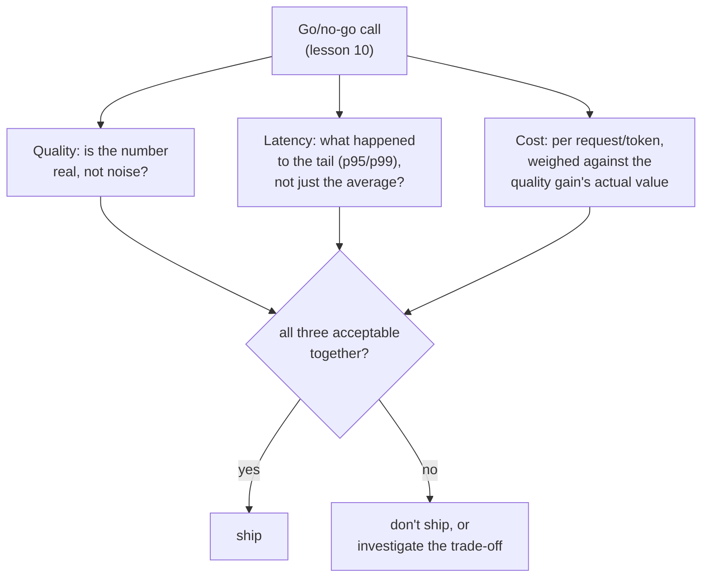

# Урок 17. Стоимость и задержка как измерения эвала

**Связь с целью курса:** Урок 10 учил защищать решение «выпускать или нет» заслуживающим доверия числом качества. У этого решения всегда были ещё два входа, ждавшие за кулисами: сколько изменение стоит в эксплуатации и как быстро оно отвечает. Если считать их запоздалой мыслью, проверяемой, только когда число качества уже выглядит хорошо, это та же ошибка, от которой урок 15 предостерегал для OEC, сообщённого без защитной метрики: одно число, отмеченное в отрыве от остального, пока где-то, где никто не измерял, копится реальная цена.
**Первоисточник:** [Научная статья: "The Tail at Scale", Dean and Barroso, 2013](https://www.barroso.org/publications/TheTailAtScale.pdf)
**Предварительные требования:** [Урок 10](0010-defending-the-go-no-go-call.md), [Урок 15](0015-ab-tests-and-guardrail-metrics.md)

## Разминка

1. ▢ Что такое OEC и какими двумя свойствами должен обладать хороший кандидат в OEC?

Проверка

Конкретная метрика (или небольшая комбинация), которую эксперимент на самом деле пытается сдвинуть. Хороший кандидат подвижен, достаточно чувствителен, чтобы сдвинуться в реалистичном эксперименте, и причинно связан с исходом, который действительно важен, а не просто коррелирует с ним.

2. ▢ Почему сообщение только об улучшении OEC без проверки защитной метрики может скрыть настоящую регрессию?

Проверка

Изменение, сконструированное, чтобы сдвинуть OEC, имеет все стимулы это делать, но успех в этом ничего не гарантирует для метрики, за которой никто не следил; именно защитная метрика нужна, чтобы поймать такой неотслеживаемый вред.

## Что нужно знать

### Средняя задержка скрывает именно ту часть, которая определяет, насколько быстрой кажется система

Самое важное свойство задержки для настоящей интерактивной системы не среднее, а её **хвост**: самая медленная доля запросов, обычно сообщаемая как перцентиль вроде p95 или p99. Изменение модели может оставить среднее время ответа почти неизменным, заметно ухудшив хвост, а реальное ощущение пользователя «быстро ли это» определяется тем, как часто он попадает в этот медленный хвост, а не средним по каждому запросу, быстрого ответа на который он даже не заметил. Если сообщать для решения «выпускать или нет» только среднюю задержку, можно скрыть настоящую регрессию, видимую пользователям, так же как агрегированная оценка точности может скрыть перекошенный сбой на одной редкой категории, а оценка достоверности всего ответа может скрыть одно неподтверждённое утверждение.

### Веерный запуск делает хвост тем, что на самом деле определяет время ответа реальной системы

В реальном масштабе один пользовательский запрос часто разветвляется на много обращений к бэкенду, и общий ответ завершается, лишь когда закончились *все* эти обращения. Это значит, что шанс наткнуться хотя бы на один медленный компонент растёт вместе с числом затронутых компонентов: компонент, медленный лишь изредка, всё равно может сделать медленной большую долю запросов с веерным запуском, ведь достаточно, чтобы одно из многих параллельных обращений попало в хвост, и весь запрос оказывается ограничен хвостовой задержкой. Именно поэтому измерять хвостовую задержку и защищаться от неё, а не от средней, это дисциплина, которая нужна настоящей продакшен-системе, и именно поэтому решение «выпускать или нет» для компонента, встроенного в большую систему, должно спрашивать именно про его хвост.

### Стоимость нужно измерять на единицу того, что обслуживается, а не считать фиксированной статьёй расходов

Стоимость, как и задержка, не одно плоское число: цена за токен различается для входных и выходных токенов, а «лучшая» модель может стоить заметно больше за запрос, давая выигрыш в качестве, который может стоить такого множителя, а может и нет. Если сообщать улучшение качества без его стоимости за запрос (или за токен, в зависимости от единицы, которая соответствует обслуживаемому), решение «выпускать или нет» вообще не может сопоставить одно с другим; выигрыш в качестве, стоящий в десять раз больше за запрос, должен быть примерно настолько же ценнее для тех, кто на него полагается, а не считаться стоящим просто потому, что набрал больше очков.

### Стоимость и задержка принадлежат тому же решению «выпускать или нет», которому учил урок 10, а не приделываются потом

Ничто в этом уроке не требует новой схемы решений: дисциплина урока 10 (защищённое число, сверенное с шумом, взвешенное с ценой ошибки) прямо применима к стоимости и задержке так же, как к качеству. Ошибка, которую исправляет этот урок, это считать стоимость и задержку отдельной второстепенной проверкой, выполняемой, только когда выигрыш в качестве уже выглядит хорошо, вместо того чтобы с самого начала считать их полноправными входами того же решения «выпускать или нет». Изменение, выигрывающее по качеству, проседающее по p99 задержки и стоящее втрое больше за запрос, вообще не оценено, пока все три числа не лежат на столе вместе, так же как прирост OEC не оценён вовсе, пока рядом не проверены его защитные метрики.

## Практика

1. ▢ Изменение модели показывает неизменную среднюю задержку, но команда не проверила её p99. Почему «средняя задержка не изменилась» недостаточно, чтобы заключить, что изменение безопасно выпускать?

Подсказка

Подумайте, что среднее может скрывать о самой медленной доле запросов.

Проверка

Неизменное среднее может сосуществовать с заметно худшим хвостом (p95 или p99); поскольку ощущение пользователей «быстро ли это» определяется тем, как часто они попадают в медленный хвост, а не средним по каждому запросу, одно среднее не может исключить настоящую регрессию задержки, видимую пользователям.

2. ▢ Пользовательский запрос разветвляется на 50 обращений к бэкенду, каждое из которых медленное лишь в 1% случаев. Почему это делает общий запрос куда вероятнее ограниченным хвостовой задержкой, чем подсказывала бы собственная доля 1% любого отдельного обращения?

Проверка

Общий запрос завершается, лишь когда закончились все 50 обращений, поэтому достаточно, чтобы одно из этих 50 независимых обращений попало в собственный медленный хвост, и весь запрос становится медленным; при достаточном числе веерных обращений шанс, что хотя бы одно попадёт в хвост, растёт заметно выше собственной редкой доли медленности любого отдельного компонента.

3. ▢ Команда сообщает, что новая модель набирает на 8% больше в их эвале качества, не упоминая стоимость за запрос. Чего не хватает, прежде чем это сможет послужить решению «выпускать или нет»?

Проверка

Стоимости за запрос (или за токен) в сравнении с предыдущей моделью, чтобы выигрыш в качестве можно было по-настоящему сопоставить с ценой его получения; выигрыш в качестве на 8%, стоящий в десять раз больше за запрос, это совсем другое решение, чем тот же выигрыш в 8% примерно при той же стоимости, а одно сообщённое число их не различит.

4. ▢ Почему этот урок описывает включение стоимости и задержки в решение «выпускать или нет» как «не новую схему», а не вводит для них отдельный процесс принятия решений?

Проверка

Потому что существующая дисциплина урока 10 (защищённое, заслуживающее доверия число, взвешенное с ценой ошибки) уже прямо применима к стоимости и задержке; исправляется ошибка считать их запоздалой мыслью, проверяемой лишь после того, как выигрыш в качестве выглядит хорошо, а не нехватка совершенно нового процесса для их оценки.

5. ▢ Какое утверждение верно описывает, как стоимость и задержка входят в решение «выпускать или нет»?

    - a) Заслуживающим доверия числом нужно защищать только метрику качества; стоимость и задержка это вторичные проверки, выполняемые, только если результат по качеству выглядит многообещающим
    - b) Стоимость и задержка это полноправные входы решения «выпускать или нет» рядом с качеством, задержку следует оценивать по её хвосту (p95/p99), а не только по среднему, а стоимость взвешивать за запрос или за токен относительно выигрыша в качестве, который она покупает
    - c) Средней задержки всегда достаточно, чтобы охарактеризовать, безопасно ли выпускать изменение системы
    - d) Улучшение качества автоматически оправдывает любой рост стоимости, поскольку важна только более высокая оценка

Проверка

**b)** Это полное полноправное рассмотрение, которое устанавливает урок. Вариант (a) неверен: считать стоимость и задержку вторичными проверками задним числом это именно та ошибка, которую исправляет урок. Вариант (c) неверен: неизменное среднее может скрывать заметно худший хвост, который на самом деле определяет реальный пользовательский опыт. Вариант (d) неверен: выигрыш в качестве нужно взвешивать относительно его цены, а не считать стоящим независимо от множителя.

## Практика в реальной работе

- [ ] Для изменения модели или системы, которое вы оценивали (или описанного в доступном вам отчёте), проверьте, сообщена ли его задержка как среднее, как перцентиль или и так и так и сообщена ли вообще стоимость за запрос.
- [ ] Для «лучшей» модели или API, которые вы рассматривали для внедрения, найдите цену за токен (входной и выходной отдельно) и оцените, стоит ли, на ваш взгляд, выигрыш в качестве того множителя стоимости, который она несёт.
- [ ] Завтра: прочитайте целиком обсуждение хеджированных и связанных запросов в первоисточнике и отметьте, чем эти приёмы жертвуют (дополнительная нагрузка, дополнительная сложность) ради снижения именно хвостовой задержки.

## Что почитать дальше

- [Научная статья: "The Tail at Scale", Dean and Barroso, 2013](https://www.barroso.org/publications/TheTailAtScale.pdf)
- [Ресурсы](../RESOURCES.md)

---

Не доходит? Перечитайте первоисточник в начале: этот урок его сжимает, а при сжатии понимание как раз и теряется. Загляните в [глоссарий](../GLOSSARY.md), если какой-то термин показался скользким.

Если неясен сам урок, а не материал, это дефект: [откройте issue](https://github.com/TokenCemetery/teach/issues).
