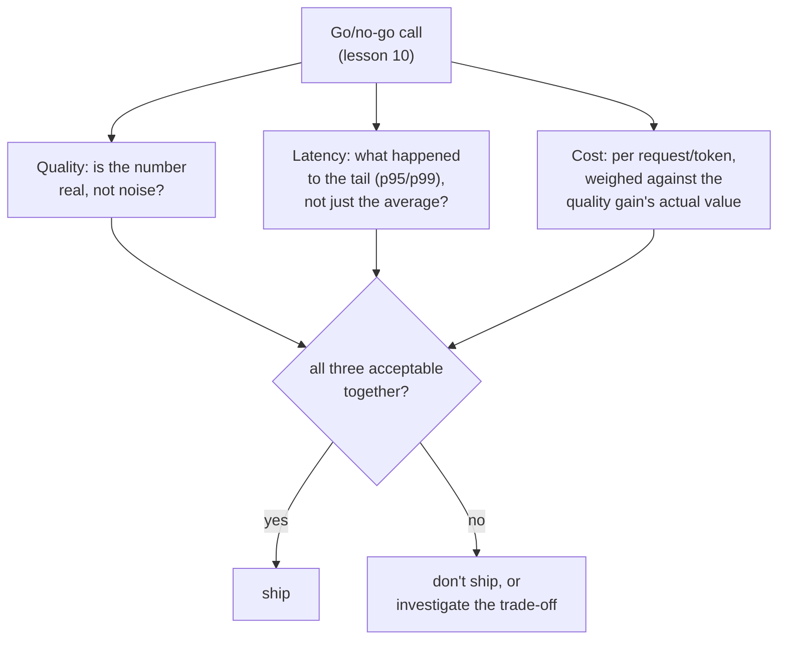

# 第 17 课：作为评测维度的成本与延迟

**使命关联:** 第 10 课教的是用一个可信的质量数字，为上线与否的判断辩护。这个判断一直还有另外两项输入在旁边等着：这项改动运行起来要花多少成本，以及它响应得有多快。把这两项当作事后才想到的东西，等质量数字已经看起来不错了才去检查，就是第 15 课警告过的、对一个没有护栏指标的 OEC 所犯的同一个错：一个数字被孤立地庆祝，而真实的代价正在某个没有人度量的地方累积。
**主要来源:** [论文：“The Tail at Scale”，Dean 和 Barroso，2013](https://www.barroso.org/publications/TheTailAtScale.pdf)
**前置知识:** [第 10 课](0010-defending-the-go-no-go-call.md)、[第 15 课](0015-ab-tests-and-guardrail-metrics.md)

## 热身

1. ▢ 什么是 OEC，好的 OEC 候选需要具备哪两个性质？

检查

实验真正想要推动的那个具体指标（或一个小的组合）。好的候选是可移动的，也就是足够灵敏，在可行的实验中能产生变化；并且与真正重要的结果有因果联系，而不只是相关。

2. ▢ 为什么只报告 OEC 的提升，而不检查任何护栏指标，可能掩盖真实的退步？

检查

为推动 OEC 而设计的改动，完全有动机这样做，但成功做到这一点，对一个没人盯着的指标什么也保证不了；需要护栏指标，才能抓住这种没人盯着的损害。

## 要点

### 平均延迟这个数字，恰恰掩盖了决定系统感觉快不快的那一部分

对于真实的交互式系统，延迟最重要的性质不是它的平均值，而是它的**尾部**：最慢的那部分请求，通常报告为 p95 或 p99 这样的百分位数。模型的一项改动，可以让平均响应时间几乎不变，同时让尾部明显变差，而用户对“这快不快”的实际体验，是由他们多常碰上那条缓慢的尾部决定的，而不是由他们从未注意到很快的每一个请求的平均值决定的。在上线与否的判断中只报告平均延迟，可能掩盖真实的、用户能感受到的退步，就像汇总的准确率可以掩盖在某个罕见类别上偏斜的失败，或整个答案的忠实性分数可以掩盖一个没有依据的论断一样。

### 扇出使得尾部成为真正决定系统响应时间的因素

在真实的规模下，一个面向用户的请求，往往会扇出到许多后端调用，而整体的响应，只有在*每一个*调用都完成之后才结束。这意味着，碰上至少一个缓慢组件的几率，随着涉及的组件数量而增长：一个只是偶尔缓慢的组件，仍可能使很大一部分扇出的请求整体变慢，因为只要许多并行调用中有一个落在尾部，整个请求就受制于尾部延迟。这正是为什么度量并防范的是尾部延迟，而不是平均延迟，才是真实的生产系统所需要的纪律，也是为什么对于嵌入在更大系统中的组件，上线与否的判断必须专门问它的尾部。

### 成本必须按所服务的单位来度量，而不是当作固定的一行开支

成本和延迟一样，不是一个平坦的数字：每个 token 的成本，对输入和输出 token 是不同的，而“更好”的模型，每个请求的成本可能高出许多，换来的质量提升是否值得这个倍数，不一定。报告质量改进而不给出每个请求（或每个 token，哪个单位真正对应所服务的东西就用哪个）的成本，会让上线与否的判断根本无法在二者之间权衡；一个每个请求成本高出十倍的质量提升，需要对依赖它的人来说，大致值那么多，而不是仅仅因为它得分更高，就想当然地认为值得。

### 成本和延迟属于第 10 课已经教过的同一个上线与否判断之内，而不是事后附加

本课并不要求一个新的决策框架：第 10 课的纪律（一个经过辩护的数字，对照噪声检查，并权衡出错的代价），直接适用于成本和延迟，就像适用于质量一样。本课纠正的错误，是把成本和延迟当作单独的、次要的检查，等到质量提升已经看起来不错之后才做，而不是从一开始就把它们作为同一个上线与否判断的一等输入。一项改动在质量上获胜，在 p99 延迟上退步，每个请求的成本又高出三倍，在这三个数字一起摆上桌面之前，它根本还没有被评估，就像一个 OEC 的提升，在它的护栏指标被一并检查之前，根本还没有被评估一样。

## 练习

1. ▢ 某个模型改动显示平均延迟没有变化，但团队没有检查它的 p99 延迟。为什么“平均延迟没变”不足以断定这项改动可以放心上线？

提示

想一想，平均值可能掩盖最慢那部分请求的什么情况。

检查

没有变化的平均值，可以与明显变差的尾部（p95 或 p99）并存；由于用户对“这快不快”的体验，取决于他们多常碰上缓慢的尾部，而不是每个请求的平均值，所以单看平均值，排除不了真实的、用户能感受到的延迟退步。

2. ▢ 某个面向用户的请求，扇出到 50 个后端调用，每个调用只有 1% 的时间是缓慢的。为什么这会使整个请求受制于尾部延迟的可能性，远高于任何单个后端调用自身 1% 的比率所暗示的？

检查

整个请求只有在这 50 个调用全部完成之后才结束，所以只要这 50 个独立的调用中，有一个落在它自己的缓慢尾部，整个请求就慢了；扇出的调用足够多时，至少有一个落入尾部的几率，会远高于任何单个组件自身罕见的缓慢比率。

3. ▢ 某团队报告，新模型在他们的质量评测上得分高出 8%，却没有提到它每个请求的成本。在这能为上线与否的决定提供依据之前，还缺什么？

检查

缺的是每个请求（或每个 token）的成本，并与上一个模型的相比较，这样才能真正把质量提升，与获得它所付出的代价权衡；一个每个请求成本高出十倍的 8% 质量提升，与成本大致相同的同样 8% 提升，是非常不同的决定，而仅凭报告出的数字，分不清这两者。

4. ▢ 为什么本课把把成本和延迟纳入上线与否的判断，描述为“不是新的框架”，而不是为它们引入单独的决策流程？

检查

因为第 10 课现有的纪律（一个经过辩护、可信的数字，权衡出错的代价），本来就直接适用于成本和延迟；要纠正的错误，是把它们当作质量提升看起来不错之后才检查的事后之想，而不需要一整套全新的流程来评估它们。

5. ▢ 下列哪项说法正确地描述了成本和延迟在上线与否的判断中所处的位置？

    - a) 只有质量指标需要用可信的数字来辩护；成本和延迟是次要的检查，只在质量结果看起来有希望时才做
    - b) 成本和延迟与质量一样，是上线与否的一等输入，延迟应当用它的尾部（p95/p99）来评估，而不只是平均值，成本应当按每个请求或每个 token，对照它所换来的质量提升来权衡
    - c) 平均延迟总是足以说明系统改动是否可以放心上线
    - d) 质量提升自动为任何成本的增加辩护，因为更高的分数是唯一重要的东西

检查

**b)** 这就是本课所确立的完整的一等待遇。（a）错误：把成本和延迟当作次要的事后检查，正是本课要纠正的错误。（c）错误：没变的平均值可以掩盖明显变差的尾部，而尾部才是真正主导用户体验的东西。（d）错误：质量提升必须对照它的代价来权衡，而不能不管倍数是多少，就想当然地认为值得。

## 实战练习

- [ ] 对于你评估过的某项模型或系统的改动（或你能接触到的某份报告中描述的一项），检查它的延迟报告的是平均值、百分位数还是两者都有，以及有没有报告过每个请求的成本。
- [ ] 对于你考虑过采用的某个“更好”的模型或 API，查一查它每个 token 的成本（输入和输出分开），并按你自己的判断，估计它的质量提升是否值得它所带的任何成本倍数。
- [ ] 明天：完整阅读主要来源中关于对冲请求和捆绑请求的讨论，并记下为了专门降低尾部延迟，这些技术牺牲了什么（额外的负载、额外的复杂性）。

## 延伸阅读

- [论文：“The Tail at Scale”，Dean 和 Barroso，2013](https://www.barroso.org/publications/TheTailAtScale.pdf)
- [资源](../RESOURCES.md)

---

没学明白？请重读顶部的主要来源，因为本课是对它的压缩，而理解正是在压缩中流失的。如果有哪个术语觉得含糊，可以查看[术语表](../GLOSSARY.md)。

如果问题出在课程本身，而不是学习材料，那就是一个缺陷：[提交 issue](https://github.com/TokenCemetery/teach/issues)。
