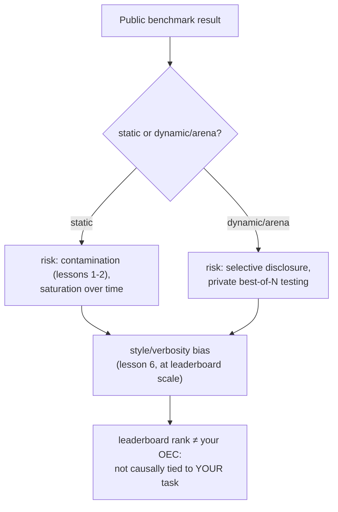

# Lección 18. Benchmarks públicos

**Vínculo con la misión:** Todo el arco de este espacio de trabajo ha ido construyendo hacia una sola cosa: un número que puedas defender tú mismo para el cambio de tu propio modelo. Un benchmark público o una tabla de clasificación ofrece un número que alguien más ya calculó, para un modelo que alguien más construyó, frente a usuarios que no son los tuyos. Esta lección trata de para qué sirve realmente ese número, de las formas concretas en que se manipula y de por qué la disciplina del OEC de la lección 15 dice que una posición en una tabla de clasificación no pasa la prueba que debe pasar una métrica de decisión real.
**Fuente principal:** [Paper: "The Leaderboard Illusion", Singh et al., 2025](https://arxiv.org/abs/2504.20879)
**Requisitos previos:** [Lección 6](0006-judge-bias-and-human-agreement.md), [Lección 15](0015-ab-tests-and-guardrail-metrics.md)

## Calentamiento

1. ▢ ¿Qué hace de una métrica un buen candidato a OEC, según la guía de Kohavi?

Comprobación

Tiene que ser movible, lo bastante sensible para cambiar dentro de un experimento factible, y estar conectada causalmente con el resultado que de verdad importa, no meramente correlacionada con él.

2. ▢ ¿Qué es el sesgo de verbosidad, y nombra una forma de mitigarlo en una configuración de LLM-as-judge?

Comprobación

La tendencia de un juez a preferir una respuesta más larga aunque la longitud extra no aporte nada frente a una más corta igual de correcta o más. Las mitigaciones incluyen instruir al juez de forma explícita para que no premie la longitud, o escribir criterios de calificación que nombren la corrección y la completitud en lugar de la longitud.

## Qué debes saber

### Un benchmark estático es una vara de medir fija y compartida, con todos los problemas de la lección 1 incorporados

Un benchmark público estático (un conjunto fijo de preguntas con respuestas correctas fijas) existe para dar a todo el campo un número comparable. Pero hereda exactamente los riesgos que ya cubrieron la lección 1 y la lección 2: las propias preguntas del benchmark pueden acabar rastreadas hacia los datos de preentrenamiento de un modelo posterior (contaminación), y un benchmark que ha sido el objetivo de suficiente ajuste durante suficiente tiempo tiende a la **saturación**, con modelos que llegan a una puntuación techo en él mientras siguen fallando el mismo tipo de tarea en el mundo real, porque el benchmark dejó de medir la habilidad de fondo y empezó a medir la familiaridad con el propio benchmark.

### Un benchmark dinámico al estilo de las arenas cambia un vector de manipulación por otro

Las arenas en vivo basadas en preferencias (un sitio público donde usuarios reales comparan las respuestas de dos modelos y votan) se construyeron específicamente para reducir el riesgo de contaminación que lleva un conjunto fijo de preguntas, ya que los prompts y las preferencias vienen del uso continuo y no de un conjunto estático que pueda congelarse. Pero "The Leaderboard Illusion" documenta un vector de manipulación distinto y serio que abre este diseño: proveedores que prueban muchas variantes privadas de un modelo sin lanzar antes de elegir cuál único resultado publicar. Sus propios hallazgos son concretos: el paper identifica 27 variantes privadas de LLM que Meta probó en la antesala del lanzamiento de Llama 4, y reporta que un pequeño número de proveedores grandes de modelos cerrados recibió una parte desproporcionada de los datos totales de comparación de la arena (un estimado del 19 al 20 por ciento cada uno para dos proveedores importantes, frente a aproximadamente el 30 por ciento compartido entre 83 modelos de pesos abiertos en conjunto). La divulgación selectiva, probar muchas variantes en privado y publicar solo la que mejor puntúa, convierte una tabla de clasificación exactamente en el tipo de objetivo que describe la ley de Goodhart: en cuanto una medida se convierte en algo contra lo que optimizar directamente, deja de medir de forma fiable aquello para lo que se construyó.

### El mismo sesgo de estilo que la lección 6 enseñó para una llamada de juez opera igual en toda una tabla de clasificación

La lección 6 cubrió el sesgo de verbosidad en una única comparación pareada de LLM-as-judge. El modo de fallo idéntico aparece a escala de tabla de clasificación con evaluadores humanos: cuando la propia investigación de una arena importante controló la longitud de la respuesta y el formato markdown (encabezados, texto en negrita, estructura de listas), las clasificaciones cambiaron de forma notable, con algunos modelos que bajaban y otros que subían una vez descontada la influencia del estilo. Esto confirma que el mecanismo de la lección 6 se generaliza más allá de un único prompt de juez: un proceso de calificación, ya sea un único juez LLM o miles de votantes humanos, puede premiar cómo está formateada una respuesta y su longitud, con independencia de si es realmente más correcta o más útil.

### Una posición en una tabla de clasificación no pasa la prueba del OEC que ya te dio la lección 15

La lección 15 nombró las dos propiedades que necesita una métrica de decisión real: tiene que ser movible y tiene que estar conectada causalmente con el resultado que de verdad importa. Una posición en una tabla de clasificación pública es movible, podría decirse que demasiado movible, dada una práctica documentada de probar variantes en privado hasta que una puntúa bien. Lo que le falta es la segunda propiedad para tu decisión concreta: agrega preferencias de muchos usuarios, tareas y casos de uso distintos que no son tus usuarios, tu tarea ni tu caso de uso, y (según los demás hallazgos de esta lección) puede que ni siquiera refleje la versión exacta del modelo que realmente te sirvieran. Una posición en una tabla de clasificación puede ser un primer filtro razonable para decidir qué modelos vale la pena evaluar más a fondo; no sustituye al número de go/no-go defendido, held-out y específico de la tarea hacia el que ha ido construyendo todo este espacio de trabajo.

## Práctica

1. ▢ Un modelo encabeza un benchmark público estático, y un análisis posterior encuentra que las preguntas exactas del benchmark aparecen en un rastreo web con el que se preentrenó el modelo. ¿Cómo llama a esto el vocabulario de la lección 1, y qué le hace al significado del benchmark?

Pista

Considera qué ocurre con las preguntas de un benchmark una vez que se rastrean hacia un gran rastreo de preentrenamiento.

Comprobación

Es contaminación de datos. Una vez que las propias preguntas de un benchmark (o paráfrasis cercanas) acaban en los datos de entrenamiento, una puntuación alta puede reflejar que el modelo ya había visto las preguntas, y no que posea la habilidad de fondo que el benchmark pretendía medir.

2. ▢ Un proveedor prueba 20 variantes privadas y sin lanzar de un modelo contra una arena de preferencias en vivo, y lanza públicamente solo la variante que mejor puntuó. ¿Cómo llama "The Leaderboard Illusion" a esta práctica, y qué ejemplo real concreto cita el paper?

Comprobación

Divulgación selectiva (probar varias variantes en privado y elegir qué puntuación publicar). El ejemplo concreto del propio paper es el de Meta, que probó 27 variantes privadas de LLM en la antesala del lanzamiento de Llama 4.

3. ▢ La propia investigación de una arena encuentra que controlar la longitud de la respuesta y el formato markdown cambia de forma notable la clasificación. ¿El modo de fallo de qué lección anterior confirma esto, solo que operando a otra escala?

Comprobación

El sesgo de verbosidad de la lección 6: un proceso de calificación (un único juez LLM allí, miles de votantes humanos de la arena aquí) puede premiar la longitud y el formato en lugar de la corrección o la utilidad reales, y el efecto aparece igual tanto si el evaluador es un modelo como si es toda una multitud.

4. ▢ Un equipo quiere saltarse la construcción de su propia eval y lanzar en cambio el modelo que encabece hoy una tabla de clasificación pública. ¿Qué dicen los criterios de OEC de la lección 15 que falta en esa decisión?

Comprobación

El requisito de conexión causal: una posición en una tabla de clasificación agrega preferencias de usuarios, tareas y casos de uso que no son los del equipo, así que un puesto alto no establece que el modelo sea realmente mejor para su tarea concreta. Además puede que ni siquiera refleje la versión exacta del modelo que les sirvieran, dadas las prácticas documentadas de divulgación selectiva. Una posición en una tabla de clasificación puede ser movible, pero la movilidad por sí sola no la convierte en un OEC válido para la decisión de otra persona.

5. ▢ ¿Qué afirmación describe correctamente cómo se relacionan los benchmarks públicos con la misión de este espacio de trabajo?

    - a) Una tabla de clasificación dinámica al estilo de las arenas es inmune a la manipulación, ya que usa preferencias de usuarios en vivo en lugar de un conjunto fijo de preguntas
    - b) Los benchmarks estáticos conllevan riesgo de contaminación y saturación, las arenas dinámicas conllevan riesgo de divulgación selectiva, ambos conllevan sesgo de estilo a escala, y una posición en una tabla de clasificación sigue sin pasar la prueba de conexión causal que necesita un OEC real para una decisión concreta
    - c) La posición de un modelo en una tabla de clasificación es un sustituto válido de una decisión de go/no-go específica de la tarea, ya que un tercero ya la ha medido con rigor
    - d) El sesgo de estilo y de verbosidad solo afecta a las configuraciones de un único LLM-as-judge, no a las arenas de preferencia humana a gran escala

Comprobación

**b)** Ese es el cuadro completo que establece esta lección. (a) es falsa: las arenas dinámicas cambian el riesgo de contaminación por un riesgo documentado de divulgación selectiva. (c) es falsa: una posición en una tabla de clasificación no está ligada causalmente a la propia tarea o los propios usuarios de un equipo concreto, que es exactamente lo que exige un OEC. (d) es falsa: la propia investigación de una arena encontró que el sesgo de estilo desplaza las clasificaciones a escala completa de tabla de clasificación, no solo en una única llamada de juez.

## Prácticas en el mundo real

- [ ] Para un modelo que estés considerando adoptar, comprueba si su posición en la tabla de clasificación viene de un benchmark estático o de una arena dinámica, y si alguna de las dos fuentes divulga algo sobre comprobaciones de contaminación o pruebas privadas previas al lanzamiento.
- [ ] Si el modelo que estás considerando tiene un puesto listado en una arena, comprueba si hay una clasificación con control de estilo disponible para la misma tabla y mira si su posición cambia.
- [ ] Mañana: lee completa la fuente primaria y anota qué remedios propone para la asimetría de acceso a datos que documenta entre proveedores cerrados y de pesos abiertos.

## Para profundizar

- [Paper: "The Leaderboard Illusion", Singh et al., 2025](https://arxiv.org/abs/2504.20879)
- [Article: "Does Style Matter?", LMArena](https://lmarena.ai/blog/style-control)
- [Recursos](../RESOURCES.md)

---

¿No termina de quedar claro? Vuelve a leer la fuente primaria de arriba, ya que esta lección la comprime y en la compresión es donde se escapa la comprensión. Consulta el [glosario](../GLOSSARY.md) por si algún término te resultó resbaladizo.

Si lo poco claro es la propia lección y no el material, eso es un defecto: [abre un issue](https://github.com/TokenCemetery/teach/issues).
