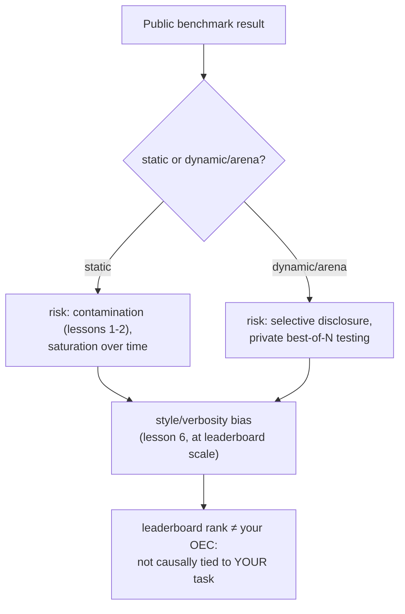

# Leçon 18. Benchmarks publics

**Lien avec la mission :** Tout l'arc de cet espace de travail a tendu vers une seule chose : un chiffre que vous pouvez défendre personnellement pour votre propre modification de modèle. Un benchmark public ou un classement offre un chiffre que quelqu'un d'autre a déjà calculé, pour un modèle que quelqu'un d'autre a construit, face à des utilisateurs qui ne sont pas les vôtres. Cette leçon porte sur ce à quoi sert réellement ce chiffre, sur les manières précises dont il est manipulé, et sur la raison pour laquelle la discipline de l'OEC de la leçon 15 dit qu'un rang de classement échoue au test qu'une vraie métrique de décision doit passer.
**Source primaire :** [Article : "The Leaderboard Illusion", Singh et al., 2025](https://arxiv.org/abs/2504.20879)
**Prérequis :** [Leçon 6](0006-judge-bias-and-human-agreement.md), [Leçon 15](0015-ab-tests-and-guardrail-metrics.md)

## Échauffement

1. ▢ Qu'est-ce qui fait d'une métrique un bon candidat d'OEC, selon les conseils de Kohavi ?

Vérifier

Elle doit être mobile, assez sensible pour changer dans une expérience réalisable, et liée causalement au résultat qui compte vraiment, pas seulement corrélée à lui.

2. ▢ Qu'est-ce que le biais de verbosité, et citez une façon de l'atténuer dans un dispositif LLM-as-judge ?

Vérifier

La tendance d'un juge à préférer une réponse plus longue même quand la longueur supplémentaire n'apporte rien par rapport à une réponse plus courte tout aussi juste, voire davantage. Les atténuations comprennent une consigne explicite au juge de ne pas récompenser la longueur, ou des critères de notation qui nomment la justesse et l'exhaustivité plutôt que la longueur.

## À savoir

### Un benchmark statique est un étalon fixe et partagé, avec tous les problèmes de la leçon 1 intégrés

Un benchmark public statique (un jeu fixe de questions aux réponses correctes fixes) existe pour donner à tout le domaine un chiffre comparable. Mais il hérite exactement des risques que les leçons 1 et 2 ont déjà couverts : les questions du benchmark peuvent finir aspirées dans les données de pré-entraînement d'un modèle ultérieur (contamination), et un benchmark qui a été la cible d'assez de réglages sur assez de temps tend vers la **saturation**, les modèles atteignant un score plafond dessus tout en échouant encore sur le même type de tâche en situation réelle, parce que le benchmark a cessé de mesurer la compétence sous-jacente pour mesurer la familiarité avec le benchmark lui-même.

### Un benchmark dynamique de type arène échange un vecteur de manipulation contre un autre

Les arènes dynamiques fondées sur la préférence (un site public où de vrais utilisateurs comparent les réponses de deux modèles et votent) ont été conçues précisément pour réduire le risque de contamination que porte un jeu de questions fixe, puisque les prompts et les préférences proviennent d'un usage continu plutôt que d'un ensemble statique et figeable. Mais « The Leaderboard Illusion » documente un autre vecteur de manipulation, sérieux, qu'ouvre cette conception : des fournisseurs qui testent de nombreuses variantes privées d'un modèle non publié avant de choisir l'unique résultat à publier. Ses propres constats sont concrets : le papier identifie 27 variantes privées de LLM que Meta a testées en amont de la sortie de Llama 4, et rapporte qu'un petit nombre de grands fournisseurs de modèles fermés ont reçu une part disproportionnée de l'ensemble des données de comparaison de l'arène (environ 19 à 20 % chacun pour deux grands fournisseurs, contre environ 30 % partagés entre 83 modèles à poids ouverts réunis). La divulgation sélective, tester de nombreuses variantes en privé et ne publier que la mieux notée, transforme un classement en exactement le genre de cible que décrit la loi de Goodhart : dès qu'une mesure devient quelque chose que l'on optimise directement, elle cesse de mesurer de façon fiable ce pour quoi elle avait été construite.

### Le même biais de style que la leçon 6 a enseigné pour un appel de juge opère à l'identique sur tout un classement

La leçon 6 a couvert le biais de verbosité dans une seule comparaison par paires d'un LLM-as-judge. Le même mode de défaillance apparaît à l'échelle d'un classement avec des annotateurs humains à la place : quand la propre recherche d'une grande arène a contrôlé la longueur des réponses et la mise en forme markdown (titres, texte en gras, structure de listes), les classements ont sensiblement changé, certains modèles reculant et d'autres progressant une fois l'influence du style neutralisée. Cela confirme que le mécanisme de la leçon 6 se généralise au-delà d'un seul prompt de juge : un processus de notation, qu'il s'agisse d'un seul juge LLM ou de milliers de votants humains, peut récompenser la mise en forme d'une réponse et sa longueur, indépendamment du fait qu'elle soit réellement plus juste ou plus utile.

### Un rang de classement échoue au test de l'OEC que la leçon 15 vous a déjà donné

La leçon 15 a nommé les deux propriétés dont une vraie métrique de décision a besoin : elle doit être mobile, et liée causalement au résultat qui compte vraiment. Un rang de classement public est mobile, sans doute trop mobile, vu la pratique documentée de tester des variantes en privé jusqu'à ce que l'une obtienne un bon score. Ce qui lui manque, c'est la seconde propriété pour votre décision précise : il agrège des préférences issues de nombreux utilisateurs, tâches et cas d'usage qui ne sont ni vos utilisateurs, ni votre tâche, ni votre cas d'usage, et (d'après les autres constats de cette leçon) peut ne même pas refléter la version exacte du modèle qui vous serait réellement servie. Une position dans un classement peut être un premier filtre raisonnable pour savoir quels modèles valent d'être évalués plus avant ; ce n'est pas un substitut au chiffre de go/no-go défendu, held-out et propre à la tâche, vers lequel tend tout cet espace de travail.

## Pratique

1. ▢ Un modèle domine un benchmark public statique, et une analyse ultérieure constate que les questions exactes du benchmark apparaissent dans un crawl du web sur lequel le modèle a été pré-entraîné. Comment le vocabulaire de la leçon 1 appelle-t-il cela, et qu'est-ce que cela fait à la signification du benchmark ?

Indice

Demandez-vous ce qui arrive aux questions d'un benchmark une fois aspirées dans un grand crawl de pré-entraînement.

Vérifier

C'est de la contamination des données. Une fois que les propres questions d'un benchmark (ou des paraphrases proches) se retrouvent dans les données d'entraînement, un score élevé peut refléter que le modèle a déjà vu les questions plutôt qu'il possède la compétence sous-jacente que le benchmark devait mesurer.

2. ▢ Un fournisseur teste 20 variantes privées, non publiées, d'un modèle sur une arène de préférence en direct, et ne publie que la variante qui a obtenu le meilleur score. Comment « The Leaderboard Illusion » appelle-t-il cette pratique, et quel exemple réel précis le papier cite-t-il ?

Vérifier

La divulgation sélective (tester plusieurs variantes en privé et choisir quel score publier). L'exemple concret du papier est Meta qui teste 27 variantes privées de LLM en amont de la sortie de Llama 4.

3. ▢ La propre recherche d'une arène constate que contrôler la longueur des réponses et la mise en forme markdown change sensiblement le classement. Le mode de défaillance de quelle leçon précédente cela confirme-t-il, simplement à une autre échelle ?

Vérifier

Le biais de verbosité de la leçon 6 : un processus de notation (un seul juge LLM là, des milliers de votants humains de l'arène ici) peut récompenser la longueur et la mise en forme plutôt que la justesse ou l'utilité réelles, et l'effet apparaît à l'identique que l'annotateur soit un seul modèle ou toute une foule.

4. ▢ Une équipe veut sauter la construction de sa propre eval et livrer à la place le modèle qui domine actuellement un classement public. Que manque-t-il à cette décision selon les critères d'OEC de la leçon 15 ?

Vérifier

L'exigence de lien causal : un rang de classement agrège des préférences issues d'utilisateurs, de tâches et de cas d'usage qui ne sont pas ceux de l'équipe, donc un rang élevé n'établit pas que le modèle est réellement meilleur pour sa tâche précise. Il peut aussi ne même pas refléter la version exacte du modèle qui lui serait servie, vu les pratiques documentées de divulgation sélective. Un rang de classement peut être mobile, mais la mobilité seule n'en fait pas un OEC valide pour la décision de quelqu'un d'autre.

5. ▢ Laquelle de ces affirmations décrit correctement le lien entre benchmarks publics et mission de cet espace de travail ?

    - a) Un classement dynamique de type arène est à l'abri de la manipulation puisqu'il utilise des préférences d'utilisateurs en direct au lieu d'un jeu de questions fixe
    - b) Les benchmarks statiques portent un risque de contamination et de saturation, les arènes dynamiques un risque de divulgation sélective, les deux portent un biais de style à grande échelle, et un rang de classement échoue quand même au test de lien causal dont un vrai OEC a besoin pour une décision précise
    - c) Le rang d'un modèle dans un classement est un substitut valide à un go/no-go propre à la tâche, puisqu'il a déjà été mesuré rigoureusement par un tiers
    - d) Les biais de style et de verbosité ne touchent que les dispositifs à juge LLM unique, pas les arènes de préférence humaine à grande échelle

Vérifier

**b)** C'est le tableau complet qu'établit cette leçon. (a) est faux : les arènes dynamiques échangent le risque de contamination contre un risque documenté de divulgation sélective. (c) est faux : un rang de classement n'est pas lié causalement à la tâche ou aux utilisateurs propres d'une équipe précise, ce qu'un OEC exige précisément. (d) est faux : la propre recherche d'une arène a constaté que le biais de style déplace les classements à l'échelle complète d'un classement, pas seulement dans un appel de juge unique.

## Exercices en situation réelle

- [ ] Pour un modèle que vous envisagez d'adopter, vérifiez si sa position dans un classement provient d'un benchmark statique ou d'une arène dynamique, et si l'une ou l'autre source divulgue quoi que ce soit sur des contrôles de contamination ou des tests privés avant publication.
- [ ] Si le modèle que vous envisagez a un rang d'arène affiché, vérifiez si un classement à style contrôlé est disponible pour le même classement, et regardez si sa position change.
- [ ] Demain : lisez la source primaire en entier, et notez quels remèdes elle propose pour l'asymétrie d'accès aux données qu'elle documente entre fournisseurs fermés et fournisseurs à poids ouverts.

## Pour aller plus loin

- [Article : "The Leaderboard Illusion", Singh et al., 2025](https://arxiv.org/abs/2504.20879)
- [Article : "Does Style Matter?", LMArena](https://lmarena.ai/blog/style-control)
- [Ressources](../RESOURCES.md)

---

Ça ne passe pas ? Relisez la source primaire en haut de page, car cette leçon la condense et c'est dans la condensation que la compréhension s'échappe. Consultez le [glossaire](../GLOSSARY.md) pour tout terme qui vous a paru glissant.

Si c'est la leçon elle-même qui n'est pas claire plutôt que la matière, c'est un défaut : [ouvrez une issue](https://github.com/TokenCemetery/teach/issues).
