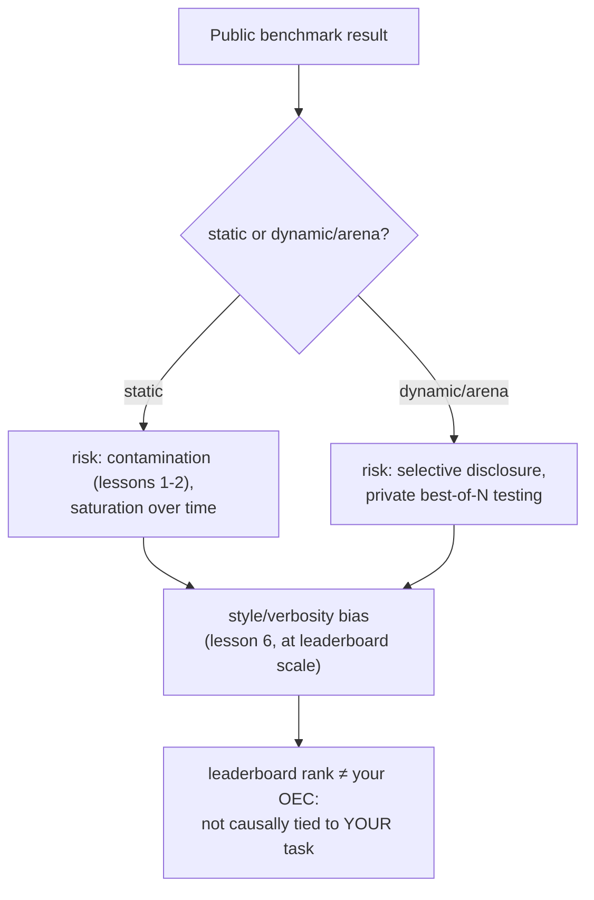

# पाठ 18. Public Benchmarks

**मिशन से संबंध:** इस workspace की पूरी रूपरेखा एक ही चीज़ की ओर बनती रही है: ऐसी संख्या जिसका बचाव आप अपने model बदलाव के लिए ख़ुद कर सकें। Public benchmark या leaderboard ऐसी संख्या देता है जिसे कोई और पहले ही निकाल चुका है, किसी और के बनाए model के लिए, उन उपयोगकर्ताओं के विरुद्ध जो आपके नहीं हैं। यह पाठ इस बारे में है कि वह संख्या असल में किसलिए है, उसमें किन ख़ास तरीक़ों से गड़बड़ी की जाती है, और पाठ 15 का OEC अनुशासन क्यों कहता है कि leaderboard rank उस कसौटी पर विफल होती है जिसे असली फ़ैसले की metric को पार करना होता है।
**मुख्य स्रोत:** [पेपर: "The Leaderboard Illusion", Singh et al., 2025](https://arxiv.org/abs/2504.20879)
**पूर्व-आवश्यकताएँ:** [पाठ 6](0006-judge-bias-and-human-agreement.md), [पाठ 15](0015-ab-tests-and-guardrail-metrics.md)

## वार्म-अप

1. ▢ Kohavi के मार्गदर्शन के अनुसार metric को अच्छा OEC उम्मीदवार क्या बनाता है?

जाँचें

वह हिलाने लायक होनी चाहिए, इतनी संवेदनशील कि व्यावहारिक experiment में खिसक जाए, और उस नतीजे से कारण के रूप में जुड़ी होनी चाहिए जो सचमुच मायने रखता है, सिर्फ़ उसके साथ correlated नहीं।

2. ▢ Verbosity bias क्या है, और LLM-as-judge setup में उसे घटाने का एक तरीक़ा बताएँ?

जाँचें

Judge की यह प्रवृत्ति कि वह लंबा response पसंद करे, तब भी जब अतिरिक्त लंबाई उतने ही या ज़्यादा सही, छोटे response से कुछ नहीं जोड़ती। घटाने के तरीक़ों में शामिल हैं judge को साफ़ निर्देश देना कि लंबाई को इनाम न दे, या grading कसौटियाँ ऐसी लिखना जो लंबाई के बजाय correctness और completeness का नाम लें।

## यह जानें

### Static benchmark तय, साझा मापने की छड़ी है, जिसमें पाठ 1 की सारी समस्याएँ पहले से मौजूद हैं

Static public benchmark (तय सही उत्तरों वाले सवालों का तय सेट) पूरे क्षेत्र को एक तुलनीय संख्या देने के लिए होता है। पर वह वही जोखिम विरासत में पाता है जो पाठ 1 और पाठ 2 पहले कवर कर चुके हैं: benchmark के अपने सवाल बाद के किसी model के pretraining data में scrape हो सकते हैं (contamination), और जिस benchmark को काफ़ी लंबे समय तक काफ़ी tuning का निशाना बनाया गया हो वह **saturation** की ओर बढ़ता है, यानी models उस पर छत वाले score तक पहुँच जाते हैं जबकि असली दुनिया में उसी तरह के task पर फिर भी चूकते हैं, क्योंकि benchmark ने मूल कौशल को मापना बंद करके benchmark से ही परिचय को मापना शुरू कर दिया।

### Dynamic, arena-शैली का benchmark गड़बड़ी का एक रास्ता दूसरे से बदलता है

Live, पसंद-आधारित arenas (public site जहाँ असली उपयोगकर्ता दो models के responses की तुलना करके वोट देते हैं) ख़ास तौर पर उस contamination जोखिम को घटाने के लिए बने थे जो तय सवाल-सेट में होता है, क्योंकि prompts और पसंद चल रहे इस्तेमाल से आते हैं, किसी स्थिर, जमाए जा सकने वाले सेट से नहीं। पर "The Leaderboard Illusion" इस डिज़ाइन से खुलने वाला अलग, गंभीर gaming रास्ता दर्ज करता है: providers का किसी अप्रकाशित model के कई निजी variants को परखना, इससे पहले कि वे चुनें कि कौन-सा अकेला नतीजा प्रकाशित करना है। उसके अपने निष्कर्ष ठोस हैं: पेपर Llama 4 जारी होने की तैयारी में Meta द्वारा परखे गए 27 निजी LLM variants की पहचान करता है, और बताता है कि मुट्ठी-भर बड़े, closed-model providers को arena के कुल तुलना data का अनुपात से कहीं ज़्यादा हिस्सा मिला (दो बड़े providers के लिए अनुमानित 19 से 20 प्रतिशत हर एक को, जबकि 83 open-weight models को मिलाकर साझा लगभग 30 प्रतिशत)। Selective disclosure, यानी कई variants को निजी तौर पर परखना और सिर्फ़ सबसे ऊँचे score वाला प्रकाशित करना, leaderboard को ठीक वैसा लक्ष्य बना देता है जिसका वर्णन Goodhart का नियम करता है: जब कोई माप सीधे उसके विरुद्ध optimize करने की चीज़ बन जाती है, तो वह जिस चीज़ को मापने के लिए बनी थी उसे भरोसे से मापना बंद कर देती है।

### पाठ 6 ने जो style bias एक judge call के लिए सिखाया, वही पूरे leaderboard पर एक जैसा काम करता है

पाठ 6 ने एक अकेली LLM-as-judge pairwise तुलना में verbosity bias कवर किया था। वही विफलता का तरीक़ा leaderboard के पैमाने पर मानव raters के साथ दिखता है: जब किसी बड़े arena के अपने शोध ने response की लंबाई और markdown formatting (headers, bold text, list संरचना) को नियंत्रित किया, तो rankings में ठोस बदलाव आए, style का प्रभाव हटाने पर कुछ models गिरे और कुछ चढ़े। यह पुष्टि करता है कि पाठ 6 की क्रियाविधि एक अकेले judge prompt से आगे भी लागू होती है: rating की प्रक्रिया, चाहे एक LLM judge हो या हज़ारों मानव वोटर, इस बात को इनाम दे सकती है कि उत्तर का format कैसा है और वह कितना लंबा है, इससे स्वतंत्र कि वह सचमुच ज़्यादा सही या ज़्यादा उपयोगी है या नहीं।

### Leaderboard rank उस OEC जाँच में विफल होती है जो पाठ 15 आपको पहले ही दे चुका है

पाठ 15 ने वे दो गुण बताए जो असली फ़ैसले की metric को चाहिए: वह हिलाने लायक होनी चाहिए, और उस नतीजे से कारण के रूप में जुड़ी होनी चाहिए जो सचमुच मायने रखता है। Public leaderboard rank हिलाने लायक है, शायद ज़रूरत से ज़्यादा, इस दर्ज प्रथा को देखते हुए कि कोई एक अच्छा score न दे तब तक variants को निजी तौर पर परखा जाता है। जो उसमें नहीं है वह आपके ख़ास फ़ैसले के लिए दूसरा गुण है: वह उन अनेक अलग उपयोगकर्ताओं, tasks और use cases की पसंद को जोड़ती है जो आपके उपयोगकर्ता, आपका task या आपका use case नहीं हैं, और (इस पाठ के दूसरे निष्कर्षों के अनुसार) शायद उस सटीक model version को भी न दर्शाए जो आपको असल में serve होगा। Leaderboard की स्थिति इस बात का उचित पहला छन्ना हो सकती है कि आगे किन models को परखना है; वह उस बचाव की गई, held-out, task-specific go/no-go संख्या का विकल्प नहीं है जिसकी ओर यह पूरा workspace बनता रहा है।

## अभ्यास

1. ▢ कोई model static public benchmark में सबसे ऊपर आता है, और बाद का विश्लेषण पाता है कि benchmark के सटीक सवाल उस web crawl में हैं जिस पर model को pretrain किया गया था। पाठ 1 की शब्दावली इसे क्या कहती है, और यह benchmark के मतलब का क्या करता है?

संकेत

सोचें कि benchmark के सवाल बड़े pretraining crawl में scrape हो जाने पर क्या होता है।

जाँचें

यह data contamination है। Benchmark के अपने सवाल (या उनके क़रीबी paraphrases) training data में पहुँच जाने पर, ऊँचा score इस बात को दर्शा सकता है कि model ने सवाल पहले देखे थे, न कि इस बात को कि उसके पास वह मूल कौशल है जिसे benchmark मापने के लिए बना था।

2. ▢ एक provider किसी model के 20 निजी, अप्रकाशित variants को live preference arena के विरुद्ध परखता है, और सिर्फ़ उस अकेले variant को सार्वजनिक रूप से जारी करता है जिसने सबसे अच्छा score किया। "The Leaderboard Illusion" इस प्रथा को क्या कहता है, और पेपर कौन-सा ख़ास असली उदाहरण cite करता है?

जाँचें

Selective disclosure (कई variants को निजी तौर पर परखना और चुनना कि कौन-सा score प्रकाशित करना है)। पेपर का अपना ठोस उदाहरण Llama 4 की release से पहले Meta द्वारा 27 निजी LLM variants को परखना है।

3. ▢ किसी arena का अपना शोध पाता है कि response की लंबाई और markdown formatting को नियंत्रित करने से leaderboard ranking में ठोस बदलाव आता है। यह किस पहले पाठ की विफलता के तरीक़े की पुष्टि करता है, बस अलग पैमाने पर काम करते हुए?

जाँचें

पाठ 6 का verbosity bias: rating की प्रक्रिया (वहाँ एक अकेला LLM judge, यहाँ हज़ारों मानव arena वोटर) असली correctness या उपयोगिता के बजाय लंबाई और formatting को इनाम दे सकती है, और असर उतना ही एक जैसा दिखता है चाहे rater एक model हो या पूरी भीड़।

4. ▢ एक टीम अपना eval बनाना छोड़कर बस वही model ship करना चाहती है जो अभी public leaderboard में सबसे ऊपर है। पाठ 15 की OEC कसौटियाँ कहती हैं कि उस फ़ैसले में क्या छूटा है?

जाँचें

कारणात्मक संबंध की ज़रूरत: leaderboard rank उन उपयोगकर्ताओं, tasks और use cases की पसंद जोड़ती है जो टीम के अपने नहीं हैं, इसलिए ऊँची rank यह स्थापित नहीं करती कि model उनके ख़ास task के लिए असल में बेहतर है। दर्ज selective-disclosure प्रथाओं को देखते हुए, वह शायद उस सटीक model version को भी न दर्शाए जो उन्हें serve होगा। Leaderboard rank हिलाने लायक हो सकती है, पर अकेली हिलने की क्षमता उसे किसी और के फ़ैसले के लिए वैध OEC नहीं बनाती।

5. ▢ Public benchmarks इस workspace के मिशन से कैसे जुड़ते हैं, इसका सही वर्णन कौन-सा दावा करता है?

    - a) Dynamic, arena-शैली का leaderboard gaming से मुक्त है, क्योंकि वह तय सवाल-सेट के बजाय live उपयोगकर्ता पसंद इस्तेमाल करता है
    - b) Static benchmarks में contamination और saturation का जोखिम है, dynamic arenas में selective-disclosure का जोखिम है, दोनों में बड़े पैमाने पर style bias है, और leaderboard rank फिर भी उस कारणात्मक-संबंध वाली जाँच में विफल होती है जो किसी ख़ास फ़ैसले के लिए असली OEC को चाहिए
    - c) Model की leaderboard rank task-specific go/no-go फ़ैसले की वैध जगह है, क्योंकि उसे किसी तीसरे पक्ष ने पहले ही कठोरता से मापा है
    - d) Style और verbosity bias सिर्फ़ अकेले LLM-as-judge setups को प्रभावित करते हैं, बड़े पैमाने के human-preference arenas को नहीं

जाँचें

**b)** यही वह पूरी तस्वीर है जो यह पाठ स्थापित करता है। (a) ग़लत है: dynamic arenas contamination के जोखिम की जगह दर्ज selective-disclosure का जोखिम ले आते हैं। (c) ग़लत है: leaderboard rank किसी टीम के अपने task या उपयोगकर्ताओं से कारण के रूप में नहीं बँधी, जो ठीक वही है जो OEC को चाहिए। (d) ग़लत है: किसी arena के अपने शोध ने पाया कि style bias पूरे leaderboard के पैमाने पर rankings बदलता है, सिर्फ़ एक judge call में नहीं।

## असली दुनिया का अभ्यास

- [ ] जिस model को आप अपनाने पर विचार कर रहे हैं, उसके लिए जाँचें कि उसकी leaderboard स्थिति static benchmark से आती है या dynamic arena से, और क्या दोनों में से कोई स्रोत contamination जाँचों या निजी pre-release परीक्षण के बारे में कुछ बताता है।
- [ ] अगर आप जिस model पर विचार कर रहे हैं उसकी arena rank सूचीबद्ध है, तो जाँचें कि उसी leaderboard के लिए style-नियंत्रित ranking उपलब्ध है या नहीं, और देखें कि उसकी स्थिति बदलती है या नहीं।
- [ ] कल: मुख्य स्रोत पूरा पढ़ें, और लिखें कि closed और open-weight providers के बीच जिस data-पहुँच की असमानता को वह दर्ज करता है उसके लिए वह कौन-से उपाय सुझाता है।

## आगे बढ़ने के लिए

- [पेपर: "The Leaderboard Illusion", Singh et al., 2025](https://arxiv.org/abs/2504.20879)
- [लेख: "Does Style Matter?", LMArena](https://lmarena.ai/blog/style-control)
- [संसाधन](../RESOURCES.md)

---

बात नहीं बन रही? ऊपर दिए primary source को दोबारा पढ़ें, क्योंकि यह पाठ उसे संक्षिप्त करता है और समझ संक्षेप में ही रिसती है। जो शब्द फिसलन भरा लगे, उसके लिए [शब्दावली](../GLOSSARY.md) देखें।

अगर दिक़्क़त सामग्री की नहीं बल्कि पाठ की ही है, तो वह एक खोट है: [issue खोलें](https://github.com/TokenCemetery/teach/issues)।
