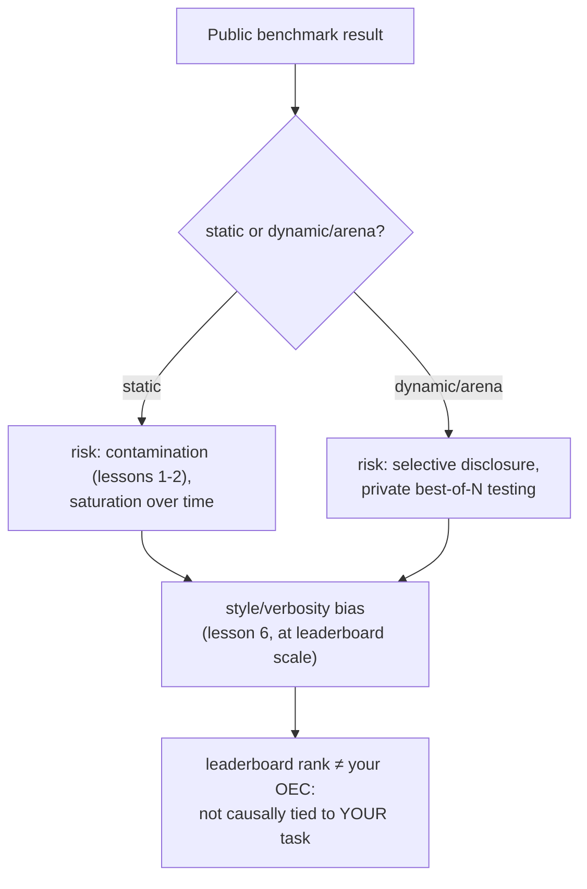

# Lição 18. Benchmarks públicos

**Ligação com a missão:** Todo o arco deste workspace vem sendo construído para uma coisa: um número que você possa defender pessoalmente para a sua própria mudança no modelo. Um benchmark ou leaderboard público oferece um número que outra pessoa já calculou, para um modelo que outra pessoa construiu, contra usuários que não são os seus. Esta lição trata do para que esse número realmente serve, das formas específicas como ele é manipulado e de por que a disciplina de OEC da lição 15 diz que uma posição em leaderboard falha no teste que uma métrica de decisão de verdade precisa passar.
**Fonte principal:** [Artigo científico: "The Leaderboard Illusion", Singh et al., 2025](https://arxiv.org/abs/2504.20879)
**Pré-requisitos:** [Lição 6](0006-judge-bias-and-human-agreement.md), [Lição 15](0015-ab-tests-and-guardrail-metrics.md)

## Aquecimento

1. ▢ O que faz de uma métrica um bom candidato a OEC, segundo a orientação de Kohavi?

Verificação

Ela precisa ser movível, sensível o bastante para se deslocar dentro de um experimento viável, e causalmente ligada ao resultado que de fato importa, e não apenas correlacionada com ele.

2. ▢ O que é o viés de verbosidade, e cite uma forma de mitigá-lo em uma configuração de LLM-as-judge.

Verificação

A tendência de um juiz a preferir uma resposta mais longa, mesmo quando o comprimento extra não acrescenta nada em relação a uma resposta mais curta igualmente correta, ou mais. As mitigações incluem instruir o juiz explicitamente a não premiar o comprimento, ou escrever critérios de avaliação que nomeiem a correção e a completude, e não o comprimento.

## Saiba isto

### Um benchmark estático é uma régua fixa e compartilhada, com todos os problemas da lição 1 embutidos

Um benchmark público estático (um conjunto fixo de perguntas com respostas corretas fixas) existe para dar a toda a área um número comparável. Mas ele herda exatamente os riscos que a lição 1 e a lição 2 já cobriram: as próprias perguntas do benchmark podem acabar raspadas para dentro dos dados de pré-treinamento de um modelo posterior (contaminação), e um benchmark que foi alvo de ajuste suficiente por tempo suficiente tende à **saturação**, com modelos chegando a uma pontuação-teto nele enquanto continuam falhando no mesmo tipo de tarefa no mundo real, porque o benchmark deixou de medir a habilidade de fundo e passou a medir a familiaridade com o próprio benchmark.

### Um benchmark dinâmico, no estilo de arena, troca um vetor de manipulação por outro

As arenas dinâmicas baseadas em preferência (um site público em que usuários reais comparam as respostas de dois modelos e votam) foram construídas especificamente para reduzir o risco de contaminação que um conjunto fixo de perguntas carrega, já que os prompts e as preferências vêm de uso contínuo, e não de um conjunto estático e congelável. Mas o "The Leaderboard Illusion" documenta um outro vetor de manipulação, sério, que esse design abre: provedores testando muitas variantes privadas de um modelo não lançado antes de escolher qual único resultado publicar. Os resultados do próprio artigo são concretos: ele identifica 27 variantes privadas de LLM que a Meta testou na corrida para lançar o Llama 4, e reporta que um pequeno número de grandes provedores de modelos fechados recebeu uma parcela desproporcional do total de dados de comparação da arena (uma estimativa de 19 a 20 por cento cada para dois grandes provedores, contra cerca de 30 por cento compartilhados entre 83 modelos de pesos abertos combinados). A divulgação seletiva, testar muitas variantes em privado e publicar apenas a de melhor pontuação, transforma um leaderboard exatamente no tipo de alvo que a Lei de Goodhart descreve: quando uma medida passa a ser algo contra o qual se otimiza diretamente, ela deixa de medir com confiabilidade aquilo que foi construída para medir.

### O mesmo viés de estilo que a lição 6 ensinou para uma chamada de juiz opera de forma idêntica em um leaderboard inteiro

A lição 6 cobriu o viés de verbosidade em uma única comparação pairwise de LLM-as-judge. O modo de falha idêntico aparece em escala de leaderboard com avaliadores humanos: quando a própria pesquisa de uma grande arena controlou o comprimento da resposta e a formatação em markdown (cabeçalhos, negrito, estrutura de listas), os rankings mudaram de forma significativa, com alguns modelos caindo e outros subindo depois de fatorada a influência do estilo. Isso confirma que o mecanismo da lição 6 se generaliza para além de um único prompt de juiz: um processo de avaliação, seja um juiz LLM ou milhares de votantes humanos, pode premiar como uma resposta é formatada e quão longa ela é, independentemente de ela ser de fato mais correta ou mais útil.

### Uma posição em leaderboard falha no teste do OEC que a lição 15 já lhe deu

A lição 15 nomeou as duas propriedades de que uma métrica de decisão de verdade precisa: ser movível e ser causalmente ligada ao resultado que de fato importa. Uma posição em leaderboard público é movível, talvez movível demais, dada a prática documentada de testar variantes em privado até uma pontuar bem. O que lhe falta é a segunda propriedade para a sua decisão específica: ela agrega preferências de muitos usuários, tarefas e casos de uso diferentes que não são os seus usuários, a sua tarefa nem o seu caso de uso e (segundo os outros achados desta lição) pode nem refletir a versão exata do modelo que você de fato receberia. Uma posição em leaderboard pode ser um primeiro filtro razoável para saber quais modelos valem uma avaliação mais profunda; não substitui o número de go/no-go defendido, held-out e específico da tarefa que todo este workspace vem construindo.

## Prática

1. ▢ Um modelo lidera um benchmark público estático, e uma análise posterior descobre que as perguntas exatas do benchmark aparecem em um web crawl com que o modelo foi pré-treinado. Como o vocabulário da lição 1 chama isso, e o que isso faz com o significado do benchmark?

Dica

Considere o que acontece com as perguntas de um benchmark quando elas são raspadas para dentro de um grande crawl de pré-treinamento.

Verificação

Isso é contaminação de dados. Quando as próprias perguntas de um benchmark (ou paráfrases próximas) acabam nos dados de treinamento, uma pontuação alta pode refletir o modelo ter visto as perguntas antes, e não possuir a habilidade de fundo que o benchmark pretendia medir.

2. ▢ Um provedor testa 20 variantes privadas e não lançadas de um modelo contra uma arena de preferência ao vivo e lança publicamente apenas a variante que pontuou melhor. Como o "The Leaderboard Illusion" chama essa prática, e que exemplo real específico o artigo cita?

Verificação

Divulgação seletiva (testar várias variantes em privado e escolher qual pontuação publicar). O exemplo concreto do próprio artigo é a Meta testando 27 variantes privadas de LLM na corrida para o lançamento do Llama 4.

3. ▢ A própria pesquisa de uma arena descobre que controlar o comprimento da resposta e a formatação em markdown muda o ranking do leaderboard de forma significativa. Que modo de falha de uma lição anterior isso confirma, apenas operando em outra escala?

Verificação

O viés de verbosidade da lição 6: um processo de avaliação (um único juiz LLM ali, milhares de votantes humanos da arena aqui) pode premiar comprimento e formatação em vez de correção ou utilidade reais, e o efeito aparece de forma idêntica quer o avaliador seja um modelo ou uma multidão inteira.

4. ▢ Uma equipe quer pular a construção do seu próprio eval e lançar o modelo que estiver no topo de um leaderboard público no momento. O que os critérios de OEC da lição 15 dizem que falta a essa decisão?

Verificação

O requisito de ligação causal: uma posição em leaderboard agrega preferências de usuários, tarefas e casos de uso que não são os da equipe, então uma posição alta não estabelece que o modelo é de fato melhor para a tarefa específica dela. Ela pode nem refletir a versão exata do modelo que seria servida, dadas as práticas documentadas de divulgação seletiva. Uma posição em leaderboard pode ser movível, mas só a capacidade de se mover não a torna um OEC válido para a decisão de outra pessoa.

5. ▢ Qual afirmação descreve corretamente como os benchmarks públicos se relacionam com a missão deste workspace?

    - a) Um leaderboard dinâmico, no estilo de arena, é imune à manipulação, já que usa preferências de usuários ao vivo em vez de um conjunto fixo de perguntas
    - b) Benchmarks estáticos carregam risco de contaminação e saturação, arenas dinâmicas carregam risco de divulgação seletiva, ambos carregam viés de estilo em escala, e uma posição em leaderboard ainda falha no teste de ligação causal de que um OEC de verdade precisa para uma decisão específica
    - c) A posição de um modelo em um leaderboard é um substituto válido para uma decisão de go/no-go específica da tarefa, já que já foi medida com rigor por um terceiro
    - d) O viés de estilo e de verbosidade só afeta configurações de juiz LLM único, não arenas de preferência humana em larga escala

Verificação

**b)** Esse é o quadro completo que esta lição estabelece. (a) é falsa: as arenas dinâmicas trocam o risco de contaminação por um risco documentado de divulgação seletiva. (c) é falsa: uma posição em leaderboard não é causalmente ligada à tarefa nem aos usuários específicos de uma equipe, que é exatamente o que um OEC exige. (d) é falsa: a própria pesquisa de uma arena descobriu que o viés de estilo desloca os rankings em escala plena de leaderboard, e não só em uma única chamada de juiz.

## Prática no mundo real

- [ ] Para um modelo que você está considerando adotar, verifique se a posição dele em leaderboard vem de um benchmark estático ou de uma arena dinâmica, e se alguma das fontes divulga algo sobre verificações de contaminação ou testes privados pré-lançamento.
- [ ] Se o modelo que você está considerando tem uma posição de arena listada, verifique se existe um ranking com controle de estilo para o mesmo leaderboard e veja se a posição dele muda.
- [ ] Amanhã: leia a fonte principal por inteiro e anote que remédios ela propõe para a assimetria de acesso a dados que documenta entre provedores fechados e de pesos abertos.

## Para ir além

- [Artigo científico: "The Leaderboard Illusion", Singh et al., 2025](https://arxiv.org/abs/2504.20879)
- [Artigo: "Does Style Matter?", LMArena](https://lmarena.ai/blog/style-control)
- [Recursos](../RESOURCES.md)

---

Não ficou claro? Releia a fonte principal no topo, já que esta lição a comprime e é na compressão que o entendimento escapa. Consulte o [glossário](../GLOSSARY.md) para qualquer termo que pareceu escorregadio.

Se o problema é a lição em si, e não o material, isso é um defeito: [abra uma issue](https://github.com/TokenCemetery/teach/issues).
