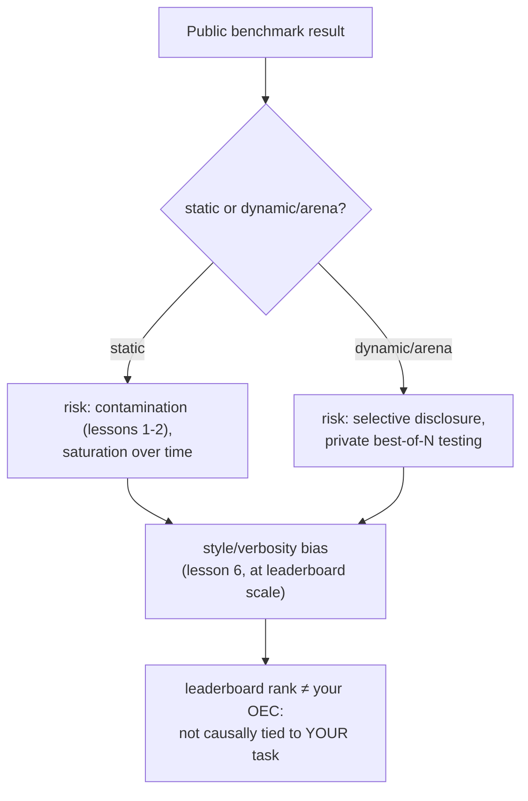

# Урок 18. Публичные бенчмарки

**Связь с целью курса:** Вся арка этой рабочей области вела к одному: к числу, которое вы можете лично защитить для собственного изменения модели. Публичный бенчмарк или таблица лидеров предлагает число, которое кто-то другой уже вычислил, для модели, которую построил кто-то другой, на пользователях, которые не ваши. Этот урок о том, для чего это число на самом деле нужно, какими конкретными способами его накручивают и почему дисциплина OEC из урока 15 говорит, что место в таблице лидеров не проходит проверку, которую обязана проходить настоящая метрика решения.
**Первоисточник:** [Научная статья: "The Leaderboard Illusion", Singh et al., 2025](https://arxiv.org/abs/2504.20879)
**Предварительные требования:** [Урок 6](0006-judge-bias-and-human-agreement.md), [Урок 15](0015-ab-tests-and-guardrail-metrics.md)

## Разминка

1. ▢ Что делает метрику хорошим кандидатом в OEC по рекомендациям Кохави?

Проверка

Она должна быть подвижной, достаточно чувствительной, чтобы сдвинуться в реалистичном эксперименте, и причинно связанной с исходом, который действительно важен, а не просто коррелирующей с ним.

2. ▢ Что такое смещение по многословию и назовите один способ смягчить его в настройке с LLM-судьёй?

Проверка

Склонность судьи предпочитать более длинный ответ, даже когда лишняя длина ничего не добавляет по сравнению с не менее или более верным, но коротким. Способы смягчить: прямо указать судье не вознаграждать длину или написать критерии оценки, где названы корректность и полнота, а не длина.

## Что нужно знать

### Статичный бенчмарк это фиксированная общая мерка, со всеми проблемами урока 1 внутри

Статичный публичный бенчмарк (фиксированный набор вопросов с фиксированными верными ответами) существует, чтобы дать всей области одно сопоставимое число. Но он наследует ровно те риски, которые уже охватили уроки 1 и 2: собственные вопросы бенчмарка могут попасть в данные претрейнинга более поздней модели (загрязнение), а бенчмарк, который достаточно долго был целью настройки, склоняется к **насыщению**: модели достигают на нём потолочной оценки, всё ещё проваливая тот же род задач в реальной работе, потому что бенчмарк перестал измерять исходное умение и начал измерять знакомство с самим бенчмарком.

### Динамичный бенчмарк в стиле арены меняет один способ накрутки на другой

Живые арены на основе предпочтений (публичный сайт, где реальные пользователи сравнивают ответы двух моделей и голосуют) создавали именно чтобы снизить риск загрязнения, который несёт фиксированный набор вопросов, поскольку промпты и предпочтения берутся из текущего использования, а не из статичного набора, который можно заморозить. Но «The Leaderboard Illusion» документирует другой серьёзный способ накрутки, который открывает такой дизайн: провайдеры тестируют много закрытых вариантов ещё не выпущенной модели, прежде чем выбрать, какой единственный результат опубликовать. Находки статьи конкретны: она выявляет 27 закрытых вариантов LLM, которые Meta протестировала накануне выпуска Llama 4, и сообщает, что небольшое число крупных провайдеров закрытых моделей получили непропорционально большую долю всех данных сравнений арены (по оценке, от 19 до 20 процентов у каждого из двух крупных провайдеров против примерно 30 процентов, поделённых между 83 моделями с открытыми весами вместе). Выборочное раскрытие, то есть закрытое тестирование многих вариантов и публикация только набравшего лучшую оценку, превращает таблицу лидеров именно в ту цель, которую описывает закон Гудхарта: как только мера становится тем, под что оптимизируются напрямую, она перестаёт надёжно измерять то, ради чего её создали.

### То же смещение по стилю, которому урок 6 учил для одного вызова судьи, действует идентично на целой таблице лидеров

Урок 6 охватывал смещение по многословию в одном парном сравнении LLM-судьи. Тот же вид сбоя проявляется в масштабе таблицы лидеров, только с асессорами-людьми: когда собственное исследование крупной арены учло длину ответа и markdown-форматирование (заголовки, жирный текст, структуру списков), рейтинги заметно сдвинулись: одни модели упали, а другие поднялись, когда влияние стиля учли. Это подтверждает, что механизм урока 6 обобщается за пределы одного промпта судьи: процесс оценки, будь то один LLM-судья или тысячи голосующих людей, может вознаграждать то, как оформлен ответ и какой он длины, независимо от того, действительно ли он вернее или полезнее.

### Место в таблице лидеров не проходит проверку OEC, которую вам уже дал урок 15

Урок 15 назвал два свойства, нужные настоящей метрике решения: она должна быть подвижной и причинно связанной с исходом, который действительно важен. Место в публичной таблице лидеров подвижно, пожалуй, даже слишком, учитывая задокументированную практику закрытого тестирования вариантов, пока какой-то не наберёт хорошую оценку. Чего ему не хватает, так это второго свойства для вашего конкретного решения: оно агрегирует предпочтения множества разных пользователей, задач и сценариев, которые не ваши пользователи, не ваша задача и не ваш сценарий, и (по другим находкам этого урока) может даже не отражать ту точную версию модели, которую вам на самом деле будут отдавать. Позиция в таблице лидеров может быть разумным первичным фильтром, какие модели стоит оценивать дальше; она не заменяет защищённого, отложенного, специфичного для задачи числа «выпускать или нет», к которому вела вся эта рабочая область.

## Практика

1. ▢ Модель возглавляет статичный публичный бенчмарк, а позднейший анализ показывает, что точные вопросы бенчмарка есть в веб-краулинге, на котором модель проходила претрейнинг. Как это называется в терминах урока 1 и что это делает со смыслом бенчмарка?

Подсказка

Подумайте, что происходит с вопросами бенчмарка, когда их собирают в большой краулинг для претрейнинга.

Проверка

Это загрязнение данных. Когда собственные вопросы бенчмарка (или их близкие пересказы) попадают в обучающие данные, высокая оценка может отражать то, что модель видела вопросы раньше, а не обладание исходным умением, которое бенчмарк должен был измерять.

2. ▢ Провайдер тестирует 20 закрытых, не выпущенных вариантов модели на живой арене предпочтений и публично выпускает только тот единственный вариант, что набрал лучшую оценку. Как «The Leaderboard Illusion» называет эту практику и какой конкретный реальный пример приводит статья?

Проверка

Выборочное раскрытие (закрытое тестирование нескольких вариантов и выбор, какую оценку публиковать). Конкретный пример самой статьи: Meta протестировала 27 закрытых вариантов LLM накануне выпуска Llama 4.

3. ▢ Собственное исследование арены показывает, что учёт длины ответа и markdown-форматирования заметно меняет рейтинг в таблице лидеров. Какой вид сбоя из прежнего урока это подтверждает, лишь в другом масштабе?

Проверка

Смещение по многословию из урока 6: процесс оценки (там один LLM-судья, здесь тысячи голосующих людей арены) может вознаграждать длину и форматирование, а не фактическую корректность или полезность, и эффект проявляется одинаково, оценивает ли одна модель или целая толпа.

4. ▢ Команда хочет пропустить построение собственного эвала и вместо этого выпустить ту модель, что сейчас возглавляет публичную таблицу лидеров. Чего, по критериям OEC из урока 15, не хватает этому решению?

Проверка

Требования причинной связи: место в таблице лидеров агрегирует предпочтения по пользователям, задачам и сценариям, которые не принадлежат команде, поэтому высокое место не устанавливает, что модель действительно лучше для её конкретной задачи. Оно, возможно, не отражает даже ту точную версию модели, которую команде отдадут, учитывая задокументированные практики выборочного раскрытия. Место в таблице лидеров может быть подвижным, но одна подвижность не делает его допустимым OEC для чужого решения.

5. ▢ Какое утверждение верно описывает, как публичные бенчмарки связаны с целью этой рабочей области?

    - a) Динамичная таблица лидеров в стиле арены застрахована от накрутки, поскольку использует живые предпочтения пользователей вместо фиксированного набора вопросов
    - b) У статичных бенчмарков есть риск загрязнения и насыщения, у динамичных арен риск выборочного раскрытия, у обоих смещение по стилю в масштабе, а место в таблице лидеров всё равно не проходит проверку причинной связи, нужную настоящему OEC для конкретного решения
    - c) Место модели в таблице лидеров допустимая замена решению «выпускать или нет» под конкретную задачу, поскольку его уже строго измерила третья сторона
    - d) Смещение по стилю и по многословию затрагивает только настройки с одним LLM-судьёй, а не крупномасштабные арены на предпочтениях людей

Проверка

**b)** Это полная картина, которую устанавливает урок. Вариант (a) неверен: динамичные арены меняют риск загрязнения на задокументированный риск выборочного раскрытия. Вариант (c) неверен: место в таблице лидеров причинно не связано с собственной задачей или пользователями конкретной команды, а именно этого требует OEC. Вариант (d) неверен: собственное исследование арены обнаружило, что смещение по стилю сдвигает рейтинги в масштабе целой таблицы лидеров, а не только в одном вызове судьи.

## Практика в реальной работе

- [ ] Для модели, которую вы рассматриваете для внедрения, проверьте, берётся ли её позиция в таблице лидеров из статичного бенчмарка или из динамичной арены, и раскрывает ли какой-либо из источников что-нибудь о проверках на загрязнение или закрытом предрелизном тестировании.
- [ ] Если у рассматриваемой вами модели указано место на арене, проверьте, доступен ли для той же таблицы лидеров рейтинг с поправкой на стиль, и посмотрите, меняется ли её позиция.
- [ ] Завтра: прочитайте первоисточник целиком и отметьте, какие меры он предлагает против описанной им асимметрии доступа к данным между провайдерами закрытых моделей и моделей с открытыми весами.

## Что почитать дальше

- [Научная статья: "The Leaderboard Illusion", Singh et al., 2025](https://arxiv.org/abs/2504.20879)
- [Статья: "Does Style Matter?", LMArena](https://lmarena.ai/blog/style-control)
- [Ресурсы](../RESOURCES.md)

---

Не доходит? Перечитайте первоисточник в начале: этот урок его сжимает, а при сжатии понимание как раз и теряется. Загляните в [глоссарий](../GLOSSARY.md), если какой-то термин показался скользким.

Если неясен сам урок, а не материал, это дефект: [откройте issue](https://github.com/TokenCemetery/teach/issues).
