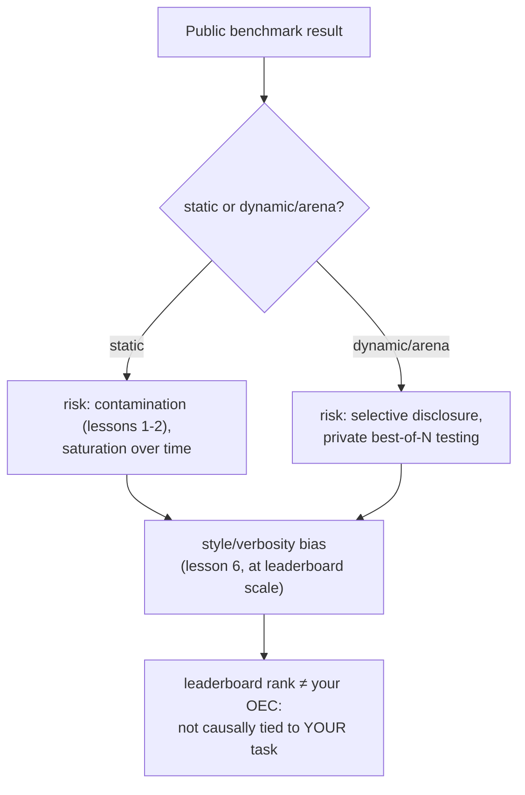

# 第 18 课：公开基准

**使命关联:** 本工作区的整个脉络，一直在朝着一件事积累：一个你能亲自为自己的模型改动辩护的数字。公开基准或排行榜提供的，是别人已经算好的一个数字，针对的是别人构建的模型，面对的是不是你的用户。本课讲的是，这个数字究竟是做什么用的，它被操纵的具体方式，以及为什么第 15 课的 OEC 纪律说，排行榜名次通不过真正的决策指标必须通过的检验。
**主要来源:** [论文：“The Leaderboard Illusion”，Singh 等，2025](https://arxiv.org/abs/2504.20879)
**前置知识:** [第 6 课](0006-judge-bias-and-human-agreement.md)、[第 15 课](0015-ab-tests-and-guardrail-metrics.md)

## 热身

1. ▢ 按照 Kohavi 的指导，什么使一个指标成为好的 OEC 候选？

检查

它必须是可移动的，也就是足够灵敏，在可行的实验中能产生变化；并且与真正重要的结果有因果联系，而不只是相关。

2. ▢ 什么是冗长偏差？请说出在 LLM-as-judge 的设置中缓解它的一种办法。

检查

裁判倾向于偏好更长的回答，即便多出来的篇幅，相比同样正确或更正确的较短回答毫无增益。缓解办法包括：明确指示裁判不要奖励长度，或者写出点名正确性和完整性而不是长度的评分标准。

## 要点

### 静态基准是一把固定的、共享的尺子，第 1 课的所有问题它都自带

静态的公开基准（一组固定的问题，配固定的正确答案）的存在，是为了给整个领域提供一个可比较的数字。但它继承了第 1 课和第 2 课已经讲过的那些风险：基准自己的问题，可能被抓取进之后某个模型的预训练数据（污染），而一个在足够长的时间里被足够多地针对着调优的基准，往往走向**饱和**：模型在上面达到天花板得分，在真实环境中却仍会在同类任务上失败，因为这个基准不再度量底层的能力，而是开始度量对基准本身的熟悉程度。

### 动态的、竞技场式的基准，用一种操纵手段换来了另一种

实时的、基于偏好的竞技场（一个公开网站，真实用户比较两个模型的回答并投票），正是为了降低固定题库所带的污染风险而建的，因为提示词和偏好来自持续的使用，而不是一个静态的、可以被冻结的集合。但“The Leaderboard Illusion”记录了这种设计所打开的另一种严重的操纵手段：服务商在选择公布哪一个结果之前，先测试一个未发布模型的许多个私有变体。它自己的发现很具体：论文查明，Meta 在发布 Llama 4 之前，测试了 27 个私有的 LLM 变体，并报告说，少数几家大型闭源模型服务商，获得了竞技场全部比较数据中不成比例的份额（两家主要服务商各约 19% 到 20%，而 83 个开放权重模型合计只共享大约 30%）。选择性披露，即私下测试许多变体，只公开发布得分最高的那一个，把排行榜变成了古德哈特定律所描述的那种目标：一旦某个度量成了直接针对着优化的东西，它就不再可靠地度量它当初要度量的东西。

### 第 6 课针对单次裁判调用讲过的同一种风格偏差，在整个排行榜上同样起作用

第 6 课讲的是单次 LLM-as-judge 成对比较中的冗长偏差。同样的失败模式，在排行榜的规模上也会出现，只是评分者换成了人类：当一个主要的竞技场自己的研究，控制了回答的长度和 markdown 格式（标题、粗体、列表结构）时，排名发生了明显变化，一旦剔除了风格的影响，有些模型下降，有些模型上升。这证实了第 6 课的机制，不局限于单个裁判提示词：一个评分过程，无论是一个 LLM 裁判，还是成千上万的人类投票者，都可能奖励一个回答的格式和长度，而与它是否真的更正确、更有用无关。

### 排行榜名次通不过第 15 课已经给你的 OEC 检验

第 15 课点出了真正的决策指标所需的两个性质：它必须是可移动的，并且必须与真正重要的结果有因果联系。公开排行榜的名次是可移动的，鉴于有文献记载的、私下测试变体直到其中一个得分很好的做法，甚至可以说过于可移动了。对你具体的决定来说，它缺的是第二个性质：它汇总的是许多不同的用户、任务和使用场景的偏好，而这些不是你的用户、你的任务或你的使用场景，而且（按本课的其他发现）甚至可能并不反映你实际会得到的那个确切的模型版本。排行榜上的位置，可以是判断哪些模型值得进一步评估的合理初筛；但它不能代替整个工作区一直在为之积累的、经过辩护的、留出的、针对具体任务的上线与否数字。

## 练习

1. ▢ 某个模型在静态的公开基准上名列榜首，后来的分析发现，该基准的确切问题出现在这个模型预训练所用的网页爬取数据中。第 1 课的术语把这叫作什么，它对基准的意义造成了什么影响？

提示

想一想，一个基准的问题一旦被抓取进大型的预训练爬取数据，会发生什么。

检查

这是数据污染。基准自己的问题（或它们的近似改写）一旦进入训练数据，高分反映的就可能是模型以前见过这些问题，而不是具备基准本该度量的底层能力。

2. ▢ 某服务商用一个实时的偏好竞技场，测试了一个模型的 20 个私有的、未发布的变体，并只公开发布得分最高的那一个变体。“The Leaderboard Illusion”把这种做法叫作什么，论文引用的具体真实例子是什么？

检查

选择性披露（私下测试多个变体，并选择公布哪个分数）。论文自己给出的具体例子，是 Meta 在发布 Llama 4 之前，测试了 27 个私有的 LLM 变体。

3. ▢ 某个竞技场自己的研究发现，控制回答的长度和 markdown 格式，会明显改变排行榜的排名。这证实了前面哪一课的失败模式，只是规模不同？

检查

第 6 课的冗长偏差：一个评分过程（那里是单个 LLM 裁判，这里是成千上万的人类竞技场投票者），可能奖励长度和格式，而不是实际的正确性或有用性，而且不管评分者是一个模型还是一大群人，这种效应都同样会出现。

4. ▢ 某团队想跳过自建评测，直接上线目前在公开排行榜上排名第一的模型。第 15 课的 OEC 标准说，这个决定缺少什么？

检查

缺少因果联系的要求：排行榜的名次汇总的是许多用户、任务和使用场景的偏好，而这些并不是该团队自己的，所以高名次并不能证明这个模型对他们具体的任务确实更好。鉴于有文献记载的选择性披露的做法，它甚至可能并不反映他们实际会得到的那个确切的模型版本。排行榜名次可以是可移动的，但仅有可移动性，并不能让它成为别人决策的有效 OEC。

5. ▢ 下列哪项说法正确地描述了公开基准与本工作区使命之间的关系？

    - a) 动态的、竞技场式的排行榜不受操纵，因为它用的是实时的用户偏好，而不是固定的题库
    - b) 静态基准有污染和饱和的风险，动态竞技场有选择性披露的风险，两者在规模上都有风格偏差，而排行榜名次仍然通不过真正的 OEC 对具体决定所需的因果联系检验
    - c) 模型的排行榜名次，是针对具体任务的上线与否判断的有效替代，因为它已经由第三方严格度量过了
    - d) 风格偏差和冗长偏差只影响单个 LLM-as-judge 的设置，不影响大规模的人类偏好竞技场

检查

**b)** 这就是本课所确立的完整图景。（a）错误：动态竞技场是用有文献记载的选择性披露风险，换掉了污染风险。（c）错误：排行榜名次与某个具体团队自己的任务或用户之间没有因果联系，而这正是 OEC 所要求的。（d）错误：竞技场自己的研究发现，风格偏差在整个排行榜的规模上都会改变排名，而不只是在单次裁判调用中。

## 实战练习

- [ ] 对于你考虑采用的某个模型，检查它在排行榜上的位置，是来自静态基准还是动态竞技场，以及这两种来源是否披露了任何关于污染检查或私下发布前测试的信息。
- [ ] 如果你考虑的模型有列出的竞技场名次，就检查同一个排行榜上有没有控制了风格的排名可用，并看看它的位置有没有变化。
- [ ] 明天：完整阅读主要来源，并记下它针对所记录的、闭源与开放权重服务商之间的数据访问不对称，提出了什么补救办法。

## 延伸阅读

- [论文：“The Leaderboard Illusion”，Singh 等，2025](https://arxiv.org/abs/2504.20879)
- [文章：“Does Style Matter?”，LMArena](https://lmarena.ai/blog/style-control)
- [资源](../RESOURCES.md)

---

没学明白？请重读顶部的主要来源，因为本课是对它的压缩，而理解正是在压缩中流失的。如果有哪个术语觉得含糊，可以查看[术语表](../GLOSSARY.md)。

如果问题出在课程本身，而不是学习材料，那就是一个缺陷：[提交 issue](https://github.com/TokenCemetery/teach/issues)。
