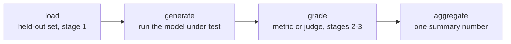

# Harness de evals: frameworks y ejecuciones reproducibles

La etapa 4 comprimida para consulta. La [lección 7](../lessons/0007-eval-frameworks-and-harness.md) cubre la forma de cuatro etapas que tiene todo harness y la elección entre dos frameworks consolidados; la [lección 8](../lessons/0008-reproducible-runs.md) cubre por qué la misma eval puede producir números distintos en ejecuciones distintas y qué registrar junto con una puntuación. Esta hoja es el pipeline, la elección del framework y la lista de comprobación de reproducibilidad.

## Por qué un harness y no un script de una sola vez

Cada decisión de diseño de las etapas 1 a 3, qué datos se reservan, qué métrica o juez califica una respuesta, cómo se agrega una puntuación, solo importa si se aplica de la misma manera cada vez. Un harness formaliza ese pipeline en código reutilizable y auditable, de modo que una nueva ejecución meses después aplica exactamente el mismo conjunto held-out y la misma lógica de calificación, en lugar de reconstruirse de memoria.

## Las cuatro etapas

| Etapa | Puede fallar por | Consecuencia |
|---|---|---|
| Cargar | Usar un conjunto de eval contaminado o que no es held-out | El número no significa nada, sin importar lo cuidadosa que sea la calificación |
| Generar | Ejecutar la versión equivocada del modelo, o truncar las salidas | Basura que ninguna métrica puede rescatar |
| Calificar | Una métrica o un juez mal calibrados (compresión de las puntuaciones, sesgo de posición/verbosidad) | Corrompe la puntuación de salidas que por lo demás son buenas |
| Agregar | Colapsar las puntuaciones por ejemplo en una única media | Esconde la varianza o unos pocos fallos catastróficos detrás de un número que parece sólido |

Cada etapa puede socavar el número final con independencia de las otras tres.

## Dos frameworks, dos trabajos

| | openai/evals | lm-evaluation-harness (EleutherAI) |
|---|---|---|
| Pensado para | Definir una eval propia como código: una función de completación más una especificación de calificación | Ejecutar un modelo contra una gran biblioteca de benchmarks estandarizados ya construidos mediante configuraciones declarativas de tareas |
| Encaja con | Una tarea específica de la misión para la que nadie ha construido aún una eval | Reutilizar un benchmark existente, sobre todo cuando importa la comparabilidad con los números publicados |
| No encaja con | Reimplementar a mano un benchmark estandarizado (arriesga diferencias sutiles que rompen la comparabilidad) | Una capacidad genuinamente nueva que ningún benchmark mide todavía |

La elección sigue el mismo principio que la elección de una métrica (etapa 2): ajustar la herramienta a lo que la tarea realmente necesita.

## Por qué la misma eval puede dar dos números distintos

Un modelo muestreado con una temperatura distinta de cero produce completaciones diferentes en ejecuciones diferentes, incluso contra un prompt idéntico, así que una puntuación agregada distinta cada vez es lo esperable, no un error. Si la calificación además usa un juez LLM, eso añade una segunda capa de ruido de muestreo encima de la varianza propia del modelo bajo prueba. El número de una sola ejecución es una muestra de una distribución, no un hecho fijo sobre el modelo.

## El compromiso del determinismo

| Elección | Compra | Cuesta |
|---|---|---|
| Temperatura 0 (voraz) | Ejecuciones mucho más repetibles | Puede no reflejar el despliegue, si el sistema desplegado muestrea con una temperatura distinta de cero |
| Muestrear con la temperatura del despliegue y reportar la dispersión | Un reflejo honesto del comportamiento real | Menos repetible en una única ejecución; necesita varias muestras por ejemplo (la misma idea que el pass@k de la etapa 2) |

Una semilla aleatoria fija reduce la varianza entre ejecuciones con la misma configuración, pero no garantiza resultados idénticos bit a bit entre hardware distinto, versiones de biblioteca distintas o composiciones de lote distintas, ya que el cálculo en coma flotante no es perfectamente asociativo en todos esos casos.

## Qué registra un número defendible junto con la puntuación

- [ ] La semilla aleatoria usada para la generación
- [ ] La temperatura de generación
- [ ] Las versiones del modelo y del framework
- [ ] La versión del conjunto de eval
- [ ] Cuando se ejecutaron varias muestras: la dispersión entre ellas, no solo la media

Sin esto, una comparación posterior (una nueva ejecución, un checkpoint distinto, un ciclo de eval distinto) no puede distinguir un cambio real de la varianza ordinaria del pipeline.

## Antes de confiar en el resultado de un harness

- Las cuatro etapas de la eval (cargar, generar, calificar, agregar) están cada una nombradas de forma explícita, aunque hoy vivan en un único script.
- La elección del framework (eval propia como código frente a un harness de benchmarks estandarizado) coincide con que ya exista o no un benchmark para esta capacidad.
- El compromiso entre temperatura y determinismo fue una elección deliberada, no lo que el harness tuviera por defecto.
- La puntuación se reporta junto con la semilla, la temperatura, las versiones y la versión del conjunto de eval, no como un número a secas.

## Fuentes

- [Repo: openai/evals, OpenAI](https://github.com/openai/evals)
- [Repo: lm-evaluation-harness, EleutherAI](https://github.com/EleutherAI/lm-evaluation-harness)
- [Recursos](../RESOURCES.md)
