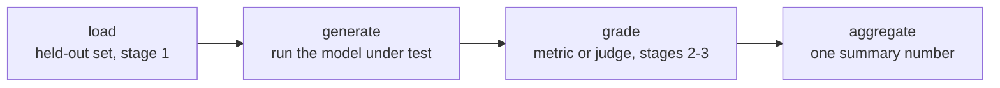

# Harness d'eval : frameworks et exécutions reproductibles

L'étape 4 condensée pour la consultation. La [leçon 7](../lessons/0007-eval-frameworks-and-harness.md) couvre la forme en quatre étapes de tout harness et le choix entre deux frameworks établis ; la [leçon 8](../lessons/0008-reproducible-runs.md) couvre pourquoi une même eval peut produire des chiffres différents d'une exécution à l'autre et ce qu'il faut journaliser avec un score. Cette fiche contient le pipeline, le choix du framework et la liste de contrôle de reproductibilité.

## Pourquoi un harness, et pas un script jetable

Chaque décision de conception des étapes 1 à 3, quelles données sont held-out, quelle métrique ou quel juge note une réponse, comment un score est agrégé, ne compte que si elle est appliquée de la même façon à chaque fois. Un harness formalise ce pipeline en code réutilisable et auditable, de sorte qu'une réexécution des mois plus tard applique exactement le même jeu held-out et la même logique de notation, au lieu d'être reconstituée de mémoire.

## Les quatre étapes

| Étape | Peut échouer par | Conséquence |
|---|---|---|
| Chargement | L'usage d'un jeu d'eval contaminé ou non held-out | Le chiffre ne veut rien dire, quel que soit le soin apporté à la notation |
| Génération | L'exécution de la mauvaise version du modèle, ou des sorties tronquées | Des déchets qu'aucune métrique ne peut sauver |
| Notation | Une métrique ou un juge mal calibré (compression des scores, biais de position/verbosité) | Fausse la notation de sorties pourtant bonnes |
| Agrégation | L'écrasement des scores par exemple en une seule moyenne | Cache la variance ou quelques échecs catastrophiques derrière un chiffre qui a l'air solide |

Chaque étape peut compromettre le chiffre final indépendamment des trois autres.

## Deux frameworks, deux usages

| | openai/evals | lm-evaluation-harness (EleutherAI) |
|---|---|---|
| Conçu pour | Définir une eval sur mesure sous forme de code : une fonction de complétion plus une spécification de notation | Exécuter un modèle sur une vaste bibliothèque de benchmarks standardisés prêts à l'emploi, via des configurations de tâches déclaratives |
| Convient à | Une tâche propre à la mission pour laquelle personne n'a encore construit d'eval | Réutiliser un benchmark existant, surtout quand la comparabilité avec des chiffres publiés compte |
| Ne convient pas à | Réimplémenter à la main un benchmark standardisé (risque de différences subtiles qui brisent la comparabilité) | Une capacité réellement nouvelle qu'aucun benchmark ne mesure encore |

Le choix suit le même principe que celui d'une métrique (étape 2) : adapter l'outil à ce dont la tâche a réellement besoin.

## Pourquoi une même eval peut donner deux chiffres différents

Un modèle échantillonné à une température non nulle produit des complétions différentes d'une exécution à l'autre, même pour un prompt identique, si bien qu'un score agrégé différent à chaque fois est attendu, pas un bug. Si la notation utilise en plus un juge LLM, cela ajoute une seconde couche de bruit d'échantillonnage par-dessus la variance propre au modèle testé. Le chiffre d'une seule exécution est un échantillon tiré d'une distribution, pas un fait fixe sur le modèle.

## Le compromis du déterminisme

| Choix | Apporte | Coûte |
|---|---|---|
| Température 0 (greedy) | Des exécutions bien plus répétables | Peut ne pas refléter le déploiement, si le système déployé échantillonne à une température non nulle |
| Échantillonner à la température de déploiement, rapporter la dispersion | Un reflet fidèle du comportement réel | Moins répétable par exécution isolée ; demande plusieurs échantillons par exemple (la même idée que le pass@k de l'étape 2) |

Un seed aléatoire fixe réduit la variance entre exécutions sur une même configuration, mais ne garantit pas des résultats identiques bit à bit entre matériels, versions de bibliothèques ou compositions de batch différents, puisque le calcul en virgule flottante n'est pas parfaitement associatif dans tous ces cas.

## Ce qu'un chiffre défendable journalise avec le score

- [ ] Le seed aléatoire utilisé pour la génération
- [ ] La température de génération
- [ ] Les versions du modèle et du framework
- [ ] La version du jeu d'eval
- [ ] Quand plusieurs échantillons ont été exécutés : la dispersion entre eux, pas seulement la moyenne

Sans cela, une comparaison ultérieure (une réexécution, un autre checkpoint, un autre cycle d'eval) ne peut pas distinguer un vrai changement de la variance ordinaire du pipeline.

## Avant de faire confiance au résultat d'un harness

- Les quatre étapes de l'eval (chargement, génération, notation, agrégation) sont chacune nommées explicitement, même si elles vivent pour l'instant dans un seul script.
- Le choix du framework (eval-as-code sur mesure ou harness de benchmark standardisé) correspond à l'existence ou non d'un benchmark pour cette capacité.
- Le compromis température/déterminisme était un choix délibéré, pas la valeur par défaut du harness.
- Le score est rapporté avec le seed, la température, les versions et la version du jeu d'eval, pas comme un chiffre nu.

## Sources

- [Dépôt : openai/evals, OpenAI](https://github.com/openai/evals)
- [Dépôt : lm-evaluation-harness, EleutherAI](https://github.com/EleutherAI/lm-evaluation-harness)
- [Ressources](../RESOURCES.md)
