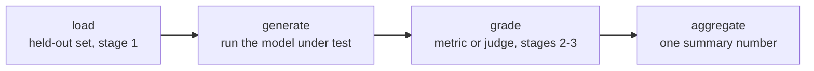

# Eval Harness: Frameworks और Reproducible Runs

चरण 4, खोजने के लिए संक्षिप्त। [पाठ 7](../lessons/0007-eval-frameworks-and-harness.md) हर harness के चार-चरण वाले ढाँचे और दो स्थापित frameworks में से चुनने को कवर करता है; [पाठ 8](../lessons/0008-reproducible-runs.md) कवर करता है कि एक ही eval अलग runs पर अलग संख्याएँ क्यों दे सकता है और score के साथ क्या log करना चाहिए। यह शीट pipeline, framework का चुनाव और reproducibility की checklist है।

## Harness क्यों, एक-बार की script क्यों नहीं

चरण 1 से 3 का हर डिज़ाइन फ़ैसला, यानी कौन-सा data held out है, कौन-सी metric या judge response को grade करता है, score कैसे aggregate होता है, तभी मायने रखता है जब वह हर बार एक ही तरह लागू हो। Harness उस pipeline को दोबारा इस्तेमाल होने लायक, जाँचे जा सकने वाले code में बदल देता है, ताकि महीनों बाद दोबारा चलाने पर वही held-out सेट और grading का तर्क लगे, न कि वह याददाश्त से दोबारा बनाया जाए।

## चार चरण

| चरण | कैसे विफल हो सकता है | नतीजा |
|---|---|---|
| Load | Contaminated या non-held-out eval सेट इस्तेमाल करना | Grading कितनी भी सावधानी से हो, संख्या का कोई मतलब नहीं |
| Generate | ग़लत model version चलाना, या outputs को truncate करना | कचरा जिसे कोई metric नहीं बचा सकती |
| Grade | Miscalibrated metric या judge (score compression, position/verbosity bias) | वरना अच्छे outputs का scoring बिगाड़ देता है |
| Aggregate | हर-example के scores को एक अकेले औसत में समेटना | Variance या कुछ भारी विफलताओं को ऐसी संख्या के पीछे छिपा देता है जो ठोस दिखती है |

हर चरण बाक़ी तीन से स्वतंत्र रूप से अंतिम संख्या को कमज़ोर कर सकता है।

## दो frameworks, दो काम

| | openai/evals | lm-evaluation-harness (EleutherAI) |
|---|---|---|
| किसके लिए बना | Custom eval को code के रूप में परिभाषित करना: एक completion function और एक grading spec | Model को घोषणात्मक task configs के ज़रिए पहले से बने, मानकीकृत benchmarks की बड़ी library पर चलाना |
| कब ठीक बैठता है | मिशन-विशिष्ट task जिसके लिए अभी किसी ने eval नहीं बनाया | मौजूदा benchmark दोबारा इस्तेमाल करना, ख़ास तौर पर जब प्रकाशित संख्याओं से तुलनीयता मायने रखती हो |
| कब ठीक नहीं बैठता | मानकीकृत benchmark को हाथ से दोबारा लागू करना (सूक्ष्म अंतर का जोखिम, जो तुलनीयता तोड़ देता है) | सचमुच नई क्षमता जिसे अभी कोई benchmark नहीं मापता |

चुनाव उसी सिद्धांत पर चलता है जिस पर metric चुनना (चरण 2): औज़ार को उससे मिलाएँ जो task को असल में चाहिए।

## एक ही eval दो अलग संख्याएँ क्यों दे सकता है

गैर-शून्य temperature पर sample किया गया model अलग runs पर अलग completions बनाता है, भले prompt एक जैसा हो, इसलिए हर बार अलग aggregate score अपेक्षित है, bug नहीं। अगर grading में भी LLM judge है, तो वह परखे जा रहे model के अपने variance के ऊपर sampling noise की दूसरी परत जोड़ देता है। एक अकेले run की संख्या किसी वितरण से लिया गया sample है, model के बारे में कोई तय तथ्य नहीं।

## Determinism का trade-off

| चुनाव | क्या मिलता है | क्या देना पड़ता है |
|---|---|---|
| Temperature 0 (greedy) | कहीं ज़्यादा दोहराने योग्य runs | Deployment को न दर्शाए, अगर deploy किया गया system गैर-शून्य temperature पर sample करता है |
| Deployment temperature पर sample करें, फैलाव बताएँ | असली व्यवहार का ईमानदार प्रतिबिंब | एक अकेले run के लिए कम दोहराने योग्य; हर example पर कई samples चाहिए (वही विचार जो चरण 2 के pass@k का है) |

तय random seed एक ही setup के runs के बीच variance घटाता है, पर अलग hardware, library versions या batch composition पर bit-दर-bit एक जैसे नतीजों की गारंटी नहीं है, क्योंकि floating-point गणना इन सब पर पूरी तरह associative नहीं होती।

## भरोसेमंद संख्या score के साथ क्या log करती है

- [ ] Generation में इस्तेमाल हुआ random seed
- [ ] Generation temperature
- [ ] Model और framework versions
- [ ] Eval सेट का version
- [ ] जब कई samples चलाए गए हों: उनके बीच का फैलाव, सिर्फ़ औसत नहीं

इनके बिना, बाद की तुलना (दोबारा run, अलग checkpoint, अलग eval चक्र) असली बदलाव और pipeline के सामान्य variance में फ़र्क़ नहीं कर सकती।

## Harness के नतीजे पर भरोसा करने से पहले

- Eval के चार चरण (load, generate, grade, aggregate) हर एक का साफ़ नाम लिया गया है, भले अभी वे एक ही script में रहते हों।
- Framework का चुनाव (custom eval-as-code बनाम मानकीकृत benchmark harness) इस पर टिका है कि इस क्षमता के लिए benchmark पहले से है या नहीं।
- Temperature/determinism का trade-off सोच-समझकर चुना गया था, harness का जो भी default था वह नहीं।
- Score को seed, temperature, versions और eval सेट के version के साथ बताया गया है, सिर्फ़ खाली संख्या के रूप में नहीं।

## स्रोत

- [Repo: openai/evals, OpenAI](https://github.com/openai/evals)
- [Repo: lm-evaluation-harness, EleutherAI](https://github.com/EleutherAI/lm-evaluation-harness)
- [संसाधन](../RESOURCES.md)
