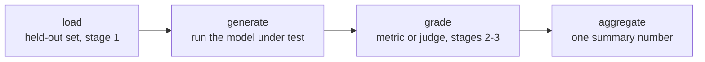

# Harness de Eval: Frameworks e Execuções Reproduzíveis

A etapa 4 condensada para consulta. A [lição 7](../lessons/0007-eval-frameworks-and-harness.md) trata do formato de quatro etapas que todo harness tem e da escolha entre dois frameworks consolidados; a [lição 8](../lessons/0008-reproducible-runs.md) trata de por que o mesmo eval pode produzir números diferentes em execuções diferentes e do que registrar junto com uma pontuação. Esta folha reúne o pipeline, a escolha de framework e o checklist de reprodutibilidade.

## Por que um harness, e não um script avulso

Toda decisão de design das etapas 1 a 3, quais dados são held-out, qual métrica ou juiz avalia uma resposta, como uma pontuação é agregada, só importa se for aplicada do mesmo jeito toda vez. Um harness formaliza esse pipeline em código reutilizável e auditável, de modo que uma nova execução meses depois aplique exatamente o mesmo conjunto held-out e a mesma lógica de avaliação, em vez de ser reconstruída de memória.

## As quatro etapas

| Etapa | Pode falhar por | Consequência |
|---|---|---|
| Carregar | Usar um conjunto de eval contaminado ou que não é held-out | O número não significa nada, por mais cuidadosa que seja a avaliação |
| Gerar | Executar a versão errada do modelo, ou truncar as saídas | Lixo que nenhuma métrica salva |
| Avaliar | Uma métrica ou juiz mal calibrado (compressão da pontuação, viés de posição/verbosidade) | Corrompe a pontuação de saídas que de outro modo seriam boas |
| Agregar | Reduzir as pontuações por exemplo a uma única média | Esconde a variância ou algumas falhas catastróficas atrás de um número que parece sólido |

Cada etapa pode minar o número final independentemente das outras três.

## Dois frameworks, dois trabalhos

| | openai/evals | lm-evaluation-harness (EleutherAI) |
|---|---|---|
| Feito para | Definir um eval customizado como código: uma função de completion mais uma especificação de avaliação | Executar um modelo contra uma grande biblioteca de benchmarks padronizados e prontos por meio de configurações declarativas de tarefa |
| Serve a | Uma tarefa específica da missão para a qual ninguém construiu um eval ainda | Reaproveitar um benchmark existente, especialmente quando a comparabilidade com números publicados importa |
| Não serve a | Reimplementar à mão um benchmark padronizado (arrisca diferenças sutis que quebram a comparabilidade) | Uma capacidade genuinamente nova que nenhum benchmark mede ainda |

A escolha segue o mesmo princípio da escolha de uma métrica (etapa 2): casar a ferramenta com o que a tarefa de fato precisa.

## Por que o mesmo eval pode dar dois números diferentes

Um modelo amostrado com temperatura diferente de zero produz completions diferentes em execuções diferentes, mesmo contra um prompt idêntico, então uma pontuação agregada diferente a cada vez é esperada, e não um bug. Se a avaliação também usa um juiz LLM, isso acrescenta uma segunda camada de ruído de amostragem sobre a variância do próprio modelo sob teste. O número de uma única execução é uma amostra de uma distribuição, e não um fato fixo sobre o modelo.

## O trade-off do determinismo

| Escolha | Traz | Custa |
|---|---|---|
| Temperatura 0 (greedy) | Execuções muito mais repetíveis | Pode não refletir a produção, se o sistema implantado amostra com temperatura diferente de zero |
| Amostrar na temperatura de produção e reportar a dispersão | Reflexo honesto do comportamento real | Menos repetível por execução única; exige várias amostras por exemplo (a mesma ideia do pass@k da etapa 2) |

Uma seed aleatória fixa reduz a variância entre execuções na mesma configuração, mas não é garantia de resultados idênticos bit a bit entre hardwares, versões de biblioteca ou composições de batch diferentes, já que a computação em ponto flutuante não é perfeitamente associativa em todos esses casos.

## O que um número defensável registra junto com a pontuação

- [ ] A seed aleatória usada na geração
- [ ] A temperatura de geração
- [ ] As versões do modelo e do framework
- [ ] A versão do conjunto de eval
- [ ] Quando várias amostras foram executadas: a dispersão entre elas, e não apenas a média

Sem isso, uma comparação posterior (uma nova execução, um checkpoint diferente, um ciclo de eval diferente) não consegue distinguir uma mudança real da variância comum do pipeline.

## Antes de confiar no resultado de um harness

- As quatro etapas do eval (carregar, gerar, avaliar, agregar) são cada uma nomeadas explicitamente, mesmo que hoje vivam em um único script.
- A escolha de framework (eval-as-code customizado contra um harness de benchmark padronizado) corresponde a se já existe um benchmark para essa capacidade.
- O trade-off de temperatura/determinismo foi uma escolha deliberada, e não o que o harness por acaso trazia como padrão.
- A pontuação é reportada junto com seed, temperatura, versões e versão do conjunto de eval, e não como um número solto.

## Fontes

- [Repositório: openai/evals, OpenAI](https://github.com/openai/evals)
- [Repositório: lm-evaluation-harness, EleutherAI](https://github.com/EleutherAI/lm-evaluation-harness)
- [Recursos](../RESOURCES.md)
