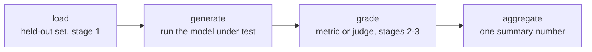

# Обвязка эвала: фреймворки и воспроизводимые запуски

Этап 4 в сжатом виде для быстрого поиска. [Урок 7](../lessons/0007-eval-frameworks-and-harness.md) рассказывает о четырёхэтапной форме любой обвязки и выборе между двумя устоявшимися фреймворками; [урок 8](../lessons/0008-reproducible-runs.md) о том, почему один и тот же эвал может дать разные числа в разных запусках и что записывать рядом с оценкой. Эта шпаргалка содержит конвейер, выбор фреймворка и чек-лист воспроизводимости.

## Зачем обвязка, а не одноразовый скрипт

Каждое проектное решение этапов с 1 по 3 (какие данные отложены, какая метрика или судья оценивает ответ, как агрегируется оценка) важно, только если применяется одинаково каждый раз. Обвязка оформляет этот конвейер в переиспользуемый, поддающийся аудиту код, так что повторный запуск спустя месяцы применяет в точности тот же набор отложенных данных и ту же логику оценки, а не восстанавливается по памяти.

## Четыре этапа

| Этап | Может дать сбой из-за | Последствие |
|---|---|---|
| Загрузка | Использования загрязнённого набора или набора без отложенных данных | Число ничего не значит, как бы аккуратно ни была устроена оценка |
| Генерация | Запуска не той версии модели или обрезки выводов | Мусор, который не спасёт никакая метрика |
| Оценка | Неоткалиброванной метрики или судьи (сжатие оценок, смещение по позиции и по многословию) | Искажает оценку в остальном хороших выводов |
| Агрегация | Сворачивания оценок по примерам в одно среднее | Прячет разброс или несколько катастрофических сбоев за числом, которое выглядит надёжно |

Каждый этап может подорвать итоговое число независимо от остальных трёх.

## Два фреймворка, две задачи

| | openai/evals | lm-evaluation-harness (EleutherAI) |
|---|---|---|
| Создан для | Описания собственного эвала как кода: функция завершения плюс спецификация оценки | Прогона модели по большой библиотеке готовых стандартизированных бенчмарков через декларативные конфигурации задач |
| Подходит для | Специфичной для курса задачи, для которой никто ещё не построил эвал | Переиспользования готового бенчмарка, особенно когда важна сопоставимость с опубликованными числами |
| Не подходит для | Ручной реализации стандартизированного бенчмарка заново (риск тонких отличий, ломающих сопоставимость) | По-настоящему новой способности, которую пока не измеряет ни один бенчмарк |

Выбор следует тому же принципу, что и выбор метрики (этап 2): подбирайте инструмент под то, что задаче действительно нужно.

## Почему один и тот же эвал может дать два разных числа

Модель, сэмплируемая при ненулевой температуре, выдаёт разные завершения в разных запусках даже на одном и том же промпте, поэтому разный итоговый балл каждый раз ожидаем, это не баг. Если при оценке ещё и используется LLM-судья, это добавляет второй слой шума выборки поверх собственной дисперсии тестируемой модели. Число одного запуска это выборка из распределения, а не фиксированный факт о модели.

## Компромисс детерминизма

| Выбор | Что даёт | Чего стоит |
|---|---|---|
| Температура 0 (жадная) | Куда более повторяемые запуски | Может не отражать развёрнутую систему, если та сэмплирует при ненулевой температуре |
| Сэмплировать при температуре развёртывания и сообщать разброс | Честно отражает реальное поведение | Один запуск менее повторяем; нужно несколько образцов на пример (та же идея, что у pass@k из этапа 2) |

Фиксированное случайное зерно снижает дисперсию между запусками на одной и той же настройке, но не гарантирует побитово одинаковых результатов на разном оборудовании, версиях библиотек или составе батчей, поскольку вычисления с плавающей точкой не вполне ассоциативны во всех этих случаях.

## Что защитимое число записывает рядом с оценкой

- [ ] Случайное зерно, использованное при генерации
- [ ] Температуру генерации
- [ ] Версии модели и фреймворка
- [ ] Версию набора для эвала
- [ ] Если запускали несколько образцов: разброс между ними, а не только среднее

Без этого последующее сравнение (повторный запуск, другой чекпоинт, другой цикл эвала) не отличит настоящее изменение от обычного разброса конвейера.

## Прежде чем доверять результату обвязки

- Четыре этапа эвала (загрузка, генерация, оценка, агрегация) названы явно, даже если сейчас живут в одном скрипте.
- Выбор фреймворка (собственный эвал как код или стандартизированная обвязка бенчмарка) соответствует тому, существует ли уже бенчмарк для этой способности.
- Компромисс температуры и детерминизма был осознанным выбором, а не тем, что обвязка выставила по умолчанию.
- Оценка приводится вместе с зерном, температурой, версиями и версией набора для эвала, а не голым числом.

## Источники

- [Репозиторий: openai/evals, OpenAI](https://github.com/openai/evals)
- [Репозиторий: lm-evaluation-harness, EleutherAI](https://github.com/EleutherAI/lm-evaluation-harness)
- [Ресурсы](../RESOURCES.md)
