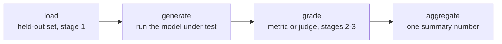

# 评测运行框架：框架与可复现的运行

第 4 阶段的内容，压缩成便于查阅的形式。[第 7 课](../lessons/0007-eval-frameworks-and-harness.md)讲每个运行框架都有的四阶段结构，以及在两个成熟的框架之间做选择；[第 8 课](../lessons/0008-reproducible-runs.md)讲为什么同一套评测在不同次运行中会得出不同的数字，以及除了分数还要记录什么。本速查表是流水线、框架的选择和可复现性检查清单。

## 为什么要用运行框架，而不是一次性的脚本

第 1 到第 3 阶段的每一个设计决定，包括哪些数据是留出的、用哪个指标或裁判给回答打分、分数如何汇总，只有每次都以同样的方式应用，才有意义。运行框架把这条流水线固化成可复用、可审计的代码，这样几个月后重跑，用的是完全相同的留出集和评分逻辑，而不是凭记忆重新拼凑。

## 四个阶段

| 阶段 | 可能的失败方式 | 后果 |
|---|---|---|
| 加载 | 使用了被污染的、或不是留出的评测集 | 不管评分多么仔细，这个数字都毫无意义 |
| 生成 | 运行了错误的模型版本，或截断了输出 | 任何指标都救不回来的垃圾 |
| 评分 | 指标或裁判没有校准好（分数压缩、位置/冗长偏差） | 把本来很好的输出评错了分 |
| 汇总 | 把逐样本的分数压成单一的平均值 | 把方差或少数几次灾难性的失败，藏在一个看起来很扎实的数字后面 |

每个阶段都可能独立于其他三个阶段，破坏最终的数字。

## 两个框架，两项工作

| | openai/evals | lm-evaluation-harness（EleutherAI） |
|---|---|---|
| 为何而建 | 把自建的评测定义为代码：一个补全函数加一份评分规格 | 通过声明式的任务配置，让模型跑一大批预先构建的标准化基准 |
| 适合 | 还没有人为之建过评测的、使命专属的任务 | 复用现有的基准，尤其是需要与已发表的数字具有可比性时 |
| 不适合 | 手工重新实现一个标准化基准（有可能产生细微的差别，破坏可比性） | 尚无任何基准度量的、真正全新的能力 |

这个选择遵循的原则，与选择指标（第 2 阶段）相同：让工具与任务真正的需求相匹配。

## 为什么同一套评测会给出两个不同的数字

模型在非零温度下采样，即使面对完全相同的提示词，每次运行也会产生不同的补全，所以每次的汇总分数不同是预期之中的，不是缺陷。如果评分还用到了 LLM 裁判，那么在被测模型自身的方差之上，又叠加了第二层采样噪声。单次运行的数字，是从一个分布中抽取的样本，而不是关于模型的固定事实。

## 确定性的取舍

| 选择 | 得到什么 | 付出什么 |
|---|---|---|
| 温度 0（贪心） | 运行的可重复性高得多 | 如果部署的系统在非零温度下采样，它可能无法反映部署时的情况 |
| 按部署温度采样，并报告离散程度 | 如实反映真实的行为 | 单次运行的可重复性较低；每个样本需要多次采样（与第 2 阶段 pass@k 的思路相同） |

固定随机种子可以减少同一配置下各次运行之间的方差，但不能保证在不同的硬件、库版本或批次组成之间得到逐位相同的结果，因为浮点计算在所有这些情况下并不完全满足结合律。

## 一个经得起辩护的数字，除了分数还要记录什么

- [ ] 生成时使用的随机种子
- [ ] 生成时的温度
- [ ] 模型和框架的版本
- [ ] 评测集的版本
- [ ] 运行了多个样本时：它们之间的离散程度，而不只是均值

缺了这些，之后的比较（重跑、换一个检查点、换一个评测周期）就无法区分真实的变化和流水线的正常方差。

## 信任运行框架的结果之前

- 评测的四个阶段（加载、生成、评分、汇总）各自都被明确指出，即使它们目前写在同一个脚本里。
- 框架的选择（自建的评测即代码，还是标准化的基准运行框架），与这项能力是否已经有现成的基准相符。
- 温度与确定性的取舍是有意做出的选择，而不是运行框架碰巧的默认值。
- 报告分数时，同时给出种子、温度、版本和评测集版本，而不是一个光秃秃的数字。

## 来源

- [仓库：openai/evals，OpenAI](https://github.com/openai/evals)
- [仓库：lm-evaluation-harness，EleutherAI](https://github.com/EleutherAI/lm-evaluation-harness)
- [资源](../RESOURCES.md)
