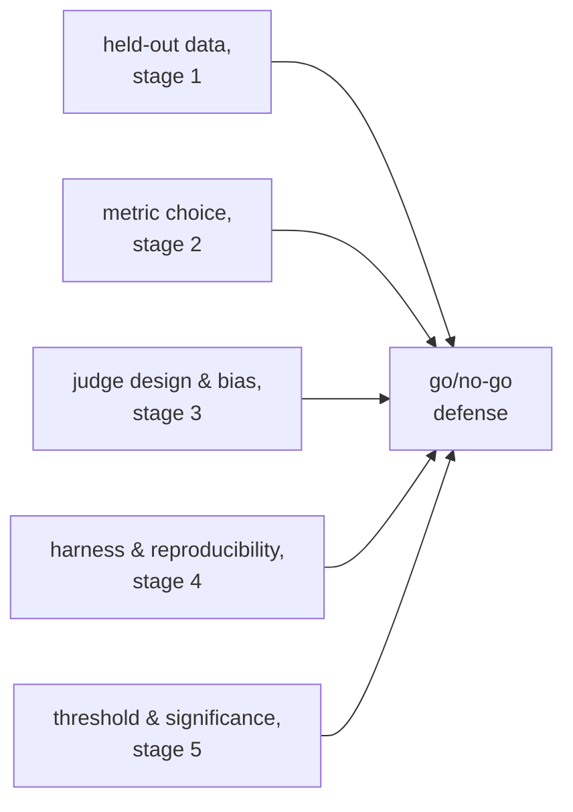

# Go/No-Go: significancia, umbrales y la defensa completa

La etapa 5 comprimida para consulta. La [lección 9](../lessons/0009-statistical-significance-vs-noise.md) cubre cómo juzgar si una brecha de puntuación es real o ruido; la [lección 10](../lessons/0010-defending-the-go-no-go-call.md) cubre cómo fijar un umbral con honestidad y citar todo lo que hace fiable el número. Esta hoja es la fórmula del ruido, la cuadrícula de la comparación pareada y la lista de comprobación de la defensa.

## ¿Es real la brecha, o es ruido?

Para una puntuación de tipo aprobado/suspendido sobre *N* ejemplos, con una tasa real de aciertos *p*, el error estándar de la proporción medida es aproximadamente:

```text
SE ≈ sqrt(p(1−p)/N)
```

Una tasa de aciertos de 0.70 sobre 100 ejemplos tiene `SE ≈ sqrt(0.70 × 0.30 / 100) ≈ 0.046`, unos 4.6 puntos. El error estándar cae con `sqrt(N)`, así que un conjunto de eval más grande lo reduce y hace más fácil distinguir una diferencia real del azar, sin que la diferencia real de fondo haya cambiado en absoluto.

| Brecha frente al SE combinado | Lectura |
|---|---|
| Claramente mayor | Sugiere una diferencia real |
| Comparable o menor | Todavía no se distingue del ruido; reúne más datos, no adivines |

## La comparación pareada supera a tratar las puntuaciones como independientes

Cuando los mismos ejemplos de eval se pasan tanto por una línea base como por una nueva variante, una **comparación pareada** mira dónde discrepan las dos (una acertó, la otra no) en lugar de comparar por separado las dos tasas de aciertos crudas. Esto cancela la dificultad a nivel de ejemplo que afecta por igual a ambas, y detecta una diferencia real con menos datos de los que necesita una comparación de proporciones independientes.


## Fijar un umbral de regresión con honestidad

| Requisito | Por qué |
|---|---|
| Fijarlo antes de que se ejecute la eval | Un umbral elegido después de ver el resultado puede doblarse, y tiende a doblarse, hacia la respuesta que se quería |
| No más estrecho que el piso de ruido | Un umbral que exige menos regresión de la que el error estándar puede resolver no puede hacerse cumplir con honestidad; aflójalo o aumenta el tamaño de la muestra |
| Ligado a lo que necesita el producto | El umbral correcto refleja el costo real de una regresión o el valor real de una mejora, no una preferencia general por la laxitud |

Un resultado no concluyente (una brecha dentro del ruido) es evidencia de que todavía no hay información suficiente, no una inclinación por defecto hacia lanzar o bloquear. Lo honesto es reunir más datos: más ejemplos, o una prueba de significancia pareada como es debido sobre los desacuerdos.

## Qué cita una defensa completa de un go/no-go



Una decisión que enuncia solo un número de titular, sin nada de lo anterior, es una intuición con decimales.

## Antes de defender una decisión de go/no-go

- El umbral de regresión se escribió antes de que se ejecutara la eval, no se eligió después de ver el resultado.
- El umbral no es más estrecho de lo que puede resolver el error estándar del tamaño de muestra actual.
- La comparación usó datos pareados (acuerdo/desacuerdo por ejemplo), no dos tasas de aciertos independientes, siempre que los mismos ejemplos se pasaron por ambas variantes.
- Una brecha no concluyente se afrontó con "reunir más datos", no con una decisión por defecto de lanzar o bloquear.
- La defensa nombra juntas la honestidad del conjunto held-out, la elección de la métrica, la calibración y las comprobaciones de sesgo de cualquier juez, el registro de reproducibilidad del harness y el argumento estadístico, no solo la puntuación.

## Fuentes

- [Docs: "Define success criteria and build evaluations", Claude Platform Docs](https://platform.claude.com/docs/en/test-and-evaluate/develop-tests)
- [Paper: "Judging LLM-as-a-Judge with MT-Bench and Chatbot Arena", Zheng et al., 2023](https://arxiv.org/abs/2306.05685)
- [Recursos](../RESOURCES.md)
