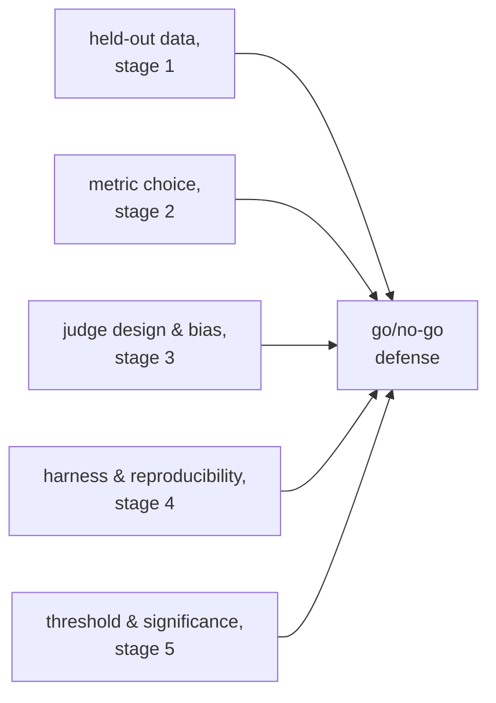

# Go/No-Go : significativité, seuils et défense complète

L'étape 5 condensée pour la consultation. La [leçon 9](../lessons/0009-statistical-significance-vs-noise.md) couvre comment juger si un écart de score est réel ou du bruit ; la [leçon 10](../lessons/0010-defending-the-go-no-go-call.md) couvre comment fixer honnêtement un seuil et citer tout ce qui rend le chiffre digne de confiance. Cette fiche contient la formule du bruit, la grille de comparaison appariée et la liste de contrôle de la défense.

## L'écart est-il réel, ou du bruit ?

Pour un score de type réussite/échec sur *N* exemples, avec un vrai taux de réussite *p*, l'erreur standard de la proportion mesurée vaut approximativement :

```text
SE ≈ sqrt(p(1−p)/N)
```

Un taux de réussite de 0,70 sur 100 exemples donne `SE ≈ sqrt(0.70 × 0.30 / 100) ≈ 0.046`, soit environ 4,6 points. L'erreur standard décroît avec `sqrt(N)` : un jeu d'eval plus grand la réduit et permet de mieux distinguer une vraie différence du hasard, sans que la vraie différence sous-jacente ait changé.

| Écart par rapport à l'SE combinée | Lecture |
|---|---|
| Nettement plus grand | Évocateur d'une vraie différence |
| Comparable ou plus petit | Pas encore distinguable du bruit ; collectez plus de données, ne devinez pas |

## La comparaison appariée l'emporte sur le traitement des scores comme indépendants

Quand les mêmes exemples d'eval passent à la fois dans une baseline et dans une nouvelle variante, une **comparaison appariée** regarde où les deux divergent (l'une a réussi, l'autre non) au lieu de comparer séparément les deux taux de réussite bruts. Cela élimine la difficulté propre à chaque exemple, qui touche les deux de la même manière, et détecte une vraie différence avec moins de données qu'une comparaison de proportions indépendantes.


## Fixer honnêtement un seuil de régression

| Exigence | Pourquoi |
|---|---|
| Fixé avant l'exécution de l'eval | Un seuil choisi après avoir vu le résultat peut être, et tend à être, infléchi vers la réponse que l'on voulait |
| Pas plus serré que le plancher de bruit | Un seuil qui exige une régression plus petite que ce que l'erreur standard sait résoudre ne peut pas être appliqué honnêtement ; assouplissez-le ou augmentez la taille d'échantillon |
| Lié à ce dont le produit a besoin | Le bon seuil reflète le coût réel d'une régression ou la valeur réelle d'une amélioration, pas une préférence généralisée pour le laxisme |

Un résultat non concluant (un écart dans le bruit) est la preuve qu'on manque encore d'information, pas un penchant par défaut vers la livraison ou le blocage. Le bon réflexe, c'est plus de données : plus d'exemples, ou un vrai test de significativité apparié sur les désaccords.

## Ce que cite une défense complète d'un go/no-go



Une décision qui n'énonce qu'un chiffre phare, sans rien de ce qui précède, est une impression avec des décimales.

## Avant de défendre un go/no-go

- Le seuil de régression a été écrit avant l'exécution de l'eval, et non choisi après avoir vu le résultat.
- Le seuil n'est pas plus serré que ce que l'erreur standard de la taille d'échantillon actuelle sait résoudre.
- La comparaison a utilisé des données appariées (accord/désaccord par exemple), et non deux taux de réussite indépendants, partout où les mêmes exemples sont passés dans les deux variantes.
- Un écart non concluant a été traité par « collecter plus de données », et non par une décision de livrer ou de bloquer par défaut.
- La défense nomme ensemble l'honnêteté du jeu held-out, le choix de la métrique, la calibration et les contrôles de biais d'un éventuel juge, la journalisation de reproductibilité du harness et l'argument statistique, et pas seulement le score.

## Sources

- [Doc : "Define success criteria and build evaluations", Claude Platform Docs](https://platform.claude.com/docs/en/test-and-evaluate/develop-tests)
- [Article : "Judging LLM-as-a-Judge with MT-Bench and Chatbot Arena", Zheng et al., 2023](https://arxiv.org/abs/2306.05685)
- [Ressources](../RESOURCES.md)
