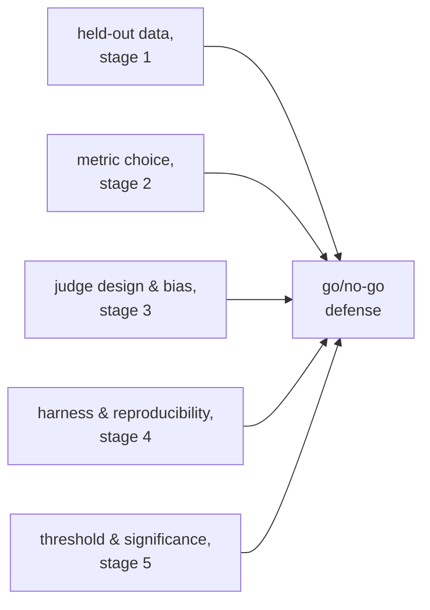

# Go/No-Go: Significance, Thresholds और पूरा बचाव

चरण 5, खोजने के लिए संक्षिप्त। [पाठ 9](../lessons/0009-statistical-significance-vs-noise.md) कवर करता है कि score का फ़ासला असली है या noise; [पाठ 10](../lessons/0010-defending-the-go-no-go-call.md) कवर करता है कि threshold ईमानदारी से कैसे तय करें और संख्या को भरोसेमंद बनाने वाली हर चीज़ cite कैसे करें। यह शीट noise का सूत्र, paired-comparison का grid और बचाव की checklist है।

## फ़ासला असली है या noise?

*N* examples पर pass/fail-शैली के score के लिए, जिसकी असली pass दर *p* है, मापे गए अनुपात की standard error लगभग यह है:

```text
SE ≈ sqrt(p(1−p)/N)
```

100 examples पर 0.70 की pass दर का `SE ≈ sqrt(0.70 × 0.30 / 100) ≈ 0.046` होता है, यानी लगभग 4.6 अंक। Standard error `sqrt(N)` के साथ गिरती है, इसलिए बड़ा eval सेट उसे घटाता है और असली फ़र्क़ को संयोग से अलग पहचानना आसान बनाता है, जबकि अंतर्निहित असली फ़र्क़ बिल्कुल नहीं बदला होता।

| फ़ासला बनाम संयुक्त SE | पढ़ना |
|---|---|
| साफ़ तौर पर बड़ा | असली फ़र्क़ का संकेत |
| बराबर, या छोटा | अभी noise से अलग नहीं पहचाना जा सकता; और data जुटाएँ, अंदाज़ा न लगाएँ |

## Paired comparison, scores को स्वतंत्र मानने से बेहतर

जब वही eval examples baseline और नए variant, दोनों से गुज़रते हैं, तो **paired comparison** दोनों कच्ची pass दरों की अलग-अलग तुलना करने के बजाय वहाँ देखती है जहाँ दोनों असहमत हैं (एक सही, दूसरा नहीं)। इससे example-स्तर की वह कठिनाई कट जाती है जो दोनों को बराबर प्रभावित करती है, और स्वतंत्र अनुपातों की तुलना जितने data माँगती है उससे कम data में असली फ़र्क़ पकड़ में आ जाता है।


## Regression threshold ईमानदारी से तय करना

| ज़रूरत | क्यों |
|---|---|
| Eval चलने से पहले तय करें | नतीजा देखने के बाद चुना गया threshold उस जवाब की ओर मोड़ा जा सकता है जो चाहा गया था, और अक्सर मोड़ा जाता है |
| Noise floor से ज़्यादा तंग नहीं | ऐसा threshold जो standard error के सुलझा सकने से कम regression माँगे, ईमानदारी से लागू नहीं हो सकता; उसे ढीला करें या sample size बढ़ाएँ |
| उत्पाद की ज़रूरत से बँधा | सही threshold regression की असली क़ीमत या सुधार के असली मूल्य को दर्शाता है, ढील के प्रति आम पसंद को नहीं |

अनिर्णायक नतीजा (noise के भीतर का फ़ासला) इस बात का प्रमाण है कि अभी जानकारी काफ़ी नहीं है, ship करने या रोकने की ओर कोई default नहीं। ईमानदार क़दम है और data: ज़्यादा examples, या असहमतियों पर ठीक से किया गया paired significance test।

## पूरा go/no-go बचाव क्या cite करता है



जो फ़ैसला सिर्फ़ एक headline संख्या बताता है और ऊपर की कोई चीज़ नहीं, वह दशमलव वाला एहसास है।

## Go/no-go फ़ैसले का बचाव करने से पहले

- Regression threshold eval चलने से पहले लिख लिया गया था, नतीजा देखने के बाद नहीं चुना गया।
- Threshold मौजूदा sample size की standard error के सुलझा सकने से ज़्यादा तंग नहीं है।
- जहाँ भी वही examples दोनों variants से गुज़रे, तुलना में paired data (हर example की सहमति/असहमति) इस्तेमाल हुआ, दो स्वतंत्र pass दरें नहीं।
- अनिर्णायक फ़ासले का जवाब "और data जुटाएँ" था, ship या block का कोई default फ़ैसला नहीं।
- बचाव held-out सेट की ईमानदारी, metric के चुनाव, किसी भी judge की calibration और bias जाँचों, harness की reproducibility logging और सांख्यिकीय तर्क को साथ-साथ नाम देता है, सिर्फ़ score को नहीं।

## स्रोत

- [दस्तावेज़: "Define success criteria and build evaluations", Claude Platform Docs](https://platform.claude.com/docs/en/test-and-evaluate/develop-tests)
- [पेपर: "Judging LLM-as-a-Judge with MT-Bench and Chatbot Arena", Zheng et al., 2023](https://arxiv.org/abs/2306.05685)
- [संसाधन](../RESOURCES.md)
