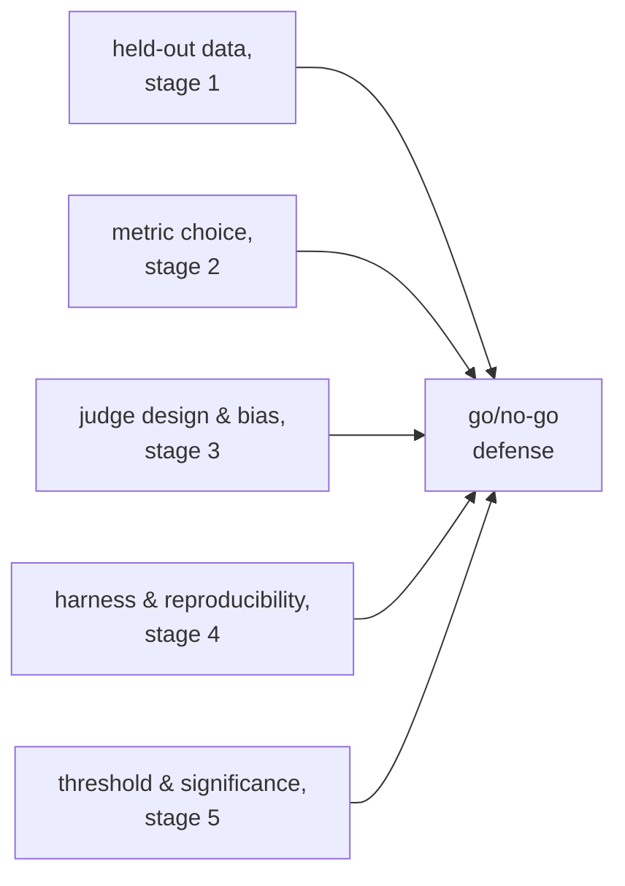

# Go/No-Go: Significância, Limiares e a Defesa Completa

A etapa 5 condensada para consulta. A [lição 9](../lessons/0009-statistical-significance-vs-noise.md) trata de julgar se uma diferença de pontuação é real ou ruído; a [lição 10](../lessons/0010-defending-the-go-no-go-call.md) trata de definir um limiar com honestidade e de citar tudo o que torna o número confiável. Esta folha reúne a fórmula do ruído, a grade da comparação pareada e o checklist da defesa.

## A diferença é real, ou é ruído?

Para uma pontuação do tipo passa/falha sobre *N* exemplos, com uma taxa real de aprovação *p*, o erro padrão da proporção medida é aproximadamente:

```text
SE ≈ sqrt(p(1−p)/N)
```

Uma taxa de aprovação de 0,70 sobre 100 exemplos tem `SE ≈ sqrt(0.70 × 0.30 / 100) ≈ 0.046`, cerca de 4,6 pontos. O erro padrão cai com `sqrt(N)`, então um conjunto de eval maior o encolhe e torna uma diferença real mais fácil de distinguir do acaso, sem que a verdadeira diferença de fundo tenha mudado.

| Diferença vs. SE combinado | Leitura |
|---|---|
| Claramente maior | Sugere uma diferença real |
| Comparável ou menor | Ainda não distinguível do ruído; reúna mais dados, não chute |

## A comparação pareada vence tratar as pontuações como independentes

Quando os mesmos exemplos de eval passam tanto por uma baseline quanto por uma nova variante, uma **comparação pareada** olha para onde as duas discordam (uma acertou, a outra não), em vez de comparar as duas taxas de aprovação brutas separadamente. Isso anula a dificuldade em nível de exemplo que afeta as duas por igual e detecta uma diferença real com menos dados do que uma comparação de proporções independentes exige.


## Definindo um limiar de regressão com honestidade

| Requisito | Por quê |
|---|---|
| Definido antes de o eval rodar | Um limiar escolhido depois de ver o resultado pode ser, e tende a ser, dobrado em direção à resposta que se queria |
| Não mais apertado que o piso de ruído | Um limiar que exige menos regressão do que o erro padrão consegue resolver não pode ser honestamente imposto; afrouxe-o ou aumente o tamanho da amostra |
| Ligado ao que o produto precisa | O limiar certo reflete o custo real de uma regressão ou o valor real de uma melhoria, e não uma preferência geral por frouxidão |

Um resultado inconclusivo (uma diferença dentro do ruído) é evidência de que ainda não há informação suficiente, e não uma inclinação padrão a lançar ou bloquear. O movimento honesto é mais dados: mais exemplos, ou um teste de significância pareado adequado sobre as discordâncias.

## O que uma defesa completa de go/no-go cita



Uma decisão que declara apenas um número de manchete, sem nada do acima, é uma impressão com casas decimais.

## Antes de defender uma decisão de go/no-go

- O limiar de regressão foi escrito antes de o eval rodar, e não escolhido depois de ver o resultado.
- O limiar não é mais apertado do que o erro padrão do tamanho atual de amostra consegue resolver.
- A comparação usou dados pareados (concordância/discordância por exemplo), e não duas taxas de aprovação independentes, sempre que os mesmos exemplos passaram pelas duas variantes.
- Uma diferença inconclusiva foi respondida com "reunir mais dados", e não com uma decisão padrão de lançar ou bloquear.
- A defesa nomeia a honestidade do conjunto held-out, a escolha da métrica, as verificações de calibração e viés de qualquer juiz, o registro de reprodutibilidade do harness e o argumento estatístico, juntos, e não apenas a pontuação.

## Fontes

- [Docs: "Define success criteria and build evaluations", Claude Platform Docs](https://platform.claude.com/docs/en/test-and-evaluate/develop-tests)
- [Artigo científico: "Judging LLM-as-a-Judge with MT-Bench and Chatbot Arena", Zheng et al., 2023](https://arxiv.org/abs/2306.05685)
- [Recursos](../RESOURCES.md)
