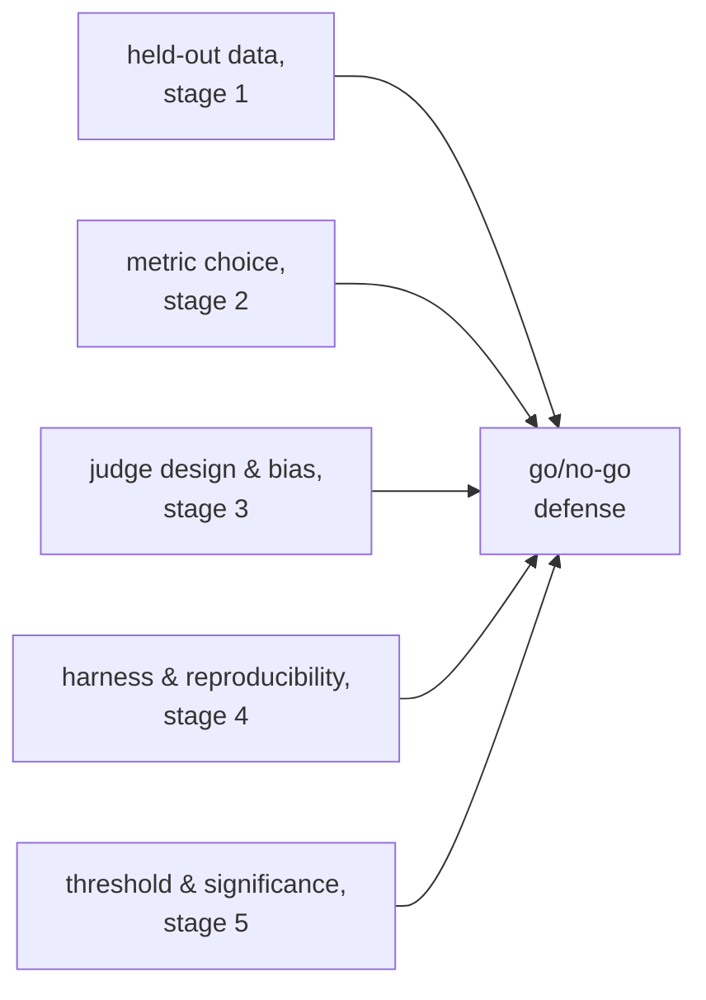

# Выпускать или нет: значимость, пороги и полная защита

Этап 5 в сжатом виде для быстрого поиска. [Урок 9](../lessons/0009-statistical-significance-vs-noise.md) рассказывает, как судить, настоящий ли разрыв оценок или шум; [урок 10](../lessons/0010-defending-the-go-no-go-call.md) о честном выборе порога и ссылках на всё, что делает число заслуживающим доверия. Эта шпаргалка содержит формулу шума, сетку парного сравнения и чек-лист защиты.

## Разрыв настоящий или это шум?

Для оценки вида «прошёл или нет» по *N* примерам с истинной долей прошедших *p* стандартная ошибка измеренной доли приблизительно равна:

```text
SE ≈ sqrt(p(1−p)/N)
```

Доля прошедших 0,70 по 100 примерам даёт `SE ≈ sqrt(0.70 × 0.30 / 100) ≈ 0.046`, около 4,6 пункта. Стандартная ошибка падает как `sqrt(N)`, поэтому больший набор для эвала её уменьшает и позволяет легче отличить настоящую разницу от случайности, хотя сама истинная разница не изменилась.

| Разрыв относительно суммарной SE | Как читать |
|---|---|
| Явно больше | Указывает на настоящую разницу |
| Сопоставим или меньше | Пока не отличим от шума; соберите больше данных, не гадайте |

## Парное сравнение лучше, чем считать оценки независимыми

Когда одни и те же примеры эвала прогоняют и через базовую версию, и через новый вариант, **парное сравнение** смотрит на то, где они расходятся (один справился, другой нет), а не сравнивает две сырые доли прошедших по отдельности. Это сокращает сложность на уровне примеров, одинаково влияющую на обе стороны, и обнаруживает настоящую разницу по меньшему объёму данных, чем нужно сравнению независимых долей.


## Честный выбор порога регрессии

| Требование | Почему |
|---|---|
| Установить до запуска эвала | Порог, выбранный после того как виден результат, можно подогнать под желаемый ответ и обычно так и делают |
| Не жёстче уровня шума | Порог, требующий меньшей регрессии, чем способна разрешить стандартная ошибка, нельзя честно соблюдать; ослабьте его или увеличьте выборку |
| Привязан к тому, что нужно продукту | Верный порог отражает реальную цену регрессии или реальную ценность улучшения, а не общее предпочтение мягкости |

Неубедительный результат (разрыв внутри шума) это свидетельство, что информации пока недостаточно, а не умолчание в пользу выпуска или блокировки. Честный ход: больше данных, то есть больше примеров или надлежащий парный критерий значимости на расхождениях.

## На что ссылается полная защита решения «выпускать или нет»



Решение, где указано одно итоговое число и ничего из перечисленного, это ощущение с десятичными знаками.

## Прежде чем защищать решение «выпускать или нет»

- Порог регрессии записан до запуска эвала, а не выбран после того как виден результат.
- Порог не жёстче, чем способна разрешить стандартная ошибка при текущем размере выборки.
- Сравнение использовало парные данные (согласие и расхождение по примерам), а не две независимые доли прошедших, везде, где одни и те же примеры прогонялись через оба варианта.
- На неубедительный разрыв ответили «соберём больше данных», а не решением выпускать или блокировать по умолчанию.
- Защита называет честность набора отложенных данных, выбор метрики, калибровку и проверки смещений любого судьи, воспроизводимость в логировании обвязки и статистическое обоснование вместе, а не одну оценку.

## Источники

- [Документация: "Define success criteria and build evaluations", Claude Platform Docs](https://platform.claude.com/docs/en/test-and-evaluate/develop-tests)
- [Научная статья: "Judging LLM-as-a-Judge with MT-Bench and Chatbot Arena", Zheng et al., 2023](https://arxiv.org/abs/2306.05685)
- [Ресурсы](../RESOURCES.md)
