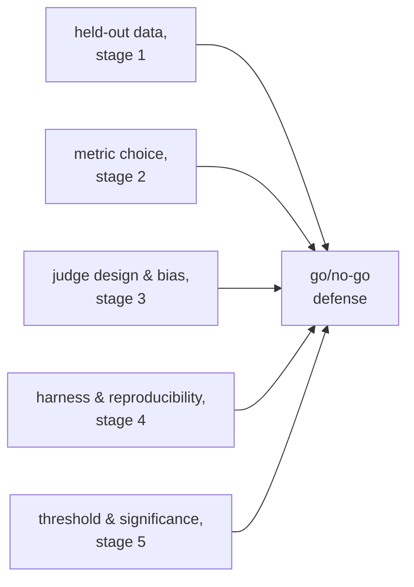

# 上线与否：显著性、阈值与完整的辩护

第 5 阶段的内容，压缩成便于查阅的形式。[第 9 课](../lessons/0009-statistical-significance-vs-noise.md)讲判断分数差距是真实的还是噪声；[第 10 课](../lessons/0010-defending-the-go-no-go-call.md)讲诚实地设定阈值，并引用一切让这个数字可信的依据。本速查表是噪声公式、成对比较的方格图和辩护检查清单。

## 差距是真实的，还是噪声？

对于在 *N* 个样本上的通过/不通过式分数，真实通过率为 *p*，所测得比例的标准误差近似为：

```text
SE ≈ sqrt(p(1−p)/N)
```

在 100 个样本上通过率为 0.70，则 `SE ≈ sqrt(0.70 × 0.30 / 100) ≈ 0.046`，约 4.6 个百分点。标准误差随 `sqrt(N)` 下降，所以更大的评测集会让它缩小，使真实的差异更容易与偶然区分开来，而底层的真实差异并没有任何改变。

| 差距与合并后 SE 的比较 | 解读 |
|---|---|
| 明显更大 | 提示存在真实的差异 |
| 与之相当，或更小 | 还无法与噪声区分开；去收集更多的数据，不要靠猜 |

## 成对比较胜过把分数当作相互独立的

当同样的评测样本同时跑过基线和新的变体时，**成对比较**看的是两者不一致的地方（一个答对了，另一个没答对），而不是分别比较两个原始的通过率。这会抵消同样影响二者的样本层面的难度，比独立比例的比较所需的数据更少，就能检测出真实的差异。


## 诚实地设定退步阈值

| 要求 | 为什么 |
|---|---|
| 在评测运行之前设定 | 看到结果之后才选的阈值，可能会（也往往会）被扭向想要的那个答案 |
| 不比噪声下限更严 | 要求的退步幅度小于标准误差所能分辨的阈值，无法诚实地执行；放宽它，或者增大样本量 |
| 与产品的需要挂钩 | 正确的阈值反映的是退步的真实代价或改进的真实价值，而不是一概偏好宽松 |

没有定论的结果（差距落在噪声之内），说明的是信息还不够，而不是默认倾向于上线或阻止。诚实的做法是获取更多数据：更多的样本，或者对不一致的部分做恰当的成对显著性检验。

## 一份完整的上线与否辩护要引用什么



一个只说出头条数字、而没有上面任何一项的判断，只是带着小数点的感觉。

## 为上线与否的判断辩护之前

- 退步阈值是在评测运行之前写下来的，而不是看到结果之后才选的。
- 阈值不比当前样本量的标准误差所能分辨的更严。
- 凡是同样的样本跑过两个变体的地方，比较用的是成对数据（逐样本的一致/不一致），而不是两个相互独立的通过率。
- 对没有定论的差距，回应的是“去收集更多数据”，而不是默认上线或阻止的决定。
- 辩护把留出集的诚实性、指标的选择、裁判的校准与偏差检查、运行框架的可复现性记录和统计依据放在一起指出，而不只是分数。

## 来源

- [文档：“Define success criteria and build evaluations”，Claude Platform Docs](https://platform.claude.com/docs/en/test-and-evaluate/develop-tests)
- [论文：“Judging LLM-as-a-Judge with MT-Bench and Chatbot Arena”，Zheng 等，2023](https://arxiv.org/abs/2306.05685)
- [资源](../RESOURCES.md)
