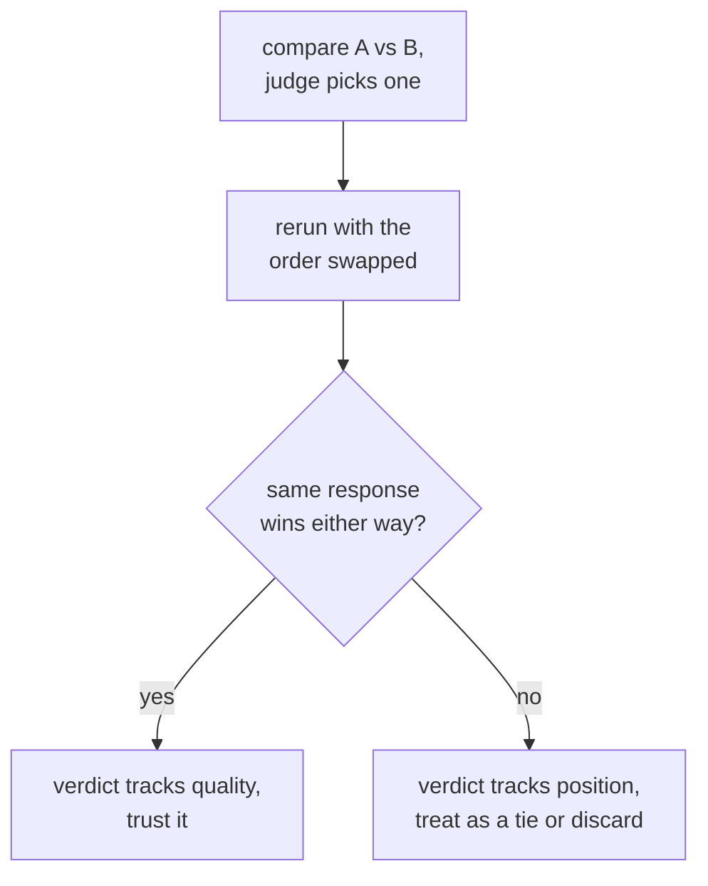

# LLM-as-judge: diseño del prompt, calibración y sesgo

La etapa 3 comprimida para consulta. La [lección 5](../lessons/0005-judge-prompt-design-and-calibration.md) cubre cómo escribir un prompt de juez y comprobar su calibración; la [lección 6](../lessons/0006-judge-bias-and-human-agreement.md) cubre el sesgo de posición, el sesgo de verbosidad y la medición del acuerdo con evaluadores humanos. Esta hoja es la lista de comprobación de diseño, los modos de fallo y las comprobaciones que detectan cada uno.

## Diseñar un prompt de juez

| Decisión | Por qué importa | Si se omite |
|---|---|---|
| Criterios explícitos (corrección, completitud, tono, los que apliquen) | Da a cada juicio la misma vara de medir | Un "¿cuál es mejor?" vago deja que el juez invente su propia rúbrica, de forma distinta en cada llamada |
| Una respuesta de referencia, cuando exista | Da al juez algo con qué contrastar | Sin una, una respuesta fluida pero errónea puede leerse convincente, sobre todo en matemáticas o razonamiento |
| Razonamiento antes de la puntuación | Obliga a justificar el juicio, no a emitir una impresión rápida | Un número a secas es menos consistente que uno precedido de una explicación |
| Una salida estructurada y analizable (una escala forzada, o A/B/empate) | Más fácil de agregar y auditar | La calificación en prosa libre dificulta convertir muchos juicios en un único número resumen |

## Calibración: ¿significa lo mismo una puntuación en todos los ejemplos?

Un juez está calibrado cuando sus puntuaciones siguen la calidad real de forma consistente y sus rankings relativos coinciden con lo que dirían los evaluadores humanos. El fallo con nombre es la **compresión de las puntuaciones hacia el techo**: el juez califica casi todo con un 8 o un 9 sin importar las diferencias reales de calidad, y borra las distinciones que una eval existe para detectar.

La calibración se comprueba, no se supone: ejecuta el juez contra un pequeño conjunto de ejemplos que una persona ya ha calificado y mide el acuerdo antes de confiar en el juez sobre el conjunto más grande y sin etiquetar.

## Sesgo en la calificación pareada: dos fallos con nombre, dos comprobaciones directas

| Sesgo | Qué ocurre | Comprobación directa |
|---|---|---|
| Sesgo de posición | El juez favorece la respuesta que aparece primero (o, en algunos modelos, la segunda), con independencia de la calidad | Vuelve a ejecutar la misma comparación con el orden de las dos respuestas intercambiado; si el ganador sigue la posición y no el contenido, descártalo o trátalo como empate |
| Sesgo de verbosidad | El juez prefiere una respuesta más larga aunque la longitud extra no aporte nada | Comprueba si las preferencias del juez se correlacionan de forma sospechosamente buena con la longitud de la respuesta a lo largo de muchas comparaciones; nombra de forma explícita la completitud y la corrección en los criterios en lugar de la longitud |

## Medir el acuerdo: la vara correcta es el acuerdo entre humanos, no el 100%

La fracción de comparaciones en que la elección del juez coincide con la de un evaluador humano (o la mayoría de varios) es el **acuerdo**. Los evaluadores humanos tampoco coinciden entre sí el 100% de las veces, así que la comparación correcta es el acuerdo entre juez y humano frente al acuerdo entre humanos sobre las mismas comparaciones: un juez cercano a la frecuencia con que los humanos coinciden entre sí lo está haciendo aproximadamente tan bien como lo haría otro evaluador humano. Medido solo contra un techo perfecto, ese mismo número parece una carencia que no es.

## Antes de confiar en el veredicto de un juez

- El prompt nombra criterios explícitos, no un "¿cuál es mejor?" a secas.
- Se aporta una respuesta de referencia siempre que exista una, sobre todo en matemáticas o razonamiento de varios pasos.
- La distribución de puntuaciones del juez se ha comprobado contra una muestra calificada por humanos para detectar compresión hacia el techo.
- Un veredicto pareado se ha vuelto a ejecutar con el orden intercambiado antes de contarlo como una preferencia real.
- Las preferencias del juez se han comprobado frente a la longitud de la respuesta, en busca de una correlación sospechosamente fuerte.
- El acuerdo se reporta junto con la tasa de acuerdo entre humanos con la que se compara, no junto a un 100% a secas.

## Fuentes

- [Paper: "Judging LLM-as-a-Judge with MT-Bench and Chatbot Arena", Zheng et al., 2023](https://arxiv.org/abs/2306.05685)
- [Docs: "Define success criteria and build evaluations", Claude Platform Docs](https://platform.claude.com/docs/en/test-and-evaluate/develop-tests)
- [Recursos](../RESOURCES.md)
