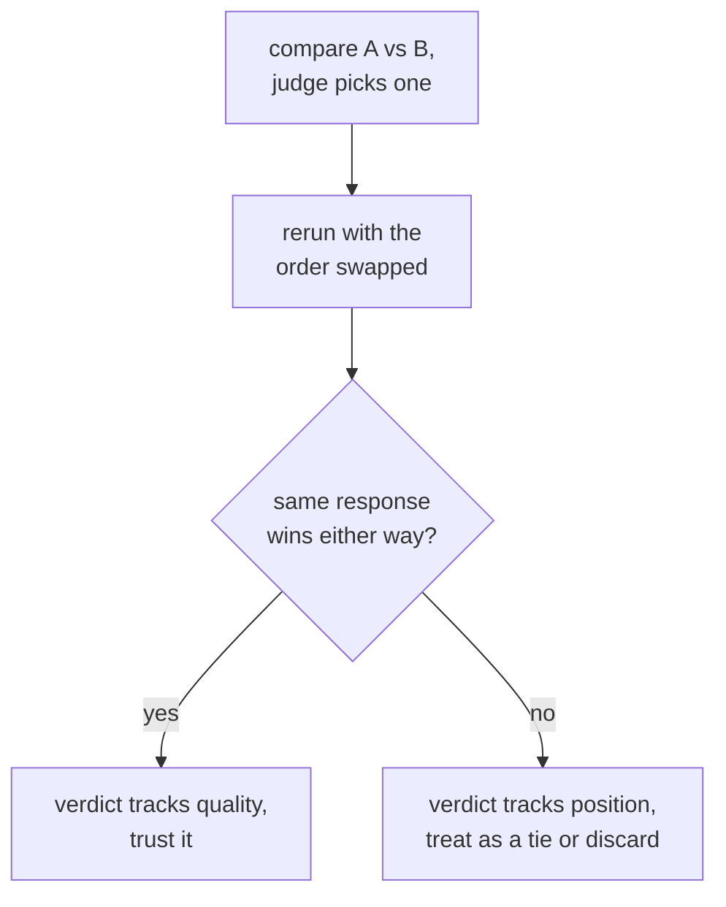

# LLM-as-Judge : conception du prompt, calibration et biais

L'étape 3 condensée pour la consultation. La [leçon 5](../lessons/0005-judge-prompt-design-and-calibration.md) couvre la rédaction d'un prompt de juge et la vérification de sa calibration ; la [leçon 6](../lessons/0006-judge-bias-and-human-agreement.md) couvre le biais de position, le biais de verbosité et la mesure de l'accord avec des annotateurs humains. Cette fiche contient la liste de contrôle de conception, les modes de défaillance et les vérifications qui détectent chacun.

## Concevoir un prompt de juge

| Choix | Pourquoi c'est important | L'omettre |
|---|---|---|
| Des critères explicites (justesse, exhaustivité, ton, selon ce qui s'applique) | Donne à chaque jugement le même étalon | Un vague « lequel est meilleur ? » laisse le juge inventer sa propre grille, différemment à chaque appel |
| Une réponse de référence, quand il en existe une | Donne au juge de quoi vérifier | Sans elle, une réponse fluide mais fausse peut paraître convaincante, surtout en mathématiques ou en raisonnement |
| Le raisonnement avant le score | Force le jugement à être justifié, pas une impression instantanée | Un chiffre nu est moins cohérent qu'un chiffre précédé d'une explication |
| Une sortie structurée et analysable (une échelle imposée, ou A/B/égalité) | Plus facile à agréger et à auditer | Une notation en prose libre se prête mal à la réduction de nombreux jugements en un seul chiffre de synthèse |

## Calibration : un score veut-il dire la même chose d'un exemple à l'autre

Un juge est calibré quand ses scores suivent la vraie qualité de façon cohérente et que ses classements relatifs concordent avec ce que diraient des annotateurs humains. La défaillance nommée est la **compression des scores vers le plafond** : le juge note presque tout 8 ou 9 quelles que soient les vraies différences de qualité, effaçant les distinctions qu'une eval existe pour repérer.

La calibration se vérifie, elle ne se suppose pas : faites passer le juge sur un petit ensemble d'exemples qu'un humain a déjà notés, et mesurez l'accord avant de faire confiance au juge sur l'ensemble plus grand, non étiqueté.

## Biais en comparaison par paires : deux défaillances nommées, deux vérifications directes

| Biais | Ce qui se passe | Vérification directe |
|---|---|---|
| Biais de position | Le juge favorise la réponse qui apparaît en premier (ou, chez certains modèles, en second), indépendamment de la qualité | Relancer la même comparaison en inversant l'ordre des deux réponses ; si le gagnant suit la position plutôt que le contenu, écarter ou traiter comme une égalité |
| Biais de verbosité | Le juge préfère une réponse plus longue même quand la longueur supplémentaire n'apporte rien | Vérifier si les préférences du juge corrèlent de façon suspecte avec la longueur des réponses sur de nombreuses comparaisons ; nommer explicitement l'exhaustivité et la justesse dans les critères plutôt que la longueur |

## Mesurer l'accord : la bonne barre est humain contre humain, pas 100 %

La fraction des comparaisons où le choix du juge coïncide avec celui d'un annotateur humain (ou de la majorité de plusieurs) est l'**accord**. Les annotateurs humains ne sont pas non plus d'accord entre eux 100 % du temps, donc la bonne comparaison est l'accord juge-humain face à l'accord humain-humain sur les mêmes comparaisons : un juge proche de la fréquence à laquelle les humains s'accordent entre eux fait à peu près aussi bien qu'un autre annotateur humain. Mesuré seulement face à un plafond parfait, le même chiffre ressemble à un manque qui n'en est pas un.

## Avant de faire confiance au verdict d'un juge

- Le prompt nomme des critères explicites, pas un simple « lequel est meilleur ? »
- Une réponse de référence est fournie partout où il en existe une, surtout en mathématiques ou en raisonnement à plusieurs étapes.
- La distribution des scores du juge a été vérifiée contre une compression vers le plafond, sur un échantillon noté par des humains.
- Un verdict par paires a été relancé avec l'ordre inversé avant d'être compté comme une vraie préférence.
- Les préférences du juge ont été confrontées à la longueur des réponses, à la recherche d'une corrélation suspectement forte.
- L'accord est rapporté avec le taux d'accord humain-humain auquel il est comparé, pas avec un simple 100 %.

## Sources

- [Article : "Judging LLM-as-a-Judge with MT-Bench and Chatbot Arena", Zheng et al., 2023](https://arxiv.org/abs/2306.05685)
- [Doc : "Define success criteria and build evaluations", Claude Platform Docs](https://platform.claude.com/docs/en/test-and-evaluate/develop-tests)
- [Ressources](../RESOURCES.md)
