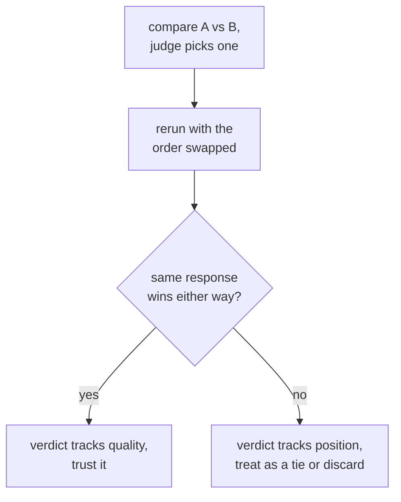

# LLM-as-Judge: Prompt Design, Calibration और Bias

चरण 3, खोजने के लिए संक्षिप्त। [पाठ 5](../lessons/0005-judge-prompt-design-and-calibration.md) judge prompt लिखने और उसकी calibration जाँचने को कवर करता है; [पाठ 6](../lessons/0006-judge-bias-and-human-agreement.md) position bias, verbosity bias और मानव raters से सहमति मापने को कवर करता है। यह शीट डिज़ाइन की checklist, विफलता के तरीक़े और हर एक को पकड़ने वाली जाँचें हैं।

## Judge prompt डिज़ाइन करना

| चुनाव | क्यों मायने रखता है | छोड़ देने पर |
|---|---|---|
| साफ़ कसौटियाँ (correctness, completeness, tone, जो भी लागू हों) | हर निर्णय को एक ही पैमाना देती हैं | धुँधला "कौन बेहतर है?" judge को अपना rubric ख़ुद गढ़ने देता है, हर call पर अलग |
| Reference उत्तर, जब कोई हो | Judge को मिलान के लिए कुछ देता है | इसके बिना, धाराप्रवाह पर ग़लत उत्तर क़ायल करने वाला लग सकता है, ख़ास तौर पर math या reasoning में |
| Score से पहले reasoning | निर्णय को सही ठहराने पर मजबूर करती है, तुरंत की धारणा नहीं रहने देती | खाली संख्या, स्पष्टीकरण से पहले आई संख्या से कम एकसार होती है |
| संरचित, parse होने लायक output (तय scale, या A/B/tie) | Aggregate और audit करना आसान | मुक्त-रूप गद्य grading कई निर्णयों को एक सारांश संख्या में बदलने का विरोध करती है |

## Calibration: क्या score का मतलब examples भर में एक ही है

Judge calibrated तब है जब उसके scores असली गुणवत्ता का लगातार पीछा करते हैं, और उसकी सापेक्ष rankings उससे मेल खाती हैं जो मानव raters कहते। इसकी नामित विफलता है **छत की ओर score compression**: judge असली गुणवत्ता के फ़र्क़ की परवाह किए बिना लगभग हर चीज़ को 8 या 9 देता है, और उन भेदों को मिटा देता है जिन्हें पकड़ने के लिए eval होता है।

Calibration जाँची जाती है, मानी नहीं जाती: judge को उन examples के छोटे सेट पर चलाएँ जिन्हें किसी इंसान ने पहले ही rate किया है, और बड़े, बिना label वाले सेट पर judge पर भरोसा करने से पहले सहमति मापें।

## Pairwise bias: दो नामित विफलताएँ, दो सीधी जाँचें

| Bias | क्या होता है | सीधी जाँच |
|---|---|---|
| Position bias | Judge उस response को पसंद करता है जो पहले आता है (या कुछ models में दूसरे), गुणवत्ता से स्वतंत्र | वही तुलना दोनों responses का क्रम पलटकर दोबारा चलाएँ; अगर विजेता content के बजाय स्थिति का पीछा करता है, तो उसे छोड़ दें या बराबरी मानें |
| Verbosity bias | Judge लंबा response पसंद करता है, तब भी जब अतिरिक्त लंबाई कुछ नहीं जोड़ती | देखें कि कई तुलनाओं में judge की पसंद response की लंबाई से संदिग्ध रूप से अच्छी तरह correlate करती है या नहीं; कसौटियों में लंबाई के बजाय completeness और correctness का साफ़ नाम लें |

## सहमति मापना: सही कसौटी human-vs-human है, 100% नहीं

तुलनाओं का वह हिस्सा जहाँ judge का चुनाव किसी मानव rater (या कई के बहुमत) से मेल खाता है, **agreement** है। मानव raters भी आपस में 100% बार सहमत नहीं होते, इसलिए सही तुलना है उन्हीं तुलनाओं पर judge-vs-human सहमति को human-vs-human सहमति के सामने रखना: जो judge इंसानों के आपस में सहमत होने की दर के क़रीब है, वह उतना ही अच्छा कर रहा है जितना दूसरा मानव rater करता। सिर्फ़ पूर्ण छत के सामने मापने पर वही संख्या ऐसी कमी लगती है जो वह है नहीं।

## Judge के फ़ैसले पर भरोसा करने से पहले

- Prompt साफ़ कसौटियों का नाम लेता है, खाली "कौन बेहतर है?" नहीं।
- जहाँ भी reference उत्तर मौजूद हो वहाँ दिया गया है, ख़ास तौर पर math या बहु-चरणीय reasoning के लिए।
- मानव-rate किए गए नमूने के सामने judge के score वितरण को छत की ओर compression के लिए जाँचा गया है।
- Pairwise फ़ैसले को असली पसंद गिनने से पहले क्रम पलटकर दोबारा चलाया गया है।
- Judge की पसंद को response की लंबाई के सामने, संदिग्ध रूप से मज़बूत correlation के लिए जाँचा गया है।
- सहमति को उस human-vs-human सहमति दर के साथ बताया गया है जिससे उसकी तुलना हो रही है, खाली 100% के साथ नहीं।

## स्रोत

- [पेपर: "Judging LLM-as-a-Judge with MT-Bench and Chatbot Arena", Zheng et al., 2023](https://arxiv.org/abs/2306.05685)
- [दस्तावेज़: "Define success criteria and build evaluations", Claude Platform Docs](https://platform.claude.com/docs/en/test-and-evaluate/develop-tests)
- [संसाधन](../RESOURCES.md)
