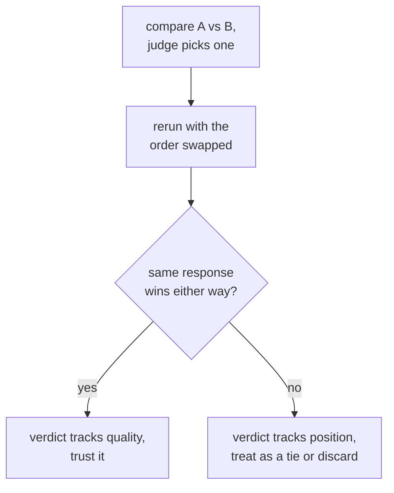

# LLM-as-Judge: Design de Prompt, Calibração e Viés

A etapa 3 condensada para consulta. A [lição 5](../lessons/0005-judge-prompt-design-and-calibration.md) trata de escrever um prompt de juiz e verificar sua calibração; a [lição 6](../lessons/0006-judge-bias-and-human-agreement.md) trata de viés de posição, viés de verbosidade e de medir a concordância com avaliadores humanos. Esta folha reúne o checklist de design, os modos de falha e as verificações que pegam cada um.

## Projetando um prompt de juiz

| Escolha | Por que importa | Se for pulada |
|---|---|---|
| Critérios explícitos (correção, completude, tom, os que se aplicarem) | Dá a cada julgamento a mesma régua | Um "qual é melhor?" vago deixa o juiz inventar a própria rubrica, de modo diferente a cada chamada |
| Uma resposta de referência, quando existe uma | Dá ao juiz algo contra o que conferir | Sem uma, uma resposta fluente porém errada pode soar convincente, especialmente em matemática ou raciocínio |
| Raciocínio antes da pontuação | Obriga o julgamento a ser justificado, e não uma impressão rápida | Um número solto é menos consistente que um precedido por explicação |
| Uma saída estruturada e interpretável (uma escala forçada, ou A/B/empate) | Mais fácil de agregar e auditar | A avaliação em prosa livre resiste a transformar muitos julgamentos em um único número-resumo |

## Calibração: uma pontuação significa a mesma coisa entre os exemplos

Um juiz é calibrado quando suas pontuações acompanham a qualidade real de forma consistente, e seus rankings relativos concordam com o que avaliadores humanos diriam. A falha nomeada é a **compressão da pontuação em direção ao teto**: o juiz dá 8 ou 9 para quase tudo, independentemente das diferenças reais de qualidade, apagando as distinções que um eval existe para pegar.

A calibração é verificada, e não presumida: execute o juiz sobre um pequeno conjunto de exemplos que um humano já avaliou e meça a concordância antes de confiar no juiz sobre o conjunto maior, sem rótulos.

## Viés pairwise: duas falhas nomeadas, duas verificações diretas

| Viés | O que acontece | Verificação direta |
|---|---|---|
| Viés de posição | O juiz favorece a resposta que aparece primeiro (ou, em alguns modelos, a segunda), independentemente da qualidade | Reexecute a mesma comparação com a ordem das duas respostas trocada; se o vencedor acompanha a posição e não o conteúdo, descarte ou trate como empate |
| Viés de verbosidade | O juiz prefere uma resposta mais longa mesmo quando o comprimento extra não acrescenta nada | Verifique se as preferências do juiz se correlacionam de modo suspeitamente bom com o comprimento da resposta ao longo de muitas comparações; nomeie a completude e a correção explicitamente nos critérios, e não o comprimento |

## Medindo a concordância: o patamar certo é humano contra humano, não 100%

A fração das comparações em que a escolha do juiz coincide com a de um avaliador humano (ou da maioria de vários) é a **concordância**. Avaliadores humanos também não concordam entre si 100% das vezes, então a comparação certa é a concordância juiz-humano contra a concordância humano-humano nas mesmas comparações: um juiz próximo de com que frequência os humanos concordam entre si está se saindo mais ou menos tão bem quanto outro avaliador humano se sairia. Medido apenas contra um teto perfeito, o mesmo número parece uma deficiência que não é.

## Antes de confiar no veredito de um juiz

- O prompt nomeia critérios explícitos, e não um "qual é melhor?" solto.
- Uma resposta de referência é fornecida onde quer que exista uma, especialmente em matemática ou raciocínio em vários passos.
- A distribuição de pontuações do juiz foi verificada quanto à compressão em direção ao teto contra uma amostra avaliada por humanos.
- Um veredito pairwise foi reexecutado com a ordem trocada antes de ser contado como uma preferência real.
- As preferências do juiz foram verificadas contra o comprimento da resposta, em busca de uma correlação suspeitamente forte.
- A concordância é reportada junto com a taxa de concordância humano-humano contra a qual está sendo comparada, e não junto com um 100% solto.

## Fontes

- [Artigo científico: "Judging LLM-as-a-Judge with MT-Bench and Chatbot Arena", Zheng et al., 2023](https://arxiv.org/abs/2306.05685)
- [Docs: "Define success criteria and build evaluations", Claude Platform Docs](https://platform.claude.com/docs/en/test-and-evaluate/develop-tests)
- [Recursos](../RESOURCES.md)
