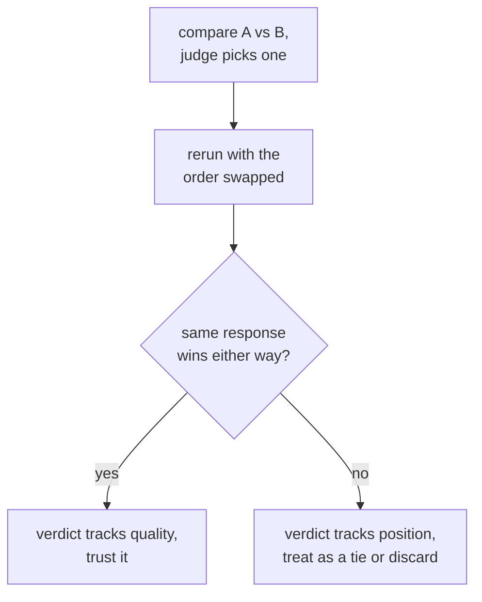

# LLM-судья: дизайн промпта, калибровка и смещения

Этап 3 в сжатом виде для быстрого поиска. [Урок 5](../lessons/0005-judge-prompt-design-and-calibration.md) рассказывает о написании промпта судьи и проверке его калибровки; [урок 6](../lessons/0006-judge-bias-and-human-agreement.md) о смещении по позиции, смещении по многословию и измерении согласия с асессорами-людьми. Эта шпаргалка содержит чек-лист дизайна, виды сбоев и проверки, которые ловят каждый из них.

## Дизайн промпта судьи

| Выбор | Почему важен | Если пропустить |
|---|---|---|
| Явные критерии (корректность, полнота, тон, что применимо) | Даёт каждому суждению одну и ту же мерку | Расплывчатое «что лучше?» позволяет судье изобрести собственную рубрику, каждый раз другую |
| Эталонный ответ, если он есть | Даёт судье, с чем сверяться | Без него беглый, но неверный ответ может выглядеть убедительно, особенно в математике и рассуждениях |
| Рассуждение перед оценкой | Заставляет обосновать суждение, а не выдать сиюминутное впечатление | Голое число менее последовательно, чем число, которому предшествует объяснение |
| Структурированный, разбираемый вывод (принудительная шкала или A/B/ничья) | Проще агрегировать и проверять | Оценка свободной прозой плохо сворачивается из многих суждений в одно итоговое число |

## Калибровка: означает ли оценка одно и то же на разных примерах

Судья откалиброван, когда его оценки последовательно отслеживают реальное качество, а его относительные рейтинги согласуются с тем, что сказали бы асессоры-люди. Названный вид сбоя это **сжатие оценок к потолку**: судья ставит почти всему 8 или 9 независимо от реальных различий в качестве, стирая различия, ради которых эвал и существует.

Калибровку проверяют, а не предполагают: прогоните судью на небольшом наборе примеров, которые человек уже оценил, и измерьте согласие, прежде чем доверять судье на большем, неразмеченном наборе.

## Парные смещения: два названных сбоя, две прямые проверки

| Смещение | Что происходит | Прямая проверка |
|---|---|---|
| Смещение по позиции | Судья отдаёт предпочтение тому ответу, который стоит первым (а у некоторых моделей вторым), независимо от качества | Повторите то же сравнение, поменяв порядок двух ответов; если победитель следует за позицией, а не за содержанием, отбросьте результат или считайте ничьей |
| Смещение по многословию | Судья предпочитает более длинный ответ, даже когда лишняя длина ничего не добавляет | Проверьте, не коррелируют ли предпочтения судьи подозрительно хорошо с длиной ответа по многим сравнениям; называйте в критериях полноту и корректность явно, а не длину |

## Измерение согласия: верная планка это согласие между людьми, а не 100%

Доля сравнений, в которых выбор судьи совпадает с выбором асессора-человека (или большинства нескольких), называется **согласием**. Асессоры-люди тоже не соглашаются друг с другом в 100% случаев, поэтому верное сравнение это согласие судьи с человеком относительно согласия человека с человеком на тех же сравнениях: судья, близкий к тому, как часто люди соглашаются между собой, справляется примерно так же, как справился бы ещё один асессор-человек. Если мерить только относительно идеального потолка, то же число выглядит недобором, которым не является.

## Прежде чем доверять вердикту судьи

- В промпте названы явные критерии, а не голое «что лучше?»
- Эталонный ответ подан везде, где он есть, особенно для математики и многошаговых рассуждений.
- Распределение оценок судьи проверено на сжатие к потолку по размеченной людьми выборке.
- Парный вердикт перепрогнан с обратным порядком, прежде чем считаться настоящим предпочтением.
- Предпочтения судьи проверены на подозрительно сильную корреляцию с длиной ответа.
- Согласие приводится вместе с долей согласия между людьми, с которой его сравнивают, а не рядом с голыми 100%.

## Источники

- [Научная статья: "Judging LLM-as-a-Judge with MT-Bench and Chatbot Arena", Zheng et al., 2023](https://arxiv.org/abs/2306.05685)
- [Документация: "Define success criteria and build evaluations", Claude Platform Docs](https://platform.claude.com/docs/en/test-and-evaluate/develop-tests)
- [Ресурсы](../RESOURCES.md)
