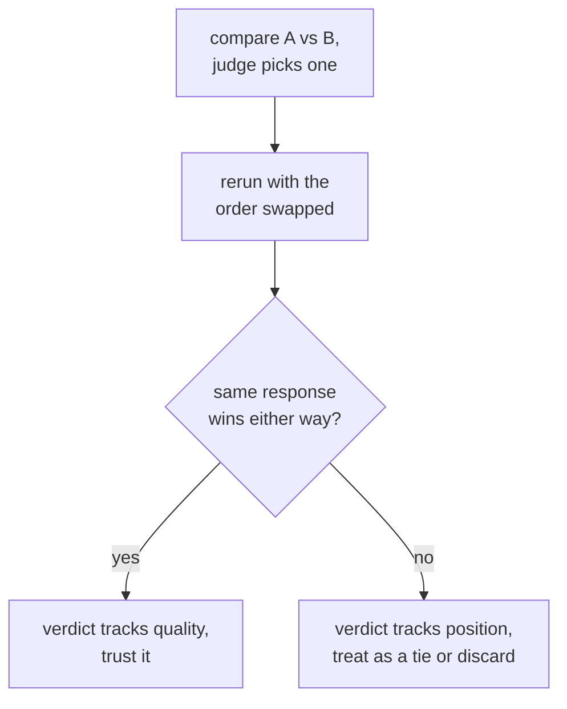

# LLM-as-Judge：提示词设计、校准与偏差

第 3 阶段的内容，压缩成便于查阅的形式。[第 5 课](../lessons/0005-judge-prompt-design-and-calibration.md)讲编写裁判提示词并检查它的校准；[第 6 课](../lessons/0006-judge-bias-and-human-agreement.md)讲位置偏差、冗长偏差，以及度量与人类评分员的一致性。本速查表是设计检查清单、失败模式，以及能抓出每种失败的检查。

## 设计裁判提示词

| 选择 | 为什么重要 | 跳过它的后果 |
|---|---|---|
| 明确的标准（正确性、完整性、语气，哪个适用用哪个） | 让每一次评判都用同一把尺子 | 含糊的“哪个更好？”会让裁判自己发明评分细则，而且每次调用都不一样 |
| 有参考答案时，提供参考答案 | 让裁判有可以核对的东西 | 没有参考答案，流畅却错误的回答可能显得很有说服力，数学或推理题尤其如此 |
| 先推理，再打分 | 迫使评判有理有据，而不是一时的印象 | 一个光秃秃的数字，不如先有解释再给出的数字一致 |
| 结构化、可解析的输出（强制的量表，或 A/B/平局） | 更容易汇总和审计 | 自由形式的散文评分，难以把许多评判汇总成一个数字 |

## 校准：分数在不同样本之间是否含义相同

裁判经过校准，指的是它的分数持续地反映真实的质量，并且它的相对排名与人类评分员会给出的意见一致。这里要点名的失败是**分数向上限压缩**：不管真实的质量差异如何，裁判几乎把所有东西都打成 8 分或 9 分，抹掉了评测本该抓住的那些区别。

校准是要检查的，不能想当然：让裁判去评一小批人类已经评过分的样本，先度量一致性，再在更大的、未标注的评测集上信任这个裁判。

## 成对比较的偏差：两种点名的失败，两种直接的检查

| 偏差 | 发生了什么 | 直接的检查 |
|---|---|---|
| 位置偏差 | 裁判偏向出现在前面（在某些模型中是后面）的回答，与质量无关 | 把两个回答的顺序对调，重跑同一个比较；如果胜者跟着位置走，而不是跟着内容走，就丢弃，或视作平局 |
| 冗长偏差 | 裁判更喜欢更长的回答，即便多出来的篇幅毫无增益 | 在许多次比较中，检查裁判的偏好是否与回答长度的相关性高得可疑；在标准里明确写上完整性和正确性，而不是长度 |

## 度量一致性：正确的基准线是人与人之间，而不是 100%

裁判的选择与某位人类评分员（或几位的多数意见）一致的比较所占的比例，就是**一致性**。人类评分员之间也不会百分之百一致，所以正确的比较，是在同样的比较上，把裁判与人类的一致性，对照人类与人类的一致性：裁判接近人类彼此一致的频率，就说明它做得大致与另一位人类评分员相当。如果只对照一个完美的上限来度量，同一个数字会显得像是一种并不存在的差距。

## 信任裁判的裁定之前

- 提示词写明了明确的标准，而不是光秃秃的“哪个更好？”
- 凡是有参考答案的地方都提供了参考答案，数学和多步推理尤其如此。
- 已经对照人类评过分的样本，检查过裁判的分数分布有没有向上限压缩。
- 成对比较的裁定，在算作真实的偏好之前，已经对调顺序重跑过。
- 已经检查过裁判的偏好与回答长度之间，是否有高得可疑的相关性。
- 报告一致性时，同时给出用来对照的人与人之间的一致率，而不是对照一个光秃秃的 100%。

## 来源

- [论文：“Judging LLM-as-a-Judge with MT-Bench and Chatbot Arena”，Zheng 等，2023](https://arxiv.org/abs/2306.05685)
- [文档：“Define success criteria and build evaluations”，Claude Platform Docs](https://platform.claude.com/docs/en/test-and-evaluate/develop-tests)
- [资源](../RESOURCES.md)
