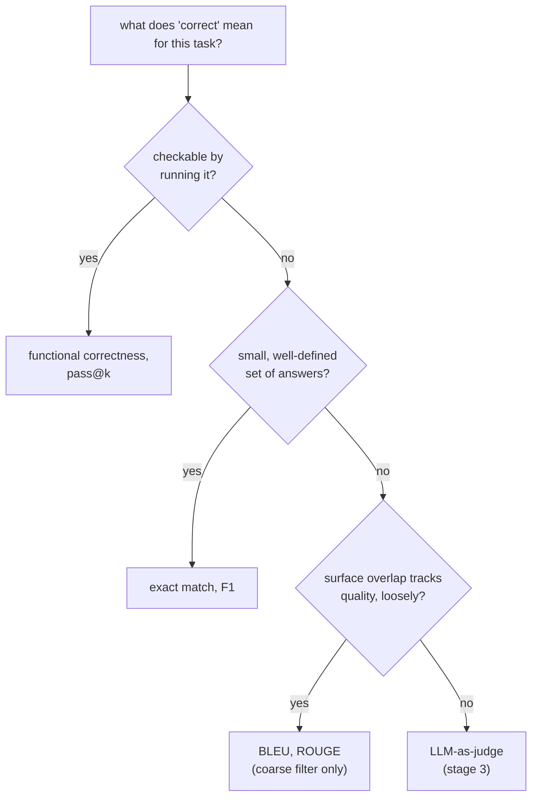

# Métricas: elegir una y calcularla

La etapa 2 comprimida para consulta. La [lección 3](../lessons/0003-task-specific-metrics.md) cubre la coincidencia exacta, el F1 y BLEU/ROUGE; la [lección 4](../lessons/0004-code-execution-metrics.md) cubre la corrección funcional, pass@k y el principio de decisión que une las cuatro. Esta hoja es la tabla comparativa, la fórmula de pass@k y la regla de decisión.

## Las cuatro, lado a lado

| Métrica | Compara | Encaja con | Ciega a |
|---|---|---|---|
| Coincidencia exacta | Predicción y referencia, cadena por cadena (tras una normalización ligera) | Un conjunto pequeño y bien definido de respuestas: clasificación, extracción, aritmética | Cualquier respuesta correcta formulada de forma distinta a la referencia |
| F1 a nivel de token | Predicción y referencia como bolsas de tokens; precisión, recall, media armónica | Tareas extractivas como QA basado en fragmentos, donde se espera cierto margen de formulación | El orden de las palabras, y si las palabras que se solapan se combinan en una afirmación correcta |
| BLEU / ROUGE | El solapamiento de n-gramas del texto generado con una o más referencias | Un filtro grueso y barato de primera pasada para texto abierto: traducción, resumen | Una paráfrasis válida con pocos n-gramas compartidos; se correlaciona solo de forma laxa con la calidad |
| Corrección funcional / pass@k | El comportamiento real del código, ejecutado contra casos de prueba | Código, donde la corrección es de comportamiento, no textual | Nada textual; no aplica fuera de una salida ejecutable |

## Calcular el F1 a partir de dos conjuntos de tokens

Precisión = tokens compartidos / número de tokens de la predicción. Recall = tokens compartidos / número de tokens de la referencia. F1 = su media armónica.

La referencia "the cat sat on the mat" (6 tokens) frente a la predicción "a cat sat on the mat" (6 tokens) comparte 5 tokens (`cat, sat, on, the, mat`; el segundo `the` de la referencia y el `a` de la predicción quedan cada uno sin emparejar): precisión `5/6`, recall `5/6`, F1 `5/6 ≈ 0.83`.

## Calcular pass@k

La generación de código de un LLM es estocástica, así que `pass@k` pregunta: de *k* soluciones muestreadas, ¿cuál es la probabilidad de que al menos una pase todas las pruebas? Generar exactamente *k* muestras y comprobarlas es ruidoso para *k* pequeño. El estimador insesgado, en cambio, genera un *n* mayor, cuenta cuántas, *c*, son correctas y calcula la probabilidad de forma analítica:

```text
pass@k = 1 − C(n−c, k) / C(n, k)
```

`C(n−c, k) / C(n, k)` es la probabilidad de que una extracción aleatoria de *k* soluciones, sin reemplazo, de las *n* generadas, no incluya ninguna de las *c* correctas; 1 menos eso es la probabilidad de que se incluya al menos una solución correcta. Esto reutiliza cada muestra generada para cualquier `k` hasta `n`, en lugar de volver a muestrear por cada `k`.

Ejemplo resuelto, `n = 10`, `c = 3`:

| k | Cálculo | Resultado |
|---|---|---|
| 1 | `1 − C(7,1)/C(10,1) = 1 − 7/10` | `0.3` (igual a `c/n`, como cabe esperar cuando `k = 1`) |
| 5 | `1 − C(7,5)/C(10,5) = 1 − 21/252` | `≈ 0.917` |

## El principio de decisión

Ajusta la métrica a lo que "correcto" significa para la tarea, en este orden:



## Antes de confiar en la elección de una métrica

- La noción de "correcto" de la tarea se declara de forma explícita, no se supone por costumbre ni por lo que una biblioteca tenga por defecto.
- La coincidencia exacta o el F1 no se aplican a una tarea con muchas formulaciones igual de válidas (código, prosa abierta).
- BLEU/ROUGE se usa como filtro grueso, no se cita como veredicto final sobre la calidad de la generación.
- Una estimación de `pass@k` reporta qué `k` se usó y a partir de cuántas muestras `n` se calculó.

## Fuentes

- [Docs: Evaluate, Hugging Face](https://huggingface.co/docs/evaluate/index)
- [Paper: "Evaluating Large Language Models Trained on Code" (Codex), Chen et al., 2021](https://arxiv.org/abs/2107.03374)
- [Docs: "Define success criteria and build evaluations", Claude Platform Docs](https://platform.claude.com/docs/en/test-and-evaluate/develop-tests)
- [Recursos](../RESOURCES.md)
