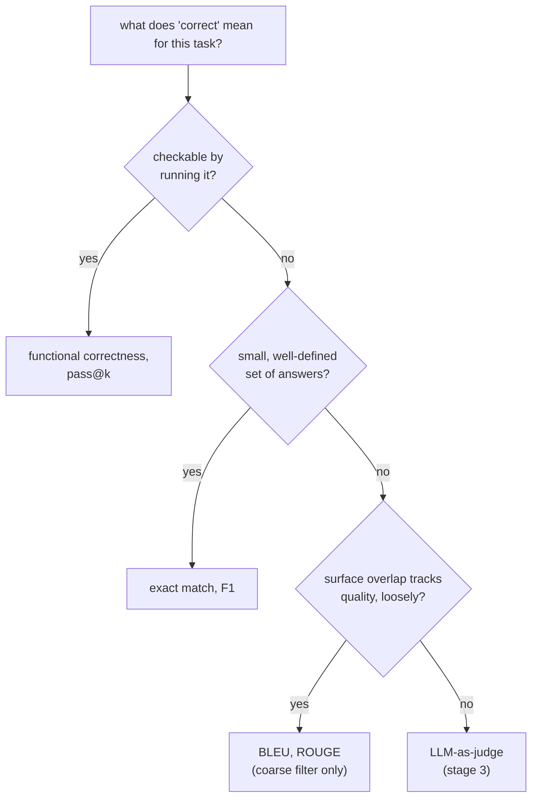

# Métriques : en choisir une et la calculer

L'étape 2 condensée pour la consultation. La [leçon 3](../lessons/0003-task-specific-metrics.md) couvre l'exact match, le F1 et BLEU/ROUGE ; la [leçon 4](../lessons/0004-code-execution-metrics.md) couvre la correction fonctionnelle, pass@k et le principe de décision qui relie les quatre. Cette fiche contient le tableau comparatif, la formule de pass@k et la règle de décision.

## Les quatre, côte à côte

| Métrique | Compare | Convient à | Aveugle à |
|---|---|---|---|
| Exact match | Prédiction et référence, chaîne contre chaîne (après une normalisation légère) | Un petit ensemble de réponses bien défini : classification, extraction, arithmétique | Toute bonne réponse formulée autrement que la référence |
| F1 au niveau des tokens | Prédiction et référence comme sacs de tokens ; précision, rappel, moyenne harmonique | Les tâches extractives comme le QA par span, où l'on s'attend à une certaine marge de formulation | L'ordre des mots, et le fait que des mots communs forment ou non une affirmation correcte |
| BLEU / ROUGE | Recouvrement de n-grammes du texte généré avec une ou plusieurs références | Un filtre grossier et peu coûteux en première passe sur du texte ouvert : traduction, résumé | Une paraphrase valide avec peu de n-grammes communs ; ne corrèle que vaguement avec la qualité |
| Correction fonctionnelle / pass@k | Le comportement réel du code, exécuté sur des cas de test | Le code, où la justesse est comportementale, pas textuelle | Rien de textuel ; ne s'applique pas en dehors d'une sortie exécutable |

## Calculer le F1 à partir de deux ensembles de tokens

Précision = tokens communs / nombre de tokens de la prédiction. Rappel = tokens communs / nombre de tokens de la référence. F1 = leur moyenne harmonique.

La référence « the cat sat on the mat » (6 tokens) face à la prédiction « a cat sat on the mat » (6 tokens) partage 5 tokens (`cat, sat, on, the, mat` ; le second `the` de la référence et le `a` de la prédiction restent chacun sans correspondance) : précision `5/6`, rappel `5/6`, F1 `5/6 ≈ 0.83`.

## Calculer pass@k

La génération de code d'un LLM est stochastique, donc `pass@k` demande : sur *k* solutions échantillonnées, quelle est la probabilité qu'au moins une passe tous les tests ? Générer exactement *k* échantillons et les vérifier est bruité pour un *k* petit. L'estimateur non biaisé génère à la place un *n* plus grand, compte combien, *c*, sont correctes, et calcule la probabilité analytiquement :

```text
pass@k = 1 − C(n−c, k) / C(n, k)
```

`C(n−c, k) / C(n, k)` est la probabilité qu'un tirage aléatoire de *k* solutions, sans remise, parmi les *n* générées, rate les *c* solutions correctes ; 1 moins cela est la probabilité qu'au moins une solution correcte soit incluse. Cela réutilise chaque échantillon généré pour tout `k` jusqu'à `n`, plutôt que de rééchantillonner pour chaque `k`.

Exemple détaillé, `n = 10`, `c = 3` :

| k | Calcul | Résultat |
|---|---|---|
| 1 | `1 − C(7,1)/C(10,1) = 1 − 7/10` | `0.3` (égal à `c/n`, comme attendu quand `k = 1`) |
| 5 | `1 − C(7,5)/C(10,5) = 1 − 21/252` | `≈ 0.917` |

## Le principe de décision

Faites correspondre la métrique à ce que « correct » veut dire pour la tâche, dans cet ordre :



## Avant de faire confiance à un choix de métrique

- La notion de « correct » propre à la tâche est énoncée explicitement, et non supposée par habitude ou d'après le défaut d'une bibliothèque.
- L'exact match ou le F1 n'est pas appliqué à une tâche qui admet de nombreuses formulations tout aussi valables (code, prose ouverte).
- BLEU/ROUGE est utilisé comme filtre grossier, et non cité comme verdict final sur la qualité de la génération.
- Une estimation de `pass@k` indique quel `k` a été utilisé et à partir de combien d'échantillons `n` elle a été calculée.

## Sources

- [Doc : Evaluate, Hugging Face](https://huggingface.co/docs/evaluate/index)
- [Article : "Evaluating Large Language Models Trained on Code" (Codex), Chen et al., 2021](https://arxiv.org/abs/2107.03374)
- [Doc : "Define success criteria and build evaluations", Claude Platform Docs](https://platform.claude.com/docs/en/test-and-evaluate/develop-tests)
- [Ressources](../RESOURCES.md)
