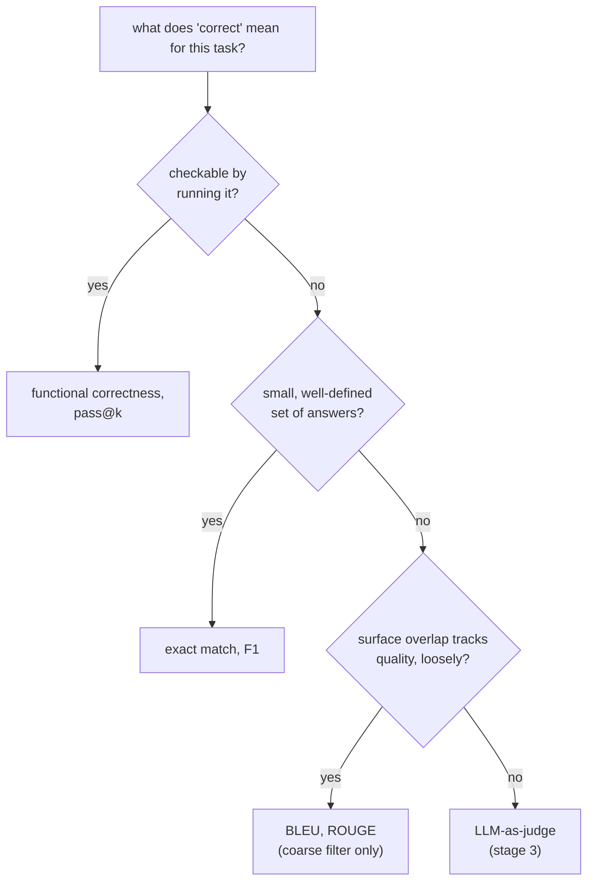

# Metrics: एक चुनना और निकालना

चरण 2, खोजने के लिए संक्षिप्त। [पाठ 3](../lessons/0003-task-specific-metrics.md) exact match, F1 और BLEU/ROUGE को कवर करता है; [पाठ 4](../lessons/0004-code-execution-metrics.md) functional correctness, pass@k और चारों को जोड़ने वाले निर्णय-सिद्धांत को कवर करता है। यह शीट तुलना की तालिका, pass@k का सूत्र और निर्णय का नियम है।

## चारों, साथ-साथ

| Metric | किसकी तुलना करती है | कहाँ ठीक बैठती है | किसके प्रति अंधी है |
|---|---|---|---|
| Exact match | Prediction और reference, string से string (हल्के normalization के बाद) | उत्तरों का छोटा, साफ़-परिभाषित सेट: classification, extraction, अंकगणित | Reference से अलग ढंग से कहा गया कोई भी सही उत्तर |
| Token-level F1 | Prediction और reference tokens की थैली के रूप में; precision, recall, harmonic mean | Span-आधारित QA जैसे extractive tasks, जहाँ शब्दावली में कुछ ढील अपेक्षित है | शब्दों का क्रम, और यह कि मेल खाते शब्द मिलकर सही दावा बनाते हैं या नहीं |
| BLEU / ROUGE | Generate किए text का एक या ज़्यादा references से n-gram overlap | खुले-सिरे वाले text पर मोटा, सस्ता पहला छन्ना: अनुवाद, सारांश | कम साझा n-grams वाला वैध paraphrase; गुणवत्ता से सिर्फ़ ढीला correlate करती है |
| Functional correctness / pass@k | Code का असल व्यवहार, test cases पर चलाकर | Code, जहाँ correctness व्यवहार की है, text की नहीं | text के स्तर पर किसी चीज़ के प्रति नहीं; चलाने लायक output के बाहर लागू नहीं होती |

## दो token सेट से F1 निकालना

Precision = साझा tokens / prediction के tokens की गिनती। Recall = साझा tokens / reference के tokens की गिनती। F1 = उनका harmonic mean।

Reference "the cat sat on the mat" (6 tokens) और prediction "a cat sat on the mat" (6 tokens) में 5 tokens साझा हैं (`cat, sat, on, the, mat`; reference का दूसरा `the` और prediction का `a`, दोनों बिना मेल के हैं): precision `5/6`, recall `5/6`, F1 `5/6 ≈ 0.83`।

## pass@k निकालना

LLM की code generation stochastic है, इसलिए `pass@k` पूछता है: *k* sample किए हल में से, कम से कम एक के सारे tests पास करने की संभावना क्या है? ठीक *k* samples बनाकर उन्हें जाँचना छोटे *k* के लिए noisy है। Unbiased estimator इसके बजाय बड़ा *n* बनाता है, गिनता है कि उनमें से कितने, *c*, सही हैं, और संभावना विश्लेषणात्मक रूप से निकालता है:

```text
pass@k = 1 − C(n−c, k) / C(n, k)
```

`C(n−c, k) / C(n, k)` इस बात की संभावना है कि बनाए गए *n* में से बिना प्रतिस्थापन के *k* हल का यादृच्छिक चुनाव सभी *c* सही हलों को चूक जाए; 1 में से उसे घटाने पर संभावना मिलती है कि कम से कम एक सही हल शामिल है। यह हर `k` के लिए दोबारा sample करने के बजाय `n` तक के किसी भी `k` के लिए बनाए गए हर sample को दोबारा इस्तेमाल करता है।

हल किया हुआ उदाहरण, `n = 10`, `c = 3`:

| k | गणना | नतीजा |
|---|---|---|
| 1 | `1 − C(7,1)/C(10,1) = 1 − 7/10` | `0.3` (`c/n` के बराबर, जैसा `k = 1` पर अपेक्षित है) |
| 5 | `1 − C(7,5)/C(10,5) = 1 − 21/252` | `≈ 0.917` |

## निर्णय-सिद्धांत

Metric को उससे मिलाएँ जो task के लिए "सही" का मतलब है, इसी क्रम में:



## Metric के चुनाव पर भरोसा करने से पहले

- Task के "सही" का विचार साफ़ बताया गया है, आदत से या किसी library के default से माना नहीं गया।
- Exact match या F1 ऐसे task पर नहीं लगाई जा रही जिसमें कई बराबर वैध शब्दावलियाँ हों (code, खुला गद्य)।
- BLEU/ROUGE मोटे छन्ने के रूप में इस्तेमाल हो रही है, generation की गुणवत्ता पर अंतिम फ़ैसले के रूप में cite नहीं की जा रही।
- `pass@k` का अनुमान बताता है कि कौन-सा `k` इस्तेमाल हुआ और कितने samples `n` से निकाला गया।

## स्रोत

- [दस्तावेज़: Evaluate, Hugging Face](https://huggingface.co/docs/evaluate/index)
- [पेपर: "Evaluating Large Language Models Trained on Code" (Codex), Chen et al., 2021](https://arxiv.org/abs/2107.03374)
- [दस्तावेज़: "Define success criteria and build evaluations", Claude Platform Docs](https://platform.claude.com/docs/en/test-and-evaluate/develop-tests)
- [संसाधन](../RESOURCES.md)
