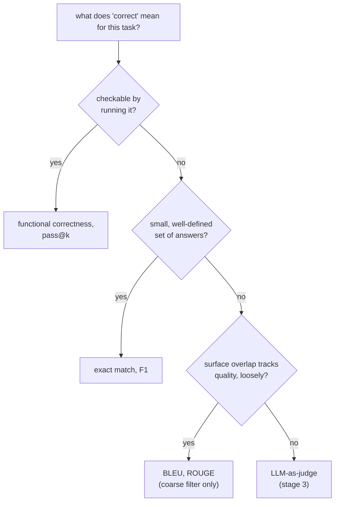

# Métricas: Escolher e Calcular uma

A etapa 2 condensada para consulta. A [lição 3](../lessons/0003-task-specific-metrics.md) trata de exact match, F1 e BLEU/ROUGE; a [lição 4](../lessons/0004-code-execution-metrics.md) trata de correção funcional, pass@k e do princípio de decisão que amarra os quatro. Esta folha reúne a tabela de comparação, a fórmula do pass@k e a regra de decisão.

## Os quatro, lado a lado

| Métrica | Compara | Serve a | Cega a |
|---|---|---|---|
| Exact match | Predição e referência, string por string (após normalização leve) | Um conjunto pequeno e bem definido de respostas: classificação, extração, aritmética | Qualquer resposta correta formulada de modo diferente da referência |
| F1 em nível de token | Predição e referência como sacos de tokens; precisão, recall, média harmônica | Tarefas extrativas como QA baseado em trechos, em que alguma folga de formulação é esperada | A ordem das palavras, e se as palavras em comum se combinam em uma afirmação correta |
| BLEU / ROUGE | A sobreposição de n-gramas do texto gerado contra uma ou mais referências | Um filtro grosseiro e barato de primeira passada em texto aberto: tradução, sumarização | Uma paráfrase válida com poucos n-gramas em comum; correlaciona-se apenas frouxamente com a qualidade |
| Correção funcional / pass@k | O comportamento real do código, executado contra casos de teste | Código, onde a correção é comportamental, e não textual | Nada textual; não se aplica fora de uma saída executável |

## Calculando o F1 a partir de dois conjuntos de tokens

Precisão = tokens em comum / número de tokens da predição. Recall = tokens em comum / número de tokens da referência. F1 = sua média harmônica.

A referência "the cat sat on the mat" (6 tokens) contra a predição "a cat sat on the mat" (6 tokens) compartilha 5 tokens (`cat, sat, on, the, mat`; o segundo `the` da referência e o `a` da predição ficam, cada um, sem correspondência): precisão `5/6`, recall `5/6`, F1 `5/6 ≈ 0.83`.

## Calculando o pass@k

A geração de código de um LLM é estocástica, então o `pass@k` pergunta: entre *k* soluções amostradas, qual é a probabilidade de que pelo menos uma passe em todos os testes? Gerar exatamente *k* amostras e verificá-las é ruidoso para *k* pequeno. O estimador não enviesado, em vez disso, gera um *n* maior, conta quantas, *c*, estão corretas e calcula a probabilidade analiticamente:

```text
pass@k = 1 − C(n−c, k) / C(n, k)
```

`C(n−c, k) / C(n, k)` é a probabilidade de que uma retirada aleatória de *k* soluções, sem reposição, entre as *n* geradas, perca todas as *c* corretas; 1 menos isso é a probabilidade de que pelo menos uma solução correta seja incluída. Isso reaproveita cada amostra gerada para qualquer `k` até `n`, em vez de reamostrar para cada `k`.

Exemplo resolvido, `n = 10`, `c = 3`:

| k | Cálculo | Resultado |
|---|---|---|
| 1 | `1 − C(7,1)/C(10,1) = 1 − 7/10` | `0.3` (igual a `c/n`, como esperado quando `k = 1`) |
| 5 | `1 − C(7,5)/C(10,5) = 1 − 21/252` | `≈ 0.917` |

## O princípio de decisão

Case a métrica com o que "correto" significa para a tarefa, nesta ordem:



## Antes de confiar em uma escolha de métrica

- A noção de "correto" da tarefa está declarada explicitamente, e não presumida por hábito ou pelo que uma biblioteca define como padrão.
- Exact match ou F1 não está sendo aplicado a uma tarefa com muitas formulações igualmente válidas (código, prosa aberta).
- BLEU/ROUGE está sendo usado como filtro grosseiro, e não citado como veredito final sobre a qualidade da geração.
- Uma estimativa de `pass@k` reporta qual `k` foi usado e a partir de quantas amostras `n` foi calculada.

## Fontes

- [Docs: Evaluate, Hugging Face](https://huggingface.co/docs/evaluate/index)
- [Artigo científico: "Evaluating Large Language Models Trained on Code" (Codex), Chen et al., 2021](https://arxiv.org/abs/2107.03374)
- [Docs: "Define success criteria and build evaluations", Claude Platform Docs](https://platform.claude.com/docs/en/test-and-evaluate/develop-tests)
- [Recursos](../RESOURCES.md)
