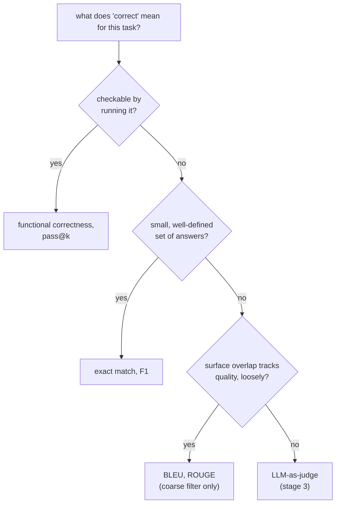

# Метрики: как выбрать и как вычислить

Этап 2 в сжатом виде для быстрого поиска. [Урок 3](../lessons/0003-task-specific-metrics.md) рассказывает о точном совпадении, F1 и BLEU/ROUGE; [урок 4](../lessons/0004-code-execution-metrics.md) о функциональной корректности, pass@k и принципе выбора, связывающем все четыре. Эта шпаргалка содержит сравнительную таблицу, формулу pass@k и правило выбора.

## Четыре метрики рядом

| Метрика | Что сравнивает | Подходит для | Слепа к |
|---|---|---|---|
| Точное совпадение | Предсказание и эталон, строка в строку (после лёгкой нормализации) | Небольшого, чётко определённого набора ответов: классификация, извлечение, арифметика | Любому верному ответу, сформулированному иначе, чем эталон |
| F1 на уровне токенов | Предсказание и эталон как мешки токенов; точность, полнота, гармоническое среднее | Экстрактивных задач вроде вопросов и ответов по фрагменту текста, где допускается некоторая свобода формулировок | Порядку слов и тому, складываются ли совпавшие слова в верное утверждение |
| BLEU / ROUGE | Перекрытие n-грамм сгенерированного текста с одним или несколькими эталонами | Грубого и дешёвого первичного фильтра для открытого текста: перевод, суммаризация | Верному пересказу с малым числом общих n-грамм; лишь слабо коррелирует с качеством |
| Функциональная корректность / pass@k | Фактическое поведение кода, выполненного на тестах | Кода, где корректность поведенческая, а не текстовая | Ничему текстовому; не применима вне выполняемого вывода |

## Вычисление F1 по двум множествам токенов

Точность = общие токены / число токенов предсказания. Полнота = общие токены / число токенов эталона. F1 = их гармоническое среднее.

Эталон «the cat sat on the mat» (6 токенов) против предсказания «a cat sat on the mat» (6 токенов) делит 5 токенов (`cat, sat, on, the, mat`; второе `the` эталона и `a` предсказания остаются без пары): точность `5/6`, полнота `5/6`, F1 `5/6 ≈ 0.83`.

## Вычисление pass@k

Генерация кода LLM стохастична, поэтому `pass@k` спрашивает: если взять *k* сгенерированных решений, какова вероятность, что хотя бы одно проходит все тесты? Генерировать ровно *k* образцов и проверять их шумно при малых *k*. Несмещённая оценка вместо этого генерирует большее *n*, считает, сколько из них, *c*, верны, и вычисляет вероятность аналитически:

```text
pass@k = 1 − C(n−c, k) / C(n, k)
```

`C(n−c, k) / C(n, k)` это вероятность того, что случайная выборка *k* решений без возвращения из *n* сгенерированных обойдёт все *c* верных; единица минус это вероятность, что хотя бы одно верное решение попадёт в выборку. Так каждый сгенерированный образец переиспользуется для любого `k` вплоть до `n`, а не генерируется заново для каждого `k`.

Разобранный пример, `n = 10`, `c = 3`:

| k | Вычисление | Результат |
|---|---|---|
| 1 | `1 − C(7,1)/C(10,1) = 1 − 7/10` | `0.3` (равно `c/n`, как и ожидается при `k = 1`) |
| 5 | `1 − C(7,5)/C(10,5) = 1 − 21/252` | `≈ 0.917` |

## Принцип выбора

Подбирайте метрику под то, что значит «верно» для задачи, в таком порядке:



## Прежде чем доверять выбору метрики

- Понятие «верно» для задачи сформулировано явно, а не взято по привычке или из значений по умолчанию библиотеки.
- Точное совпадение или F1 не применяется к задаче со множеством одинаково верных формулировок (код, открытая проза).
- BLEU/ROUGE используется как грубый фильтр, а не приводится как окончательный вердикт о качестве генерации.
- В оценке `pass@k` указано, какое `k` использовано и по скольким образцам `n` она вычислена.

## Источники

- [Документация: Evaluate, Hugging Face](https://huggingface.co/docs/evaluate/index)
- [Научная статья: "Evaluating Large Language Models Trained on Code" (Codex), Chen et al., 2021](https://arxiv.org/abs/2107.03374)
- [Документация: "Define success criteria and build evaluations", Claude Platform Docs](https://platform.claude.com/docs/en/test-and-evaluate/develop-tests)
- [Ресурсы](../RESOURCES.md)
