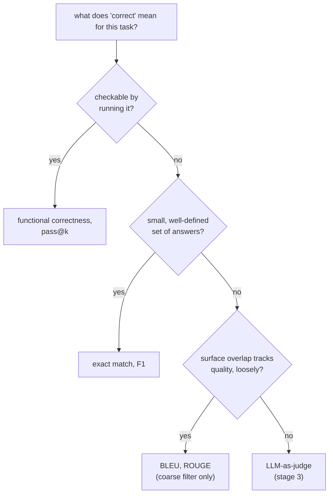

# 指标：选择并计算

第 2 阶段的内容，压缩成便于查阅的形式。[第 3 课](../lessons/0003-task-specific-metrics.md)讲精确匹配、F1 和 BLEU/ROUGE；[第 4 课](../lessons/0004-code-execution-metrics.md)讲功能正确性、pass@k，以及把这四者串起来的决策原则。本速查表是对比表、pass@k 公式和决策规则。

## 四种指标并列对比

| 指标 | 比较的对象 | 适合 | 看不见 |
|---|---|---|---|
| 精确匹配 | 预测与参考答案，逐字符串比较（经过轻度归一化） | 答案集合小而明确的任务：分类、抽取、算术 | 任何措辞与参考答案不同的正确答案 |
| token 级 F1 | 把预测和参考答案各看作 token 的集合；精确率、召回率及其调和平均 | 像基于片段的问答这类抽取式任务，其中允许一定的措辞出入 | 词序，以及重叠的词合在一起是否构成正确的论断 |
| BLEU / ROUGE | 生成文本与一个或多个参考答案之间的 n-gram 重叠 | 对开放式文本（翻译、摘要）做粗略、廉价的初筛 | 共有 n-gram 很少的有效改写；与质量只有松散的相关性 |
| 功能正确性 / pass@k | 代码的实际行为，对测试用例运行得出 | 代码，因为它的正确性是行为上的，而不是文本上的 | 与文本无关，它不适用于不可运行的输出 |

## 由两个 token 集合计算 F1

精确率 = 共有 token 数 / 预测的 token 数。召回率 = 共有 token 数 / 参考答案的 token 数。F1 = 二者的调和平均。

参考答案 “the cat sat on the mat”（6 个 token）与预测 “a cat sat on the mat”（6 个 token）共有 5 个 token（`cat, sat, on, the, mat`；参考答案中的第二个 `the` 和预测中的 `a` 各自没有匹配）：精确率 `5/6`，召回率 `5/6`，F1 为 `5/6 ≈ 0.83`。

## 计算 pass@k

LLM 的代码生成是随机的，所以 `pass@k` 问的是：在采样出的 *k* 个解答中，至少有一个通过全部测试的概率是多少？恰好生成 *k* 个样本再检查，在 *k* 较小时噪声很大。无偏估计量的做法是：生成一个更大的 *n*，数出其中正确的有 *c* 个，再用解析的方式计算这个概率：

```text
pass@k = 1 − C(n−c, k) / C(n, k)
```

`C(n−c, k) / C(n, k)` 是从生成的 *n* 个解答中，不放回地随机抽取 *k* 个，却把 *c* 个正确解答全部漏掉的概率；1 减去它，就是至少包含一个正确解答的概率。这样，对不超过 `n` 的任何 `k`，每个生成的样本都能被重复利用，而不必为每个 `k` 重新采样。

算例，`n = 10`，`c = 3`：

| k | 计算 | 结果 |
|---|---|---|
| 1 | `1 − C(7,1)/C(10,1) = 1 − 7/10` | `0.3`（等于 `c/n`，`k = 1` 时本该如此） |
| 5 | `1 − C(7,5)/C(10,5) = 1 − 21/252` | `≈ 0.917` |

## 决策原则

让指标与任务中“正确”的含义相匹配，按这个顺序：



## 信任指标的选择之前

- 任务中“正确”的含义是明确说出来的，而不是出于习惯，或某个库的默认设置而想当然。
- 没有把精确匹配或 F1 用在有许多同样有效的措辞的任务上（代码、开放式的散文）。
- BLEU/ROUGE 被当作粗略的初筛来用，而不是被引用为生成质量的最终裁定。
- `pass@k` 的估计值会说明用的是哪个 `k`，以及是由多少个样本 `n` 算出来的。

## 来源

- [文档：Evaluate，Hugging Face](https://huggingface.co/docs/evaluate/index)
- [论文：“Evaluating Large Language Models Trained on Code”（Codex），Chen 等，2021](https://arxiv.org/abs/2107.03374)
- [文档：“Define success criteria and build evaluations”，Claude Platform Docs](https://platform.claude.com/docs/en/test-and-evaluate/develop-tests)
- [资源](../RESOURCES.md)
