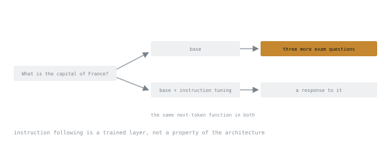

# 第 1 课：基础模型到底是什么

**使命关联:** 在确切知道模型放着不管时会做什么之前，你无法判断微调是不是正确的答案。
**主要来源:** [LLM Visualization，Brendan Bycroft](https://bbycroft.net/llm)
**前置知识:** 无，这是第一课。

## 要点

语言模型就是一个函数。它接收一串 token ID，为词表中的每个 token 返回一个分数，描述接下来可能出现什么。整个运算就是这样。聊天、工具调用、拒答、推理轨迹，全都建立在这一步“预测下一个 token”之上。

这些原始分数叫作 **logits**。softmax 把它们变成概率分布，采样器从这个分布里挑出一个 token，把它追加到序列末尾，函数再运行一次。文本就这样一个 token 一个 token 地冒出来，除此之外什么也没有发生。

有两个推论，对后面的一切都很重要。

**推理时权重不会改变**。当模型看起来记得对话前面的某件事时，这份记忆是躺在它上下文窗口里的 token，而不是模型发生了变化。在本工作区里，只有微调会改变权重，而且它发生在离线阶段，在部署服务之前。

**采样不等于模型**。温度、top-p 和 top-k 是在模型产出分布之后，才对这个分布重新塑形。如果改变温度后输出质量变了，你学到的是采样器的特性，而不是权重的特性。在把任何现象归因于训练之前，先把采样固定住。

### 基础模型与指令模型

**基础**模型只用一个目标训练过：在一个非常庞大的语料库上预测下一个 token。它不会回答问题。给它 `What is the capital of France?`，它可能接着再写出三道考试题，因为它的训练数据中，这句话周围的文本就是那个样子。

**指令**模型或**对话**模型，是在基础模型之上，用成对的指令和回复继续训练出来的，这就是监督微调，在这之后通常还要用人类或模型的偏好数据继续训练。你觉得理所当然的遵循指令的行为，是后来训练出来的一层，而不是架构本身的属性。

同一个提示词，两种续写，而二者底层都是同一个预测下一个 token 的函数。第二个框就是第一个框加上训练，差别就出在这里。

从哪一个出发，是一个真正的决定：

| 出发点 | 你继承到的 | 你必须自己补上的 |
|---|---|---|
| 基础模型 | 只有原始的语言能力 | 每一条格式和行为上的约定 |
| 指令模型 | 格式、遵循指令、拒答行为 | 只需补上你的任务，但有可能损害已有的能力 |

大多数适配器微调都从指令模型出发，因为在小数据集上从头重建遵循指令的能力，是一桩亏本的买卖。代价是你的训练数据现在要和厂商已经做过的训练竞争，而这种竞争正是后面[灾难性遗忘](../GLOSSARY.md)的来源。

### 训练信号

训练时，模型会看到一段真实的序列，并按它给真正出现的下一个 token 分配了多少概率来打分。这个分数就是**交叉熵损失**。损失低，意味着模型觉得真实的续写并不让它意外。

请记住一个但书，因为第 6 阶段就建立在它之上：损失度量的是模型对你手头已有文本的“下一个 token 意外程度”，它不度量模型是否有用。

## 练习

1. ▢ 用一句话描述语言模型计算的是什么，句子里不要出现“理解”这个词。

检查

给定一串 token，它为词表中的每个 token 产出一个分数，描述接下来可能出现什么。

错误的直觉，是去描述生成（“它写文本”），而不是描述这个函数。生成是包在函数外面的一个循环，实现在权重之外。把两者分开，才能让你推断问题出在哪里。

2. ▢ 你用完全相同的输入两次提示一个模型，得到了两个不同的答案。说出差异可能来自的两个地方，并指出哪一个涉及权重。

检查

采样器（温度大于零时，会从同一个分布里挑出不同的 token）和上下文（系统提示词不同，或者有你忘了的对话历史）。两者都不涉及权重。

推理时权重是冻结的。如果你没有改过它们，它们就不可能是原因，在断定模型不稳定之前，这是最先要排除的一点。

3. ▢ 你给基础模型的提示词是 `Summarise this article:` 后面跟着一篇文章，它却产出了另一篇文章，而不是摘要。模型坏了吗？

检查

没有。它正在做它该做的事：续写看似合理的文本。在它的训练语料里，一篇文章后面接着更多文章，远比接着摘要常见。

遵循指令是训练出来的行为。指望基础模型具备这种行为，是最常见的早期错误，而且常被误诊为模型不好或提示词不好。

4. ▢ 下列哪一项是微调会改变的？

    - a) 部署服务时使用的采样温度
    - b) 存储在模型权重里的数值
    - c) 出现在模型上下文窗口里的 token
    - d) 模型最初构建时的词表大小

检查

**b)** 存储在模型权重里的数值。

温度是部署服务时的旋钮。上下文是每次请求的输入。词表大小由分词器和嵌入矩阵决定，改动它比微调要伤筋动骨得多。训练挪动的只是权重的数值。

5. ▢ 各给出一个理由：为什么要微调指令模型而不是基础模型，以及为什么反过来做。

检查

想保留遵循指令和通用的有用性，而又承担不起用小数据集重建它们时，从指令模型出发，这几乎总是如此。

当你的任务的输出格式与普通聊天相差太远，以至于继承来的聊天行为反而在添乱时，从基础模型出发：严格的结构化输出、单个分类标签，或者对话式的铺垫纯属噪声的领域记法。

## 实战练习

- [ ] 运行任何一个你能在本地或通过 API 访问的模型。以温度 0 发送同一个提示词两次，再以温度 1 发送两次。写下哪一对结果一致，以及原因。
- [ ] 在 Hugging Face Hub 上找一个同时有基础版和指令版的模型。阅读两张模型卡，记下指令版的模型卡声称新增了什么。
- [ ] 明天：给基础模型一个直接的问题，记录它没有回答而是做了什么。把输出留下来，你在第 6 阶段还会再次认出这种失败。

## 延伸阅读

- [LLM Visualization，Brendan Bycroft](https://bbycroft.net/llm)：一个 token 从头到尾的路径，可以逐步点开查看
- [The Illustrated Transformer，Jay Alammar](https://jalammar.github.io/illustrated-transformer/)
- [术语表](../GLOSSARY.md)：本工作区里的 `fine-tuning` 始终指的是冻结基础模型的那一种
- [资源](../RESOURCES.md)

---

没学明白？请重读顶部的主要来源，因为本课是对它的压缩，而理解正是在压缩中流失的。如果有哪个术语觉得含糊，可以查看[术语表](../GLOSSARY.md)。

如果问题出在课程本身，而不是学习材料，那就是一个缺陷：[提交 issue](https://github.com/TokenCemetery/teach/issues)。
