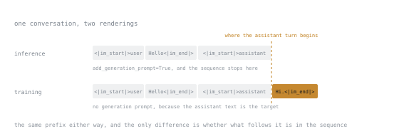

# 第 3 课：分词器与聊天模板

**使命关联:** 一次训练顺利、表现却很糟的微调，最常见的原因是模板不匹配，而不是超参数。
**主要来源:** [文档：Chat Templates，Hugging Face Transformers](https://huggingface.co/docs/transformers/main/en/chat_templating)
**前置知识:** [第 1 课](0001-what-a-base-model-is.md)、[第 2 课](0002-where-the-weights-live.md)

## 热身

1. ▢ 现代的块里，注意力和 MLP 哪个参数更多？

<details markdown="1"><summary>检查</summary>

MLP，因为它的中间维度是隐藏维度的好几倍，而分组查询注意力还会进一步缩小 `k_proj` 和 `v_proj`。

</details>

2. ▢ 怎样找到模型真实的模块名？

<details markdown="1"><summary>检查</summary>

用 `named_modules()` 从已加载的模型里打印出来。永远不要凭记忆回想，它们因架构而异。

</details>

3. ▢ 交叉熵损失度量的是什么？

<details markdown="1"><summary>检查</summary>

模型给真正出现的下一个 token 分配了多少概率。损失低，意味着真实的续写对模型来说并不意外。

</details>

## 要点

模型看到的不是文本，而是整数。分词器就是两者之间的映射，它是模型的一部分：一个检查点的分词器不能和另一个互换，即使同属一个系列也不行。

### 分词器是什么

现代模型使用子词分词，通常是字节对编码。训练分词器时，从字节出发，反复合并出现最频繁的相邻字节对，得到的词表里，常见的词是单个 token，罕见的词被拆成几块。

有三个性质在实践中会咬人：

**token 不是单词**。` the`（前面带一个空格）和 `the` 是不同的 token。大小写会改变分词结果。像 `1234` 这样的数字可能是一个 token，也可能是四个，这就是模型做算术时错得看似毫无章法的原因。

**token 数不等于字符数**。英文平均大约四个字符一个 token；代码、非拉丁文字和不寻常的格式，效率要低得多。第 7 课里你的序列长度预算是以 token 计量的，所以必须去测量，而不是估算。

**特殊 token 承载结构**。序列开始符、序列结束符、填充符，以及下面的角色标记，都是普通的词表条目，只是模型学会了把它们当作结构来对待。手工写错地输出它们，并不会报语法错误，只会悄悄造成分布偏移。

### 聊天模板

对话模型训练时，对话被一种特定而精确的字符串格式渲染成一条扁平的 token 序列。例如，某个模型训练时用的可能是这样的形状：

```text
<|im_start|>system
You are helpful.<|im_end|>
<|im_start|>user
Hello<|im_end|>
<|im_start|>assistant
Hi.<|im_end|>
```

另一个系列用的是完全不同的标记。这种格式不是你可以大致模仿的约定，它就是权重所拟合的那个分布。标记写错，多一个多余的换行，或者模型期望有系统块时你把它省了，模型就稍微偏离了分布。它仍然会产出流畅的文本，而这正是这类失败难以发现的原因。

模板以 Jinja 字符串的形式，随分词器一起发布。请直接使用它，而不是自己去写格式：

```text
tokenizer := load_tokenizer("<model>")
messages := [
    {role: "system", content: "You are helpful."},
    {role: "user", content: "Hello"},
]

# For inference: leaves the sequence ready for the model to continue.
prompt := tokenizer.render(messages, add_generation_prompt: true)

# For training: the assistant turn is already present, so no generation prompt.
full := tokenizer.render(messages + [{role: "assistant", content: "Hi."}])

print(exact(prompt))
print(exact(full))
```

要打印的是精确的字符串，而不是经过概括的视图，这一点很重要。正确的模板和损坏的模板之间的差别，往往只是一个空白字符，而普通的打印可能把它藏起来。在 Python 里，这意味着对字符串用 `repr`，而不是 `print`。

### 唯一的规则

**用你将要部署的同一种渲染方式来训练。** 如果你在自己手写的格式上微调，然后通过模型官方的模板来部署，你训练的是一个分布，部署的却是另一个。损失曲线看起来会很正常，模型却会微妙地变差，而你会花一整天去怪罪秩。

`add_generation_prompt` 是这里最容易出错的地方：它属于推理，那时你要让模型以助手的身份往下续写；它不属于训练样本，因为在训练样本里，助手的文本本身就是要学习的序列的一部分。



两种渲染在助手标记之前，是相同的片段、相同的位置。不同的是它后面的那个片段，它恰恰是模型在推理时应当产出的内容，也恰恰是它在训练时应当学会的内容。

### 基础模型没有模板

如果基础模型的分词器没有聊天模板，这不是缺陷，因为本来就没有需要保留的对话格式。格式由你来选，所以选一个，把它写下来，并在训练和部署中完全一致地使用。

## 练习

1. ▢ 为什么同一个模型系列的两个检查点之间，不能互换分词器？

<details markdown="1"><summary>检查</summary>

token ID 直接索引嵌入矩阵。不同的词表会把同一个整数映射到不同的行，于是每个输入都被悄悄地译错。输出是流畅的胡话，如果词表大小不同，则会直接崩溃。

</details>

2. ▢ 你在构建一个训练样本。`add_generation_prompt` 应该是 `True` 还是 `False`，为什么？

<details markdown="1"><summary>检查</summary>

`False`。生成提示是开头的标记，告诉模型“接下来轮到助手说话”，它在推理时有用，因为那时助手这一轮还不存在。在训练中助手这一轮已经在文本里了，再加上这个提示就会让标记重复，使序列偏离模型熟悉的格式。

</details>

3. ▢ 你的微调训练到了很低的损失，但部署后，模型在答案结束之后仍然絮叨不停，不会停下来。说出最可能的原因。

<details markdown="1"><summary>检查</summary>

你的训练样本里缺了回合结束 token，所以模型从未学到答案是会终止的。

损失抓不到这一点：预测流畅的续写，恰恰是模型在你的数据上得到奖励的事。这是一个数据构造上的缺陷，只有真正去生成才会暴露，这也是第 24 课坚持要实际生成，而不只是打分的原因之一。

</details>

4. ▢ 一段提示词有 700 个英文单词。大约是多少个 token？你会相信这个估计来做训练预算吗？

<details markdown="1"><summary>检查</summary>

大约 900 到 1000 个 token，按每个英文单词约 1.3 个 token 算。不，你不会相信它：这个比例会随代码、JSON、非拉丁文字和不寻常的格式而大幅变动，而这些在微调数据里都很常见。

用真正的分词器去测量实际的分布。第 7 课会把这个分布变成一个内存数字。

</details>

5. ▢ 下列哪一项在训练和部署之间改动是安全的？

    - a) 所使用的聊天模板字符串的具体内容
    - b) 随模型一起发布的分词器
    - c) 生成时使用的采样温度
    - d) 标记回合结束的特殊 token

<details markdown="1"><summary>检查</summary>

**c)** 生成时使用的采样温度。

温度是在模型产出分布之后才应用的，所以它是部署时的选择。另外三项定义了权重所拟合的分布；改动其中任何一项，都意味着部署的问题和你训练的问题不一样。

</details>

## 实战练习

- [ ] 取一个模型，用你所用的库真实的聊天模板调用（例如 Transformers 里的 `apply_chat_template(..., tokenize=False)`）渲染一个模板，把包括空白在内的精确字符串打印出来（例如用 Python 的 `repr`）。把它抄进你的笔记。
- [ ] 用两个不同系列的模型对同一段文字做分词，比较 token 数。然后对一块 JSON 做分词，再比较一次。
- [ ] 明天：故意去掉回合结束标记，把模板弄坏，然后提示模型。看它做了什么。这就是你正在学着去识别的那种失败。

## 延伸阅读

- [文档：Chat Templates，Hugging Face Transformers](https://huggingface.co/docs/transformers/main/en/chat_templating)
- [代码：minbpe，Andrej Karpathy](https://github.com/karpathy/minbpe)：易读形式的字节对编码
- [失败模式](../reference/failure-modes.md)：模板不匹配出现在那里
- [第 21 课：构建数据集](0021-building-the-dataset.md)

---

没学明白？请重读顶部的主要来源，因为本课是对它的压缩，而理解正是在压缩中流失的。如果有哪个术语觉得含糊，可以查看[术语表](../GLOSSARY.md)。

如果问题出在课程本身，而不是学习材料，那就是一个缺陷：[提交 issue](https://github.com/TokenCemetery/teach/issues)。
