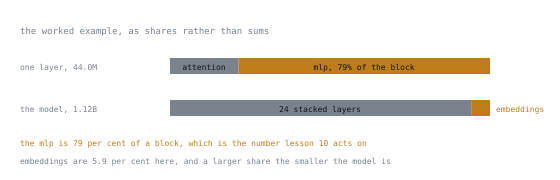

# Leçon 5. Compter les paramètres et les octets

**Lien avec la mission :** « Rendre compte de chaque octet » fait partie de la mission. C'est la leçon où vous apprenez à faire l'arithmétique au lieu de deviner.
**Source primaire :** [Doc : Model memory anatomy, Hugging Face Transformers](https://huggingface.co/docs/transformers/main/en/model_memory_anatomy)
**Prérequis :** [Leçon 2](0002-where-the-weights-live.md), [Leçon 4](0004-what-training-changes.md)

## Échauffement

1. ▢ Quelles sont les quatre opérations d'un pas d'entraînement ?

<details markdown="1"><summary>Vérifier</summary>

Passe avant (en conservant les activations), loss, passe arrière (qui produit les gradients), pas de l'optimizer.

</details>

2. ▢ Que signifie `-100` dans un tenseur de labels ?

<details markdown="1"><summary>Vérifier</summary>

Ignorer cette position dans le calcul de la loss. C'est ainsi que les tokens du prompt sont masqués pour la loss sur la complétion seule.

</details>

3. ▢ Quelles projections d'attention rétrécissent avec la grouped-query attention ?

<details markdown="1"><summary>Vérifier</summary>

`k_proj` et `v_proj`. `q_proj` et `o_proj` gardent la dimension cachée complète.

</details>

## À savoir

Un paramètre est un nombre. La mémoire, c'est la taille de stockage de ce nombre multipliée par leur quantité. Tout le reste de l'étape 2 n'est que de la comptabilité par-dessus cela.

### Formats numériques

| Format | Octets | Notes |
|---|---|---|
| `float32` (fp32) | 4 | Pleine précision. Le choix historique par défaut pour l'entraînement. |
| `bfloat16` (bf16) | 2 | Même plage d'exposant que fp32, moins de bits de mantisse. Le choix moderne par défaut. |
| `float16` (fp16) | 2 | Plus de mantisse, plage bien plus petite, donc il déborde plus facilement vers l'infini. |
| `int8` | 1 | Entier, demande un facteur d'échelle pour être interprété. |
| 4 bits (`nf4`, `int4`) | 0.5 | Deux valeurs par octet, plus des échelles par bloc. Étape 4. |

bf16 est préféré à fp16 pour l'entraînement bien qu'il stocke moins de précision, parce que sa plage d'exposant correspond à celle de fp32. Un débordement est un échec plus difficile à rattraper qu'une erreur d'arrondi, et l'entraînement en fp16 a historiquement eu besoin du loss scaling pour l'éviter.

### Les deux nombres qui décrivent un modèle

Disons qu'une fiche de modèle annonce 1.5B paramètres. Alors :

```text
weights in fp32 = 1.5e9 × 4 bytes = 6.0 GB
weights in bf16 = 1.5e9 × 2 bytes = 3.0 GB
weights in nf4  = 1.5e9 × 0.5     = 0.75 GB, plus quantisation constants
```

Ce n'est que la mémoire des poids pour l'inférence : le plancher pour avoir le modèle en mémoire tout court, avant toute activation, tout KV cache, et a fortiori avant l'entraînement.

Un réflexe utile : **les gigaoctets en bf16 ≈ le double du nombre de paramètres en milliards.** Un modèle 7B pèse environ 14 Go de poids. Un modèle 70B pèse environ 140 Go. Vous devriez pouvoir produire ces chiffres instantanément.

### Où sont les paramètres

D'après la leçon 2, par couche :

```text
attention = 2 × d² + 2 × d × d_kv          (q, o full; k, v narrowed by GQA)
mlp       = 3 × d × d_ff                    (gate, up, down)
```

et sur l'ensemble du modèle :

```text
total ≈ n_layers × (attention + mlp) + vocab × d × (1 or 2)
```

Le dernier terme est doublé quand la projection de sortie n'est pas liée à l'embedding d'entrée. Pour les petits modèles, ce terme n'est pas négligeable : un vocabulaire de 32k avec une taille cachée de 2048 représente 65M paramètres par copie, ce qui est une vraie fraction d'un modèle de 1.5B.

### Exemple calculé

Un modèle avec `d = 2048`, `d_kv = 256`, `d_ff = 5632`, 24 couches, un vocabulaire de 32k, des embeddings liés :

```text
attention = 2 × 2048² + 2 × 2048 × 256  = 8.39M + 1.05M = 9.44M
mlp       = 3 × 2048 × 5632             = 34.6M
per layer                               = 44.0M
× 24 layers                             = 1.056B
embeddings = 32000 × 2048               = 0.066B
total                                   ≈ 1.12B
```

En bf16, cela fait environ 2.2 Go de poids. Notez que le MLP représente 79 % du bloc ; gardez-le en tête pour la leçon 10.



Les mêmes sommes sous forme de parts, aux deux niveaux qui comptent. À l'intérieur d'un bloc, l'attention est la plus petite moitié, et de loin, ce qui explique pourquoi la question des target modules de la leçon 10 est surtout une question sur le MLP. Sur l'ensemble du modèle, le terme des embeddings est petit ici et grandit en proportion à mesure que le modèle rétrécit, ce qui est le cas contre lequel le paragraphe ci-dessus met en garde.

### Ce que cela n'inclut pas encore

Vous avez maintenant le coût des poids. L'entraînement ajoute trois autres catégories, et ce sont elles qui dominent :

- Les gradients, un par paramètre entraînable (leçon 6)
- L'état de l'optimizer, deux par paramètre entraînable (leçon 6)
- Les activations, qui dépendent de la batch size et de la longueur de séquence plutôt que du nombre de paramètres (leçon 7)

Quiconque vous dit qu'un modèle 7B « a besoin de 14 Go pour être fine-tuné » n'a compté que la première catégorie. C'est l'erreur que cette étape existe pour éliminer.

## Pratique

1. ▢ Combien de gigaoctets pèsent les poids d'un modèle 13B en bf16 ? En fp32 ? En 4 bits ?

<details markdown="1"><summary>Vérifier</summary>

bf16 : 26 Go. fp32 : 52 Go. 4 bits : environ 6.5 Go, plus les constantes de quantification.

La chaîne de doublements et de divisions par deux à partir du nombre de paramètres mérite d'être maîtrisée sans calculatrice.

</details>

2. ▢ Pourquoi bf16 est-il préféré à fp16 pour l'entraînement, alors que fp16 stocke plus de bits de mantisse ?

<details markdown="1"><summary>Vérifier</summary>

bf16 conserve la plage d'exposant de fp32, donc les valeurs ne débordent pas vers l'infini. La plage étroite de fp16 signifie que les gradients peuvent déborder ou tomber à zéro, ce qui a historiquement nécessité le loss scaling pour que cela fonctionne tout court.

L'erreur d'arrondi se dégrade en douceur ; un débordement produit des `NaN` et met fin au run. L'échange favorise la plage.

</details>

3. ▢ Un modèle a `d = 4096`, `d_ff = 14336`, `d_kv = 1024`, 32 couches. Calculez les paramètres par couche et le total du modèle, embeddings exclus.

<details markdown="1"><summary>Vérifier</summary>

Attention : 2 × 4096² + 2 × 4096 × 1024 = 33.6M + 8.4M = 42.0M.
MLP : 3 × 4096 × 14336 = 176.2M.
Par couche : 218.2M. Fois 32 couches ≈ 6.98B.

À peu près un modèle 7B, et le MLP en représente 81 %.

</details>

4. ▢ Deux modèles annoncent tous deux 7B paramètres. L'un a un vocabulaire de 32k, l'autre de 256k. Qu'est-ce qui diffère, et de combien ?

<details markdown="1"><summary>Vérifier</summary>

Le coût des embeddings. Avec une taille cachée de 4096, un vocabulaire de 32k représente 131M paramètres par copie ; un vocabulaire de 256k en représente 1.05B, environ 15 % du modèle entier dans une seule table, et le double si la projection de sortie n'est pas liée.

Le modèle à grand vocabulaire a donc nettement moins de paramètres dans ses blocs de transformer, là où les adapters se rattachent.

</details>

5. ▢ Quelqu'un dit qu'un modèle 7B tient confortablement dans 16 Go pour le fine-tuning, parce que les poids en bf16 pèsent 14 Go. Qu'est-ce qui cloche dans ce raisonnement ?

<details markdown="1"><summary>Vérifier</summary>

Cette personne n'a compté que les poids. Le full fine-tuning demande aussi des gradients et deux moments d'optimizer par paramètre entraînable, plus les activations, soit plusieurs fois le coût des poids. Même l'affirmation des 14 Go ne laisse que 2 Go pour tout le reste.

La leçon suivante en fait un chiffre exact, et la réponse n'est pas proche.

</details>

## Exercices en situation réelle

- [ ] Choisissez trois modèles de tailles différentes. À partir de leurs seuls fichiers de configuration (`hidden_size`, `intermediate_size`, `num_hidden_layers`, `num_key_value_heads`, `vocab_size`), calculez les nombres de paramètres et comparez-les aux fiches de modèle.
- [ ] Chargez un modèle en bf16 et mesurez la mémoire réellement utilisée. Comparez-la à votre prédiction et expliquez tout écart.
- [ ] Demain : faites de tête l'estimation des gigaoctets en bf16 pour cinq tailles de modèle, puis vérifiez avec une calculatrice.

## Pour aller plus loin

- [Doc : Model memory anatomy, Hugging Face Transformers](https://huggingface.co/docs/transformers/main/en/model_memory_anatomy)
- [Budget mémoire](../reference/memory-budget.md) : le tableau vers lequel cette leçon construit
- [Leçon 6. Gradients et état de l'optimizer](0006-gradients-and-optimizer-state.md)

---

Ça ne passe pas ? Relisez la source primaire en haut de page, car cette leçon la condense et c'est dans la condensation que la compréhension s'échappe. Consultez le [glossaire](../GLOSSARY.md) pour tout terme qui vous a paru glissant.

Si c'est la leçon elle-même qui n'est pas claire plutôt que la matière, c'est un défaut : [ouvrez une issue](https://github.com/TokenCemetery/teach/issues).
