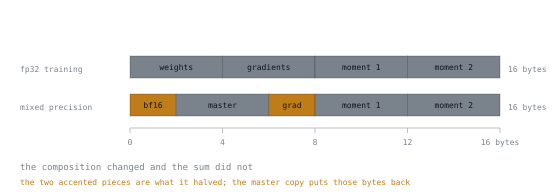

# 第 6 课：梯度与优化器状态

**使命关联:** 这是支持适配器的论证。一旦你能推导出每个参数十六字节这个数字，LoRA 就不再是一个小把戏，而成了顺理成章的应对办法。
**主要来源:** [论文：“ZeRO: Memory Optimizations Toward Training Trillion Parameter Models”，Rajbhandari 等，arXiv:1910.02054](https://arxiv.org/abs/1910.02054)
**前置知识:** [第 4 课](0004-what-training-changes.md)、[第 5 课](0005-counting-parameters-and-bytes.md)

## 热身

1. ▢ 7B 模型的 bf16 权重：多少 GB？

<details markdown="1"><summary>检查</summary>

约 14 GB。每个参数两字节，所以 bf16 的 GB 数大致是以十亿计的参数量的两倍。

</details>

2. ▢ AdamW 为每个可训练参数保存哪两个张量？

<details markdown="1"><summary>检查</summary>

梯度的滑动均值和梯度平方的滑动均值，即一阶矩和二阶矩。每个都与参数同形状。

</details>

3. ▢ 为什么训练时 bf16 胜过 fp16？

<details markdown="1"><summary>检查</summary>

它的指数范围与 fp32 一致，所以数值不会溢出成无穷大。舍入误差还能承受，`NaN` 则不能。

</details>

## 要点

一个可训练参数的全部开销，按每个参数计：

| 类别 | fp32 训练 | 混合精度（bf16 计算，fp32 主权重） |
|---|---|---|
| 权重 | 4 | 2（bf16）+ 4（fp32 主权重副本） |
| 梯度 | 4 | 2 |
| AdamW 一阶矩 | 4 | 4 |
| AdamW 二阶矩 | 4 | 4 |
| **合计** | **16 字节** | **16 字节** |



右边那一列是让人意外的地方。**混合精度并不会减少总量。**

两条条形到达同一个刻度，这就是全部的发现。两块带强调色的部分，是真正被减半的张量，二者合计省下四字节，而紧挨着第一块的主权重副本，又把四字节原样加了回来。再往右的部分，则根本没有动过。它把权重和梯度张量减半，然后又加回一份 fp32 的权重主副本，因为把微小的更新累加到 bf16 的值上，会悄悄地把它们丢掉。优化器的矩出于同样的原因保持 fp32。混合精度的收益在于算术吞吐，而不在内存。

所以：**每个可训练参数 16 字节**，这还没有算上任何一个激活值。

### 这意味着什么

```text
1.5B trainable × 16 bytes = 24 GB
7B   trainable × 16 bytes = 112 GB
70B  trainable × 16 bytes = 1120 GB
```

对 7B 模型做全量微调，仅权重和优化器状态就需要 112 GB，再加上激活值。对一个权重只有 14 GB 的模型来说，这已经是多 GPU 的地界。“模型放得下”和“训练这个模型放得下”之间，差了八倍，而这完全是梯度和优化器状态造成的。

### 出路

再看一眼这张表，留意这 16 字节是乘以什么的：是**可训练**参数的个数，而不是总参数个数。冻结的参数每个只花 2 字节，用于存它们的权重，别无其他。没有梯度，没有矩。

这就是支持适配器的全部论证：

```text
frozen parameter   = 2 bytes  (bf16 weights only)
trainable parameter = 16 bytes (weights + master + grad + 2 moments)
```

冻结基础模型，加上几百万个可训练参数，第二项就几乎消失了。以 7B 的基础模型加 4M 个可训练的适配器参数为例：

```text
frozen base    7B  × 2  = 14.0 GB
trainable      4M  × 16 = 0.064 GB
```

适配器的优化器状态是 64 MB。相对于基础权重，它已经成了舍入误差，而基础权重是你可以单独去对付的那一部分，办法就是量化，见第 4 阶段。

### 局部的办法，以及它们为什么不够

在适配器出现之前，人们用别的办法降低这项开销。它们现在仍然都可用，也都仍然有上限：

| 技术 | 节省什么 | 代价 |
|---|---|---|
| 8 位优化器 | 矩从 4 字节降到 1 字节：16 → 10 字节 | 有轻微的质量风险；仍然与可训练参数的个数成线性关系 |
| 带动量的 SGD | 两个矩变成一个：16 → 12 字节 | 对 Transformer 而言，收敛明显更差 |
| 优化器分片（ZeRO） | 把状态分摊到 N 台设备上 | 需要 N 台设备和高速互连 |
| 卸载到 CPU | 把状态移出加速器 | 受带宽限制；每一步慢得多 |

这些办法每一个都只是缩放那个常数。没有一个能改变这个事实：开销与可训练参数的个数成正比。适配器对付的是乘数，所以它赢的是几个数量级，而不是几倍。

### 为什么不能干脆把矩去掉

一个合理的问题：如果 AdamW 的两个矩占了开销的三分之二，为什么不用朴素的 SGD？因为 Transformer 的训练依赖于 Adam 的逐参数步长缩放。梯度的量级在 Transformer 的各个参数之间相差悬殊，单一的全局学习率对它们都不合适。二阶矩正是让每个参数迈出大小合适的一步的东西。这是经验性的，始终一致，不是靠调参就能凭空消除的问题。

## 练习

1. ▢ 推导在混合精度下，用 AdamW 对 3B 模型做全量微调所需的内存，不含激活值。

<details markdown="1"><summary>检查</summary>

每个可训练参数 16 字节 × 3e9 = 48 GB。

拆开来看：6 GB 的 bf16 权重 + 12 GB 的 fp32 主权重 + 6 GB 的 bf16 梯度 + 12 GB 的一阶矩 + 12 GB 的二阶矩 = 48 GB。

</details>

2. ▢ 为什么混合精度不能降低训练的总内存？

<details markdown="1"><summary>检查</summary>

它把权重和梯度减半，却加了一份 fp32 的权重主副本，还让两个优化器矩保持 fp32。节省和新增相互抵消，又回到了 16 字节。

主权重副本并非可有可无：把很小的更新反复加到 bf16 的值上，舍入后毫无变化，更新就丢了。

</details>

3. ▢ 7B 的基础模型以 bf16 冻结，你训练一个 20M 参数的适配器。总量是多少，不含激活值？

<details markdown="1"><summary>检查</summary>

冻结的基础模型 14 GB（7e9 × 2），加上适配器的 0.32 GB（2e7 × 16），所以约 14.3 GB。

对比全量微调的 112 GB：缩小为约 7.8 分之一，而剩下的几乎全是冻结的基础模型。第 4 阶段对付的就是这个余量。

</details>

4. ▢ 对于固定的模型，下列哪项改动最能减少优化器内存？

    - a) 把优化器从 AdamW 换成 SGD
    - b) 把计算精度换成 bf16
    - c) 冻结基础模型，改为训练适配器
    - d) 改用仅补全部分的损失屏蔽

<details markdown="1"><summary>检查</summary>

**c)** 冻结基础模型，改为训练适配器。

（a）两个矩去掉一个，省下四分之一。（b）总体上什么也没省，如上所述。（d）改变的是哪些位置对损失有贡献，而不是有多少参数带有状态。只有（c）对付的是可训练参数的个数，而它是所有开销的乘数。

</details>

5. ▢ 有人提议用 8 位优化器，好在一块 80 GB 的加速器上对 70B 模型做全量微调。算一算，然后回应。

<details markdown="1"><summary>检查</summary>

8 位的矩给出 2 + 4 + 2 + 1 + 1 = 每个参数 10 字节。70e9 × 10 = 700 GB。仍然是一块 80 GB 设备的近九倍，还没算激活值。

这项技术是真实且有用的；但这个方案差了一个数量级。这就是在做实验之前先算一算的价值。

</details>

6. ▢ 用一句话说：为什么冻结的参数比可训练的便宜这么多？

<details markdown="1"><summary>检查</summary>

冻结的参数只需要存下它自己的值，供前向传播使用，而可训练的参数还需要一个梯度、两个优化器矩和一份高精度的主权重副本：开销是八倍。

</details>

## 实战练习

- [ ] 在纸上凭记忆建出这张 16 字节的表。然后针对你真正关心的三种模型大小，算出总的训练内存。
- [ ] 加载一个小模型，用 AdamW 对所有参数运行一个训练步骤，记录峰值内存。与你的预测比较。
- [ ] 明天：冻结基础模型，只让一个小适配器可训练，再重复一次。你测得的那个比值，就是支持第 3 阶段的论证。

## 延伸阅读

- [论文：“ZeRO: Memory Optimizations Toward Training Trillion Parameter Models”，Rajbhandari 等，arXiv:1910.02054](https://arxiv.org/abs/1910.02054)：对这些类别的权威记账
- [论文：“8-bit Optimizers via Block-wise Quantization”，Dettmers 等，arXiv:2110.02861](https://arxiv.org/abs/2110.02861)
- [内存预算](../reference/memory-budget.md)
- [第 8 课：低秩思想](0008-the-low-rank-idea.md)：对本课的回应

---

没学明白？请重读顶部的主要来源，因为本课是对它的压缩，而理解正是在压缩中流失的。如果有哪个术语觉得含糊，可以查看[术语表](../GLOSSARY.md)。

如果问题出在课程本身，而不是学习材料，那就是一个缺陷：[提交 issue](https://github.com/TokenCemetery/teach/issues)。
