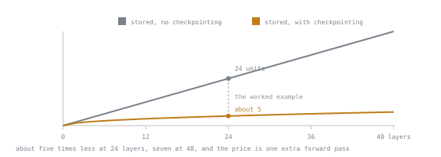

# 第 7 课：激活值、批大小与检查点

**使命关联:** 适配器去掉了优化器的开销，却没有去掉激活值的开销，这就是 LoRA 运行仍会内存不足的原因。这是最让人意外的部分。
**主要来源:** [论文：“Training Deep Nets with Sublinear Memory Cost”，Chen 等，arXiv:1604.06174](https://arxiv.org/abs/1604.06174)
**前置知识:** [第 6 课](0006-gradients-and-optimizer-state.md)

## 热身

1. ▢ 在 AdamW 和混合精度下，每个可训练参数多少字节？

<details markdown="1"><summary>检查</summary>

十六字节：bf16 权重两字节，fp32 主权重副本四字节，bf16 梯度两字节，两个矩各四字节。

</details>

2. ▢ 每个冻结参数多少字节？

<details markdown="1"><summary>检查</summary>

两字节，bf16，仅用于权重的值。没有梯度，没有矩，没有主权重副本。

</details>

3. ▢ 为什么对 Transformer 来说，AdamW 的矩不能干脆去掉？

<details markdown="1"><summary>检查</summary>

梯度的量级在 Transformer 的各个参数之间相差悬殊，而二阶矩提供了逐参数的步长缩放，这是单一的全局学习率做不到的。

</details>

## 要点

梯度和优化器状态随**参数量**而变化。激活值随**批大小和序列长度**而变化，而且几乎与有多少参数可训练无关。冻结基础模型在这里毫无帮助。

### 激活值为什么存在

反向传播需要每一层的输入，才能算出这一层的梯度。所以前向传播会保留它的中间结果，而不是丢弃。每个被保留的张量大致是：

```text
batch_size × sequence_length × hidden_size × bytes_per_element
```

每个张量如此，而一个 Transformer 块里有十几个这样的张量：每次归一化之后、每个投影之后、注意力的输出、处于更宽维度的 MLP 中间结果，等等。再乘以层数。

对一个 bf16 的 Transformer 块，把值得一提的张量算在内，一个粗略的工作用数字是：

```text
activations ≈ n_layers × batch × seq_len × hidden × ~20 bytes
```

把这个常数当作有待测量的起点，而不是定律，因为它会随注意力的实现、激活函数，以及框架是否融合了运算而变动。要紧的是这个公式的*形状*。

### 这个形状带来的后果

**与批大小成线性关系。** 批次翻倍，激活内存翻倍。这是你最先去拧的旋钮，而梯度累积（第 4 课）在内存上不花代价就恢复了有效批大小。

存储的激活值与**序列长度成线性关系**，而注意力分数矩阵与之成二次关系，除非你用的是内存高效的注意力内核。FlashAttention 这样的现代实现避免了把完整的 `seq_len × seq_len` 矩阵实体化，从而去掉了二次项。如果你在长序列上仍然碰到二次的暴涨，要改的是注意力的实现，而不是批大小。

以一个 24 层、隐藏维度 2048、批大小 4、序列长度 2048 的模型为例：

```text
24 × 4 × 2048 × 2048 × 20 bytes ≈ 8.0 GB
```

8 GB 的激活值，而冻结的 bf16 权重大约只有 2.2 GB，适配器状态只有几十 MB。**激活值现在成了主要开销。** 这就是典型适配器运行的内存画像，与第 6 课里全量微调的画像正好相反。

### 梯度检查点

解决它的交易是：不存大多数激活值。只存几个，其余的在反向传播时重新计算。

保留每个块的输入（一个*检查点*），丢弃块内的一切，等反向传播走到这个块时，重新跑一遍它的前向传播，再生出需要的东西。存储量从大致与深度成线性，降到大致是深度的平方根，代价是多出约一次前向传播，通常每一步慢 20% 到 40%。



这笔交易的形状，就是它近乎成为默认做法的原因。直线和平方根在两三层时几乎没有差别，所以在玩具模型上，这项技术看上去毫无意义；到了算例里的 24 层，差距约为五倍，还在继续拉大，而且无论模型多深，代价都只是多一次前向传播。

```python
model.gradient_checkpointing_enable()
model.config.use_cache = False  # incompatible with checkpointing during training
```

第二行很重要。KV 缓存的存在，是为了加速自回归的*生成*，在训练中没有任何作用；和检查点一起开着，往好了说会产生警告，往坏了说会浪费内存。

**梯度检查点对适配器微调来说近乎是默认做法。** 它把上面那幅画像里最大的单项开销买了回来，而这点减速几乎总是值得的。

### 填充与打包

一个批次里的每个序列，都会被填充到该批次里最长的那个，而填充消耗激活内存，却什么也没贡献。两个补救办法：

- **按长度分组。** 把大小相近的序列放进同一批，这样需要的填充就更少。
- **打包。** 把短样本拼接成满长度的序列，几乎完全消除填充。

在短样本的数据集上，打包是实实在在的效率提升，它有一个正确性要求：被打包在一起的样本，不能跨越它们的边界相互注意。实现上是靠位置重置和感知边界的注意力来处理的。如果你启用了打包，要验证你的损失屏蔽在打包后依然有效：打包后的序列必须保持它的 `-100` 标签完好，否则仅补全部分的损失会悄悄变成全序列损失。

### 尝试的顺序

当一次运行放不下时，按你要牺牲的东西排序：

1. 启用梯度检查点，只花时间
2. 减小每设备的批大小，并提高梯度累积，只花一点时间，在统计上没有任何改变
3. 缩短序列长度，这会改变任务，所以先检查你的 token 长度分布
4. 量化基础模型，这是第 4 阶段，会损失一些质量
5. 降低适配器的秩，这会损失容量，而且是这里所有选项中省得最少的

最后一点值得多想一想。秩是人们最先去拧的旋钮，却几乎是*最没有效果*的，因为适配器的参数只占总量很小的一部分。把一个 4M 参数的适配器的秩减半，只省 32 MB。

## 练习

1. ▢ 梯度、激活值、优化器矩、冻结权重，这几项哪些随可训练参数量而变，哪些随批大小和序列长度而变？

<details markdown="1"><summary>检查</summary>

可训练参数量：梯度、优化器矩。仅取决于模型大小：冻结权重。批大小和序列长度：激活值。

激活值完全属于另一条轴，这正是本课的要点，也是适配器解决不了它们的原因。

</details>

2. ▢ 估算一个 32 层、隐藏维度 4096、批大小 2、序列长度 4096、bf16 的模型的激活内存。

<details markdown="1"><summary>检查</summary>

32 × 2 × 4096 × 4096 × 20 ≈ 21 GB。

相对于 14 GB 的冻结 7B 基础模型，这是个庞然大物。用了梯度检查点，这个数字大约能降低一个数量级，而这正是让这次运行能在单台设备上进行的原因。

</details>

3. ▢ 你的 LoRA 运行内存不足。一位同事建议把秩从 64 降到 8。评估一下。

<details markdown="1"><summary>检查</summary>

帮助很小。在 7B 模型上，把秩从 64 降到 8，省下的适配器状态和梯度只有一百兆字节左右，而激活值是以 GB 计的。

先启用梯度检查点，并减小每设备的批大小。秩是一个关乎容量的决定，把它花在你本来就不缺的内存上，是一桩糟糕的交易。

</details>

4. ▢ 为什么开启梯度检查点时必须禁用 `use_cache`？

<details markdown="1"><summary>检查</summary>

KV 缓存存储过去的键和值，以避免在自回归生成时重复计算。训练是对一整条序列做一次前向传播，所以缓存毫无益处，而且它与检查点的重新计算策略相冲突，同时还占用内存。

</details>

5. ▢ 梯度检查点在两个方向上各交换了什么？

<details markdown="1"><summary>检查</summary>

它用计算换内存：激活值的存储从大致与深度成线性，降到大致是它的平方根，代价是每一步大约多一次前向传播，通常慢 20% 到 40%。

</details>

6. ▢ 你启用了打包，模型开始回答根本没人问过的问题。哪里出了问题？

<details markdown="1"><summary>检查</summary>

最可能的是损失屏蔽没能经受住打包，于是提示词的 token 现在也被训练了，或者样本跨越了各自的边界相互注意，学到了答案后面会跟着不相干的文本。

验证 `-100` 标签在打包这一步中得以保留，并且实现是感知边界的。打包是一种效率优化，有一个正确性的前提条件。

</details>

## 实战练习

- [ ] 在批大小 1、2、4 下各运行一个训练步骤，每次记录峰值内存。确认这个关系是线性的。
- [ ] 打开梯度检查点再重复一次。同时记录省下的内存和损失的每步秒数，并决定你是否愿意做这笔交易。
- [ ] 明天：用真正的分词器测量一个真实数据集的 token 长度分布。找出第 95 百分位。你的序列长度应该取它，而不是最大值。

## 延伸阅读

- [论文：“Training Deep Nets with Sublinear Memory Cost”，Chen 等，arXiv:1604.06174](https://arxiv.org/abs/1604.06174)
- [论文：“FlashAttention: Fast and Memory-Efficient Exact Attention with IO-Awareness”，Dao 等，arXiv:2205.14135](https://arxiv.org/abs/2205.14135)
- [文档：Methods and tools for efficient training on a single GPU，Hugging Face](https://huggingface.co/docs/transformers/main/en/perf_train_gpu_one)
- [内存预算](../reference/memory-budget.md)：现在已经完整到可以使用了

---

没学明白？请重读顶部的主要来源，因为本课是对它的压缩，而理解正是在压缩中流失的。如果有哪个术语觉得含糊，可以查看[术语表](../GLOSSARY.md)。

如果问题出在课程本身，而不是学习材料，那就是一个缺陷：[提交 issue](https://github.com/TokenCemetery/teach/issues)。
