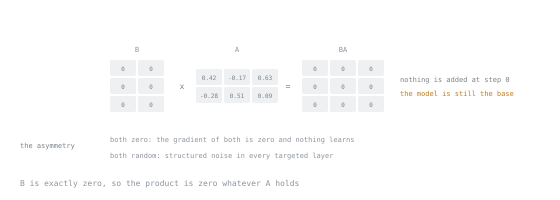

# Урок 9. Ранг, альфа и инициализация

**Связь с целью курса:** Цель курса требует обосновывать каждый гиперпараметр самой задачей. Именно на этих трёх люди чаще всего повторяют фольклор.
**Первоисточник:** [Документация: LoRA, Hugging Face PEFT](https://huggingface.co/docs/peft/main/en/developer_guides/lora)
**Предварительные требования:** [Урок 8](0008-the-low-rank-idea.md)

## Разминка

1. ▢ Запишите уравнение прямого прохода LoRA.

<details markdown="1"><summary>Проверка</summary>

`h = W₀x + (α/r) · BAx`, где `W₀` заморожена, а обучаемы только `A` и `B`.

</details>

2. ▢ Число параметров адаптера для одного целевого слоя?

<details markdown="1"><summary>Проверка</summary>

`r × (d_in + d_out)`. Преобладает большая размерность.

</details>

3. ▢ Почему слитый адаптер ничего не стоит при инференсе?

<details markdown="1"><summary>Проверка</summary>

Обновление аддитивно и линейно, поэтому оно вливается в базовый вес и оставляет после себя обычную матрицу.

</details>

## Что нужно знать

### Инициализация и почему она не произвольна

`A` инициализируется случайно, по Гауссу или равномерно по Каймингу (Kaiming-uniform). `B` инициализируется **ровно нулём**.

Следовательно, `BA = 0` на нулевом шаге, значит `ΔW = 0`, значит **адаптированная модель до первого обновления побитно совпадает с базовой.** Это намеренное и важное свойство:

- Обучение начинается с заведомо хорошей модели, а не с возмущённой.
- Предобученное поведение не получает начального шока, поэтому нет раннего вреда, который нужно исправлять.
- Любая замеченная деградация это то, что сделало обучение, а не инициализация.



Элементы `A` видны, и ни один из них не имеет значения: каждый умножается на ноль по дороге в произведение.

Асимметрия необходима. Если бы оба были нулевыми, градиент обоих был бы нулевым и ничего бы никогда не училось: чтобы произведение несло сигнал, один множитель должен быть ненулевым. Если бы оба были случайными, `ΔW` начиналась бы со структурированного шума, внесённого в каждый целевой слой.

Поэтому же LoRA переносит гораздо более высокие скорости обучения, чем полное дообучение. Вы не подталкиваете веса, которые уже кодируют всё, что знает модель; вы выращиваете слагаемое из нуля.

### Альфа и масштабный множитель

`α` (`lora_alpha`) это фиксированный скаляр. Обновление масштабируется на `α/r`.

Смысл деления на `r` был в том, чтобы сделать эффективную величину обновления примерно независимой от ранга, чтобы смена ранга не вынуждала заново подбирать скорость обучения. **Важно отношение `α/r`, а не какое-либо из двух чисел по отдельности.**

| `r` | `α` | `α/r` | Эффект |
|---|---|---|---|
| 8 | 16 | 2,0 | Распространённый базовый вариант |
| 16 | 32 | 2,0 | Больше ёмкости, тот же масштаб обновления |
| 16 | 16 | 1,0 | Больше ёмкости, более слабое обновление |
| 64 | 16 | 0,25 | Намного больше ёмкости, сильно приглушено |

Последняя строка это ловушка, которую стоит назвать: повышение ранга при неизменной `α` *уменьшает* масштаб обновления. Люди повышают ранг в надежде на большую выразительность, забывают про `α` и заключают, что больший ранг вредит. Он не вредил; они молча приглушили адаптер в 8 раз.

Традиционная отправная точка `α = 2r`. Считайте это соглашением с обоснованием, а не открытием.

**rsLoRA** ([arXiv:2312.03732](https://arxiv.org/abs/2312.03732)) утверждает, что делитель `α/r` слишком приглушает при высоком ранге, и предлагает вместо него `α/√r`, что сохраняет стабильность обучения при росте ранга. Если вы планируете работать с рангом 64 и выше, эту настройку стоит знать:

```python
LoraConfig(r=64, lora_alpha=16, use_rslora=True, ...)
```

### Выбор ранга

Ранг это **ёмкость**. Он ограничивает, насколько сложное обновление адаптер способен выразить.

| Ранг | Разумно для |
|---|---|
| от 4 до 8 | Стиля, тона, формата вывода; небольших датасетов |
| от 16 до 32 | Настоящей задачи с несколькими тысячами примеров |
| от 64 до 128 | Более трудных задач, больших датасетов, поведения с тяжёлыми рассуждениями |
| 256+ | Приближения к ёмкости полного дообучения на больших датасетах SFT |

Две диагностики, которые лучше гадания:

**Недообучение.** Потери на обучении выходят на плато выше того уровня, который вам нужен, и дополнительные эпохи не помогают. Ёмкости не хватает: повысьте ранг или добавьте целевые модули (обычно это лучший ход, по уроку 10).

**Переобучение.** Потери на обучении продолжают падать, а потери на отложенных данных растут. Слишком много ёмкости для данных или слишком много эпох. Снизьте ранг, добавьте dropout, получите больше данных или остановитесь раньше.

Обратите внимание на асимметрию с уроком о памяти: ранг стоит очень мало памяти (урок 7), так что цена лишнего ранга это риск переобучения и немного вычислений, а не вопрос о том, поместится ли всё в память. Это переворачивает инстинкт, который многие приносят из эпохи, когда памяти не хватало.

### Dropout

`lora_dropout` применяет dropout ко входу адаптера. Типичные значения от 0,0 до 0,1. Прибегайте к нему, когда потери на отложенных данных растут, а больше данных получить нельзя. На больших датасетах он часто не нужен и просто замедляет сходимость.

### Конфигурация

```text
config := {
    rank: 16,
    alpha: 32,               # α/r = 2
    dropout: 0.05,
    adapt_bias: false,
    target_modules: [...],   # Lesson 10
}

model := attach_adapter(model, config)
print(model.trainable_parameter_count())
```

Последняя строка не опциональна. Это проверка того, что ваши целевые модули вообще с чем-то совпали, и она должна согласоваться с арифметикой, которую вы сделали в уроке 8. Читайте имена параметров в документации установленной версии, а не по памяти, потому что эта поверхность меняется между релизами.

## Практика

1. ▢ Почему `B` инициализируется нулём, а `A` случайно, а не обе нулём и не обе случайно?

<details markdown="1"><summary>Проверка</summary>

Нулевая `B` делает `ΔW = 0` в начале, так что обучение стартует ровно с базовой модели без возмущения, которое нужно было бы исправлять. Случайная `A` сохраняет градиент произведения ненулевым, так что обучение может начаться.

Обе нулевые: градиенты исчезают, ничего не учится. Обе случайные: модель начинает как база плюс шум в каждом целевом слое.

</details>

2. ▢ Вы повышаете ранг с 8 до 64 и оставляете `α` равной 16. Потери почти не двигаются. Поставьте диагноз.

<details markdown="1"><summary>Проверка</summary>

Масштаб `α/r` упал с 2,0 до 0,25. У адаптера в восемь раз больше ёмкости и в восемь раз меньше влияния, так что суммарный эффект это приглушённое обновление, а не более сильное.

Поднимите `α` до 128, чтобы сохранить отношение, или задайте `use_rslora=True`, чтобы делитель стал `√r`.

</details>

3. ▢ Потери на обучении выравниваются на уровне, слишком высоком, чтобы быть полезным, и четвёртая эпоха не помогает. Что это и какие у вас два варианта?

<details markdown="1"><summary>Проверка</summary>

Недообучение: у адаптера не хватает ёмкости, чтобы выразить нужное обновление.

Повысьте ранг или расширьте целевые модули, чтобы они покрывали больше модели. Добавление целевых модулей обычно лучший первый ход, потому что в MLP хранится большая часть параметров и именно там часто находится недостающая ёмкость. Дополнительные эпохи не могут исправить потолок ёмкости.

</details>

4. ▢ Какая пара даёт самый сильный масштаб обновления?

    - a) `r = 8` с `alpha = 8`
    - b) `r = 8` с `alpha = 32`
    - c) `r = 32` с `alpha = 32`
    - d) `r = 64` с `alpha = 64`

<details markdown="1"><summary>Проверка</summary>

**b)** `r = 8` с `alpha = 32`, что даёт `α/r = 4`.

У остальных `α/r = 1`. Ёмкость у них разная, а масштаб обновления одинаковый, и именно это различие и должен был провести замысел `α/r`.

</details>

5. ▢ Почему LoRA может использовать скорость обучения в десять-сто раз выше, чем полное дообучение?

<details markdown="1"><summary>Проверка</summary>

Обучаемые параметры начинают с нулевого вклада и сами не являются хранилищем предобученных знаний. Нет накопленной структуры, которую можно повредить, а слагаемое должно вырасти из ничего, поэтому ему нужен гораздо больший шаг, чтобы заметно сдвинуться за разумное число шагов.

</details>

6. ▢ Когда вы *не* стали бы повышать ранг, даже если адаптер недообучается?

<details markdown="1"><summary>Проверка</summary>

Когда датасет мал. Дополнительная ёмкость на малом числе примеров покупает заучивание, а не обобщение: потери на обучении падают, потери на отложенных данных растут.

Правильный ответ в этом случае это больше или лучше данных, либо более узкая задача, а не больший адаптер.

</details>

## Практика в реальной работе

- [ ] Постройте три конфигурации, `(8, 16)`, `(16, 32)` и `(64, 16)`, запишите `α/r` для каждой и что, по-вашему, произойдёт. Сохраните прогнозы.
- [ ] Выведите `print_trainable_parameters()` для каждой и сверьте с арифметикой из урока 8.
- [ ] Завтра: найдите опубликованную конфигурацию дообучения в дикой природе, вычислите её `α/r` и решите, выбрал ли это значение автор или унаследовал.

## Что почитать дальше

- [Документация: LoRA, Hugging Face PEFT](https://huggingface.co/docs/peft/main/en/developer_guides/lora)
- [Научная статья: "A Rank Stabilization Scaling Factor for Fine-Tuning with LoRA", Kalajdzievski, arXiv:2312.03732](https://arxiv.org/abs/2312.03732)
- [Статья: "Practical Tips for Finetuning LLMs Using LoRA", Sebastian Raschka](https://magazine.sebastianraschka.com/p/practical-tips-for-finetuning-llms)
- [Гиперпараметры LoRA](../reference/lora-hyperparameters.md)

---

Не доходит? Перечитайте первоисточник в начале: этот урок его сжимает, а при сжатии понимание как раз и теряется. Загляните в [глоссарий](../GLOSSARY.md), если какой-то термин показался скользким.

Если неясен сам урок, а не материал, это дефект: [откройте issue](https://github.com/TokenCemetery/teach/issues).
