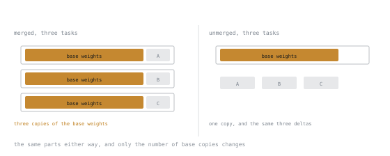

# Урок 13. Слияние, сохранение и поставка адаптера

**Связь с целью курса:** Адаптер, который существует только в скрипте обучения, не поставлен. Этим закрывается этап 3.
**Первоисточник:** [Документация: LoRA merging, Hugging Face PEFT](https://huggingface.co/docs/peft/main/en/developer_guides/lora)
**Предварительные требования:** [Урок 8](0008-the-low-rank-idea.md), [Урок 12](0012-reading-a-training-run.md)

## Разминка

1. ▢ Какой чекпоинт вы выпускаете из запуска с переобучением?

<details markdown="1"><summary>Проверка</summary>

Тот, что в минимуме потерь на отложенных данных, а не последний шаг.

</details>

2. ▢ Чего кривая потерь никогда не может вам показать?

<details markdown="1"><summary>Проверка</summary>

Пригодны ли генерации и не деградировали ли способности за пределами распределения вашей задачи. Для обоих нужна настоящая генерация на зафиксированных промптах.

</details>

3. ▢ Запишите обновление LoRA с масштабированием.

<details markdown="1"><summary>Проверка</summary>

`ΔW = (α/r) · BA`, прибавляется к замороженной `W₀`.

</details>

## Что нужно знать

### Что лежит в каталоге

Сохранённый адаптер содержит примерно следующее:

```text
adapter_model.safetensors   # the A and B matrices, nothing else
adapter_config.json         # base model name, r, alpha, target_modules, task_type
README.md                   # generated model card
```

Небольшой, часто десятки мегабайт. И **неполный по замыслу**: это разность, бессмысленная без точной базовой модели, названной в его конфигурации. Потерять след базы или её ревизии значит превратить адаптер в мусор.

### Два способа поставки

**Неслитый.** Загрузите базу, примените адаптер при загрузке.

```text
base := load_model("<base model>", dtype: "bfloat16")
model := load_adapter(base, "runs/first-adapter/final")
```

**Слитый.** Влейте обновление в веса и отбросьте структуру адаптера.

```python
merged = model.merge_and_unload()
merged.save_pretrained("runs/first-adapter/merged")
tokenizer.save_pretrained("runs/first-adapter/merged")
```

Сохраняйте токенизатор рядом. Каталог модели без токенизатора это обращение в поддержку, которое только ждёт своего часа.

### Выбор между ними

| | Неслитый | Слитый |
|---|---|---|
| Диск | База один раз, адаптеры в мегабайтах | Полная копия модели на каждую задачу |
| Скорость инференса | Два лишних небольших умножения матриц на адаптированный слой | Идентична базовой модели |
| Несколько задач | Одна база, много адаптеров, переключаемых | По одной полной модели на каждую |
| Развёртывание | Стек обслуживания должен поддерживать адаптеры | Любой стек, который загружает модель |
| Компонуемость | Адаптеры можно менять местами или взвешивать во время работы | Фиксируется при слиянии |



Три разности с обеих сторон одни и те же. Умножается заштрихованная часть, и это же та часть, которая велика.

Практическое правило: **сливайте для развёртывания с одной целью, оставайтесь неслитыми, когда обслуживаете несколько задач с одной базы.** Урок 25 подробно разбирает обслуживание нескольких адаптеров.

### Слияние точно, с двумя исключениями

Поскольку обновление аддитивно и линейно, слияние арифметически точно. `W₀ + (α/r)BA` это та же функция, которую вычисляла неслитая модель. Никакого приближения и потери качества нет.

Кроме двух случаев, которые стоит знать:

**Слияние в квантизованную базу с потерями.** Если база 4-битная, добавление обновления в bf16 требует деквантизации, сложения и повторной квантизации, а на шаге повторной квантизации информация теряется. Правильный порядок такой: обучайте против квантизованной базы, затем сливайте в базу *полной точности*, затем квантизуйте слитый результат, если нужно. Слияние прямо в квантизованные веса без причины ухудшает качество. К этому возвращается этап 4.

**Dropout меняет эффективный масштаб.** `lora_dropout` активен при обучении и неактивен при инференсе. Это стандартное поведение dropout и обычно безвредно, но значит, что слитый вес отражает путь без dropout, который и является правильным.

### Проверьте слияние

Никогда не предполагайте. Сравните выводы:

```python
prompt = "<one of your fixed probes>"
# Greedy decoding, so any difference is the weights and not the sampler.
out_unmerged = unmerged_model.generate(**inputs, do_sample=False, max_new_tokens=64)
out_merged   = merged_model.generate(**inputs, do_sample=False, max_new_tokens=64)
assert tokenizer.decode(out_unmerged[0]) == tokenizer.decode(out_merged[0])
```

Суть в жадном декодировании: при включённом сэмплировании нельзя отличить баг слияния от обычной случайности. Небольшие численные различия всё равно могут вызвать расхождение в конце длинной генерации, поэтому сравнивайте умеренное число токенов и разбирайтесь с *ранним* расхождением, а не с поздним.

### Несколько адаптеров на одной базе

PEFT может держать несколько адаптеров и переключаться между ними, а также комбинировать их с весами:

```python
model.load_adapter("path/to/adapter-a", adapter_name="a")
model.load_adapter("path/to/adapter-b", adapter_name="b")
model.set_adapter("a")                       # use one
model.add_weighted_adapter(["a", "b"], weights=[0.7, 0.3], adapter_name="blend")
```

Взвешенная комбинация это действительно полезный инструмент, и это не магия: два адаптера, обученные независимо на разных задачах, не обязательно складываются в один, который делает обе. Это стоит пробовать, и это нужно измерять, а не предполагать. Относитесь к любому утверждению об арифметике адаптеров как к тому, что нужно проверить на своей задаче.

### Что записывать

Всё, что нужно для воспроизведения и последующей отладки:

- Идентификатор базовой модели **и ревизию**
- Конфигурацию адаптера дословно
- Идентичность датасета и точное разбиение
- Зерно, эффективный размер батча, скорость обучения, расписание, шаги
- Какой чекпоинт вы выбрали и почему, то есть число на отложенных данных, которое это оправдало
- Версии библиотек
- Результаты оценки, включая регрессионные пробы

Это не процесс ради процесса. Через полгода на вопрос «почему старый адаптер лучше нового» можно ответить только по таким записям.

## Практика

1. ▢ Почему файл адаптера в 40 МБ бесполезен сам по себе?

<details markdown="1"><summary>Проверка</summary>

Он содержит только матрицы `A` и `B`: разность относительно конкретного набора базовых весов. Без точной базовой модели и ревизии его нельзя применить, а при применении к базе, которая почти совпадает, он молча ухудшает качество.

</details>

2. ▢ Вы обслуживаете пять дообученных вариантов одной базовой модели. Сливать или нет?

<details markdown="1"><summary>Проверка</summary>

Не сливайте. Неслитый вариант означает одну копию базы в памяти плюс пять небольших адаптеров, переключаемых на каждый запрос. Слитый означает пять полных копий модели.

Цена это два лишних небольших умножения матриц на адаптированный слой и стек обслуживания, поддерживающий адаптеры.

</details>

3. ▢ Вы обучали против 4-битной квантизованной базы. Опишите правильную процедуру слияния.

<details markdown="1"><summary>Проверка</summary>

Загрузите базу в полной точности, примените адаптер, слейте там и квантизуйте слитую модель после, если нужен квантизованный артефакт.

Слияние прямо в квантизованные веса требует деквантизации, сложения и повторной квантизации, а повторная квантизация теряет информацию без всякой пользы.

</details>

4. ▢ Вы сливаете, затем сравниваете генерации с сэмплированием при температуре 0,8. Выводы различаются. Что вы узнали?

<details markdown="1"><summary>Проверка</summary>

Ничего. При включённом сэмплировании различия в выводах ожидаемы независимо от того, корректно ли слияние.

Сравнивайте с жадным декодированием, где любое расхождение объясняется весами. Затем разбирайтесь с ранними расхождениями; различие, появившееся только после многих токенов, может быть обычным численным дрейфом.

</details>

5. ▢ Что верно про слияние неквантизованной LoRA?

    - a) Оно точно и ничего не стоит во время инференса
    - b) Оно немного теряет в качестве, но ускоряет инференс
    - c) Оно точно, но требует больше памяти при инференсе
    - d) Оно с потерями, и его следует избегать в продакшене

<details markdown="1"><summary>Проверка</summary>

**a)** Оно точно и ничего не стоит во время инференса.

Обновление аддитивно и линейно, поэтому вливается в обычную матрицу весов с той же функцией, той же памятью и без лишних умножений матриц. Это свойство и отличало LoRA от методов со слоями-адаптерами до неё.

</details>

6. ▢ Вы комбинируете адаптер форматирования и адаптер предметных знаний через `add_weighted_adapter`, и результат хуже обоих. Удивительно ли это?

<details markdown="1"><summary>Проверка</summary>

Нет. Независимо обученные низкоранговые обновления занимают несвязанные подпространства, и их взвешенная сумма не гарантированно является хорошим обновлением ни для одной задачи, не говоря об обеих.

Иногда это работает хорошо, и пробовать стоит. Но предполагать это нельзя; измеряйте относительно каждого адаптера по отдельности.

</details>

## Практика в реальной работе

- [ ] Слейте ваш адаптер и проверьте жадным декодированием на ваших зафиксированных промптах. Убедитесь, что выводы совпадают.
- [ ] Сравните размеры каталогов: только адаптер и слитая модель. Отметьте отношение.
- [ ] Напишите описанную выше запись запуска полностью для одного настоящего запуска.
- [ ] Завтра: загрузите два адаптера на одну базу и переключайтесь между ними для одного и того же промпта. Понаблюдайте за различием.

## Что почитать дальше

- [Документация: LoRA merging, Hugging Face PEFT](https://huggingface.co/docs/peft/main/en/developer_guides/lora)
- [Документация: Model merging, Hugging Face PEFT](https://huggingface.co/docs/peft/main/en/developer_guides/model_merging)
- [Урок 25. Обслуживание адаптеров](0025-serving-adapters.md)
- [Режимы отказа](../reference/failure-modes.md)

---

Не доходит? Перечитайте первоисточник в начале: этот урок его сжимает, а при сжатии понимание как раз и теряется. Загляните в [глоссарий](../GLOSSARY.md), если какой-то термин показался скользким.

Если неясен сам урок, а не материал, это дефект: [откройте issue](https://github.com/TokenCemetery/teach/issues).
