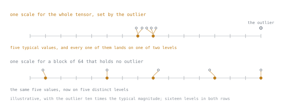

# पाठ 14. पहले सिद्धांतों से Quantisation

**मिशन से संबंध:** QLoRA यानी LoRA और एक विचार। यह पाठ वही विचार है, अकेले सिखाया गया ताकि अगला पाठ छोटा रहे।
**मुख्य स्रोत:** [पेपर: "LLM.int8(): 8-bit Matrix Multiplication for Transformers at Scale", Dettmers et al., arXiv:2208.07339](https://arxiv.org/abs/2208.07339)
**पूर्व-आवश्यकताएँ:** [पाठ 5](0005-counting-parameters-and-bytes.md), [quantisation](../GLOSSARY.md)

## वार्म-अप

1. ▢ fp32, bf16 और 4-bit में प्रति parameter bytes?

<details markdown="1"><summary>जाँचें</summary>

चार, दो, और आधा, साथ में 4-bit वाले मामले में quantisation constants, जिन्हें यह पाठ समझाता है।

</details>

2. ▢ 20M adapter वाले 7B base के लिए, training memory कहाँ जाती है?

<details markdown="1"><summary>जाँचें</summary>

14 GB frozen base weights, ~0.3 GB adapter state, और activations जो दोनों से ज़्यादा हो सकते हैं। Frozen base सबसे बड़ा fixed पद है, और यह चरण उसी पर वार करता है।

</details>

3. ▢ Quantized base में merge करने से गुणवत्ता क्यों जाती है?

<details markdown="1"><summary>जाँचें</summary>

इसके लिए dequantise करना, update जोड़ना, और requantise करना पड़ता है। Requantisation का चरण जानकारी फेंक देता है।

</details>

## यह जानें

Quantisation संख्याओं को उतने bits से कम में store करता है जितने में वे train हुई थीं। [शब्दावली](../GLOSSARY.md) से याद करें कि इस workspace में यह हमेशा **frozen base** को दर्शाता है, adapter को नहीं।

### तंत्र

किसी ऊँची-precision वाले tensor को छोटे integer type में store करने के लिए आपको असली सीमा और integer सीमा के बीच एक mapping चाहिए। दो योजनाएँ:

**Symmetric, absmax।** सबसे बड़ा निरपेक्ष मान लें, scale ऐसे करें कि वह integer के अधिकतम पर पड़े।

```text
s = absmax(x) / 127          # for int8
q = round(x / s)             # store q, an int8
x̂ = q · s                    # recover, approximately
```

**Asymmetric, affine।** एक zero-point offset भी store करें, ताकि सीमा का शून्य पर केंद्रित होना ज़रूरी न रहे।

```text
s = (max(x) − min(x)) / 255
z = round(−min(x) / s)
q = round(x / s) + z
```

Transformers में weight distributions लगभग symmetric और शून्य के पास केंद्रित होते हैं, इसलिए weights के लिए symmetric absmax आम चुनाव है।

जो भी हो, त्रुटि **rounding error** है: हर value सबसे नज़दीकी representable स्तर पर चली जाती है। 4-bit के लिए सोलह स्तर, 8-bit के लिए 256।

### Outlier की समस्या

यही वह चीज़ है जो naive quantisation को transformers पर विफल करती है। Tensor में एक अकेली बहुत बड़ी value `absmax` तय करती है, जो scale तय करता है, जो सारे representable स्तरों को उस सीमा को ढकने के लिए फैला देता है जिसे लगभग बाक़ी हर value कभी इस्तेमाल नहीं करती। तब आम values सब मुट्ठी-भर स्तरों में round हो जाती हैं, और tensor की ज़्यादातर जानकारी एक outlier से नष्ट हो जाती है।

यह काल्पनिक नहीं है। Transformer activations में व्यवस्थित बड़े-परिमाण वाले features बन जाते हैं, और यही अवलोकन LLM.int8() के काम का मूल है: थोड़े-से outlier आयाम अनुपात से कहीं ज़्यादा अहमियत रखते हैं, और उन्हें naive ढंग से सँभालना बड़े पैमाने पर गुणवत्ता नष्ट कर देता है।

### Blockwise quantisation, इलाज

पूरे tensor को एक scale से quantise न करें। उसे 64, 128 या 256 elements के छोटे सटे हुए **blocks** में बाँटें, और हर block को उसका अपना scale दें।

```text
per-tensor:  one absmax  → one outlier ruins everything
per-block:   one absmax per 64 → one outlier ruins 64 values
```



दोनों पंक्तियों में सोलह स्तर हैं, एक जैसे फ़ासले पर। जो बदला है वह सिर्फ़ यह कि उन सोलह स्तरों से कितनी संख्यात्मक सीमा ढकने को कहा गया है, और वह उस हर चीज़ की सबसे बड़ी value से तय होती है जिस पर scale निकाला जाता है। जाल को ऐसी सीमा पर ख़र्च करें जहाँ data कभी जाता ही नहीं और data मुट्ठी-भर स्तरों पर पहुँचता है; उस सीमा पर ख़र्च करें जिसमें data असल में रहता है और हर value को अपना स्तर मिलता है।

नुक़सान सीमित रहता है। इसीलिए blockwise quantisation मानक है और per-tensor नहीं।

इसकी एक क़ीमत है, और यही क़ीमत अगले पाठ का पूरा विषय है। हर block का scale store करना पड़ता है, और वह scale एक असली संख्या है:

```text
4-bit weights, block size 64, fp32 scales:
  weights = 0.5 bytes/param
  scales  = 4 bytes per 64 params = 0.0625 bytes/param
  total   = 0.5625 bytes/param, i.e. 4.5 bits, not 4
```

4-bit budget के ऊपर बारह प्रतिशत overhead, सिर्फ़ हिसाब-किताब के लिए। यह संख्या याद रखें।

### Storage precision बनाम compute precision

Quantized weight अपने quantized रूप में इस्तेमाल नहीं होता। Forward pass **एक block को वापस bf16 में dequantise करता है, matmul करता है, और dequantise की हुई copy फेंक देता है।**

```text
stored:   4-bit + per-block scale
computed: bf16
```

तो quantisation memory ख़रीदता है, और compute की क़ीमत लेता है: हर forward pass में हर block पर एक dequantisation चरण। कुल असर तेज़ है या धीमा, यह पूरी तरह इस पर निर्भर है कि आप memory-bound थे या compute-bound, और dequantisation kernel आपके hardware के लिए कितना अच्छी तरह optimised है।

वह आख़िरी बात वह जगह है जहाँ hardware सचमुच आता है। *अंकगणित* हर जगह एक जैसा है। जो backend के हिसाब से बदलता है वह यह कि किसी bit-width और block size के लिए fused, optimised kernel मौजूद है, या library धीमे generic रास्ते पर लौट जाती है। पाठ 16 मौजूदा तस्वीर देता है।

### यहाँ quantisation किसलिए है

दो इस्तेमाल जिन्हें गड्डमड्ड नहीं करना चाहिए:

**Inference के लिए quantisation** model को सिकोड़ता है ताकि वह समाए और सस्ते में serve हो। Weights quantized होते हैं और वही artifact है जो आप ship करते हैं। अपने आप में विषय के रूप में यह इस workspace के दायरे से बाहर है।

**Training के लिए quantisation**, जो QLoRA करता है, *frozen base* को सिकोड़ता है ताकि adapter training समा सके। Adapter ऊँची precision में रहता है, और जो artifact आप ship करते हैं उसे बाद में full-precision base में merge किया जा सकता है। Base की precision training के समय का budget-फ़ैसला है, नतीजे का गुण नहीं।

## अभ्यास

1. ▢ मान `[0.1, −0.3, 0.2, 8.0]` को symmetric absmax से int8 में quantise करें। पहले तीन का क्या होता है?

<details markdown="1"><summary>जाँचें</summary>

`absmax = 8.0`, इसलिए `s = 8.0/127 ≈ 0.063`। Values `round(0.1/0.063) = 2`, `round(−0.3/0.063) = −5`, `round(0.2/0.063) = 3`, और `127` पर map होती हैं।

वापस पाए गए: 0.126, −0.315, 0.189, 8.0। छोटी values में अब काफ़ी सापेक्ष त्रुटि है, क्योंकि एक outlier ने सीमा खा ली। 4-bit में, सोलह स्तरों के साथ, पहले तीन लगभग एक ही value पर सिमट जाते।

</details>

2. ▢ Blockwise quantisation क्यों मदद करता है, और उसकी क्या क़ीमत है?

<details markdown="1"><summary>जाँचें</summary>

Outlier सिर्फ़ अपने block का scale तय करता है, इसलिए वह पूरे tensor की जगह 64 values को नुक़सान पहुँचाता है।

क़ीमत है हर block का एक scale store करना। Block size 64 और fp32 scales पर वह प्रति parameter 0.0625 bytes है, 4-bit budget पर लगभग 12% overhead।

</details>

3. ▢ 4-bit weights, block size 128, fp32 scales के लिए प्रति parameter कुल bytes?

<details markdown="1"><summary>जाँचें</summary>

0.5 + 4/128 = 0.5 + 0.03125 = 0.53125 bytes, या 4.25 bits।

बड़े blocks का मतलब कम scale overhead और बदतर outlier-नियंत्रण। यही वह trade-off है जो block size तय करता है।

</details>

4. ▢ Quantized forward pass में matmul किस precision में होता है?

<details markdown="1"><summary>जाँचें</summary>

ऊँची में, आम तौर पर bf16। हर block bf16 में dequantise होता है, गुणा होता है, और dequantise की हुई copy फेंक दी जाती है।

Quantisation *storage* का फ़ैसला है। Compute precision अलग है और अलग से configure होती है।

</details>

5. ▢ सिर्फ़ अंकगणित से देखने पर जितना लगता है, transformer quantisation उससे कठिन क्यों है?

<details markdown="1"><summary>जाँचें</summary>

व्यवस्थित outlier features की वजह से। कुछ आयामों में बहुत बड़े परिमाण और अनुपात से ज़्यादा अहमियत होती है, इसलिए जो योजना सभी values को अदल-बदल योग्य मानती है, प्रति tensor एक scale के साथ, वह साधारण values को नष्ट कर देती है जबकि outliers को बचा लेती है।

Blockwise quantisation, और LLM.int8() के मामले में outlier आयामों को पूरी तरह ऊँची precision में अलग करना, इसका जवाब है।

</details>

6. ▢ Inference के लिए quantisation और training के लिए quantisation में भेद बताएँ।

<details markdown="1"><summary>जाँचें</summary>

Inference के लिए, quantized weights *ही* artifact हैं: आप उन्हें ship करते हैं, और गुणवत्ता की क़ीमत स्थायी है।

Training के लिए, frozen base को quantise करना memory budget का फ़ैसला है। Adapter ऊँची precision में रहता है, और ship होने वाला नतीजा full-precision base में merge किया जा सकता है, इसलिए quantisation की क़ीमत का artifact तक पहुँचना ज़रूरी नहीं।

</details>

## असली दुनिया का अभ्यास

- [ ] किसी tensor के लिए absmax int8 quantisation और dequantisation हाथ से कुछ पंक्तियों में लागू करें। अधिकतम और औसत त्रुटि मापें।
- [ ] एक बड़ा outlier डालें और त्रुटि फिर मापें। फिर इसे block size 64 के साथ blockwise दोबारा करें और तुलना करें।
- [ ] कल: block sizes 32, 64, 128 और 256 के साथ 4-bit के लिए सच्चे bytes-प्रति-parameter निकालें, और नोट करें कि overhead कहाँ नगण्य हो जाता है।

## आगे बढ़ने के लिए

- [पेपर: "LLM.int8(): 8-bit Matrix Multiplication for Transformers at Scale", Dettmers et al., arXiv:2208.07339](https://arxiv.org/abs/2208.07339)
- [पेपर: "8-bit Optimizers via Block-wise Quantization", Dettmers et al., arXiv:2110.02861](https://arxiv.org/abs/2110.02861)
- [पाठ 15. NF4 और Double Quantisation](0015-nf4-and-double-quantisation.md)

---

बात नहीं बन रही? ऊपर दिए मुख्य स्रोत को दोबारा पढ़ें, क्योंकि यह पाठ उसे संक्षिप्त करता है और समझ संक्षेप में ही रिसती है। जो शब्द फिसलन भरा लगे, उसके लिए [शब्दावली](../GLOSSARY.md) देखें।

अगर दिक़्क़त सामग्री की नहीं बल्कि पाठ की ही है, तो वह एक खोट है: [issue खोलें](https://github.com/TokenCemetery/teach/issues)।
